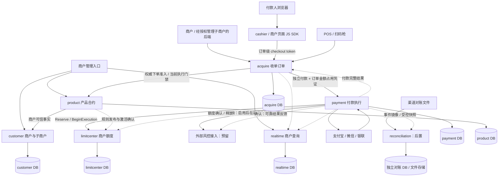
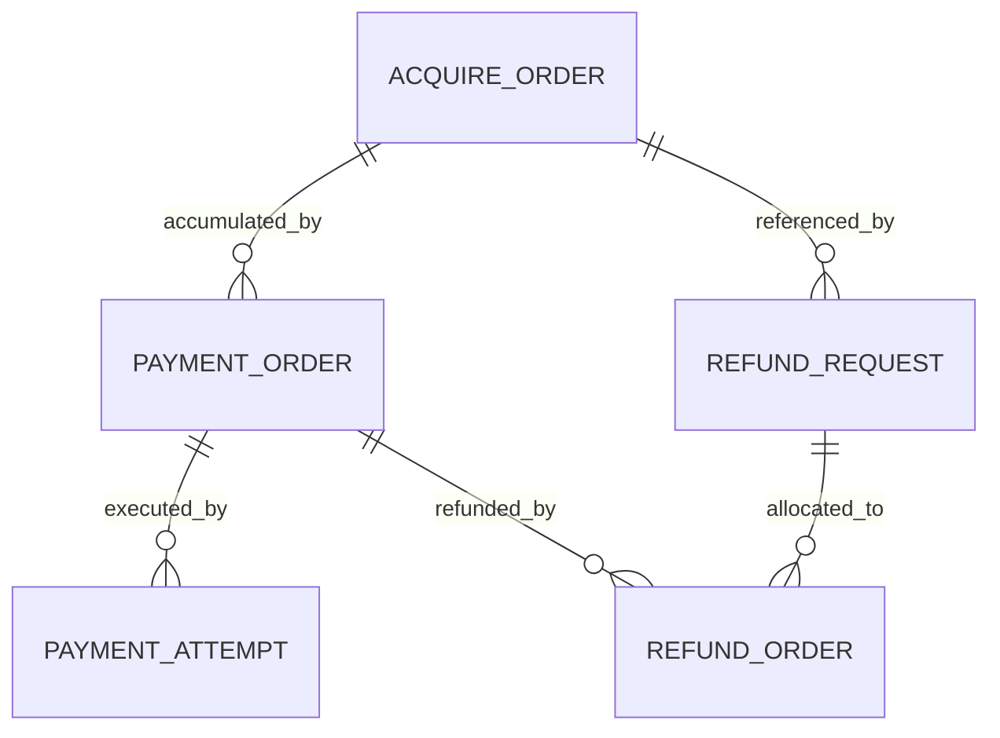
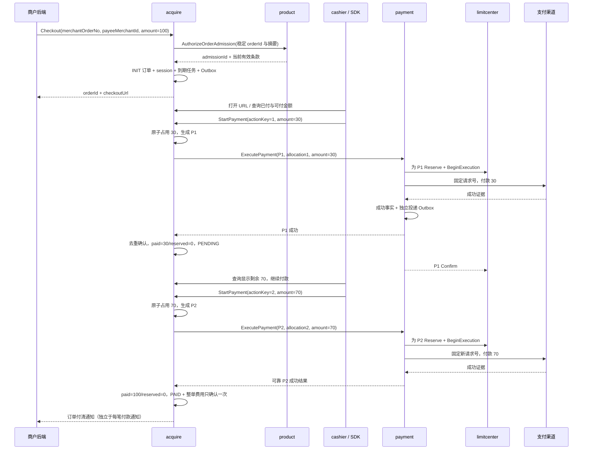

# 外部渠道收单系统架构设计

版本：v1.4 ｜ 日期：2026-10-20 ｜ 状态：设计稿，待实施

本文规划 acquire、payment、realtime、customer、product、limitcenter 六个核心服务，另预留后置 reconciliation 对账服务、风控咨询/确认接入接口，以及可选托管 cashier 和薄 JS SDK。范围为支付宝、微信、银联等外部渠道收单；不建设消费者用户资源，不包含内部余额、充值、提现、转账。

**本轮决策已收敛：固定订单总额，付款金额手动输入，多笔成功付款累计恰好等于订单总额才 PAID；合约停止禁止新单，原 pending 订单继续完成；未全额付款按原合约关闭或保持 PENDING。退款独立建模，不修改订单状态/总额/累计已付；费用统一以订单总额计算。风控默认放行，仅预留渠道提交前咨询和支付后异步结果反馈。支付宝/微信/银联为目标渠道，默认币种 CNY。**

术语见 [GLOSSARY.md](GLOSSARY.md)，已确认决策及实施基线见 [DESIGN-DECISIONS.md](DESIGN-DECISIONS.md)。当前代码仍为 acquire/payment 连通骨架及 Headlamp，本文新增业务能力尚未实现。

详细设计已细化为[COLA DDD与事务流程](DETAILED-DESIGN.md)、[数据库](design/DATABASE.md)、[Client API](design/CLIENT-API.md)及[合约配置](design/CONTRACT-SCHEMA.md)；业务语义仍以本稿D01—D10为基线，新增物理结构和接口为待实现方案。

2026-10-21实施更新：六核心应用的client/domain/bootstrap、核心纯领域规则及启动/部署源码已完成第一阶段，见[实施说明](IMPLEMENTATION.md)；未运行构建/测试/部署，数据库事务与真实渠道闭环仍在后续阶段。

## 1. 服务划分与设计结论

| 服务/模块 | 职责与权威数据 | 不承担 |
|---|---|---|
| acquire | 收单订单、准入、多付款/金额占用、订单总额计费、会话、关单与订单通知 | 渠道协议、退款执行与退款状态、周期额度计数 |
| payment | 独立付款/尝试、回调查证、独立退款申请/分配/明细、渠道绑定与必要身份 | 修改原订单支付金额或以退款倒改付款成功状态 |
| realtime | 商户订单汇总、付款/退款明细投影、来源版本、重放进度 | 订单/支付/额度的权威决策 |
| customer | 平台商户/子商户主数据、关系、经营状态与管理授权事实 | 消费者会员、消费者登录与个人账单 |
| product | 产品、方案、不可变合约条款、当前有效性、下单准入、规则发布 | 实际支付、商户额度 used/held |
| limitcenter | 商户日/周/月/终生限额、原子预占、执行凭证、消耗与释放 | 用户限额、资金余额、收款结果裁定 |
| cashier（可选） | 托管支付页面与薄接入，读取订单汇总和发起独立付款 | 交易主库、商户私钥、独立支付结果 |
| JS SDK（可选） | 为已有页面商户封装相同会话、动作、查询协议 | 商户服务端认证、金额/权限裁定 |
| 风控接入接口（预留） | 渠道执行前咨询、结果确定后确认反馈，保存决策关联与投递记录 | 本期自建风控引擎、用户资源、替代商户限额 |
| reconciliation（后置） | 账单文件、独立交易核对视图、对账批次与差错处理轨迹 | 阻塞交易、直接修改 payment/acquire/额度事实 |

cashier 与 SDK 互补。没有收银页的商户使用托管 URL；有页面的商户使用 SDK/API；POS 可以 DirectPay。服务不按支付宝、微信、银联继续拆分。

本期不要求先冻结渠道资金再 capture，也不以 capture 表示普通付款。资金预授权可作为未来独立产品扩展，不能成为当前 Checkout、多笔付款或部分付款的前置条件。

生命周期、付款策略、计费/退款、通知与限额配置来自版本化合约，平台与渠道硬约束优先。风控采用已确认的默认放行基线：未接入/咨询超时或不可用时允许继续，并记录真实原因；将来接入的明确 DENY 不伪装为 ALLOW，具体规则和厂商协议后置。容量、峰值、保留期限、新鲜度和恢复指标本轮暂不展开。

## 2. 总体拓扑与数据归属



实线是同步调用，虚线是本地事务提交后的可靠后台投递。realtime 与 reconciliation 不参与下单与付款提交。限额是执行前强门禁，真实支付结果必须先在 payment 持久化。

- 每类事实一个写入所有者，不跨库 JOIN、共享 Mapper 或跨服务共享事务。开发可共用 MySQL 实例，但六服务分别使用独立 database/schema 与账户；cashier 无交易数据库。
- 订单应收金额与每笔付款的金额占用归 acquire；付款是否实际成功归 payment；周期累计额度归 limitcenter；三者不同，不允许用一张异步交易流水替代。
- 商户/子商户身份来自可信认证与归属校验。浏览器只能使用订单级受限会话，不能指定其他收款商户、合约、渠道号或凭证。
- 后台操作员与商户关联复用授权能力，不创建消费者 profile。渠道 openId 等仅为支付必要参数，不做用户额度和全平台用户交易列表。

## 3. 商户、子商户与双接入模式

### 3.1 两层关系必须分开

customer 管理平台内商户/子商户关系及管理权限；payment 管理渠道接入绑定。平台父商户不自动等于微信/支付宝的渠道服务商，一个平台层级关系也不自动证明具备代调用或代收款授权。

每个实际收款主体都有独立 merchantId；请求可由该主体自身发起，或由获得对应权限的父商户后端发起，但必须明确 payeeMerchantId 并验证当前调用方有权为其下单。订单绑定该实际收款主体的有效合约，父商户合约不能自动替代子商户合约；若未来采用集团合约覆盖，须显式建模覆盖对象并做权威资格校验。

首期一笔订单只对应一个实际收款商户和一种币种，所有部分付款必须归同一主体。不在同一订单内拆分收给多个商户，不把服务商模式设计成“平台先收款后转给子商户”。

### 3.2 渠道接入绑定

| 模式 | payment 必须持有的语义 | 不可混淆 |
|---|---|---|
| DIRECT 直连 | 实际收款商户的渠道商户身份、应用绑定、凭证引用、已开通支付方式 | 与 DirectPay 接口无关；Checkout 也可走直连 |
| SERVICE_PROVIDER 服务商 | 渠道服务商身份/凭证、目标商户或子商户渠道身份、有效代调用授权、应用作用域 | 调用凭证主体与实际收款主体可能不同，需分别保存 |

支付宝和微信两种模式都纳入目标能力矩阵。不同渠道的服务商授权与商户参数按各自协议适配，不强行规定一套通用字段能直接原样发给所有渠道。微信服务商下单存在服务商与子商户的分别标识；支付宝代调用授权也需要按对应产品校验。[微信服务商 JSAPI](https://pay.wechatpay.cn/doc/v3/partner/4012738519)、[支付宝第三方代调用示例](https://developer.alibaba.com/docs/doc.htm?articleId=104837&docType=1&treeId=180)

绑定至少表达 bindingId/version、payeeMerchantId、channel、accessMode、渠道服务商/商户/子商户身份、应用作用域、授权状态、credentialRef/version、允许方法。实际字段按渠道类型化，令牌/私钥原文不存入合约、日志或事件。

每笔付款冻结收款绑定快照；同订单不同付款可按合约选择不同渠道/接入绑定，但实际收款商户不能变。查询、回调、退款按原绑定身份校验。凭证轮换用版本化引用，不能为了重试把原付款改到另一个商户号。

## 4. acquire：订单、多笔付款与不可逆终态

### 4.1 订单、付款和退款分离



订单总额创建后固定，currency 缺省时规范化为 CNY。每次付款手动输入金额，经服务端校验后创建固定金额的 paymentId；同一次动作重放复用原付款，新的一笔付款才分配新 actionKey/paymentId。初版不限制付款人必须相同，不建设用户身份资源；并发付款仍必须遵守同一订单的金额上界。

例：100元订单先付30元，再付20元，仍为 PENDING；最后付50元，累计成功100元才 PAID。若一笔付款UNKNOWN，保留其占用，不把它当成失败后重复收款。某笔付款退款后，原订单累计成功支付金额仍不变。

### 4.2 金额判定优先

订单保存 amountMinor（应收总额）、paidAmountMinor（累计成功支付）、paymentReservedMinor（仍可能成功的在途占用）。退款金额不作为收单订单的业务可写字段，而由独立退款记录在查询侧汇总。

非终态容量为 `unallocatedAmount = amountMinor - paidAmountMinor - paymentReservedMinor`。

对外 `availableToPay = canAcceptNewPayment ? unallocatedAmount : 0`；仅INIT/PENDING且原等待策略允许继续收款时canAcceptNewPayment为真。CLOSING/PAID/CLOSED均返回可付款金额0，未收金额另外以 `outstandingAmount = amountMinor - paidAmountMinor` 展示，不把“还差多少钱”误当成“现在还能付款多少钱”。

`PAID ⇔ paidAmountMinor = amountMinor`，正常执行必须同时满足 `0 <= paidAmountMinor`、`0 <= paymentReservedMinor` 和 `paidAmountMinor + paymentReservedMinor <= amountMinor`。这里“总金额等于累计支付金额”是付清条件；部分支付过程中小于总额是正常情况，不能因此拒绝部分付款。

- 每笔手动输入金额必须为正、符合币种精度及合约最小/最大约束，且不超过可付金额；CNY 以分存储，禁止浮点比较或用容差认定付清。
- acquire 本地事务原子创建 paymentId/金额占用并增加 reserved；多人/多页面并发也不能使总占用超额。若合约限制笔数，成功笔数和仍可能成功的付款笔数同样原子占用。
- payment 只接受可信 acquire 的 orderId/paymentId/金额/币种/收款主体/原准入关联。每笔成功消费一次：allocation 从占用转已付，paid 增加、reserved 减少、订单版本/通知/事件同事务提交。
- 只有明确确认未收款并封禁该付款的迟到执行后才释放占用。UNKNOWN、RPC超时和回调未到都不释放。
- 退款始终不减少 paid、不增加 availableToPay，不重新开放 PAID/CLOSED，也不通过修改订单总额实现再次收款。净收款可在查询视图计算，但不参与付清/可付金额判断。
- 是否设置付款最小金额/次数为可配置限制；最后尾款低于通常最小金额时，可允许“恰好付清剩余金额”的受控例外，仍不得突破渠道最低金额。此为首期建议规则，可在合约选择开启，不能影响完整付清能力。

### 4.3 精简状态与终态命令约束

| 订单状态 | 含义 | 允许的订单业务写操作 |
|---|---|---|
| INIT | 已受理新订单，尚未发起付款 | 开始付款；按原合约延期/申请关闭 |
| PENDING | 未全额付款，可有部分已付或结果未知的付款 | 满足剩余额/原合约时续付、延期、申请关闭；消费权威付款结果 |
| CLOSING | 正在封禁新增付款并收敛已有付款 | 仅关闭查证与已有付款结果收敛，不新增付款/延期 |
| PAID | 已全额付款，正常终态 | 不新增付款、改额、延期、重开或再次关闭 |
| CLOSED | 已关闭，所有在途收敛，正常终态 | 不新增付款、改额、延期、重开或转为 PENDING/PAID |

初始统一 INIT，首笔受理后进入 PENDING；部分支付和处理中不再拆成 PARTIALLY_PAID/PROCESSING 订单状态。付款进度是按金额派生的 UNPAID/PARTIAL/FULL，展示每笔 PaymentOrder 的执行状态即可。订单也没有 REFUNDING/REFUNDED/PARTIAL_REFUNDED 状态。

“终态禁止其他操作”落实为禁止改变该订单生命周期和继续收款。查询、返回已提交命令的幂等结果，以及引用原成功付款创建独立退款单仍然允许；否则 PAID 后无法退款。退款有自己的执行状态，但不迁移原订单或原付款的成功状态。

重复成功回调不改终态；必须继续处理渠道证据以防丢失真实资金事实。若渠道在已确认关闭后仍异常收款，payment 保存异常收款/差错，按独立流程核实和补偿；不把 CLOSED 重开、不再次减少已释放 reserved，也不改写正常终态订单的冻结金额。

### 4.4 未全额付款：合约选择关闭或保持 PENDING

合约 `unpaidOrderAction = CLOSE | KEEP_PENDING` 决定到期/检查时点的处理，不用退款状态决定订单状态：

- CLOSE：进入 CLOSING，先封禁父订单下新的付款，逐笔查证已有付款；收敛后若恰好付清则 PAID，否则 CLOSED，保留已付金额。关闭本身不触发“已退款”或自动撤销成功付款。
- KEEP_PENDING：未付清订单到期后仍为 PENDING，已有 INIT 订单可转 PENDING 等待付款；允许按原订单条款继续手动付款。到期是策略检查点，不隐含另一个绝对停付时间。
- 一旦 CLOSED，不允许以后修改合约把该单重开为 PENDING。需要收新业务款项时创建新订单，并重新经过当前合约准入。

订单等待时点、收银会话有效期、渠道单笔支付参数有效期分别维护。KEEP_PENDING 不会自动延长已过期的渠道二维码；旧尝试先安全关闭/失效，新的合法付款动作再生成当前渠道参数。会话过期可为原 pending 订单续发受限会话，不是新建交易。

### 4.5 创单、幂等与原单续付

`(tenantId,payeeMerchantId,merchantOrderNo)` 唯一；摘要固定订单总额、币种、收款主体及业务条款身份。先重放已提交的幂等结果，再判断新的准入。订单总额不可后续修改；商户只能在原合约允许范围内调整等待安排和会话，不能修改终态。

一笔新 PaymentOrder 的 actionKey 和摘要固定手动金额/币种/方法；同笔换渠道必须先确认原尝试无收款风险，且继续使用同一 allocation，不以新 key 规避 UNKNOWN。新的一笔部分付款另行原子取得订单剩余额。

合约到期或停止只拒绝新 AcquireOrder；合约停止前已受理的 INIT/PENDING 属于可继续完成的原交易，包括后续部分付款，不将每个新 paymentId 当成一个需当前活跃合约的新收单订单。DirectPay 对一个新商户订单仍是新交易，必须被停止的合约拒绝。

### 4.6 按订单总额统一计费

费用基数固定 `feeBase=ORDER_AMOUNT`，以原订单 amountMinor 和合约 rate/舍入/保底/封顶规则计算一次订单费用 F。30+20+50和一次100的订单总额相同，订单费用相同，不按三笔付款重复套用最低费或封顶。渠道实际每笔手续费是渠道成本/对账口径，不能混为平台商户计费规则。

使用独立 order_fee 记录 ruleVersion、baseAmount、feeAmount、rounding 与确认标记，订单创建时冻结计算结果；PAID 迁移时以 orderId+feeType 唯一键确认一次。首期实施基线为 INIT/PENDING/未付清 CLOSED 不触发常规全额费用确认，避免因拆单或未完成而重复/提前确认；若以后需要部分关闭订单收费，显式增加收费触发政策，费用基数仍不得偷偷改成每笔付款。

退款退费是独立 fee_adjustment/退款条款，不覆盖原 F、订单总额和 paid；退款后净费用可以查询展示。本节的“付清时确认”是为细化落地选择的保守实施基线，并非增加平台余额扣费或清分结算能力。

## 5. payment：独立付款、尝试与退款

### 5.1 统一 INIT 与权威事实

| 对象 | 初始状态 | 后续状态及约束 |
|---|---|---|
| AcquireOrder | INIT | PENDING、PAID、CLOSING、CLOSED；部分支付以金额展示，退款不用订单状态表达 |
| PaymentOrder | INIT | PROCESSING、UNKNOWN、SUCCEEDED、FAILED、CLOSING、CLOSED；SUCCEEDED 表示这一笔成功，不代表父订单付清 |
| PaymentAttempt | INIT | SUBMITTING、PENDING、UNKNOWN、SUCCEEDED、FAILED、CLOSED；同付款尝试串行 |
| RefundOrder | INIT | PROCESSING、UNKNOWN、SUCCEEDED、FAILED |
| CheckoutSession | INIT | ACTIVE、COMPLETED、CANCELLED、EXPIRED；归 acquire |
| OrderPaymentAllocation / LimitReservation | INIT | 各自持久占用/执行/消耗/释放状态；不可与资金状态混用 |

INIT 统一新业务过程，不重命名渠道状态码、Outbox/DelayedTask 状态或合约发布生命周期。某个 attempt 明确失败但允许重试时，PaymentOrder 保持可处理状态；只有明确终止该笔所有后续尝试才 FAILED/CLOSED，并封禁迟到执行，随后释放 allocation。

payment 对每个 paymentId 固定订单、收款主体、金额、币种、渠道请求号和 allocation 关联；一个订单可有多个 paymentId，数据库不再对 acquireOrderId 设置单付款唯一约束。每个成功付款单最多有一个成功尝试；回调核对成功金额等于该笔付款金额，不把渠道少付结果直接当作一个合法部分付款。

### 5.2 渠道适配

内部接口覆盖 submit/query/close/reversePayment、submit/queryRefund、验签解析通知、必要的渠道身份交换。按 channel + DIRECT/SERVICE_PROVIDER + method + 商户授权状态选择实现，不按渠道拆新服务。

PaymentAction 类型为 NONE、DISPLAY_QR、REDIRECT、INVOKE_JSAPI、INVOKE_APP、WAIT；不强制所有方式返回渠道 URL。付款码场景的 auth_code 是敏感短期凭据，不是授权冻结或稳定用户标识；需要恢复发送时加密短期保存，禁止进入 URL/普通日志/查询投影。

关闭与撤销按渠道协议区别处理，某些撤销可能包含资金退回，不能把所有撤销都当作“从未收款”。银联具体产品和接入机构仍待指定；直连和服务商支持并不意味着任一商户无需进件/授权即可使用所有支付方法。

### 5.3 调用、通知与恢复

先本地持久化 INIT 付款/attempt/固定渠道请求号；预留风控在提交前执行对应咨询/默认放行，并真实记录来源结果，再经过 merchant limitcenter Reserve/BeginExecution、本地 payment/订单关闭门禁与有效期校验后提交渠道。不持数据库锁等待 RPC 或 HTTP。

渠道受理后返回失败/超时不必然证明未扣款。UNKNOWN 保留订单金额占用和商户额度占用，使用同一渠道请求号查询，不自动新建另一笔相同金额付款或切商户号重扣。

回调按渠道验证签名/解密、渠道商户或子商户身份、paymentId/尝试、金额、币种及渠道交易号；可靠提交结果/去重/给各消费者的独立 Outbox 后才 ACK。付款成功先持久化，不因 acquire/limitcenter/realtime 当前不可用而丢弃事实，后台可靠补齐。风控的结果确认也在资金事实可靠落库后独立投递，不阻塞渠道 ACK 或付款成功。

### 5.4 独立退款申请、分配与执行

payment 统一拥有 refund_request、refund_allocation_plan、refund_order 三类独立退款数据。退款引用 orderId/paymentId，但不更新 acquire_order 的状态、amount/paid/reserved，也不把成功 PaymentOrder 改成“已退款”；退款自身保留 INIT/PROCESSING/UNKNOWN/SUCCEEDED/FAILED 以跟踪外部执行。

- 商户可经 acquire 统一 HTTP 入口提交退款意图，但它只做授权/委托，不修改终态订单；RefundFacade 在 payment 侧落库和幂等执行。PAID 或部分收款后 CLOSED 的原付款仍可在独立权限和合约退款条件下退款。
- 退款申请唯一键为商户作用域的 merchantRefundNo/requestKey，摘要绑定原订单、总退款额和分配语义；重复请求返回原申请和原有子退款进度。
- 默认顺序采用 FIFO：按原付款成功时间升序，再按 paymentId 稳定排序，从每笔尚可退金额依次分配。合约可选择已实现的 FIFO/LIFO/EXPLICIT 等策略；未实现策略不能通过自由字符串启用。优先实现 FIFO，不默认按比例拆分。
- 在 payment 本地事务内固定分配计划和每个子退款的请求号，并原子预占各原付款的可退金额，保证 `累计成功退款 + 退款中/未知预占 + 本次金额 <= 原付款成功金额`。失败释放退款预占，UNKNOWN 保留；单笔的可退金额不与别笔混用。
- 一个申请可跨多个原支付渠道分别退款，分别收敛，不承诺跨渠道原子成功。重试不改变计划，也不因某子退款失败自动改退另一付款；需要变更计划须显式版本化并核实原子退款不会迟到成功。
- 退款成功只更新退款侧金额、进度、独立事件和合约允许的商户额度/退费处理。订单净收款、退款进度由 realtime 组合退款记录展示，不回写订单生命周期。

例如100元由30、20、50三笔付款完成，申请退40元：FIFO固定拆为第一笔30+第二笔10。退款成功后原订单仍PAID、paid=100；独立退款记录合计40，查询可显示净收60。不能因此让原收银URL再收40。

正式文件对账仍归后置 reconciliation；payment 保留实时查证、原路退款身份和受控事实导出，realtime/reconciliation 均不裁定或直接改写原资金状态。

## 6. cashier 与 JS SDK：一次创单、多次付款

托管 cashier 覆盖无页面商户，JS SDK 复用其后端协议。托管收银 UI 本身不持有交易金额裁定权。

1. 商户后端经过认证调用 Checkout/CreateOrder，绑定固定应收金额、实际收款商户、原合约及允许的付款策略。
2. acquire 持久化 INIT 订单和 CheckoutSession，返回 checkoutUrl、sessionExpiresAt、orderId；checkoutUrl 指向平台 cashier，不是某个渠道预支付号。
3. cashier/SDK 查询已付、在途占用、尚可支付金额、当前可用方法；付款人输入金额仅为申请，最终由 acquire 校验合约与原子占用。
4. 每次明确付款动作提交独立的客户端动作幂等键；重复点击、刷新、同一次动作重试复用原 paymentId。选择“继续付剩余”或新的付款金额才是新动作、新 paymentId。
5. cashier 按 payment 返回的 PaymentAction 展示二维码、跳转或拉起；页面回跳/前端 success 仅触发权威查单。单笔付款成功后，若还有可支付金额，继续展示订单汇总和付款入口；全部付清才显示订单完成。
6. 会话在订单可继续付款时保持 ACTIVE；某笔付款成功不会使订单级会话 COMPLETED。全部付清、订单关闭或会话过期按协议处理；关闭且部分已付时显示已收金额与后续退款/保留状态。

session token 只存摘要，限制 orderId、有效期、允许金额范围/动作与方法；不授予改收款人/合约、退款、商户列表或长期凭证访问。returnUrl/通知目标来自经审核配置，金额不可直接信任浏览器字段。需要更新会话时由已认证商户后端按原单履约门禁续发（普通合约停止不拒绝合法pending续付），不允许过期 token 自行扩大权限。

手动付款金额默认显示当前 availableToPay，提交前允许输入更小合法金额；成功累计等于总额即完成，后端不接受超额输入。退款不能让原已付清URL重新可支付。

同 URL 可用于多次合法付款，但每笔渠道二维码/预支付参数绑定固定 paymentId 和付款金额；过期或已完成动作不能拿来执行下一笔付款。渠道域名、JSAPI 应用/身份限制仍适用，SDK 无法代替渠道开通。

## 7. customer 与 realtime 的边界

customer 复用 merchant 能力，维护实际商户/子商户资料、关系和经营状态，以及“谁可代表谁下单”的必要事实。ACTIVE 不等于渠道已开通。保留 customer 名称，但不新增 customer_profile、消费者登录、用户额度或平台个人账单。

payment 可按渠道/应用作用域保留必要付款人引用用于执行/查询/退款。它不进入商户限额 key；不额外要求每笔付款先识别自然人。后台操作员使用 UPMS/授权，与付款人无关。

realtime 分别维护：

- 订单汇总：固定应收总额、累计已付、收款主体、状态、派生付款进度，来源 acquire；退款金额/进度独立来自退款投影。
- 付款明细：每笔 paymentId、金额、渠道/接入模式/实际收款身份、状态和受控渠道证据，来源 payment。
- 退款明细：原 paymentId、独立退款申请/计划/子退款、金额与结果，来源 payment；与订单只读关联，不要求 acquire 消费退款来迁移订单。

子商户仅查询授权范围内数据；父商户跨子商户查询需显式权限过滤。订单版本与付款版本不能相互比较，也不能把多笔付款都覆盖到同一个 paymentId 字段。事件重复/乱序时按每个聚合的完整快照和版本去重；父订单汇总以 acquire 为准，不在查询侧重新累计明细金额替代它。

投影不等待主请求，也不参与订单余额/商户限额判定。生产方使用独立目标 Outbox，查询库/连接池资源隔离；故障积压仍需监控与恢复，不承诺无限容量。支付结果页经 acquire 权威查询，不因 realtime 滞后触发新付款。

## 8. product：新交易准入与存量交易履约分开

### 8.1 当前合约只决定是否接受新的收单订单

CreateOrder/Checkout创单/DirectPay创单必须使用主库当前状态、服务端Clock和半开生效区间判断。合约到期、停止、暂停或终止拒绝新 AcquireOrder；不能依赖定时更新、旧缓存、旧URL或历史条款放行。

AuthorizeOrderAdmission 在 product 本地事务内绑定 orderId、实际收款商户、摘要、合约修订/generation，并与停单状态变更序列化。停单后不产生新准入；停单前已准入的在途请求按原admissionId幂等收敛，不换订单复用。准入与跨库持久化的并发截止语义保持可审计，不假定一次RPC能形成跨库原子事务。

### 8.2 原 pending 订单继续完成

用户已确认：**新交易禁止，pending交易可继续完成。** “新交易”指新的收单订单，不是原订单中的每个新paymentId。停止前已经受理、仍为INIT/PENDING的原订单可以继续创建部分付款、处理渠道参数和接收结果，按该订单已冻结的商业条款履约，不重新要求合约仍在可售/有效期内。

续付门禁改为 ValidateAdmittedOrder：检查原准入确属此订单和收款主体、原条款完整、订单仍可付款、金额/次数/等待策略允许、当前渠道授权/凭证可用及商户额度。**普通合约到期/停止本身不能使该校验失败**。原准入和快照在订单侧持久化且可校验时，不为了重复检查“当前合约活跃”让存量交易依赖 product 在线。

已过订单等待时点时按原合约unpaidOrderAction处理：CLOSE仍会关闭订单，KEEP_PENDING则继续等待；这与合约是否停止是两个独立维度。收银会话过期可在原单scope内刷新，不能升级成新交易权限。

显式渠道撤销授权、密钥失效、独立安全冻结等有自己的拒绝理由，不等同于普通合约停止；回调/退款/查证始终按真实事实收敛。若未来需要强制冻结所有存量交易，另行设计专门命令，不能偷偷改变本期D03语义。

### 8.3 配置项与固定语义

| 类别 | 已确定语义 / 可配置字段 | 执行者 |
|---|---|---|
| 目标渠道/币种 | ALIPAY、WECHAT、UNIONPAY；defaultCurrency=CNY，显式带currency；未开通币种拒绝而非隐式换汇 | acquire规范化，payment核对能力 |
| 主体与接入 | 实际收款商户独立merchantId/合约；父商户代操作逐项授权；DIRECT/SERVICE_PROVIDER均支持 | customer、product、payment |
| 订单付款 | 总额固定、手动输入、多笔成功之和恰好等于总额才PAID；minPaymentAmount/maxSuccessfulPayments/尾款例外可配置 | acquire金额/次数原子占用 |
| 未付清处理 | unpaidOrderAction=CLOSE/KEEP_PENDING；orderDueAt/等待周期可配置 | acquire任务和续付门禁 |
| 存量履约 | 已准入INIT/PENDING继续完成，不因合约停止拒绝；终态不重开 | acquire以原条款履约 |
| 总额计费 | feeBase固定ORDER_AMOUNT；费率/舍入/保底/封顶可配置；一订单一费用记录 | acquire/order_fee |
| 独立退款 | refundAllocationPolicy默认FIFO，可配已实现的LIFO/EXPLICIT；partialRefundAllowed/refundFeePolicy | payment退款子域 |
| 商户通知 | 至少PaymentSucceeded、OrderFullyPaid；关闭/退款事件独立，签名/目标/ACK/退避配置 | acquire订单/付款通知，payment退款通知 |
| 商户限额 | DAY/WEEK/MONTH/LIFETIME、阈值/是否启用、父级汇总、受支持的统计和恢复规则可配置 | limitcenter |
| 风控预留 | 默认放行，提交渠道前咨询，支付结果后异步反馈；厂商/细节后置 | payment适配 |

配置的是明确受支持的规则，不执行任意脚本，不让商户把ORDER_AMOUNT改回逐付款收费或把终态重新开放。条款继承/覆盖权限沿用框架，平台/渠道硬约束优先。缺失必须策略时阻止不完整合约发布/签约，不用不明默认行为代替业务定义。

### 8.4 冻结条款与框架适配

每个订单保存contractId/revision/hash、合约等待/费用/退款/通知/限额引用。后续新合约不重算旧订单费用，也不把新到期时间回灌旧单。current合约准入与历史订单履约是两个接口，不复用一个“暂停即拒绝”的当前资格函数处理两种场景。

product 的商户事实经 customer gRPC 提供；不复制customer仓储。订单准入、历史准入验证及配置新语义属于收单平台消费工程新增设计，不假定框架现有源码已经实现。

## 9. limitcenter：商户日、周、月与终生限额

### 9.1 主体与窗口

本期**仅商户限额**，删除买家、payerId、设备/IP 等用户额度维度。实际收款商户/子商户 merchantId 为基本主体，跨付款人、渠道和 DIRECT/SERVICE_PROVIDER 模式累计，不能换渠道商户号绕过同一平台商户额度。

可按合约对受授权的父商户同时施加汇总限额：同一付款必须满足实际收款商户规则以及配置的父级规则。父子关系由 customer 的可信事实确定，不让请求方任意省略；父/子有独立桶，同一规则/主体去重后仅计一次。父级汇总不表示资金先收给父级。

| 窗口 | Asia/Shanghai 区间 | 说明 |
|---|---|---|
| DAY | 当日 00:00 至次日 00:00 | 自然日，不是滚动 24 小时 |
| WEEK | 合约指定周起始日 00:00 至下周同日起点 | 周起点配置固定，不是滚动七天 |
| MONTH | 当月 1 日 00:00 至下月 1 日 00:00 | 自然月，不按固定 30 天 |
| LIFETIME | 商户在稳定规则范围内的累计 | 无周期清零，合约修订不重置 |

金额按币种隔离；金额和次数是独立 metric。已采用首期默认 INITIATED_AT：**每笔 PaymentOrder** 在渠道执行前受理的时间确定日/周/月桶，成功确认仍记入原桶；不是按父订单创建日期确定所有后续付款的桶。同一订单跨月分两次付款，各笔归自己的受理月，延迟通知不挪桶。

已采用金额及PAYMENT_COUNT口径：每笔成功部分付款计一笔，同一付款的attempt重试不另计；不是父订单数量。阈值、规则启停、周起点、父级汇总与退款恢复策略可配置。新的ORDER_COUNT/成功日等口径须实现对应原子算法后才能启用，不能只换配置字符串。

日/周/月/终生、可选父级和平台硬上限全部命中规则在同一个 limitcenter 本地事务内原子成功或全部失败。规则和阈值来自可信已激活版本，不能让商户请求直接带更宽松 threshold。

### 9.2 已接受的限额默认基线

| 配置 | 初始基线 | 配置约束 |
|---|---|---|
| countingBasis | INITIATED_AT | 每笔首次受理时确定桶，重试不挪桶；仅选择已实现口径 |
| countMetric | PAYMENT_COUNT | 成功付款数，金额与笔数分别计数 |
| timezone / 周起点 | Asia/Shanghai / 周一00:00 | 周起点可按规则配置；规则变更须处理在途桶，不回溯清零 |
| windows | DAY/WEEK/MONTH/LIFETIME | 各阈值和启用状态可配置，MONTH为自然月 |
| parentAggregation | 默认关闭，按合约显式启用 | 启用后子级与父级全部规则同时原子满足 |
| limitRestorePolicy | 默认NO_RESTORE，合约可启用成功退款后的恢复 | 恢复原付款对应桶，不增加订单可付金额；笔数恢复单独配置，默认不恢复 |

NO_RESTORE与父级关闭是本稿依据“采用推荐且规则可配置”选择的保守初始配置，不是不可变平台限制。测试合约可显式选择其他已实现规则；任何调整都不允许生成新ruleScopeId或policyVersion来清空历史累计。

### 9.3 订单金额占用与商户额度是两道门禁

| 维度 | 所有者 | 解决的问题 |
|---|---|---|
| OrderPaymentAllocation | acquire | 多笔/并发付款不超过同一订单应收总额 |
| LimitReservation | limitcenter | 多订单、多实例的付款不超过商户日/周/月/终生额度 |

acquire 先为 paymentId 原子取得订单金额占用，再向 payment 发出稳定执行意图；payment 持久化后以 operationId/paymentId 申请商户额度。商户额度不足且确定未开始渠道执行时，payment 先封禁该付款的后续提交，再可靠通知 acquire 释放订单占用。额度请求超时先查询原 operationId，不新建付款以绕过。

### 9.4 原子预占与执行确认

核心约束：`used + held + requested <= effectiveLimit`，同一 operation 的全部桶和明细同事务处理；固定顺序获取锁/条件更新，唯一约束和有界整事务重试处理并发。

1. Reserve：INIT -> RESERVED，按稳定 paymentId/operationId 和摘要为每个桶增加 held；金额是这一笔部分付款金额，不是整个父订单金额。
2. BeginExecution：RESERVED -> EXECUTING，和预占过期互斥，再检查原订单适用且已激活的限额规则及专门安全门禁；普通合约停止不撤销原单续付资格，返回绑定该操作的凭证。
3. payment 重新核对本地门禁及 allocation 绑定，CAS 进入可提交状态，再调用渠道。停止或取消发生在发送前时，必须先封禁旧 worker 的发送路径，不能先释放再让迟到提交成功。
4. 成功：payment 本地保存成功及独立 Outbox，再可靠 Confirm 将原 held 转 used；重复确认只生效一次。付款尝试重试不重复计为新的付款笔数。
5. 确定失败/关闭：封禁该付款继续提交，可靠 Release 商户额度，并通知 acquire 释放对应订单金额占用。UNKNOWN 不释放任何可能还会收款的占用。

RESERVED 尚未开始时可过期失效，迟到 BeginExecution 拒绝；EXECUTING 后不能仅按 TTL 释放，须取得 payment 持久查证证据。双向差异核查按 paymentId/operationId 收敛未完成占用。

limitcenter 故障阻止新增渠道执行，但已发生的支付事实照常持久化，Confirm/Release 可靠重投，held 保留。acquire/limitcenter 两端的成功确认不能阻塞 payment 对渠道 ACK。消息的重复、乱序必须通过原 operation、来源版本/完整累计结果处理，不能直接随到随加减计数。

### 9.5 规则升级、退款与恢复

- 桶 key 使用稳定 ruleScopeId、merchantId、metric、currency、windowStart/end，不把 policyVersion 放进 key 导致升级重置。reservation 保留使用版本；日/周/月/终生累计在同范围延续。
- 发布额度相关合约前可靠同步规则并确认激活，未激活则新执行拒绝。降低阈值可使 existing used+held 超新上限，此时禁止新预占，不伪造回滚既有收款。
- 退款是否恢复额度由 limitRestorePolicy 决定；只在原 Confirm 与成功退款证据齐备后按原付款对应的桶幂等冲减，恢复累计不超过该付款原消耗。跨日/月退款不创造新日/月额度，退款笔数是否恢复单独配置。
- 原订单的退款不会自动增加订单可新付金额；商户额度恢复与订单金额是不同语义。
- 原合约停止后，其已激活限额规则版本仍可服务原pending订单的付款，不因停止新单而删除历史规则或让原单Reserve失败。阈值/专门安全约束的合法变更按自身规则处理，不以普通合约到期替代。
- 商户禁用、合约到期/停止的**创单门禁归 customer/product/acquire**。limitcenter 不代替当前合约资格检查，也不靠重置额度实现停单。
- MySQL 保存 limit_rule_runtime、limit_bucket、limit_reservation/item、limit_operation_history。Redis 可缓存/预筛选，不能作为缺乏持久保障的终生累计唯一来源；realtime 不做限额判断。

## 10. Checkout、多次付款与关闭流程

### 10.1 创单与两次部分付款



图中为金额示意，实际传输使用币种最小单位整数。渠道提交前预留风控咨询，未接入/不可用按默认放行并记录原因；实际结果落库后独立异步反馈。创建部分付款可并发，但 acquire 的原子占用始终保证总额上界。渠道返回支付参数/处理中时 UI 执行动作并轮询，不能把图中“渠道成功”假定为所有方法同步返回。

### 10.2 DirectPay

DirectPay 是经过相同合约准入的创单和首笔付款便捷入口，内部按订单总额/首笔金额占用、生成独立 paymentId、商户额度、渠道执行。POS 首笔金额是否等于总额由合约约束；响应未知保留原订单/付款键查证。

DirectAccess 是渠道接入模式，DirectPay 是业务入口，两者不等同。DirectPay/Checkout 均可按实际开通能力使用直连或服务商方式，不能因入口名称选择错误的收款凭证。

### 10.3 未付清订单：关闭或继续PENDING

1. 到达原合约等待检查时点，先读取unpaidOrderAction。KEEP_PENDING保留PENDING并继续受理原单部分付款；不因为合约已停止再变为CLOSING。
2. CLOSE或商户明确关闭命令：acquire条件迁移CLOSING，停止新allocation/付款动作。PAID/CLOSED终态拒绝新的关闭/延期/支付命令。
3. CloseForAcquireOrder在payment先持久封禁父orderId，尚无付款也保留门禁，防迟到创建新的paymentId；再逐笔查证/关闭该订单下未终结付款。
4. acquire按paymentId去重确认或释放allocation；全部在途收敛后，成功合计等于总额则PAID，否则CLOSED。CLOSED可显示金额派生PARTIAL，但不派生退款状态。
5. 关闭不触发退款状态迁移，也不回退已付金额。退款须以独立申请/计划/子退款记录执行，成功后原订单仍CLOSED或PAID。

取消单个付款同样先持久封禁该paymentId，确认无在途收款风险后才释放allocation；不存在记录时也创建单付款门禁。父订单仍可付时，新的明确动作可创建另一付款单。

### 10.4 合约停止后的原单续付

合约停止/到期后，新的Checkout/CreateOrder/DirectPay创单拒绝。停止前已经创建的INIT/PENDING订单继续依原条款收款：新paymentId仍关联原orderId、admissionId、应收总额和实际收款商户，不创建新收单交易。

原单等待策略KEEP_PENDING时，即使合约已停止且原等待时间经过，仍可在剩余额内手动付款，收银会话可以续发；CLOSE策略会在订单等待时点启动关闭。会话有效期和单笔渠道参数截止独立，不把KEEP_PENDING订单的过期等待时点直接复制成新attempt截止。

续付仍要求非终态、真实渠道授权可用、金额/次数合法且商户限额满足。不能通过更换orderId/商户订单号/收款主体借旧准入创单。已在途回调、查询、退款及限额结果继续处理，终态不以新合约“修复”为待支付。

## 11. 接口与协议契约

下表为目标接口，不表示已经实现或生成 proto。外部商户用认证 HTTP，内部用 gRPC；渠道通知保留原生协议。

| 所属 | 接口动作 | 关键契约 |
|---|---|---|
| acquire | Checkout / CreateOrder | 固定应收总额、实际收款商户、商户订单号；当前合约准入；返回 orderId/checkoutUrl |
| acquire | CreateCheckoutSession / GetCheckoutView | 受限会话，返回累计已付/在途/可付金额，不泄露商户凭证 |
| acquire | StartPayment / GetPaymentStatus | 每次独立付款金额和 actionKey；相同动作返回同一 paymentId |
| acquire | DirectPay | 同一幂等请求关联原订单及首笔付款，不虚构跨库原子提交 |
| acquire | GetOrder / CloseOrder / ExtendOrder | 权威金额汇总、单笔/全部付款关联、版本与关闭进度 |
| acquire（可选统一入口） | RequestOrderRefund | 仅鉴权/委托payment的独立RefundFacade，不修改订单状态或支付金额 |
| acquire 内部 | ApplyPaymentOutcome | 校验支付事实、paymentId/allocation、金额/币种/收款主体与来源版本，同事务去重并汇总 |
| payment | ExecutePayment / QueryPayment | 付款金额固定，订单 allocation 必须可信；保持请求号与实际收款绑定 |
| payment | ClosePayment / CloseForAcquireOrder | 分别封禁单付款或父订单所有付款，未知保留并查证 |
| payment | RequestRefund / QueryRefundRequest / QueryRefund | 独立退款申请/固定FIFO等分配计划/子退款，可退金额原子预占和商户请求键幂等 |
| payment | ResolveChannelIdentity / ChannelNotify | 实际渠道作用域、必要身份交换与回调验签，不建设用户资源 |
| product | AuthorizeOrderAdmission | 主库当前有效合约、暂停/终止/到期拒绝，准入绑定新 orderId |
| product / acquire原准入校验 | ValidateAdmittedOrder | 原订单准入/条款合法，非终态；普通合约到期/停止不阻止原pending订单续付 |
| customer | GetPayeeFacts / ValidateMerchantRelation | 明确调用方、实际收款商户/子商户和授权关系 |
| limitcenter | ActivateRuleVersion / Reserve / BeginExecution / GetReservation | 全部商户规则原子预占、执行与过期互斥、重复摘要校验 |
| limitcenter | Confirm / Release / RestoreAfterRefund | 原付款/预占/规则/桶的权威事实，幂等且可审计 |
| realtime | PageOrders / GetOrderTransactions / PagePayments / PageRefunds | 商户/子商户授权过滤、订单与每笔付款分别版本化 |
| 风控端口（预留） | ConsultRisk / ConfirmRiskOutcome | 决策绑定具体操作；结果反馈可重试且不执行扣款 |
| reconciliation（后置） | ImportStatement / StartReconciliation / GetBatch / PageDifferences / ReviewDifference | 文件/批次幂等、独立核对、人工差错流程；不从交易主请求调用 |
| payment 内部（后置） | ExportReconciliationSnapshot / SubmitEvidenceForVerification | 受控导出与差错查证，仍由事实所有者验证后更新 |

currency缺省时先规范为CNY（人民币）再计算请求摘要；显式币种仍受已开通产品/渠道约束，不能因带字段就自动支持。标准字段包括 orderId、paymentId、allocationId、payeeMerchantId、admissionId、contractId/revision/hash、amountMinor/currency、requestKey/digest、来源 version；服务商接入另保存对应 bindingId/version 和实际渠道收款身份，不信任浏览器自报渠道号。

- 金额使用最小币种单位 int64，JSON 展示固定安全整数范围或十进制字符串；费率用十进制字符串/BigDecimal，明确舍入规则、费用归属及计费层级。
- 每个 RPC 设置 deadline。写操作不透明重试/hedging，重放需使用同一幂等键；超时不证明服务端未执行。
- 传输失败与业务拒绝分开。稳定业务码可包括 CONTRACT_NOT_ACTIVE、CONTRACT_EXPIRED、PAYEE_NOT_AUTHORIZED、ORDER_AMOUNT_UNAVAILABLE、PAYMENT_OUTCOME_UNKNOWN、MERCHANT_LIMIT_EXCEEDED，详细枚举后续定义。
- UNKNOWN 是业务处理状态，不等于 gRPC UNKNOWN 错误码。JSON API 使用 LoadUp envelope，渠道 ACK 不包装为平台 JSON 业务响应。
- proto 版本化并保留删除字段号，不将 Spring Facade/DO/配置对象作为共享跨服务报文。

## 12. 事务、事件、任务与补偿

### 12.1 本地事务边界

| 事务所有者 | 同时提交 |
|---|---|
| product | 当前合约状态/时间校验、特定订单准入决定；与停用状态变更序列化 |
| acquire 创单 | 订单、准入/条款引用、整单费用冻结记录、会话、幂等信息、等待策略任务及事件 |
| acquire 新付款 | 订单状态/金额条件检查、独立 paymentId/意图、allocation、订单在途占用及恢复记录 |
| payment | 付款/attempt 状态、渠道请求号、回调去重/证据、恢复查单任务、独立目标 Outbox |
| acquire 消费付款结果 | Inbox、每笔allocation更新、订单支付金额/version；恰好付清时PAID及整单费用唯一确认、通知/事件 |
| limitcenter | 全部命中桶、reservation/item、used/held 变化、幂等与审计 |
| payment独立退款申请 | refund_request、固定分配计划/子请求键、各原付款可退金额预占、待执行任务 |
| payment子退款结果 | 退款事实、退款侧累计/来源版本、退款通知/额度恢复事件，不写原订单及付款成功状态 |
| realtime | Inbox、各来源版本和查询投影 |

不跨服务分布式事务，不在持锁事务内等待 HTTP/gRPC。OrderAdmission 与 acquire 事务分开，按明确定义的准入截止点处理在途请求。订单占用、商户额度、渠道执行各有稳定关联键与可恢复状态，不能用内存回调串联后声称原子完成。

先使用 LoadUp Outbox + 后台 gRPC 可靠投递，不强制新增消息代理。框架每种 eventType 一个 handler，给 acquire、limitcenter、realtime 以及未来风控确认/reconciliation 分别生成独立目标投递记录；不能一个 handler 串行调用所有目标导致慢查询服务阻塞订单或额度确认。

### 12.2 事件与乱序

事件带 eventId/type、schemaVersion、producer、tenantId、aggregateType/id/version、occurredAt、traceId 和受控 payload；deliveryId 属于各目标投递记录。至少一次投递，消费者以 `(consumerName,eventId)` 去重，不承诺全局顺序或跨服务恰好一次。

| 事件 | 生产者 → 消费者 | 核心要求 |
|---|---|---|
| AcquireOrderChanged | acquire → realtime | 完整订单金额/状态汇总及 version，不覆盖独立付款明细 |
| PaymentChanged | payment → acquire、realtime | 每笔付款完整事实及 version，acquire 只累计该笔一次 |
| RefundChanged / RefundRequestChanged | payment → realtime、退款商户通知，按策略给limitcenter/独立费用调整消费者 | 独立原paymentId与退款聚合版本；只影响退款/额度恢复/独立费用调整，不迁移订单状态或支付金额 |
| LimitOperationOutcome | payment → limitcenter | 原付款/reservation、确认/释放/恢复证据，独立于查询投影 |
| LimitRuleVersionPublished | product → limitcenter | 激活可确认；未就绪不放行新执行 |
| PaymentSucceeded / OrderFullyPaid / OrderClosed | acquire → 商户通知任务 | 前两种为首期至少通知类型，关闭独立；付款成功不等于整个订单履约完成 |
| RiskOutcomeReady（预留） | payment → 风控适配 | 独立结果确认任务，关联 consultationId/操作/来源版本，不阻塞其他目标 |
| PaymentChanged / RefundChanged（后置订阅） | payment → reconciliation | 独立核对视图，重放与账单位点不回压主交易 |

支付/退款通知分别有来源版本；不能跨不同 paymentId 比较数字版本并丢弃较“小”的那笔。订单付款结果聚合以每笔持久贡献标记/金额迁移为准，不按事件金额随到随加。限额退款恢复先确认原消耗后执行，独立聚合不可依赖消息全局顺序。

商户通知采用固定事件信封eventId、eventType、aggregateId/version、orderId/paymentId/refundId、发生时间与签名keyId；至少PaymentSucceeded和OrderFullyPaid，关闭/退款另有独立事件。HTTP成功加语义ACK中的eventId/结果匹配才确认送达，重复通知保持eventId不变，接收端按聚合版本处理乱序。签名规范和ACK schema在协议细化时冻结，合约选择已实现的签名/目标/重试策略；接收方按 eventId/订单或付款版本幂等处理。通知失败不回滚收款。只发送最小必要数据，不含密钥、短期付款码、完整证件或任意渠道错误原文。

### 12.3 持久任务与兜底

acquire 用 DelayedTask 注册未付清策略检查、会话过期和付款意图恢复；payment注册查单、单付款/父订单关闭查证、独立退款执行/查证及额度结果补齐；Scheduler 初期采用 local binder，不为每单生成一个远端定时作业。

所有 handler 重新读取状态/version/业务截止时间。到期按CLOSE/KEEP_PENDING选择关闭或继续等待；关闭仍不能直接宣布未收款。Outbox/DelayedTask 达重试上限后告警、人工重放，另有未终态与占用差异扫描兜底。租约过期后的旧 worker 确认受 token 限制，外部调用仍依靠渠道请求幂等，不声称本地租约能撤回已经发出的渠道请求。

未投递事件、UNKNOWN 付款、CLOSING 订单、未解决 allocation/reservation 不得当普通日志清理；规则升级不删除终生计数。查询投影重建使用受控快照导出和增量位点/版本重叠，首期可采用维护窗口，不假定已有 CDC。

## 13. 核心数据模型与索引

以下为逻辑模型而非本轮迁移。主业务表遵循 LoadUp：id VARCHAR(64)、tenant_id、created_at、updated_at、deleted TINYINT，按需 row_version；新业务过程初始 INIT。框架任务/事件保留自身 schema。

| 服务 | 表/聚合 | 关键字段与约束 |
|---|---|---|
| acquire | acquire_order | callerMerchantId、payeeMerchantId、merchantOrderNo、应收/已付/在途金额（无业务退款金额）、币种、INIT/PENDING/终态、等待策略/时点、准入/合约引用；商户订单键唯一 |
| acquire | order_payment_intent / order_payment_allocation | orderId、paymentId、actionKey/digest、固定付款金额、执行/关闭状态及版本；一付款一个 allocation |
| acquire | checkout_session / order_state_history / merchant_notification | token 摘要、允许动作、截止；状态证据；类型化通知及目标/凭证版本 |
| acquire | order_fee / fee_adjustment（按需） | 按订单总额一次计算的原费用/规则，PAID时唯一确认；退费调整另有记录，不改原支付金额 |
| payment | refund_request / refund_allocation_plan / refund_order | 独立退款表组、商户退款键/摘要、FIFO等固定分配版本、原paymentId、可退预占与子退款状态 |
| payment | payment_order | paymentId、orderId（非唯一）、allocationId、实际收款商户、固定金额/币种、状态、收款绑定快照、来源版本 |
| payment | payment_attempt | paymentId、attemptNo、channel/accessMode/method、渠道号/请求号、状态/证据；付款内尝试序号唯一 |
| payment | order_execution_gate / payment_execution_gate | 父订单或单付款持久封禁；无记录关闭也创建门禁，防迟到请求 |
| payment（风控接入时） | risk_consult_record / 风控结果投递记录 | 操作/事实摘要、决策引用/有效期/策略版本及可重放确认关联；当前仅模型预留 |
| payment | channel_merchant_binding / channel_notification / channel_exception | 直连/服务商目标身份/授权/凭证引用；回调去重；差错证据 |
| customer | merchant_profile / merchant_relation | 商户/子商户独立身份、层级、代表下单/查询权限事实，不等同渠道服务商关系 |
| product | contract_catalog_version / merchant_contract / merchant_contract_revision / order_admission | 复用目录/合约；新准入绑定订单/摘要/状态 generation/截止，不复制旧资格 |
| limitcenter | limit_rule_runtime / limit_bucket / reservation/item/history | 稳定商户范围、日/周/月/终生桶、used/held、每付款原子明细与操作键 |
| realtime | order_view / payment_view / refund_view / projection_inbox | 订单汇总与每笔资金事实分离，商户/子商户可见范围、独立来源版本 |
| reconciliation（后置） | statement_file / reconciliation_batch / normalized_bill_item / trade_snapshot / reconciliation_difference | 文件不可变版本、解析/输入水位、逐笔匹配及差错复核，全部独立于交易写库 |

特别变更：payment_order.acquireOrderId 不再唯一；业务唯一性改为 paymentId 与适当作用域下的付款 actionKey。acquire 同一订单允许多个成功 paymentId，但单个 paymentId 只贡献一次成功金额。

业务幂等键不因逻辑删除复用。渠道请求号/交易号按真实 channel+接入模式+渠道商户作用域定义唯一性。索引覆盖商户订单号、orderId/paymentId、状态+下一查证时间、当前金额占用、商户投影分页及稳定限额桶；不增加用户额度或消费者账单索引。

## 14. LoadUp 复用与工程组织

| 能力 | 复用方向 | 收单平台负责的新增设计 |
|---|---|---|
| 基础栈 | Java 25、Spring Boot 4.1.1、LoadUp BOM | 各部署单元装配 |
| 业务分层 | COLA、MyBatis-Flex、Flyway、Spring MapStruct | 订单/多笔付款/占用、事务与迁移 |
| gRPC | loadup-components-rpc-binder-grpc 与生成 stub | 身份、deadline、幂等/结果/关闭协议 |
| 商户与合约 | merchant-*、contract-* | 子商户授权关系、双模式绑定、OrderAdmission、多付款与计费策略 |
| 可靠性 | Outbox/Inbox、DelayedTask、Scheduler | 独立投递、查证、占用差异核对 |
| 安全与观测 | 授权、资源服务、signature/KMS 按需、LogUtil/Micrometer | 实际收款身份、商户通知、敏感材料与审计 |
| 收银交互 | Vue/TypeScript、既有 Web 能力 | cashier 与薄 SDK、同一订单多次合法动作 |
| 风控接口预留 | 现有 HTTP/gRPC 与可靠投递能力 | 咨询/确认语义及外部协议适配，不引入厂商 SDK 作为业务公共契约 |
| 文件对账预留 | 现有文件存储/任务/数据库能力按需 | reconciliation 独立解析、核对、差错闭环，后续再选具体适配 |
| 商户限额 | 数据库本地事务、可靠任务 | 日/周/月/终生全部规则原子预占及恢复 |

```text
loadup-pay/
├── acquire/                 # 订单与多付款编排
├── payment/                 # 付款、渠道与退款
├── realtime/                # 待实现：商户汇总/明细
├── customer/                # 待实现：商户/子商户，非消费者
├── product/                 # 待实现：条款与权威准入
├── limitcenter/             # 待实现：商户累计额度
├── reconciliation/          # 后置目标服务，当前不创建空应用
├── cashier/                 # 可选：托管页面/薄适配
├── cashier-sdk/             # 可选：浏览器薄 SDK
├── pay-contract/         # 业务 proto 过渡模块，当前仍为 Ping
├── deploy/
└── scripts/
```

代码按职责分层，不先生成空子模块或把生产业务放入框架集成启动器。当前手动 Ping Server/Channel 后续迁到框架原生 binder 与生成 proto；该迁移与新业务实现需单独验收。

## 15. K8s、配置与本地时区

六核心服务独立 Deployment/Service，cashier 按需单独部署，SDK 为客户端包。继续使用 Service/DNS、Headlamp；新增服务和子商户管理能力需显式配置 RBAC/应用权限，当前 Headlamp 仅能修改 acquire/payment，不能把它当商户业务授权。

所有容器 TZ=Asia/Shanghai，Java 同时 -Duser.timezone=Asia/Shanghai；数据库会话、Clock、JDBC/任务与日/周/月边界一致。业务 DATETIME(6) 使用明确本地时区；跨服务需要定位时刻时携带 +08:00 或明确时区。渠道 epoch/签名时间和 K8s 标准时间戳按原协议保留绝对时间语义，不为改变显示破坏签名。

技术配置使用 ConfigMap/Secret，业务策略使用 product 合约；Nacos 不作为本期注册前提。生产使用不可变镜像及可拉取策略，本地 imagePullPolicy: Never 只是开发约定。

liveness 不因 realtime/渠道失效触发重启；readiness 检查自身必要资源。新单依赖 product 不可用时通过业务拒绝处理，不用旧资格偷偷降级。生产渠道通知与收银页需要稳定 HTTPS、对应渠道应用/域名；内部 gRPC 做认证/TLS、授权和必要网络隔离，metadata 不天然可信。

## 16. 正确性与验收条件

本节是待执行验收，非已运行结果。日志关联 orderId/paymentId/allocationId/refundId/limitOperationId/traceId，凭证和付款码不进入普通日志；指标不以业务 ID 作高基数标签。配置变更、准入、付款、退款、手工重放和额度修正保留审计。

| 场景 | 预期 |
|---|---|
| 直连/服务商 + 商户/子商户矩阵 | 请求、渠道实际收款、回调、查询和原路退款身份一致；越权代子商户下单拒绝 |
| 100元手动分30+20+50 | 前两笔PENDING，成功合计100才PAID；精确分单位比较，不能超额 |
| 统一总额计费 | 一次100和30+20+50原订单费用相同；一个orderId只确认一次费用，不重复最低收费 |
| 两页面同时对剩余 70 发起 70 | 最多一笔取得该剩余额占用，不能超收 |
| 并发 30+40 付款剩余 70 | 若合约允许，二者各占其金额且合计受约束 |
| 同动作重复点击/重试/刷新 | 返回同 paymentId，不变成新部分付款 |
| 单付款渠道响应丢失 | 原尝试请求号查证，订单/商户额度均不释放或重复扣款 |
| 某付款结果先到或旧事件后到 | 每笔只累计一次，独立版本不互相覆盖 |
| 未付清等待处理 | CLOSE收敛后CLOSED并保留已付；KEEP_PENDING继续等/续付，不自动退款或重开终态 |
| PAID/CLOSED后的独立退款 | 原订单状态/总额/已付/可付均不变化；退款自己推进状态，查询可见净收与独立退款进度 |
| 关闭先于迟到新 paymentId | 父订单持久门禁拒绝；单付款取消也封禁原 paymentId |
| 多笔跨渠道退款、部分成功 | 原付款可退上界、固定子退款计划、只重试未完成项 |
| 合约到期/停止后新 Checkout/CreateOrder/DirectPay | 实时主库准入拒绝，不创建可付新单/URL；无旧缓存放行 |
| 合约状态变更与新准入并发 | 权威串行截止点明确，已准入请求按原绑定幂等收敛 |
| 合约停止后的原INIT/PENDING订单 | 仍可按原条款/等待策略续付，不能重新以当前合约到期拒绝；新orderId始终拒绝 |
| 终态命令 | PAID/CLOSED拒绝新付款、改额、延期/重开，对外availableToPay=0；查询、幂等返回与独立退款可用 |
| 商户日/周/月/终生并发 | 所有桶和可选父级规则原子成功/失败，无版本升级清零 |
| 月末/闰年/跨月部分付款 | 自然月正确，每笔按自己受理时间归桶，延迟确认不挪桶 |
| 退款恢复额度 | 按原付款和桶幂等；不自动重开父订单可付金额 |
| product/limitcenter/realtime 故障 | 新单或新执行按职责拒绝；已付款事实照存、可靠收敛，不丢资金结果 |
| INIT 状态和身份 | 新过程统一 INIT，渠道码/组件生命周期不混改；无用户资源/用户限额 |
| 风控预留默认行为 | 未接入/咨询超时不可用默认放行，记录DEFAULT_ALLOW及原因，不伪造外部ALLOW；明确DENY按真实结果处理 |
| 风控确认失败/乱序 | 已付款事实照常提交并反馈订单/额度，独立重投确认，不重复扣款或倒改结果 |
| 对账服务停机/慢任务 | 创单、支付、退款、限额和渠道 ACK 不同步依赖对账服务 |
| 文件重复/更正/缺失或本地位点滞后 | 批次幂等/历史可追溯，不将缺数据标为对平，不因重跑重复触发资金操作 |
| 时区 | 应用/数据库/任务与日周月边界按 Asia/Shanghai 验证 |

先做领域状态/金额不变量，再做 MySQL 并发、事件/故障恢复及渠道沙箱和回调联调。本轮不构建、不跑测试、不改部署；容量/SLO/RTO/RPO 不在本次细化范围。

## 17. 风控预留：默认放行，细节后置

D01已确定时序和默认策略，本轮不展开外部风控的详细协议、厂商SDK、REVIEW工作流或部署。

| 接口 | 调用位置 | 本期基线 |
|---|---|---|
| ConsultRisk | 每次明确的attempt提交渠道之前 | 未接入/超时/不可用时默认放行，记录DEFAULT_ALLOW及真实原因；明确的外部ALLOW/DENY与默认结果分别记录 |
| ConfirmRiskOutcome | 付款结果在payment可靠落库之后 | 独立Outbox异步反馈；失败重投，不阻塞渠道ACK、订单完成、退款和商户额度收敛 |

当前预留适配返回默认允许，不假装已有外部咨询成功。后续真正接入时，明确DENY应按其真实决策处理；咨询有效期、拒绝/人工处理码和其他故障策略届时设计，本期不预设“必须有外部ALLOW才能执行”的强依赖。

接口至少保留operation/consultation关联、orderId/paymentId/attemptId、收款商户、金额/币种/渠道与事实摘要、policy版本、是否默认放行及来源结果版本。重试保持操作幂等；确认不执行扣款，不把UNKNOWN伪装成失败终态。逐笔部分付款分别关联，不能借用父订单第一次默认结果冒充后续咨询。

主链路位置为：订单金额占用 → payment持久准备 → 风控咨询/默认放行 → 商户限额Reserve/BeginExecution → 本地门禁 → 渠道提交。资金结果落库 → 异步反馈风控；支付结果不能等待风控反馈可用。

不创建消费者资料，不把付款码/密钥/完整原报文作为默认载荷。风控与正式文件对账均可后置，不阻塞当前订单/支付/退款/商户限额详细设计。

## 18. reconciliation：后置文件对账服务

### 18.1 职责与隔离

正式账单核对从 payment 任务中独立为未来 reconciliation 服务：负责渠道账单文件取得、保存、解析、完整性检查、标准化、交易核对、差错记录/复核与重跑。首期交易实现仅预留关联字段与受控快照接口，不创建空服务或把对账完成作为收款成功条件。

reconciliation 使用独立 Deployment、数据库、文件存储和任务资源。交易 HTTP/RPC 不同步调用它；付款成功、渠道 ACK、关单、退款和限额确认不等它。交易侧只提供已持久化事实的独立异步镜像/快照导出，导出按独立资源预算执行，不能把对账批量扫描压到交易请求线程或用 realtime 列表回源主库。

payment 继续拥有渠道实时查单、支付/退款证据及业务状态；reconciliation 拥有“某份账单与某一时点本地快照的核对结论”。二者不是同一类事实，对账也不是清分结算或会计记账。

### 18.2 文件、批次与输入位点

- 取得方式可为受控上传、渠道下载或 SFTP，实际渠道/文件类型/授权材料在后置阶段再确认。渠道凭证由可信设施提供最小所需引用，不因拆服务复制长期密钥到任务参数。
- 保存原文件不可变版本、来源、渠道/接入模式、账单账户或服务商/子商户范围、账单类型/日期、币种、checksum、解析版本与导入人/任务标识。文件校验和只证明内容一致，来源可信性另行验证。
- 批次幂等键包含渠道/账户范围、账单类型/日期、文件版本或 checksum；重复文件不重复产生差错。更正账单保留新版本及与旧版的替代关系，不原地覆盖历史结论。
- 对格式、头尾汇总、行数、金额合计及必要字段做完整性校验；缺文件、下载失败、解析失败不能标记“对账平”。
- 本地核对输入使用 payment/退款的权威事件镜像或受控一致快照，记录截止水位。渠道文件未齐、本地镜像未追平时标记 WAITING_DATA，不直接宣判“平台漏单”。不能将 realtime 的最终一致展示当成唯一权威凭据。

对账批次初始 INIT，可经 ACQUIRING、PARSING、WAITING_DATA、MATCHING 到 COMPLETED/COMPLETED_WITH_DIFF 或 FAILED。流程是否完成与差错是否关闭分别记录，不能用一个成功状态掩盖未处理差错。

### 18.3 匹配、差错与后续处置

匹配键按渠道真实唯一范围：channel/accessMode、渠道账户/服务商/子商户范围、渠道商户请求号/交易号，定位到 paymentId/attemptId 或 refundId；不能只按父 orderId 匹配，因为一订单已有多笔付款和退款。账单切日/类型遵循渠道定义，归档时保留原账单日期和时区，展示按 Asia/Shanghai；不能强行按订单创单日匹配跨日/月付款。

逐笔比较交易类型、收款主体、金额、币种和可比状态；若文件提供费用/退款明细，可单独核对对应口径。汇总再核对笔数和金额，识别渠道有/本地无、本地有/渠道无、金额/状态/手续费不符、重复记录、迟到更正等。不同类型文件不能互相替代，如支付账单与资金到账文件不能直接按相同状态比较。

差错生成独立 differenceId、证据引用、批次/version、处理状态、操作者/原因及关联查证任务。后续可发起 payment 的 SubmitEvidenceForVerification，payment 再按可信渠道查询/证据验证后执行自己的幂等状态迁移；reconciliation 不直接 UPDATE 交易表、触发退款或修改商户额度。自动补单/退款/核销权限及审批策略待对账阶段定义，首版可先人工复核和受控查证。

重跑保留原批次/规则版本，新的核对结论不重复触发资金副作用。对账服务停机只影响核对与差错发现，恢复后可补文件/补位点重跑；不在主链路增加同步依赖。

## 19. 分阶段实施

1. **设计与契约**：按已确认D01—D10冻结金额/终态/原单续付/退款/费用规则，细化商户权限、双接入绑定与合约schema，制定业务 proto/迁移；真实 auth/capture 不列为前置任务。
2. **商户、合约、额度**：复用 merchant/contract，补子商户权限、权威 OrderAdmission 与停单语义；实现商户日/周/月/终生全部桶原子预占/确认/释放；原单续付不受普通合约停止误拦截。
3. **单渠道 Checkout 闭环**：acquire 订单、多个付款与金额占用；payment 回调/查询/关闭；至少验证直连和服务商身份两种路径，不为不同模式复制业务模型。
4. **收银 URL 与多次付款**：托管 cashier、薄 SDK、独立 actionKey、部分成功后继续付款、满额完成及部分关闭；DirectPay 作为同模型便捷入口。
5. **退款、查询与三渠道**：独立退款表组/FIFO分配、整单计费、商户通知、realtime汇总/明细、跨渠道退款和差错查证；落实支付宝/微信/银联目标适配，默认CNY。风控默认放行接口与异步反馈后置。
6. **后置对账与风控接入**：实现 reconciliation 文件导入/校验/独立核对/差错工作流，再按实际风控协议实现咨询/可靠确认与故障策略。渠道产品与机构按实际接入确定，容量指标仍不展开。

## 20. 当前实现与目标设计差异

| 项目 | 当前 | 目标未实现部分 |
|---|---|---|
| acquire/payment | Boot 最小启动、Ping 调用和本地 K8s 连通已验收 | 订单、多付款、金额占用、真实渠道/接入模式/退款 |
| customer/product/limitcenter/realtime | 无收单业务部署 | 商户关系/合约准入/商户额度/独立投影 |
| cashier/SDK | 无实现 | 收银 URL、会话、多笔动作与汇总展示 |
| 风控接口 / reconciliation | 仅本稿预留，无实现/部署 | 外部咨询与结果确认适配、账单文件独立对账可后置 |
| 合约与商户模块 | 框架有可复用源码/文档 | 远程服务适配、子商户授权及 admission/多付款策略仍需实现 |
| K8s/Headlamp/时区 | 两应用/Headlamp 运行，Asia/Shanghai 已验证 | 其余业务部署、身份权限与安全入口 |
| 数据可靠性 | 当前 Ping 无真实资金/数据库状态 | 本文所有业务本地事务、Outbox/Inbox、金额/商户额度查证 |

文档不将框架测试源码或设计能力标为运行通过。

## 21. 已确认决策与可实施基线

D01—D10的语义已确认，不再作为待业务选择的P0问题反复询问。完整映射和基线见 [DESIGN-DECISIONS.md](DESIGN-DECISIONS.md)。

| 决策 | 确定后的设计 |
|---|---|
| D01风控 | 默认放行，提交渠道前咨询，付款结果落库后异步反馈；外部详细协议后置 |
| D02付款 | 订单总额固定，金额手动输入，多笔成功合计恰好等于总额才PAID，金额/次数原子占用 |
| D03停单 | 当前合约到期/停止禁止新AcquireOrder；原INIT/PENDING依原条款继续完成，不只允许已有渠道请求返回 |
| D04订单/退款 | 订单和退款表/状态分离；退款不改原订单状态或支付金额；未付清CLOSE/KEEP_PENDING由合约配置；PAID/CLOSED不再收款/改额/延期/重开 |
| D05费用 | 固定ORDER_AMOUNT基数，一订单一次费用计算/唯一确认，不因分笔重复保底/封顶 |
| D06限额 | 默认按每笔受理时点与成功PAYMENT_COUNT，日/周/月/终生，规则启停/阈值/受支持恢复策略可配置，累计不清零 |
| D07权限 | 实际收款商户独立ID/合约；父商户代操作逐项授权，关系不自动带来全部权限 |
| D08退款分配 | 合约可配置，首期优先FIFO，固定计划/幂等键，退款单独记录部分成功 |
| D09通知 | PaymentSucceeded与OrderFullyPaid分开，关闭/退款独立；签名、语义ACK、eventId/版本去重及重试 |
| D10范围 | 支付宝、微信、银联，默认人民币CNY；支持直连/服务商的已开通能力，具体渠道参数按实际产品适配 |

为落地采用的实现基线：退款申请/计划/子退款归payment；订单部分支付使用PENDING而非额外部分退款状态；FIFO按成功时间+paymentId稳定排序；订单费用创建时计算、付清时唯一确认；限额周一自然周/默认NO_RESTORE/父级汇总按需启用等仍允许合约在受支持规则内配置。这些推导已单列说明，不伪装为用户给出的新增数值。

现阶段无需再次讨论已确定的范围、是否建设用户资源、是否做真实资金auth/capture或风控是否阻断。后续需填充的是：合约实际费率/阈值/等待策略数值、沙箱/渠道商户授权及银联实际接口材料；风控厂商和reconciliation文件样例可在后置阶段提供。容量等仍遵循暂不展开的决定。

## 22. 设计依据

仓库依据：

- [商户模块](../loadup-framework/loadup-modules/loadup-modules-merchant/README.md)：商户基本资料和事实边界。
- [合约架构](../loadup-framework/loadup-modules/loadup-modules-contract/ARCHITECTURE.md)：固定版本、不可变快照、运行时判定；订单准入及多付款策略为消费应用新增设计。
- [gRPC binder](../loadup-framework/loadup-components/integration/loadup-components-rpc/loadup-components-rpc-binder-grpc/README.md)：原生 starter 与生成 stub。
- [Outbox](../loadup-framework/loadup-components/reliability/loadup-components-outbox/README.md)、[DelayedTask](../loadup-framework/loadup-components/reliability/loadup-components-delayedtask/README.md)：至少一次、目标隔离、持久任务与租约边界。

外部依据（仅用于相应协议，不代表已接入）：

- [微信服务商 JSAPI](https://pay.wechatpay.cn/doc/v3/partner/4012738519)：服务商与子商户的渠道身份需分开处理。
- [支付宝第三方代调用示例](https://developer.alibaba.com/docs/doc.htm?articleId=104837&docType=1&treeId=180)：服务商代商户调用需对应授权，不能把所有渠道的授权模型混为一体。
- [微信 JSAPI 开发指引](https://pay.wechatpay.cn/doc/v3/merchant/4012791870)、[回调与查单](https://pay.wechatpay.cn/doc/v2/merchant/4011984682)、[撤销说明](https://pay.wechatpay.cn/doc/v2/merchant/4011937361)：动作/结果、主动查询及撤销语义分别处理。
- [gRPC 状态码](https://grpc.io/docs/guides/status-codes/)：deadline 失败不能证明写操作未完成，幂等与主动查询由业务负责。
