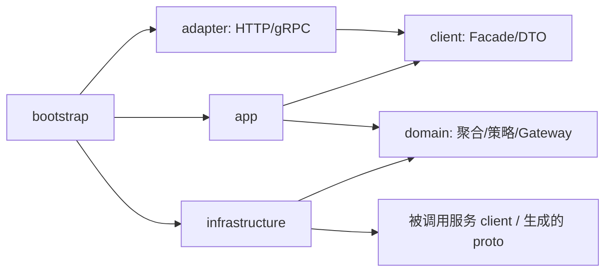
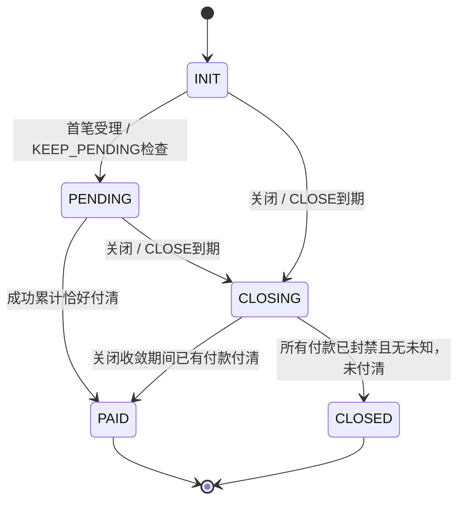

# 外部渠道收单系统详细设计

版本：v1.0 ｜ 日期：2026-10-20 ｜ 基线：[架构 v1.4](ARCHITECTURE.md)、[D01—D10](DESIGN-DECISIONS.md) ｜ 状态：待实现的设计稿

2026-10-21实施进度：六应用client/domain/bootstrap、P1生命周期与结果收敛、顺序退款/容量、额度恢复及完整快照契约已落源码，见[第一阶段实施说明](IMPLEMENTATION.md)
。已完成构建/部署脚本、生产源码打包、六镜像及OrbStack启动验收，未编译或执行单测；本设计中的数据库事务、业务应用服务及渠道执行仍待实现。以下“本轮”指2026-10-20的设计编写阶段。

本文把已确认的架构细化为 COLA DDD 模型、事务、数据库和 client 契约。当前程序仍是 acquire/payment Ping
骨架；文中的业务接口、表、任务和渠道适配均不表示已经实现。本轮未修改运行代码、数据库或 Kubernetes 部署。

## 1. 文档入口与范围

| 文档                                      | 内容                                                                  |
|-------------------------------------------|-----------------------------------------------------------------------|
| 本文                                      | 工程分层、聚合、不变量、事务、执行和故障恢复                          |
| [数据库设计](design/DATABASE.md)          | 六服务数据归属、完整新增表字段/类型、唯一键/索引、锁与迁移            |
| [Client API 设计](design/CLIENT-API.md)   | Java Facade、Command/Query/DTO、HTTP/gRPC、事件和通知协议             |
| [合约配置设计](design/CONTRACT-SCHEMA.md) | 复用框架合约的参数路径、类型、校验、快照与发布                        |
| [新增表 DDL 草案](design/schema/)         | 按服务分开的 MySQL 建表草案，仅用于评审，不是可直接应用的 Flyway 迁移 |

范围为外部渠道收单；ALIPAY/WECHAT/UNIONPAY，默认 CNY，支持直连与服务商下实际商户/子商户收款。无消费者会员、用户限额、余额、充值、提现、转账，也不引入资金
auth/capture。risk 只保留提交前默认放行咨询和结果后异步确认接口；reconciliation 继续后置，不创建空应用或提前设计账单解析表。

## 2. COLA DDD 工程设计

每个服务按业务聚合逐步建设以下层次，不预生成空模块。包前缀为 `io.github.loadup.pay.<service>`。

```text
acquire/
  acquire-client/          client.facade / command / query / dto / error
  acquire-domain/          domain.model / policy / gateway / event
  acquire-app/             app.service / handler / converter
  acquire-infrastructure/  infrastructure.dataobject / repository / converter / rpc / task
  acquire-adapter/         adapter.web / grpc / security
  acquire-bootstrap/       Spring Boot 启动与装配
```

payment/customer/product/limitcenter/realtime 使用相同职责划分；模块数量可随实现阶段合并，依赖方向不变。`adapter` 对应框架可选
web 层，并同时承载未来业务 gRPC 入站。2026-10-23源码更新：应用间统一使用 gRPC，实际协议与映射归各服务 *-rpc 模块，框架现有 gRPC binder 提供通用调用/认证支持；各业务 profile 提供 gRPC 入站，Java业务client不引入传输协议依赖。



- client 表达完整用例，不暴露 Mapper、表结构、Spring、gRPC stub、HTTP envelope。app 的 `XxxService` 直接实现 Facade，不增加只透传的
  Service/Impl。
- domain 为普通Java对象；不使用 Spring/ORM 注解，不依赖传输 DTO 或生成的 proto。复用LoadUp
  commons-dto的Money与commons-json的ToStringAsJson/DiagnosticHidden基础能力；收单层保留CNY/非负金额规则。聚合执行状态与金额规则；app
  管理权限、事务、跨服务调用和恢复编排。
- infrastructure 实现 domain Gateway，用 MyBatis-Flex、生成的 Tables/Mapper 和 MapStruct 完成持久化；远程 Gateway
  将本地领域入参映射为被调用方 client/proto，不把目标服务仓储引入本地。
- adapter 验证请求、建立可信租户/调用者上下文，再调用 Facade；出站 RPC 由 infrastructure 持有。app 可装配 infrastructure
  的自动配置，业务源码依赖 domain 接口。
- Command/Query/DTO 使用 record；公开字段使用英文 OpenAPI Schema；构造器注入，无 Lombok。普通 DTO 按框架使用 JSON
  toString；敏感输入单独脱敏，禁止 record 默认 toString 泄露付款码。
- domain 不重复包一层没有行为的贫血对象；金额、状态迁移、退款计划、额度归桶是必须保留的领域行为。映射使用
  `LoadUpMapStructConfig`，不在 Controller 中计算金额。

## 3. 聚合与行为归属

| 服务        | 聚合/策略                                    | 主要行为与不变量                                                                                             |
|-------------|----------------------------------------------|--------------------------------------------------------------------------------------------------------------|
| acquire     | AcquireOrder，内含 allocation 协调           | 固定总额/币种/收款主体；reservePayment、applyPaymentOutcome、requestClose、finishClose；paid+reserved≤amount |
| acquire     | OrderFee                                     | 原总额一次计算；付清唯一确认；退费作为独立 adjustment                                                        |
| acquire     | CheckoutSession                              | 订单级访问授权；会话到期与订单可付性分别判断；不保存消费者身份                                               |
| payment     | PaymentOrder + PaymentAttempt                | 固定单笔金额；单个 activeAttempt；稳定渠道请求号；一个 paymentId 最多一次正常成功                            |
| payment     | ChannelMerchantBinding                       | 类型化渠道身份和不可变 revision；当前可用性与历史查证/退款身份分开                                           |
| payment     | RefundRequest + AllocationPlan + RefundOrder | 固定计划，原付款可退容量原子预占；跨渠道子退款独立收敛                                                       |
| customer    | 复用 Merchant，新增 MerchantActionGrant      | 商户基本事实；父子关系与代操作授权分开，不创建消费者模型                                                     |
| product     | 复用 MerchantContract，新增 OrderAdmission   | 新单按当前主库准入；原订单按冻结条款履约；停单和新准入共用合约锁                                             |
| limitcenter | LimitReservation + BucketSet                 | 所有商户/窗口/指标一次原子预占；先执行授权、后提交渠道；成功 held→used                                       |
| realtime    | Order/Payment/RefundProjection               | 按各来源聚合版本更新完整投影；不裁决支付成功、剩余额或额度                                                   |

订单金额占用和商户周期限额是两类不同资源。领域事务只在单服务数据源内成立；多个聚合需原子协调时，由同服务应用事务固定锁顺序完成，不宣称跨库
ACID。

### 3.1 领域接口与适配位置

以下为设计级签名，不是新增Java源文件。聚合不调用远程接口，app在事务内取得聚合后调用行为，保存结果和对应事件。

```java
// Domain model: no Spring, ORM, transport or facade DTO dependencies.
public interface AcquireOrderGateway {
    AcquireOrder lock(String orderId);

    void save(AcquireOrder order, long expectedVersion);
}

// Aggregate behaviour signatures, implemented on AcquireOrder.
// reservePayment(PaymentIntent intent, LocalDateTime now) -> OrderPaymentAllocation
// applyOutcome(VerifiedPaymentOutcome outcome) -> OrderChange
// requestClose(CloseReason reason, LocalDateTime now) -> CloseDecision
// finishClose(ConvergedPayments evidence, LocalDateTime now) -> OrderChange

public interface PaymentChannelGateway {
    ChannelSubmitOutcome submit(PreparedChannelPayment payment);

    ChannelQueryOutcome query(ChannelPaymentIdentity identity);

    ChannelCloseOutcome close(ChannelPaymentIdentity identity);

    ChannelRefundOutcome refund(PreparedChannelRefund refund);
}
```

Gateway.lock表达当前应用事务内取写锁；仅infrastructure使用QueryWrapper.forUpdate，domain不感知SQL。OrderChange携带此次真正发生的领域事件，app在同事务按目标发布Outbox。Money使用框架的不可变金额类型；PaymentIntent、VerifiedPaymentOutcome为本地domain值对象，不复用业务client
record作为内部可变模型。

PaymentChannelGateway有真实的支付宝/微信/银联及沙箱adapter替换点。返回类型必须区分已受理等待交互、确定无收款风险、结果未知和成功事实；close返回还需区分仅停止未收款交易与带资金退回的撤销。不能把所有HTTP非2xx映射成可释放FAILED。纯计算的OrderFeePolicy、RefundAllocationPolicy、LimitWindowPolicy可直接用领域对象验证，无需启动Spring。

## 4. 金额、状态和时间

### 4.1 固定金额规则

```text
unallocatedAmount = amountMinor - paidAmountMinor - paymentReservedMinor
availableToPay = canAcceptNewPayment ? unallocatedAmount : 0
outstandingAmount = amountMinor - paidAmountMinor
PAID <=> paidAmountMinor == amountMinor  （正常订单收敛路径）
```

所有金额用正/非负有符号 BIGINT 存储，Java long，计算使用 checked arithmetic；CNY 单位为分。费率使用 BigDecimal
十进制字符串，舍入到整数分，禁止 double。首期只开放 CNY；显式其他币种必须先实现并开通能力。金额业务上限由平台产品定义并校验，不能等到数据库溢出才拒绝。

退款不减少 `paidAmountMinor`，不改变上述公式。净收款 `paid-refunded` 只在查询组合中展示。原成功付款的金额/成功状态不因退款改写，可退容量在
payment 独立表维护。

例如100元订单先收30再退30，原paid仍30、可收未占用余额仍70；后续成功收70后按历史成功合计进入PAID，净收显示70。退款事实须独立呈现给商户，不能为了补回退款额再向原订单收30。

### 4.2 状态迁移



INIT/PENDING 可以取得新付款占用；CLOSING 禁止新占用，但处理原付款结果。PAID/CLOSED
禁止新付款、改额、延期、重开和新关单；查询、已提交命令的幂等返回、独立退款不改订单，继续允许。

| 对象             | 过程状态                                                                                                    |
|------------------|-------------------------------------------------------------------------------------------------------------|
| allocation       | INIT→HELD→CONSUMED / RELEASED；正常终态只转换一次                                                           |
| PaymentOrder     | INIT→PROCESSING / UNKNOWN / CLOSING→SUCCEEDED / FAILED / CLOSED；UNKNOWN可回到查证后的处理中或终态          |
| PaymentAttempt   | INIT→SUBMITTING→PENDING / UNKNOWN→SUCCEEDED / FAILED / CLOSED；可靠同步结果可以直接从SUBMITTING收敛         |
| RefundRequest    | INIT→PROCESSING→SUCCEEDED / PARTIAL_SUCCEEDED / FAILED；UNKNOWN子项未收敛时保持PROCESSING并显示unknownCount |
| RefundOrder      | INIT→PROCESSING / UNKNOWN→SUCCEEDED / FAILED；确定失败后才释放该子项可退预占                                |
| LimitReservation | INIT→RESERVED→EXECUTING→CONFIRMED / RELEASED；未执行RESERVED也可EXPIRED                                     |

PaymentOrder 的 FAILED/CLOSED 只有在不再允许新 attempt、所有旧 attempt 不可能收款后才能形成。单 attempt 失败但允许下一尝试，不提前终结整个
PaymentOrder 或释放 acquire allocation。成功后再收到互相矛盾的退款/撤销事实，记录独立证据与补偿，不把原成功任意倒改。

### 4.3 时间约定

应用 Clock、JVM、任务、JDBC 和数据库会话采用一致的系统默认时区；业务持久化 DATETIME (6)，跨服务 DTO 用 OffsetDateTime 携带实际偏移。区间采用 `[start,end)`。只在 gRPC Timestamp、渠道签名/epoch、Kubernetes 等要求绝对时间的协议边界转换，不改写其语义。

orderDueAt 是未付清处理检查点；sessionExpiresAt 是访问凭证期限；actionExpiresAt 是渠道参数期限。KEEP_PENDING 不把
orderDueAt 当成隐蔽停付时间，也不会延长旧二维码。延期按原条款修改检查点，不改总额或合约版本。

## 5. 关键事务与锁顺序

网络调用一律在本地短事务之外执行。表字段、唯一约束及事务锁顺序见[数据库设计](design/DATABASE.md)。推荐交易事务使用 READ
COMMITTED，所有金额决策显式锁行/CAS，不能依赖隔离级别隐含保护。死锁只做有界整事务重试，保持所有业务ID/请求号不变。

| 编号  | 本地事务                 | 同事务的持久副作用                                                                                                                               |
|-------|--------------------------|--------------------------------------------------------------------------------------------------------------------------------------------------|
| A0    | 取得商户订单号创建意图   | 固定orderId、规范化摘要和首个请求意图；并发唯一键胜出者是所有重试的唯一身份                                                                      |
| P1    | product权威新单准入      | 合约锁、有效性、可信商户事实、OrderAdmission快照与幂等记录                                                                                       |
| A1    | 正式创单                 | order、snapshot、fee、可选session、到期任务、订单投影Outbox、创建意图完成                                                                        |
| A2    | 新付款受理               | 锁order；验证原条款/时间/金额/次数；生成paymentId、HELD allocation；reserved增加；输入齐备时写执行意图Outbox，缺输入则由恢复用例补齐后同事务发布 |
| Y1    | payment接受执行意图      | 锁parent gate、payment gate；验证allocation；插入PaymentOrder、首attempt、稳定渠道请求号；登记执行任务                                           |
| L1/L2 | Reserve / BeginExecution | 全部桶held预占 / reservation执行状态及执行凭证；互斥过期释放                                                                                     |
| Y2    | 提交渠道前               | 锁gate→payment→attempt，CAS INIT→SUBMITTING、记录执行凭证与风险结果；提交事务后才发渠道请求                                                      |
| Y3    | 付款结果                 | 验证证据，锁gate→payment→attempt；成功事实、退款容量、各独立目标Outbox；失败/未知证据和查证任务                                                  |
| A3    | 消费付款结果             | Inbox去重，锁order→allocation；逐笔CONSUMED/RELEASED，paid/reserved、订单状态、fee确认、订单通知和投影Outbox                                     |
| R1    | 退款计划                 | 锁parent gate→成功付款容量（paymentId排序）；申请、固定计划/子退款、各容量reserved、执行任务                                                     |
| R2    | 子退款结果               | 锁parent gate→refund_request→capacity→refund_order；退款金额、容量reserved→refunded、申请累计、退款事件/退费/额度恢复Outbox                      |

R2 在parent gate之后先锁申请，容量锁按 paymentId
取锁，多个子项批量处理时先统一锁request，再按同一顺序锁全部capacity；禁止先锁refund_order再反向锁request。payment成功与退款规划共用parent
gate，使“本次规划看到了哪些成功付款”有清楚的串行点；跨订单之间仍能并行。

## 6. 创单、准入与 DirectPay

### 6.1 可靠的创建身份

唯一业务键是 `(tenantId,payeeMerchantId,merchantOrderNo)`。A0 创建 `order_create_intent`，保留稳定
orderId/requestDigest，而不是先插一个绕过准入的可付订单。规范化 CNY、默认业务字段后计算摘要；不把稍后服务端生成的时间重新代入重试摘要。

同键同摘要返回原意图/订单；同键不同摘要为 IDEMPOTENCY_CONFLICT。A0唯一键冲突后先回滚当前事务，再读胜出记录，不继续持有失败的创建事务去调用product。

product 以稳定 orderId 请求进行
P1：锁当前merchant_contract，再判断状态、半开有效区间、revision/generation和已验证商户事实。合约停单使用同一锁。先读取已存在相同准入结果再判断当前资格，保证停单后的原请求重试返回原准入，不生成另一订单。拒绝的意图不能悄悄因重试变成新订单；修正业务须新商户订单号。

准入绑定orderId/payee/requestDigest/revision，返回admissionId和不可变快照。跨库截止点是 **P1提交时**
：此前已准入但A1尚未完成的请求，可在准入的materializeBefore内按原ID完成；其后新准入拒绝。该期限是创建意图恢复期限，不是存量订单的续付截止。恢复超期而A1从未完成时终结意图，不能用旧admission新建其他订单；已持久化订单不因此作废。A1超时应查询原orderId，不立即假定失败。

customer经营状态为P1读取到的可信事实，跨服务不承诺与customer变更全局零窗口原子截止。用户要求的合约停止门禁通过product自己的合约锁实现；未来紧急冻结存量交易是另外的能力。

### 6.2 Checkout与DirectPay

Checkout 在 A1 保存订单/费用/会话并返回托管URL；渠道单尚未创建。session
token只保存摘要，页面使用订单受限权限；重放创建命令不在已失效会话上重新发放更高权限token，商户通过独立session创建命令续发。

DirectPay
是同模型的便利入口：创建意图冻结首笔金额、actionKey、方式和输入摘要；A1/A2可以合并成本地事务，然后可靠发起首笔付款。接受后返回orderId/paymentId及当前PaymentAction或WAIT；不承诺RPC超时等于失败或扫码枪一定同步成功。新merchantOrderNo必须当前准入，已有合法pending的后续付款用StartPayment。

付款码等敏感输入只通过HTTPS/可信RPC进入payment的短期加密input存储，返回绑定paymentId/attempt意图的opaque
inputRef；acquire只持引用。敏感输入准备与A2之间允许存在未使用input，按期限清理；未取得input时不发送执行命令，A2恢复必须重用原paymentId。业务摘要使用服务端keyed摘要，不存可离线枚举的短付款码明文散列。原输入到期且尚未提交时，先封禁原attempt，再由明确的新尝试补充输入；不得让Outbox无限重放已过期付款码。

## 7. 多笔付款执行与结果收敛

1.

acquire先查actionKey幂等，再锁order。校验原snapshot、等待策略、允许方式、手动金额、最大成功笔数；CLOSE已到检查点时当场持久进入CLOSING并拒绝新付款，不依赖延时任务准时到达；金额和笔数在途一起预占。同一动作返回同paymentId，新付款动作才用新actionKey。

2. allocation保存不可变paymentId、金额/币种/主体和执行意图摘要；A2同事务产生执行目标Outbox。payment仅接受可信acquire的绑定，不能让页面直接提交任意金额或渠道商户号。

   缺少必须的敏感输入时，A2保留NEED_INPUT且不发布可执行意图；恢复用例以同paymentId补齐inputRef后，在占用仍HELD/订单可执行的事务内发布一次。渠道请求号由adapter按对应产品字符集/长度生成并先持久化，不直接截断或假设平台64位ID必然能作为渠道商户订单号。
3.

payment持久化Y1后再准备渠道绑定/attempt；咨询risk（当前DEFAULT_ALLOW），Reserve与BeginExecution商户限额。operationId固定到PaymentOrder，attempt重试不重复计成功笔数；执行凭证额外绑定当前attempt和executionEpoch。

4. payment进行Y2检查并进入SUBMITTING，然后调用渠道。claim租约仅调度互斥，不能证明旧worker不会继续。进入SUBMITTING即按可能已发送处理；响应丢失为UNKNOWN，不自动重新扣款或换渠道。
5.

回调验签、解密和初步解析在事务外；Y3重新核对实际收款身份、金额币种、稳定请求号和渠道交易号，保存可审计receipt/证据。只有提交成功后返回渠道ACK。同receipt的规范化资金事实冲突进入anomaly，不静默覆盖；只改变签名/重发时间等非资金信息的合法重复不误报新的付款。

6. 一次成功原子提交：PaymentOrder/attempt成功、refund_capacity初始化、acquire结果、limit确认、realtime快照、risk结果各自目标Outbox。若某目标不可用，不阻止其他目标收敛。
7.

acquire以paymentId/allocationId消费完整结果：HELD→CONSUMED，reserved减该笔、paid加该笔，成功笔数加一；状态变PAID时唯一确认整单费用并发OrderFullyPaid。重复成功为无操作；不同paymentId不能共享一个去重键。

同payment下一attempt仅在旧attempt有渠道确定不收款证据且旧发送路径安全终结后准备；金额/币种/原allocation保持不变。PaymentOrder的activeAttemptId在锁下更新，旧回调仍按原attempt处理；单纯查询NOT_FOUND不足以证明一个暂停的SUBMITTING
worker以后不会提交。

## 8. 关单与迟到执行

acquire锁order进入CLOSING，设置closeEpoch，并持久化关闭目标Outbox；从此A2拒绝全部新付款。payment接收父订单关闭时先持久化parent
gate（即使没有任何PaymentOrder），在同一锁下封禁之后抵达的新paymentId。迟到execute若对应付款从未准备/提交，在门禁下按原绑定持久化最小CLOSED
PaymentOrder和本地NO_SUBMISSION_GATE证据并可靠返回结果，使acquire能释放原allocation；已有SUBMITTING不能走此捷径。单笔取消也先写payment
gate tombstone，再检查PaymentOrder是否已创建。

INIT且能证明从未进入SUBMITTING的attempt可在持久门禁下取消。已经SUBMITTING/PENDING/UNKNOWN的attempt必须按原渠道请求号查证/关闭/撤销；
**本地CANCELLED、任务租约到期、RPC超时或渠道NOT_FOUND都不能单独证明可释放金额**
。已放行而暂停的worker仍可能恢复，不能靠“发送前再查一次”宣称消除了检查与发送间隙。

适配器必须给出渠道支持的确定关闭/无收款风险证据，且覆盖同一请求号的迟到提交；若渠道不能保证，保持CLOSING/UNKNOWN并继续受控查证或人工处理，不强行承诺到固定时间必然CLOSED。已成功的付款保留；带资金退回的渠道撤销按实际资金事实分开记录。

payment仅在父gate已封禁、每笔旧付款已成功或最终无收款风险、没有可提交旧尝试时发出可收敛结果。acquire必须逐笔取得最终结果并消除HELD，不能只凭parent
fence ACK释放尚未到达payment的执行意图；之后全部付清为PAID，否则CLOSED，保留部分paid。随后异常成功仍在payment保存anomaly及独立补偿，不能重开CLOSED或对已释放allocation再次做减法。

KEEP_PENDING的到期任务只记录策略检查并维持可续付状态，不发送父级关闭；重放任务必须重读当前状态与deadlineVersion。已CLOSED不受后来合约修改影响。

## 9. 商户额度的原子执行

### 9.1 规则和归桶

每笔PaymentOrder第一次被payment受理时固定initiatedAt。以此计算系统默认时区自然日/周/月，终生使用固定哨兵区间；成功、退款和重试都引用原bucketId，不按通知到达日重新归桶。metric为AMOUNT与PAYMENT_COUNT，预占时分别持有本笔金额和1，成功才转used。

product先发布limit
policy并收到激活ACK，才允许对应合约新准入。历史已激活policy持续服务原pending订单。ruleScopeId是稳定累计身份，policyVersion只是配置解释；阈值调整不生成空桶。当前runtime阈值在原稳定范围生效，降低后used+held可能已经超过阈值，此时只拒绝新预占，不回滚真实付款。

周起点/统计口径属于桶形状，不能对活跃规则直接覆盖后漏计。首期提供发布校验：有已用/在途桶时禁止原地改形状；变更需独立迁移方案，包含原窗口结转/重叠双校验，在实现该算法前不开放此类在线修改。阈值和启停仍正常可配置；终生累计始终保留。

### 9.2 Reserve、执行、确认与释放

Reserve校验可信payee、原policy和父级范围，列出全部规则；按稳定ruleScope/merchant/metric/windowStart排序锁runtime与bucket，并一次检查used+held+requested≤currentLimit。任一不足则整事务回滚。缺失桶通过唯一键创建竞争后整事务重试，不忽略冲突继续更新其他桶。

已登记范围停用商业拦截时，enforcementEnabled=false但持续计量，重新启用沿用停拦截期间的累计；平台硬上限不能由商户停用。阈值比较只对启用拦截的规则执行，Confirm/Release/Restore仍引用原item。

BeginExecution只对未过期RESERVED成功，并与过期任务锁同reservation；进入EXECUTING后不做TTL释放。每次安全的新attempt取得新的executionEpoch，仍引用同一operation和原桶；旧epoch不能许可新attempt。该许可不等于product当前合约资格，不因普通停单拒绝原订单。

Confirm持可信payment成功版本，把每个item的held转used，只生效一次；Release需要payment最终无收款风险证据，不能接受商户自报失败。payment成功先落库，limitcenter不可用只使held继续保留并重投Confirm。对相互矛盾的CONFIRMED/RELEASED事实拒绝自动覆盖并生成差异，不能依靠消息先后抵销。

所有额度操作先锁稳定operation gate，再锁reservation/runtime/bucket。Release若先于Reserve到达，保存FENCED
tombstone和证据，即使尚无reservation也不只返回NOT_FOUND；迟到Reserve/Begin不能创建新held。Confirm若发现相反的已释放门禁必须进入差异查证，不能在未验证真实成功来源时重新开放该operation。

默认NO_RESTORE；若原policy允许成功退款恢复，必须同时有原Confirm与RefundSucceeded。退款先到时返回依赖未就绪并可靠重试，不标记已成功消费；按原reservation_item逐桶恢复，累计不超过原consume。默认不恢复笔数；启用全额退款恢复笔数时只有该PaymentOrder累计退款全额且首次满足条件才恢复1，不能每个子退款都减1。

## 10. 独立退款与整单费用

RefundFacade在payment落库。原条款退款策略由首次可信执行意图在payment保存的订单条款摘要/退款配置提供，不能信任商户新传的fee/refund规则，也不要求当前合约仍活跃。调用方权限独立校验，允许对PAID和部分收款CLOSED引用原成功付款退款；订单状态不作为回写对象。

R1在parent gate下固定成功付款集合，按paymentId锁可退容量，再按FIFO（succeededAt、paymentId）排序规划。每笔容量遵守
`refundedMinor+reservedMinor≤succeededAmountMinor`。将申请、plan
version、每个子退款id/固定channelRefundNo和所有预占一次提交。部分退款不允许时，只接受该申请时已成功可退款范围的全额退款；不能把未收的订单应收差额当成可退资金。

首期按计划sequenceNo串行执行；前一子项确定成功/失败后才启动下一项，UNKNOWN先查证并等待，确定失败保留其失败并继续固定计划下一项，不把失败额重新分配。R2使UNKNOWN保留reserved；确定失败释放，成功转refunded。申请全部完成后汇总SUCCEEDED/FAILED/PARTIAL_SUCCEEDED，存在未确定子项则不终结。通信重放/查证重用固定子退款，不重开确定FAILED子项，也不自动改退其他付款；首期不提供自动重规划接口，需重新申请的业务必须确认原子项不可迟到成功并使用新merchantRefundNo。

费用F按原amountMinor一次计算（费率/固定费/舍入/保底/封顶来自合约），OrderFee在A1为INIT、整单PAID唯一CONFIRMED。首期部分关闭不确认整单费用。退款退费用独立FeeAdjustment：payment发完整成功退款汇总，acquire锁order_fee按来源版本保留refundBasis，即使费用尚未确认也不丢依据。费用确认与退款汇总共用该费用锁，在确认F后按原配置计算累计应退费用，再减已调整额，按触发键生成本次调整；不能更新原F、paid或订单版本。累计算法避免多次舍入超退，最大不超过已确认F；未确认费用不产生“已退手续费”。这只是商户业务费用记录，不建设钱包账户或清分结算。

## 11. 可靠事件、任务与投影

使用实际框架接口：

```java
outbox.publish(new OutboxMessage(tenantId,
        "pay.payment.outcome.acquire.v1",1,paymentId, payloadJson));
        delayedTasks.

register("pay.order.due",orderId +":"+deadlineVersion, dueAt);
```

二者均在同一DataSource的本地写事务注册。`OutboxMessage.version`是载荷schemaVersion，业务aggregateVersion在payload；不能把两者混用。
`publish`不按businessId去重，应用业务唯一键/状态迁移负责只产生一次领域事实。

Outbox每type仅支持一个handler。一次支付结果必须显式创建acquire/limitcenter/realtime/risk等独立投递记录，而不是一个handler串行调用所有目标。定义稳定businessEventId（在成功事实事务内一次生成），各投递记录有自己的outboxId；后续重放保持各ID不变，不能把目标重投误认为新的付款事实。

远程消费者在本地事务中把受信事件映射成`OutboxEvent`，调用 `OutboxInbox.consume(consumerId,event,databaseWork)`
；保留生产方outboxId/type/schemaVersion/occurredAt，并以业务事实ID和状态约束作第二道去重。Tenant必须与认证出的服务授权范围匹配，不能直接信任payload。回调不得做外部扣款/HTTP后宣称恰好一次。

| 所有者      | 持久任务                                                     | 处理要求                                             |
|-------------|--------------------------------------------------------------|------------------------------------------------------|
| acquire     | 创建意图恢复、order.due、关闭收敛、待发送input恢复           | 当前state/deadlineVersion/意图摘要复核；旧任务无操作 |
| payment     | execute/query/close、refund.execute/query、额度/订单差异修复 | 外部操作固定请求号；每次执行前重新验门禁             |
| limitcenter | reservation.expire、未确认占用差异核查                       | 只自动过期RESERVED；EXECUTING查证，不盲目释放        |
| realtime    | projection.repair                                            | 从权威完整快照修复；不回写交易库                     |

DelayedTask唯一键为tenant/type/bizId；已完成任务不能依赖同键register获得再次调度。每次新查证用`attemptId:querySequence`
，订单延期用`orderId:deadlineVersion`。任务状态由组件维护，不强制改成INIT。handler自身短事务、幂等、可重复；框架当前无租约续期，长HTTP超时必须受控，不能拿租约当资金锁。

realtime分别按订单/付款/退款sourceVersion更新完整快照，较旧版本忽略。一个投影行若组合多来源，必须分别保留acquireVersion/paymentRefundVersion，不能比较两个服务的数字版本。退款汇总在payment_parent_gate下递增refundSummaryVersion并发送完整累计快照；不得按到达顺序简单“加退款额”。查询展示snapshotAt与来源位点，不回源交易主库给列表补齐；付款结果页查acquire/payment权威接口。

## 12. LoadUp复用清单及新增范围

以下已核对当前仓库README与源码。链接是设计依据，不表示收单平台已经接入。

| 现有能力                                                                                                                           | 具体复用                                                         | 收单平台新增                                                                                 |
|------------------------------------------------------------------------------------------------------------------------------------|------------------------------------------------------------------|----------------------------------------------------------------------------------------------|
| [merchant](../loadup-framework/loadup-modules/loadup-modules-merchant/README.md)                                                   | MerchantFacade、MerchantQueryFacade、merchant_profile            | customer远程事实、关系和逐项授权；不另建重复商户主档                                         |
| [contract](../loadup-framework/loadup-modules/loadup-modules-contract/ARCHITECTURE.md)                                             | catalog/contract/revision、ContractResolveFacade和强类型配置合并 | OrderAdmission持久决策、合约停单锁、收单参数编译、limit激活协议；现有resolve不能直接代替准入 |
| [database](../loadup-framework/loadup-components/data/loadup-components-database/README.md)                                        | BaseDO、MyBatis-Flex、IdGenerator、sequence、Flyway              | 收单平台DO/Gateway、金额CAS/锁顺序；独立数据库配置稳定site，不复制序列表DDL                  |
| [database-processor](../loadup-framework/loadup-components/data/loadup-components-database-processor/README.md)                    | wrapper processor生成Mapper/Tables                               | 不编写空Mapper或重复处理器配置                                                               |
| [Outbox](../loadup-framework/loadup-components/reliability/loadup-components-outbox/README.md)                                     | OutboxTemplate/Message/Inbox/Handler及组件迁移                   | 目标类型、业务事实ID、事件内容、重投/差异流程                                                |
| [DelayedTask](../loadup-framework/loadup-components/reliability/loadup-components-delayedtask/README.md)                           | 事务register、handler、失败管理                                  | 关单/查证/恢复任务；Scheduler仅唤醒扫描，不用内存定时替代持久任务                            |
| [gRPC binder](../loadup-framework/loadup-components/integration/loadup-components-rpc/loadup-components-rpc-binder-grpc/README.md) | 原生spring.grpc、BindableService、GrpcChannelFactory             | 生成proto/stub、身份和tenant拦截器、deadline/幂等/业务结果映射                               |
| [signature](../loadup-framework/loadup-components/security/loadup-components-signature/README.md) / KMS                            | RequestSigner/Verifier、原始字节签名、nonce store、密钥引用      | 商户身份映射和通知语义ACK；渠道签名仍由各渠道adapter负责                                     |
| resource-server / authorization / UPMS                                                                                             | 操作员与调用者令牌、动作授权                                     | payee与父子商户作用域校验；cashier订单scope，不新增付款人账号                                |
| webmvc / springdoc / commons                                                                                                       | SuccessResponse、FailureResponse、PageDTO/PageResponse、统一异常 | 业务ResultCode及外部渠道回调专用ACK适配                                                      |
| http / observability / resilience4j                                                                                                | HTTP连接、超时、Micrometer/Observation、LogUtil                  | 只对可安全重试的操作配置策略，不能给扣款POST加盲目自动重试                                   |
| file/DFS（后置）                                                                                                                   | 对账文件存储引用、任务基础设施                                   | reconciliation完整领域后置                                                                   |

框架contract阶段一是扁平字段路径和STRING/INTEGER/DECIMAL/BOOLEAN强类型值，不支持任意对象/数组Schema。收单平台按[配置设计](design/CONTRACT-SCHEMA.md)
编译，不能把一个尚不存在的JSON Schema引擎写成已复用能力。

继续使用Kubernetes
Service/DNS、Headlamp和ConfigMap/Secret；不增加Nacos。业务条款存product，技术连接配置存ConfigMap，密钥使用Secret/KMS引用。内部gRPC生产需TLS/服务身份；不能把metadata中自报tenant等同于认证。

## 13. 实施顺序与验收设计

1. 建立client/proto及typed配置，复用customer/product并补准入；实现limitcenter的持久规则和桶事务。
2. acquire订单/费用/金额占用、payment单渠道执行与回调，形成Checkout多笔付款闭环；再接托管cashier与DirectPay输入。
3. 关单fence/UNKNOWN恢复、独立退款/FIFO/费用调整、商户通知与realtime；补全三渠道及两接入模式。
4. 后置风控厂商接入与reconciliation，不改变当前资金事实所有权。

实施时通过Facade验证：100元30+20+50、并发超额、同action重放、渠道超时保留双占用、停单前准入恢复/原单续付、CLOSE/KEEP_PENDING、终态独立退款、FIFO跨渠道部分成功、费率整单一次计算、额度多窗口全回滚/月界/版本不清零、乱序通知和投影。并发/唯一键/回滚用真实MySQL针对性验证；渠道关闭证据和身份用对应沙箱验收。

本轮仅做文档静态一致性检查，没有运行构建、测试或DDL。容量、保留期、SLO/RTO/RPO仍按用户决定暂不展开；实际合约数值与渠道授权材料在实施对应能力前填入，不再作为已确认业务语义的待决问题。

## 渠道集成模块边界更新（2026-10-23）

渠道技术实现不再归属 payment-infrastructure。统一契约归 channel-api，Facade/Registry 归 channel-core，协议策略分别归 channel-alipay/channel-wechat。payment 的领域 Gateway 保留，基础设施仅提供原绑定解析适配器；依赖从 payment 指向 channel，不允许 channel 反向依赖 payment。统一 API、路由约束和当前未完成边界详见 [渠道模块](channel/README.md)。该调整不增加独立部署服务，也不增加内部 HTTP 调用。

payment-infrastructure 显式依赖 channel-api，channel-core 和厂商插件统一由 payment-bootstrap 装配。类型化 ChannelAccountIdentity 通过多态提供所属渠道、接入模式与实际收款主体；payment 的账户摘要计算不再按厂商类型分支。完整依赖图、设计模式和扩展约束见 [渠道架构](channel/ARCHITECTURE.md)。

支付渠道 query/close 使用 ChannelPaymentTarget，统一携带原金额；支付宝已补查单与待付款关闭的协议映射，未付款关闭采用明确 CLOSE_RESPONSE 组合来源。payment 主链自动驱动已有源码，关闭 ACK 丢失恢复仍为后续工作，详见 [支付宝说明](channel/channel-alipay/README.md)。

收款提交现采用独立 ChannelPaymentRequest/Submission，将付款码/已解析渠道标识和唤起动作与资金事实分开；原订单标题、截止时间在 acquire→payment 的持久意图/gRPC 中冻结。支付宝付款码/JSAPI 适配源码已补；动作快照/Y3 同事务记录/授权查询已补源码；Y2 前本地预检与自动执行已有源码；H5 仍待实现，详见 [提交契约](design/CLIENT-API.md)。


### 付款自动续行协议

受理事务登记 payment_recovery_cursor 和原生首轮 DelayedTask；任务只保存 paymentId/generation，不保存付款码、凭证或成功状态。正常等待与异常重试分开：正常等待在原门禁/游标 CAS 事务登记下一代，异常沿用原生租约重试。事务失败不能只提交游标或只登记后继。

首笔固定路由后，锁外打开原未绑定输入并调用统一 ChannelPaymentFacade.validate，再执行风控与额度/Y2。仅返回给 Y2 赢家的内存 ticket 允许一次 submit；任何恢复都不能从持久 attempt 重新创建提交许可。Y3 接收原观察与动作。已进入 Y2 的 attempt 保持原身份 query/close；到期/封禁先持久关闭门禁，渠道未知仍保留资金/额度占用。

源码已接线不等于验收；关闭及 JSAPI 动作 ACK 丢失的确定恢复仍待后续协议。原生异常重试有上限，专用运维重放/监控与清理仍待补。未执行本批编译、测试、迁移或真实渠道验证。


### JSAPI 创建响应丢失后的恢复

查询恢复使用不带输入/提交许可的 ChannelPaymentRecovery，包含原 identity/amount/method/executionEpoch/payableUntil；统一 Facade 路由到原 Provider。支付宝插件仅从验签的原交易 WAIT_BUYER_PAY 重建原 trade_no 和原到期时间的 JSAPI 动作。调用 recover 不产生新的渠道创单或扣款请求，原短期输入到期不阻止查询。

payment 的非关闭任务经 recover→recordRecovery 接收观察与动作，二者仍由原 Y3 事务应用；首次 submit 与 close 路径保持独立。已有动作的交易号/期限不能被重放覆盖。动作可见性仍要求 PROCESSING、原 active attempt/epoch、双门禁 OPEN 且未过期；UNKNOWN 中间财务状态不降级。此接线不提供商户结果写入 API，不解决关闭 ACK 丢失的确定未收款证据问题，未执行编译/测试/真实环境验收。


### 渠道异步通知入口

接收流程为可信 endpointRef→tenant/channel/bindingRevision、无权限 identify→原已 Y2 attempt→原公钥 verify→原渠道 query→归一 CALLBACK 观察→Y3 原子应用→渠道 ACK。签名失败之前不能查询渠道或写付款；原 HTTP/body 参数不能覆盖配置中的租户、绑定或收款账户。本地锁不跨文件/KMS/渠道调用。

复用现有 payment_channel_receipt，receiptKey 为 notifyId 与 query factsDigest 的长度分帧摘要，sourceDigest 组合验签内容和查询源摘要；同一通知先未知后查明成功可以形成不同查证回执，重复相同事实仍幂等。没有新增双写 Inbox，只有 payment_attempt 查找索引。CALLBACK 资金事实来自验签后原号查询，不直接使用回调状态或 gmt_payment；终态与独立退款不被中间通知回退。

公开路径只放行 JWT，渠道签名与冻结账户核验仍为实际认证。当前 form/RSA2 原生协议 ACK 与 JSAPI notify_url 配置已有源码；其他渠道、公开路径装配、生成代码/事务/真实回调验收仍未执行，业务目标继续按实现清单推进。


## 退款商户通知实施归属（2026-10-24）

退款结果归 payment，商户签名投递统一归 acquire。payment 在既有退款结果/容量事务写独立商户目标 Outbox；acquire 通过 SERVICE gRPC 验证源身份、原订单及子付款绑定，按原订单通知条款登记固定正文、原生任务和不可变接收回执。此接收是通知事实投影，不作金融裁决、不写交易金额，也不跨数据库事务。

终态通知分别为 RefundSucceeded、RefundFailed、RefundRequestCompleted，整笔申请保留固定总额及成功/失败两部分，允许 PARTIAL_SUCCEEDED。未知不通知成失败，退款不减少原付款成功金额。共用 acquire merchant_notification_delivery 引擎，移除 payment 侧重复投递表草案。内部 ACK 表示持久登记/原策略禁用，外部 2xx+精确 eventId/SUCCESS 才是送达。契约与 DDL 见 design/CLIENT-API.md、design/DATABASE.md；未运行验证或真实发送。


## 通知运营入口与恢复边界（2026-10-24）

通知元数据查询按商户 JWT 隔离，运营由 OPERATOR/配置的 pay-ops SERVICE 与专门 manage 权限授权。client Facade 不输出私有正文和签名路由；分页复用框架契约。

运营恢复是当前 native wake 的有界恢复：原业务预算、窗口、退避、正文/事件身份、不可变路由不变。当前代次缺任务登记原 due，FAILED 调组件 retryFailed，CANCELLED 调组件 reschedule 原 due；运行租约不抢占，PENDING 不加速，终态/超期不另授许可。SUCCEEDED/current generation 不一致必须显式修复，不能通过重复发送掩盖。

wake receipt 与调度变化同库事务，操作身份绑定已验证主体、请求键和完整参数，重复请求回首次决定；新操作显式 expectedVersion，防止误操作已推进通知。审计只给运营读取，不修改任何交易金额或生命周期。本批源码/测试源码未运行，真实数据库原子性与调度竞态仍为未验证项。


## Cashier 付款编排复用（2026-10-24）

商户 API 的授权切片调用共享 PaymentInitiationOperations，cashier 使用 capability 授权切片调用同一 A2/安全输入/受理链路。原金额与次数规则不复制；内部 PaymentInitiationPrincipal 仅封装可信 owner、幂等 actorScope 和本地授权策略，不能由 HTTP 参数构造。收银台 checkout/sessionId 与 merchant/ownerHash 分开幂等，原收款商户、合约和数据归属不改变。

新动作 order→session 行锁内核验 ACTIVE、期限、原 scope 与当前会话权限；原已预占意图在到期后继续履约。结果收敛改用内部 OrderPaymentScope，核对原归属/意图与 merchant 或 checkout 范围，不授予创建或商户 API 权限；后台不依赖浏览器能力仍有效。会话进度入口另行核对精确 session actorScope，不能跨会话查询。

当前托管交互子集为服务端场景的 H5/WAP，choices 来自显式部署目录与原冻结能力交集；JSAPI 身份等待可信 OAuth。浏览器请求不持商户令牌、OpenID 或任意渠道参数，响应只给安全 CashierPaymentDTO 与原动作。scope 初期直接更新，无兼容层；未做运行验证。H5 页面交互/轮询源码已补，OAuth 与实网域名/代理验收仍待完成；撤销源码见本文末节。


## 托管 H5 页面状态（2026-10-24）

页面以未确认付款操作为边界维护固定 actionKey、金额/渠道选择和可空 paymentId；原操作在第一次 HTTP 前保存到当前标签页 sessionStorage，token/支付 URL 只留内存。未知或网络失败只允许原动作重试；取得 paymentId 后只查原付款，start 返回终态也先经 progress/A3 收敛，才移除操作并允许下一笔手动付款。损坏/不可保存状态不静默生成新动作。

金额输入和 JSON 边界用精确整数分，展示原单笔/准确尾款/剩余笔数规则；服务端仍行锁校验并发总额、笔数和终态。响应必需 accepted 判别未受理，不把状态字段缺失等价未收款。轮询有次数上限、页面隐藏暂停，超时不迁移金融状态；支付 URL 保留原文/原期限、不自动重建付款。

四个静态 GET 资源单独公开，业务 capability POST 独立鉴权；无内联/第三方脚本，安全文本渲染，API 无 referrer，支付链接只发送 strict-origin。现有页面已由摘要页扩展为 H5 操作页面源码；JSAPI OAuth/动作与真实浏览器/域名/恢复验证仍需完成；撤销管理源码见本文末节，未执行构建/测试/实际发送。


## 收银台链接撤销（2026-10-24）

独立 revoked_at 永久标记与 checkout_session_revocation_receipt 实现原签发者管理；商户 detail/revoke/revocations
API、专门 read/revoke 权限、客户端契约与 MapStruct/DO/Gateway/迁移源码已补。撤销不改业务终态、金额、凭证或原期限，
已付清/关闭订单链接可撤销；没有恢复原链接的入口。原签发键重放已撤销链接明确拒绝。

撤销和新付款按订单→session 行锁串行化，锁后重查操作回执；标记和回执同事务，原已提交 A2 意图继续履约。
新键需当前版本，同键同参回首次回执，改参拒绝；审计查询绑定原 issuer/hash，输出不含能力凭证。
新增领域/管理服务/认证/预占/已提交意图/签发重放测试源码，全部运行验证仍暂停。
JSAPI OAuth、动作丢失/期限恢复、其他渠道能力、通知生命周期、交易重建、风控/后置对账及完整验证继续保留。


## 收银台原付款意图恢复（2026-10-24）

新增 capability 范围的 recover Command/DTO/Facade/HTTP 入口，按原 actionKey 定位 A2，即使 start 回复丢失仍保留原 paymentId。
共享 PaymentInitiationOperations 在原订单→会话锁内绑定 owner/scope/金额/choice/原准入，返回明确三态；
未观察到意图不创建预占，原安全输入未绑定保留 INPUT_REQUIRED，已绑定则在事务外使用原执行命令幂等受理。
非 HELD 意图不重受理；结果经过 PaymentOutcomeOperations/A3 后安全投影给页面，不把恢复成功等同支付成功。

页面原操作先恢复再重试，已知 paymentId 走原进度入口；未知不清元数据、不换键，终态经证据收敛后才允许下笔。
补充共享编排、capability/原会话和 JS 解析的测试源码，未运行验证。远端安全输入与本地引用间回复丢失的恢复已由 InputLookup 补源码；未受理输入到期的有证据关闭已接 InputExpire，
真实集成、JSAPI OAuth、其他渠道与对账等完整目标不变。


## 原安全输入引用恢复（2026-10-24）

payment 的独立 InputLookup Facade/gRPC 以 acquire SERVICE+input:read 校验原不可变意图的完整范围，
只返回原 opaque 引用/摘要/期限，不解密、指纹计算、改数据或续期。found 明确存在并与可空 input 一致；
过期/BOUND 仍回原元数据。acquire 恢复缺失引用时事务外查询，再在原订单→会话锁下 CAS 绑定原引用，继续原命令幂等受理和 A3。
不再为已存原输入重新生成当前 IP/场景。异常不当缺失、缺失不当未收款、到期不直接释放占用，金融编号/金额/渠道不变。

新增权限须由服务 JWT 发行方配置，没有签发令牌或修改部署。provider/consumer/MapStruct/proto/接线与测试源码已补，
未运行任何验证；未受理输入到期后的有证据关闭源码已补；第一次准备仍在途的竞态与其余完整业务范围继续。


## 未受理输入到期收敛（2026-10-26）

InputExpire 是完整原输入范围绑定的内部条件操作，要求 acquire SERVICE+input:expire 权限。
在原 parent/child/payment/input 锁序内，已有付款保持原状；有效未受理输入仍可原命令受理；
到期且从未受理时复用单笔 close 原子写门禁与固定控制回执，不封禁父订单或调用渠道。
回复丢失可用原请求重放证明，孤立数据没有证明不能按无付款记录直接释放。

acquire 原 actionKey 恢复据三态处理，关闭证明经通用 applyClose/A3 核对并幂等释放原 allocation。
paid gross、其他占用和订单业务状态不改变，后续 progress 不虚构 payment 行；页面得到明确收敛结果才允许下一笔。
控制 API/DTO/Protobuf/MapStruct/consumer、恢复接线及测试源码已补，未运行验证、令牌签发、部署或真实调用。
首次准备并发/地址变化、JSAPI OAuth、其他渠道、通知/交易重建/风控/对账及完整目标继续。


## 商户原 actionKey 恢复入口（2026-10-26）

POST `/api/acquire/payments/recover` 接收原 orderId/actionKey/amountMinor/choice，专门 merchant JWT 权限为
`pay:acquire:payment:recover`。恢复绑定原 tenant/callerScopeHash 与 merchant scope，不接受自报范围，不读取 checkout 的同名动作。
复用共享原意图恢复/原输入查回与条件到期证明/A3，找不到或缺输入时 accepted 明确 null；
只有 RESOLVED 的已受理原付款或经 A3 的未受理证据分别返回 true/false，不把依赖失败伪装成未受理。

补充原合法 NoInteraction H5 的恢复：以原 v1 摘要精确确认 NONE 模式才跳过输入查询/到期接口，
原字段全量经 MapStruct 重建摘要候选，不依据空引用猜测。敏感输入路径继续查原输入，不能切换到 NONE。
Java 恢复枚举提升为共享 PaymentRecoveryState，商户与 cashier 使用同一组语义，未保留早期兼容类型。

新增源码与权限/隔离/三态/原证据/未知 JSON 判别/无输入与损坏拒绝测试源码，未执行任何验证、部署或实际支付。
DirectPay 整体丢失回复、首次输入准备并发、JSAPI OAuth、其他渠道/通知生命周期/交易重建/风控/对账和完整验证仍需继续。


## DirectPay 首笔绑定与整体恢复（2026-10-26）

DirectPay 改为独立 DIRECT_PAY A0，固定非敏感订单字段和首笔 actionKey/金额/choice/输入种类，禁止与 ORDER/CHECKOUT 同号混用或改变首笔。
raw input 不进入创建库。原 DirectPay 先恢复原首笔，确实尚未提交才用原请求补做 start；结果统一为当前订单和 PaymentRecoveryDTO，
不再保留早期 PaymentStartDTO 的嵌套兼容表示。调用权限增加 payment:recover。

新 POST /api/acquire/payments/direct-pay/recover 接收原非敏感元数据，新增 direct-pay:recover 并要求 create/read/payment:recover。
未知 orderId 也能按原商户订单号恢复 A0：未观察到不分配 ID；INIT 通过仅续办入口继续原准入；已拒绝/到期返回白名单固定决定；
已完成后恢复原首笔。仅续办在 A0 事务内再次要求行存在，绝不因丢行重建新单；恢复不调用 start 或创建新 A2。

DTO、Facade、编码/摘要、COLA 编排、模式约束、MapStruct、开发期 CHECK 与表草案、测试源码已同步。
未执行 IDEA/构建/测试/DDL/部署或真实调用。首次输入准备并发/地址变动、JSAPI OAuth、其他渠道/通知/交易重建/风控/对账及全部原目标继续。


## A2 自主续办（2026-10-26）

A2 原子提交预占与第 0 代 native 恢复任务。任务按原 paymentId 定位 acquire 的不可变 orderId/owner/action，
禁止调用 start 创建新付款；复用原 intent 的 recover，敏感输入只允许按原键查回 opaque reference。D03 允许已提交意图继续，
后台无需仍有效的收银台凭证或商户在线；商户/合约门禁继续约束新交易。

任务执行前验证 native 租户/类型/业务键/登记时间/RUNNING/attempts/租约，按 order→allocation→cursor 锁定检查后释放事务。
原查询、受理或输入关闭 RPC 在锁外；A3 按现有规则落资金事实。之后再锁定，只有精确绑定的终态回执允许完成游标；
其他情况原子登记 generation+1 和下一轮 native 任务，旧代不继续派生。缺输入及依赖错误不构成关闭或失败证明。
具体 schema、配置和未完成边界见 acquire README 与数据库设计；本轮未做运行验证。


## 订单自动到期与 C0 续办（2026-10-26）

A1 创建与 native 到期任务同事务；延期回执与新版本到期任务同事务。版本由原 acquire_order.deadline_version 驱动，
旧版任务在订单锁内淘汰。CLOSE 到期通过 C0 落 CLOSING 并禁止新 A2，KEEP_PENDING 按原领域 checkDue 保持续付。

商户接口只负责鉴权并调用共享 OrderClosureOperations；后台按持久化原 scope 续办原请求，不获得商户创建或新关单权限。
C0 的第 0 代任务与关闭意图同事务，后续扫描游标/rowVersion 与下一代任务同事务。后台校验 native 登记/租约/attempts、
原订单、关闭意图、scope、epoch 与当前代次，随后在锁外沿原父门禁/子付款关闭/结果收敛流程执行。
最终 CLOSED 继续依赖完整权威证明，未知结果保持 CLOSING。到期处理与延期使用同一订单锁，不存在旧任务关闭新截止的路径。

复用现有表及 gRPC；没有每笔作业或自建计时器。新增源码与测试源码，暂停验证仍有效；native FAILED 运维续办、真实环境证明继续待办。


## Payment/refund 失败唤醒的受限运营路径（2026-10-26）

payment 的恢复运维路径只接 COLLECTION/REFUND_REQUEST 原任务。配置运维 SERVICE 与细分权限校验后，
按原父门禁、付款/退款计划和游标锁序核验金融归属与当前代次；同库原子调用 native retryFailed 与不可变审计写入。
PAYMENT_VERSION_CONFLICT 表示原任务观测已变化，不允许用旧观测授权新的重试周期。

运维不获得首次扣款/退款提交许可。native worker 继续使用原 Y2 边界、原请求幂等号、固定退款子单及查询/关闭逻辑；
终态或旧代只留下 NO_LONGER_NEEDED。完成游标配非终态聚合被视为损坏，拒绝隐藏未结束业务。
退款锁边界补强 reference→原请求 ID/订单/商户/摘要精确绑定，避免持另一个父门禁锁继续当前请求。

已补客户端/HTTP/存储/测试源码与配置，未运行验证或操作真实任务。列表告警、旧库补登记和整体剩余协议/业务工作继续。
