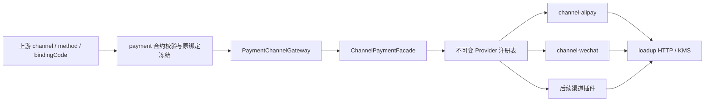

# 渠道模块架构

渠道是独立的插件模块族，随 payment 应用装配。payment 维护支付状态和业务约束，渠道插件处理厂商协议。统一入口为 `ChannelPaymentFacade`，由上游选择的 channel 和原冻结绑定决定策略。

## 模块与依赖

| 模块 | 职责 | 业务依赖 |
|---|---|---|
| channel-api | Facade、Provider SPI、请求/结果、类型化账户身份和动作契约 | loadup commons |
| channel-core | Facade 实现、不可变策略注册表、统一结果核验、动作快照编解码 | channel-api |
| channel-alipay | 支付宝协议、签名验签、凭证、支付/退款/通知适配 | channel-api |
| channel-wechat | 微信协议、签名验签、凭证及后续支付/退款/通知适配 | channel-api |
| payment-domain/app/infrastructure | 执行编排、原绑定读取、状态与证据持久化 | channel-api |
| payment-bootstrap | 装配 core 与具体插件 | channel-core、channel-alipay、channel-wechat |

插件按需依赖 HTTP/KMS 等 loadup 技术组件，不依赖 payment 或 channel-core。应用基础设施仅通过 API 调用，具体实现由启动模块选择。新增渠道插件不得反向读取 payment 表或调用 payment 内部服务。

## 设计模式

- **Facade**：`ChannelPaymentFacade` 统一预检、提交、查单、恢复、关单和退款；回调使用独立的 `ChannelNotificationFacade`。
- **Strategy**：每个渠道实现 `ChannelProvider`，通过 `channel()` 声明所属渠道。同一策略处理直连/服务商及商户/子商户差异。
- **Registry**：Spring 收集策略构造不可变 Channel→Provider 映射；相同渠道重复注册即失败。缺少策略或能力时明确拒绝，没有默认渠道或跨账户回退。
- **Adapter**：`PaymentChannelGatewayImpl` 只把支付领域调用桥接到 Facade；插件内部的适配器负责厂商报文和协议语义。

账户身份通过多态提供 `channel()`、`accessMode()`、`collectingAccountId()`。支付宝以 sellerId、微信直连以 merchantId、微信服务商以 subMerchantId 表示实际收款主体。payment 根据统一接口计算账户作用域摘要，不按厂商类型分支计算；切换应用或凭证版本不能改变同一实际收款主体的资金唯一性范围。

## 路由与交易约束

1. 上游指定 `PaymentChoice(channel, method, bindingCode)`；payment 按商户合约和绑定选择，冻结 channel、binding revision、账户作用域和支付方式。
2. 基础设施使用可信租户加载原 revision，构造 `ChannelExecutionContext`；请求不能提供任意渠道 URL 或密钥路径。
3. Facade 按请求原身份的 channel 选择策略，并核验租户、原绑定和账户作用域。付款预检/提交还核验支付方式能力。
4. 插件解析原绑定并处理协议，返回统一观察与可选唤起动作；Facade 核验结果属于原身份和原金额。
5. payment 在本地事务中落状态、证据、动作与 Outbox。真实渠道调用在本地事务外进行；未知结果保留未知，不能因网络超时换渠道重扣。

查单、恢复、关单和退款始终使用原渠道和原账户版本。当前商户路由的变更不能重定向在途交易。渠道回调先验签再查证，通过同一结果收敛流程落库。

## 扩展方式与当前边界

新增渠道时增加 `channel-{vendor}`、对应类型化契约和 Provider 自动装配，在 bootstrap 引入插件并配置。新渠道不需要修改 Facade 的路由分支。涉及新的公开账户或动作结构时，同步更新 API/客户端 DTO/Protobuf/MapStruct 和白名单快照编码；这些属于表示契约，不承担支付选路或厂商协议执行。

支付宝已有付款码/JSAPI、查询、关闭、退款和回调策略源码；H5 待实现。微信已有协议基础源码，支付/通知 Provider 尚未注册。银联待确定产品和接入机构后增加独立插件。上述源码未运行编译、测试或真实渠道验收。
