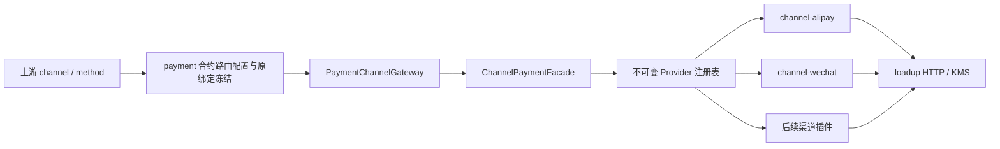

# 渠道模块架构

渠道是独立的插件模块族，随 payment 应用装配。payment 维护支付状态和业务约束，渠道插件处理厂商协议。统一入口为 `ChannelPaymentFacade`，由上游选择的 channel 和原冻结绑定决定策略。

## 模块与依赖

| 模块 | 职责 | 业务依赖 |
|---|---|---|
| channel-api | Facade、Provider SPI、请求/结果、类型化账户身份和动作契约 | loadup commons |
| channel-core | Facade 实现、不可变策略注册表、统一结果核验、动作快照编解码 | channel-api |
| channel-alipay | 支付宝协议、签名验签、凭证、支付/退款/通知适配 | channel-api |
| channel-wechat | 微信协议、签名验签、凭证及后续支付/退款/通知适配 | channel-api |
| payment-domain/app/infrastructure | 执行编排、原绑定读取、状态与证据持久化 | channel-api |
| payment-bootstrap | 装配 core 与具体插件 | channel-core、channel-alipay、channel-wechat |

插件按需依赖 HTTP/KMS 等 loadup 技术组件，不依赖 payment 或 channel-core。应用基础设施仅通过 API 调用，具体实现由启动模块选择。新增渠道插件不得反向读取 payment 表或调用 payment 内部服务。

## 设计模式

- **Facade**：`ChannelPaymentFacade` 统一预检、提交、查单、恢复、关单和退款；回调使用独立的 `ChannelNotificationFacade`。
- **Strategy**：每个渠道实现 `ChannelProvider`，通过 `channel()` 声明所属渠道。同一策略处理直连/服务商及商户/子商户差异。
- **Registry**：Spring 收集策略，由 `ChannelStrategyRegistry` 构造不可变 Channel→Provider 映射，支付和通知 Facade 共用注册规则；相同渠道重复注册即失败。缺少策略或能力时明确拒绝，没有默认渠道或跨账户回退。注册后的映射不随原集合变更。
- **Adapter**：`PaymentChannelGatewayImpl` 只把支付领域调用桥接到 Facade；插件内部的适配器负责厂商报文和协议语义。

### 上游参数与统一调用

例如上游传入 `choice={"channel":"WECHAT","method":"H5"}`，payment 用商户合约与路由规则选定并冻结微信收款绑定，
基础设施调用 `ChannelPaymentFacade.submit(context, request)`，core 从注册表取得 `WechatChannelProvider`。
上游改为 `ALIPAY` 时走支付宝策略，payment 不增加 `if/switch` 厂商执行分支。`method` 是同一渠道内的产品选择，
由对应插件检查支持情况；不支持时明确拒绝。策略集合的注入顺序不决定渠道，选定策略异常也不触发另一渠道提交。

payment 中账户 DTO、JSAPI 唤起参数及 Protobuf 的类型映射属于公开表示契约；它们不能包含厂商 HTTP 调用、签名、
凭证读取或选路执行。源码边界测试禁止 payment 引用渠道实现包，也禁止插件反向依赖业务服务内部类型。
已有交易的查询、关闭、退款沿原冻结身份调用相同 Facade，后续上游参数或路由配置变化不改变其原渠道。

账户身份通过多态提供 `channel()`、`accessMode()`、`collectingAccountId()`。支付宝以 sellerId、微信直连以 merchantId、微信服务商以 subMerchantId 表示实际收款主体。payment 根据统一接口计算账户作用域摘要，不按厂商类型分支计算；切换应用或凭证版本不能改变同一实际收款主体的资金唯一性范围。

## 路由与交易约束

1. 上游指定 `PaymentChoiceDTO(channel, method)`；payment 根据已准入合约的 `routingProfileRef` 获取有序 `bindingCode`/接入模式规则，选择商户绑定，冻结 channel、binding revision、账户作用域和支付方式。调用方不能直接指定密钥或绑定版本。
2. 基础设施使用可信租户加载原 revision，构造 `ChannelExecutionContext`；请求不能提供任意渠道 URL 或密钥路径。
3. Facade 按请求原身份的 channel 选择策略，并核验租户、原绑定和账户作用域。付款预检/提交还核验支付方式能力。
4. 插件解析原绑定并处理协议，返回统一观察与可选唤起动作；Facade 核验结果属于原身份和原金额。
5. payment 在本地事务中落状态、证据、动作与 Outbox。真实渠道调用在本地事务外进行；未知结果保留未知，不能因网络超时换渠道重扣。

渠道绑定发布不维护支付宝/微信白名单，也不把发布成功当成插件可用的证明。类型化账户身份校验 channel 与 accessMode 一致；实际支付预检由 Facade 查找已注册 Provider，并由渠道策略判断支付方式、接入模式及参数。停用或未装配插件时明确拒绝执行。新增渠道的表示契约仍需同步，但无需修改 payment 绑定服务中的厂商条件。

查单、恢复、关单和退款始终使用原渠道和原账户版本。当前商户路由的变更不能重定向在途交易。渠道回调先验签再查证，通过同一结果收敛流程落库。

## 扩展方式与当前边界

新增渠道时增加 `channel-{vendor}`、对应类型化契约和 Provider 自动装配，在 bootstrap 引入插件并配置。新渠道不需要修改 Facade 的路由分支。涉及新的公开账户或动作结构时，同步更新 API/客户端 DTO/Protobuf/MapStruct 和白名单快照编码；这些属于表示契约，不承担支付选路或厂商协议执行。

bootstrap 通过 runtime 依赖装配 core 和具体插件；payment 业务模块的编译依赖只到 channel-api。付款、退款和回调均通过 Facade 调用策略，渠道 HTTP operation、凭证解析、签名验签和原生 ACK 归各插件。

通用回调 Controller 不维护厂商签名头白名单，只采集原始 body 和有界、多值 HTTP headers。上限为 64 个头名称、每个名称 8 个值、单值 2048 字符、全部值 16384 字符，body 上限为 65536 字节；超限拒绝，不截断签名字段。ChannelNotificationInput 统一大小写并保留重复值，插件选择自己的协议头并拒绝不允许的重复签名。HTTP headers 始终是不可信输入，不能提供租户、渠道、商户或密钥路由；endpointRef 对应的服务端配置和原交易冻结绑定决定这些身份。原始 headers/body 在诊断输出中隐藏。

支付宝已有付款码/JSAPI、查询、关闭、退款和回调策略源码；H5 待实现。微信已条件注册直连/服务商 JSAPI/H5、查询/关闭及普通退款 Provider，支付通知已有原字节验签/解密与 Y3 接线，退款通知也已接独立退款结果流程；付款码与异常退款处置待实现。H5 的场景映射、固定 operation 与官方跳转 URL 校验属于微信插件；payment 只传类型化输入和保存统一动作。银联待确定产品和接入机构后增加独立插件。上述源码未运行编译、测试或真实渠道验收。

加密通知的定位阶段需要可信原绑定：Notification Facade 的 identify(context,input) 先获得服务端 endpointRef 固定的上下文；微信在验签/解密后提取订单号，支付宝继续解析自身 form。定位结果只用于寻找原 attempt，后续仍需 target 精确核验及原渠道查询。通知 ACK 携带协议 HTTP 状态，payment Controller 不改写失败为 200。

退款通知在同一 Facade/Provider 中使用类型化 identifyRefund/verifyRefund，不把支付 target 与退款 target 混用。微信协议复用签名/解密后按 refund 资源校验；退款 App 服务只查原计划、验原身份、查原渠道退款并调用既有退款结果事务。原回调控制器复用采集逻辑并增加独立退款路径，不添加业务厂商路由。
