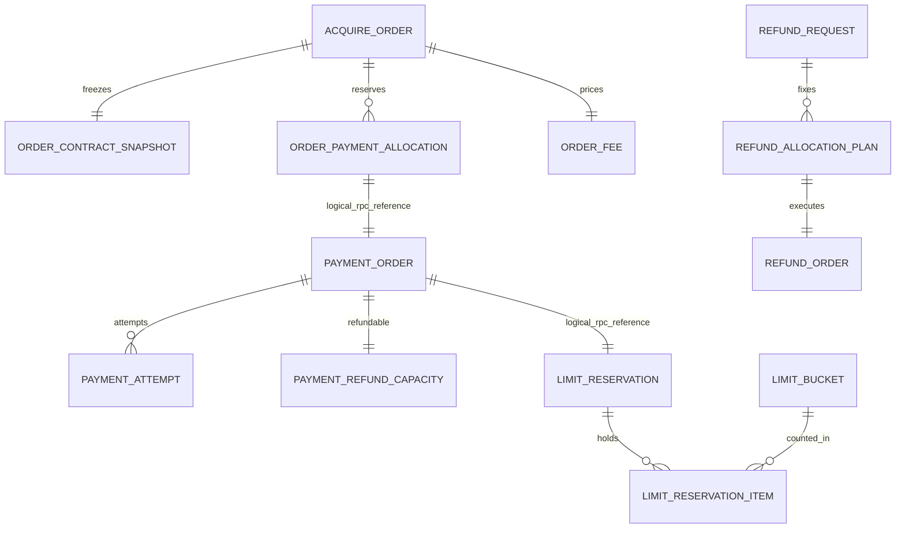

# 数据库详细设计

版本：v1.0 ｜ 日期：2026-10-20 ｜ 对应[详细设计](../DETAILED-DESIGN.md)

## 1. 物理约定与复用

六服务各自独立MySQL
database、数据源、数据库账号与Flyway历史；开发可共用实例。使用InnoDB、utf8mb4_bin，唯一业务号大小写敏感；所有新表包含以下BaseDO字段。跨服务仅保存逻辑ID，不跨库JOIN或建外键。首期本地关系也以唯一键、锁和Gateway校验维护，不给恢复/历史保留引入级联删除。

| 公共列       | SQL类型/约束                 | 语义                                        |
|--------------|------------------------------|---------------------------------------------|
| `id`         | `VARCHAR(64) NOT NULL`       | 主键，IdGenerator生成，外部业务ID可显式指定 |
| `tenant_id`  | `VARCHAR(64) NOT NULL`       | 可信租户；商户业务唯一键按租户隔离          |
| `created_at` | `DATETIME(6) NOT NULL`       | 系统默认时区创建时间                        |
| `updated_at` | `DATETIME(6) NOT NULL`       | 系统默认时区更新时间                        |
| `deleted`    | `TINYINT NOT NULL DEFAULT 0` | BaseDO标准字段；交易/累计事实禁止逻辑删除   |

`row_version`
不是BaseDO自带字段，需要逐表显式声明；应用按行锁或条件更新维护。公共审计时间不等于业务事件发生时间。SQL草案没有把状态默认成成功：业务过程显式以INIT开始，在同事务内可以进入HELD/ACTIVE等已完成准备状态；框架Outbox/任务/合约生命周期保留原定义。

金额/计数为有符号BIGINT并校验非负，业务金额限制应小于long上限；货币缺省值在应用规范化成CNY，不依赖DB默认值。所有DATETIME (6)
为系统默认时区会话时间，SQL不做UTC默认转换。业务ID长度≤64，商户订单/退款号≤64、action/requestKey≤128，严格校验且不静默截断。大JSON/密文不建通用索引，字段大小另由请求/产品定义约束；关键状态/金额不只埋在JSON里。

交易、准入、幂等、门禁、成功退款、额度累计不允许通过deleted=1复用业务唯一键。索引不包含deleted；归档必须连同幂等/累计保留方案另行设计，当前不定保留期。租户插件之外，跨服务命令还要显式校验tenant/merchant归属。

技术全局键有明确例外：session
token_hash，以及真实渠道账户作用域内的渠道请求号/交易号/退款号不带tenant前缀，防止同一外部资金事实被两个租户重复认领。它们不授予跨租户读取权限；冲突只返回脱敏错误，查证仍由服务端按真实绑定处理。

### 已有表直接复用

- customer：框架`merchant_profile`，不再建customer_profile。原有id、merchant_code、名称/行业/经营状态、row_version及联系资料按原迁移保留。
- product：框架`contract_catalog_version`、`merchant_contract`、`merchant_contract_revision`
  。catalog以kind区分产品/条件/组合/方案，不为同一概念复制多组产品表；合约generation与revision保持原语义。
- 各有需要的服务：database的sequence表、Outbox/Inbox、DelayedTask及其组件自有迁移。使用实际依赖所带脚本，不把本草案重复迁入组件表。
- 本文SQL仅包含收单平台新增表；已有表字段/迁移以框架源码为准。框架merchant/contract并没有OrderAdmission、子商户代操作、商户周期桶或退款表。

## 2. 表关系和约束

虚拟逻辑关系不表示跨库外键。支付/退款的成功事实与总额不受投影更新影响。主键id即实体ID；例如PaymentOrder.id=paymentId、AcquireOrder.id=orderId，不能再重复一列同义主键。

## 3. 新增表清单

### acquire

DDL草案：[acquire.sql](schema/acquire.sql)。

#### `order_create_intent`

商户订单号的稳定创建意图；准入前不产生可支付订单。

以下为公共五字段以外的完整列。未写DEFAULT的列由业务显式写入；NULL只用于尚未产生的事实。

| 列                   | 类型/约束                   | 说明                                             |
|----------------------|-----------------------------|--------------------------------------------------|
| `payee_merchant_id`  | `VARCHAR(64) NOT NULL`      | 实际收款商户                                     |
| `merchant_order_no`  | `VARCHAR(64) NOT NULL`      | 商户业务订单号                                   |
| `order_id`           | `VARCHAR(64) NOT NULL`      | A0分配且重试不变的订单ID                         |
| `request_digest`     | `CHAR(64) NOT NULL`         | 规范化请求摘要                                   |
| `entry_mode`         | `VARCHAR(24) NOT NULL`      | CHECKOUT / DIRECT_PAY / ORDER                    |
| `intent_payload`     | `JSON NOT NULL`             | 非敏感规范化创建参数，含固定首笔动作（若有）     |
| `state`              | `VARCHAR(24) NOT NULL`      | INIT / ADMITTED / COMPLETED / REJECTED / EXPIRED |
| `admission_id`       | `VARCHAR(64) NULL`          | product准入关联                                  |
| `materialize_before` | `DATETIME(6) NULL`          | 未建单意图的恢复期限                             |
| `result_code`        | `VARCHAR(64) NULL`          | 稳定的完成/拒绝码                                |
| `row_version`        | `BIGINT NOT NULL DEFAULT 0` | 本地CAS版本                                      |

约束/索引：

- `UNIQUE KEY uk_intent_merchant (tenant_id,payee_merchant_id,merchant_order_no)`
- `UNIQUE KEY uk_intent_order (tenant_id,order_id)`
- `KEY ix_intent_recovery (tenant_id,state,updated_at)`

#### `acquire_order`

固定总额订单；没有退款金额或退款状态字段。

以下为公共五字段以外的完整列。未写DEFAULT的列由业务显式写入；NULL只用于尚未产生的事实。

| 列                         | 类型/约束                   | 说明                                     |
|----------------------------|-----------------------------|------------------------------------------|
| `payee_merchant_id`        | `VARCHAR(64) NOT NULL`      | 实际收款商户                             |
| `merchant_order_no`        | `VARCHAR(64) NOT NULL`      | 商户业务订单号                           |
| `admission_id`             | `VARCHAR(64) NOT NULL`      | 新单权威准入                             |
| `contract_snapshot_id`     | `VARCHAR(64) NOT NULL`      | 不可变订单条款                           |
| `subject`                  | `VARCHAR(200) NOT NULL`     | 商户业务标题，不放付款码                 |
| `currency`                 | `CHAR(3) NOT NULL`          | 规范化后的币种，首期CNY                  |
| `amount_minor`             | `BIGINT NOT NULL`           | 固定应收总额                             |
| `paid_amount_minor`        | `BIGINT NOT NULL DEFAULT 0` | 累计正常成功付款，不因退款扣减           |
| `payment_reserved_minor`   | `BIGINT NOT NULL DEFAULT 0` | HELD占用总额                             |
| `successful_payment_count` | `INT NOT NULL DEFAULT 0`    | 成功付款笔数                             |
| `reserved_payment_count`   | `INT NOT NULL DEFAULT 0`    | HELD付款笔数                             |
| `state`                    | `VARCHAR(24) NOT NULL`      | INIT / PENDING / CLOSING / PAID / CLOSED |
| `admitted_at`              | `DATETIME(6) NOT NULL`      | 准入的业务受理时刻                       |
| `order_due_at`             | `DATETIME(6) NOT NULL`      | 原条款等待策略检查点                     |
| `deadline_version`         | `BIGINT NOT NULL DEFAULT 1` | 延期/到期任务版本                        |
| `close_epoch`              | `BIGINT NOT NULL DEFAULT 0` | 父订单关闭门禁代次                       |
| `paid_at`                  | `DATETIME(6) NULL`          | 首次正常付清时间                         |
| `closed_at`                | `DATETIME(6) NULL`          | 正常关闭完成时间                         |
| `row_version`              | `BIGINT NOT NULL DEFAULT 0` | 订单来源版本                             |

约束/索引：

- `UNIQUE KEY uk_order_merchant (tenant_id,payee_merchant_id,merchant_order_no)`
- `UNIQUE KEY uk_order_admission (tenant_id,admission_id)`
- `KEY ix_order_payee_page (tenant_id,payee_merchant_id,created_at,id)`
- `KEY ix_order_due (tenant_id,state,order_due_at,id)`
- CHECK `amount_minor > 0`
- CHECK `paid_amount_minor >= 0 AND payment_reserved_minor >= 0`
- CHECK `paid_amount_minor <= amount_minor AND payment_reserved_minor <= amount_minor - paid_amount_minor`
- CHECK `successful_payment_count >= 0 AND reserved_payment_count >= 0`
- CHECK `state IN ('INIT','PENDING','CLOSING','PAID','CLOSED')`
- CHECK `state <> 'PAID' OR (paid_amount_minor = amount_minor AND payment_reserved_minor = 0)`

#### `order_contract_snapshot`

订单不可变条款副本；原单履约不依赖当前合约活跃。

以下为公共五字段以外的完整列。未写DEFAULT的列由业务显式写入；NULL只用于尚未产生的事实。

| 列                    | 类型/约束               | 说明                                     |
|-----------------------|-------------------------|------------------------------------------|
| `order_id`            | `VARCHAR(64) NOT NULL`  | 逻辑关联订单                             |
| `contract_id`         | `VARCHAR(64) NOT NULL`  | 框架商户合约ID                           |
| `contract_revision`   | `INT NOT NULL`          | 不可变修订号                             |
| `contract_generation` | `BIGINT NOT NULL`       | 准入时状态代次                           |
| `snapshot_hash`       | `VARCHAR(128) NOT NULL` | 原框架合约revision快照hash               |
| `compiled_terms_hash` | `CHAR(64) NOT NULL`     | typed条款编译后的独立canonical hash      |
| `schema_version`      | `INT NOT NULL`          | 收单条款编译版本                         |
| `configuration`       | `JSON NOT NULL`         | 编译后的强类型策略和各字段来源，不含密钥 |
| `admission_digest`    | `CHAR(64) NOT NULL`     | 准入绑定摘要                             |

约束/索引：

- `UNIQUE KEY uk_snapshot_order (tenant_id,order_id)`

#### `order_payment_allocation`

订单内单笔金额/笔数占用及执行意图，付款结果逐笔幂等。

以下为公共五字段以外的完整列。未写DEFAULT的列由业务显式写入；NULL只用于尚未产生的事实。

| 列                       | 类型/约束                   | 说明                                                 |
|--------------------------|-----------------------------|------------------------------------------------------|
| `order_id`               | `VARCHAR(64) NOT NULL`      | 父订单                                               |
| `payment_id`             | `VARCHAR(64) NOT NULL`      | 稳定付款ID                                           |
| `actor_scope`            | `VARCHAR(128) NOT NULL`     | 可信商户主体或sessionId，防跨调用者动作串用          |
| `action_key`             | `VARCHAR(128) NOT NULL`     | 一次用户意图，重放复用                               |
| `request_digest`         | `CHAR(64) NOT NULL`         | 金额/币种/方式等不可变摘要                           |
| `amount_minor`           | `BIGINT NOT NULL`           | 本笔占用金额                                         |
| `currency`               | `CHAR(3) NOT NULL`          | 与订单相同                                           |
| `state`                  | `VARCHAR(24) NOT NULL`      | INIT / HELD / CONSUMED / RELEASED                    |
| `execution_intent`       | `JSON NOT NULL`             | 非敏感执行参数和inputRef，未准备输入时标明NEED_INPUT |
| `input_state`            | `VARCHAR(24) NOT NULL`      | NONE / NEED_INPUT / READY / EXPIRED                  |
| `payment_source_version` | `BIGINT NOT NULL DEFAULT 0` | 最后应用的该PaymentOrder来源版本                     |
| `last_business_event_id` | `VARCHAR(64) NULL`          | 结果事实ID                                           |
| `consumed_at`            | `DATETIME(6) NULL`          | 正常成功累计时刻                                     |
| `released_at`            | `DATETIME(6) NULL`          | 确定无收款风险后释放时刻                             |
| `row_version`            | `BIGINT NOT NULL DEFAULT 0` | 占用CAS版本                                          |

约束/索引：

- `UNIQUE KEY uk_allocation_payment (tenant_id,payment_id)`
- `UNIQUE KEY uk_allocation_action (tenant_id,order_id,actor_scope,action_key)`
- `KEY ix_allocation_order (tenant_id,order_id,state,payment_id)`
- CHECK `amount_minor > 0`
- CHECK `state IN ('INIT','HELD','CONSUMED','RELEASED')`

#### `order_fee`

一次整单费用，退款不覆盖原计算。

以下为公共五字段以外的完整列。未写DEFAULT的列由业务显式写入；NULL只用于尚未产生的事实。

| 列                      | 类型/约束                   | 说明                                     |
|-------------------------|-----------------------------|------------------------------------------|
| `order_id`              | `VARCHAR(64) NOT NULL`      | 原订单                                   |
| `fee_type`              | `VARCHAR(24) NOT NULL`      | ACQUIRING                                |
| `currency`              | `CHAR(3) NOT NULL`          | 费用币种，首期同CNY                      |
| `base_amount_minor`     | `BIGINT NOT NULL`           | 固定订单总额                             |
| `fee_amount_minor`      | `BIGINT NOT NULL`           | 创建时计算并冻结F                        |
| `fee_rule_snapshot`     | `JSON NOT NULL`             | 费率/固定费/舍入/保底/封顶及版本         |
| `refund_basis_version`  | `BIGINT NOT NULL DEFAULT 0` | 最新完整退款汇总版本，费用未确认时也保留 |
| `refund_basis_minor`    | `BIGINT NOT NULL DEFAULT 0` | 最新成功退款累计依据                     |
| `adjusted_amount_minor` | `BIGINT NOT NULL DEFAULT 0` | 已累计退费，受原确认F上界约束            |
| `state`                 | `VARCHAR(24) NOT NULL`      | INIT / CONFIRMED                         |
| `confirmed_at`          | `DATETIME(6) NULL`          | PAID时唯一确认                           |
| `row_version`           | `BIGINT NOT NULL DEFAULT 0` | 费用调整并发协调版本                     |

约束/索引：

- `UNIQUE KEY uk_fee_order_type (tenant_id,order_id,fee_type)`
- CHECK `base_amount_minor > 0 AND fee_amount_minor >= 0`
- CHECK `refund_basis_minor >= 0 AND refund_basis_minor <= base_amount_minor`
- CHECK `adjusted_amount_minor >= 0 AND adjusted_amount_minor <= fee_amount_minor`

#### `fee_adjustment`

独立退费记录；累计计算后生成差额，不更新原订单。

以下为公共五字段以外的完整列。未写DEFAULT的列由业务显式写入；NULL只用于尚未产生的事实。

| 列                          | 类型/约束               | 说明                                                |
|-----------------------------|-------------------------|-----------------------------------------------------|
| `order_id`                  | `VARCHAR(64) NOT NULL`  | 查询关联                                            |
| `fee_id`                    | `VARCHAR(64) NOT NULL`  | 原已确认费用                                        |
| `refund_request_id`         | `VARCHAR(64) NULL`      | 若由单次退款汇总触发则关联申请；费用确认补算可为空  |
| `trigger_key`               | `VARCHAR(128) NOT NULL` | FEE_CONFIRMED或REFUND_SUMMARY:version等稳定触发身份 |
| `source_event_id`           | `VARCHAR(64) NOT NULL`  | 触发事实ID：退款汇总或费用确认事实                  |
| `source_version`            | `BIGINT NOT NULL`       | payment退款汇总版本                                 |
| `adjustment_minor`          | `BIGINT NOT NULL`       | 本次退费正数，可为0                                 |
| `cumulative_refunded_minor` | `BIGINT NOT NULL`       | 此版本退款累计用于计算                              |
| `rule_snapshot`             | `JSON NOT NULL`         | 原退费政策和本次计算依据                            |

约束/索引：

- `UNIQUE KEY uk_fee_adjust_trigger (tenant_id,fee_id,trigger_key)`
- `KEY ix_fee_adjust_order (tenant_id,order_id,created_at,id)`
- CHECK `adjustment_minor >= 0`

#### `checkout_session`

订单scope会话；只保存token摘要，不是消费者登录态。

以下为公共五字段以外的完整列。未写DEFAULT的列由业务显式写入；NULL只用于尚未产生的事实。

| 列                  | 类型/约束                   | 说明                                            |
|---------------------|-----------------------------|-------------------------------------------------|
| `order_id`          | `VARCHAR(64) NOT NULL`      | 授权订单                                        |
| `payee_merchant_id` | `VARCHAR(64) NOT NULL`      | 只读绑定                                        |
| `request_key`       | `VARCHAR(128) NOT NULL`     | 续发命令幂等键                                  |
| `request_digest`    | `CHAR(64) NOT NULL`         | 创建会话约束摘要                                |
| `token_hash`        | `CHAR(64) NOT NULL`         | 高熵token的摘要                                 |
| `token_nonce`       | `CHAR(64) NOT NULL`         | 创建时安全随机nonce的Hex编码，固定不变          |
| `token_key_ref`     | `VARCHAR(128) NOT NULL`     | 服务器HMAC Secret引用，不是密钥值               |
| `token_key_version` | `VARCHAR(64) NOT NULL`      | 可重建同一短期token的密钥版本                   |
| `state`             | `VARCHAR(24) NOT NULL`      | INIT / ACTIVE / COMPLETED / CANCELLED / EXPIRED |
| `expires_at`        | `DATETIME(6) NOT NULL`      | 会话过期时间                                    |
| `allowed_origin`    | `VARCHAR(512) NULL`         | SDK允许origin，来自可信配置                     |
| `scope_snapshot`    | `JSON NOT NULL`             | 允许操作/方式/金额约束，不允许浏览器扩大        |
| `row_version`       | `BIGINT NOT NULL DEFAULT 0` | 会话版本                                        |

约束/索引：

- `UNIQUE KEY uk_session_request (tenant_id,order_id,request_key)`
- `UNIQUE KEY uk_session_token (token_hash)`
- `KEY ix_session_order (tenant_id,order_id,state)`

#### `order_command_receipt`

关闭/延期等订单命令回执；不替代业务表约束。

以下为公共五字段以外的完整列。未写DEFAULT的列由业务显式写入；NULL只用于尚未产生的事实。

| 列               | 类型/约束               | 说明                                        |
|------------------|-------------------------|---------------------------------------------|
| `order_id`       | `VARCHAR(64) NOT NULL`  | 命令对象                                    |
| `command_type`   | `VARCHAR(32) NOT NULL`  | CLOSE / EXTEND / SESSION_CREATE             |
| `request_key`    | `VARCHAR(128) NOT NULL` | 调用方命令键                                |
| `request_digest` | `CHAR(64) NOT NULL`     | 命令摘要                                    |
| `result_payload` | `JSON NOT NULL`         | 非敏感已提交结果；会话只记ID，不记token明文 |

约束/索引：

- `UNIQUE KEY uk_order_command (tenant_id,order_id,command_type,request_key)`

#### `merchant_notification_delivery`

acquire 实际迁移为 V20261024180000__merchant_notification_delivery.sql；其 DDL 与 schema/acquire.sql 已同步。公共 BaseDO
五字段以外列如下。付款、订单与退款商户通知统一由 acquire 登记和投递；payment 通过独立 Outbox/gRPC 提供原退款事实，两个服务不共库。

| 列                    | 类型/约束                 | 说明                                                                                                      |
|-----------------------|---------------------------|-----------------------------------------------------------------------------------------------------------|
| event_id              | VARCHAR(64) NOT NULL      | 商户幂等事件身份，与 native task ID 分离                                                                  |
| order_id              | VARCHAR(64) NOT NULL      | 原订单                                                                                                    |
| payee_merchant_id     | VARCHAR(64) NOT NULL      | 通知所属商户/子商户                                                                                       |
| event_type            | VARCHAR(64) NOT NULL      | PaymentSucceeded / OrderFullyPaid / OrderClosed / RefundSucceeded / RefundFailed / RefundRequestCompleted |
| aggregate_id          | VARCHAR(64) NOT NULL      | 原 payment/order/refund/refund request                                                                    |
| source_version        | BIGINT NOT NULL           | 原来源聚合版本                                                                                            |
| body                  | MEDIUMTEXT NOT NULL       | 固定 JSON，以同一 UTF-8 字节签名发送，不重新序列化                                                        |
| body_digest           | CHAR(64) NOT NULL         | 原字节 SHA-256                                                                                            |
| target_ref            | VARCHAR(128) NOT NULL     | 原审核目标的不可变版本引用                                                                                |
| signing_identity_ref  | VARCHAR(128) NOT NULL     | 原审核签名身份引用，目录映射显式 KMS 版本                                                                 |
| timeout_millis        | INT NOT NULL              | 合约超时预算                                                                                              |
| retry_initial_seconds | BIGINT NOT NULL           | 首轮重试间隔                                                                                              |
| retry_multiplier      | DECIMAL(38,18) NOT NULL   | 退避倍率，无损表示且不小于1                                                                               |
| retry_maximum_seconds | BIGINT NOT NULL           | 间隔上限                                                                                                  |
| retry_max_attempts    | INT NOT NULL              | 发送许可次数上限                                                                                          |
| retry_window_seconds  | BIGINT NOT NULL           | 原事件起重试窗口                                                                                          |
| occurred_at           | DATETIME(6) NOT NULL      | 不可变事件时刻                                                                                            |
| expires_at            | DATETIME(6) NOT NULL      | 原事件时刻加合约窗口                                                                                      |
| next_attempt_at       | DATETIME(6) NOT NULL      | 后继调度/最终耗尽检查时刻                                                                                 |
| attempt_count         | INT NOT NULL DEFAULT 0    | 已提交发送许可数，包含崩溃或缺配置时的许可                                                                |
| state                 | VARCHAR(24) NOT NULL      | INIT / PENDING / ACKED / EXHAUSTED                                                                        |
| route_fingerprint     | CHAR(64) NULL             | 首次解析后冻结目标与签名身份指纹                                                                          |
| acknowledged_at       | DATETIME(6) NULL          | 仅严格语义 ACK 成功时存在                                                                                 |
| row_version           | BIGINT NOT NULL DEFAULT 0 | 独立投递游标 CAS                                                                                          |

唯一键为 (tenant_id,event_id,target_ref)，按 (tenant_id,state,next_attempt_at,id) 扫描及
(tenant_id,order_id,occurred_at,id) 查询。原事件与首任务同事务；每次 HTTP 前提交游标与不同身份的后继任务。ACK
另开短事务。状态更新禁止修改 body/身份/原策略及非空路由指纹，不承担任何资金记账。未执行 DDL 或运行验收。

### payment

DDL草案：[payment.sql](schema/payment.sql)。

#### `payment_parent_gate`

父订单执行门禁及退款规划串行点，不是acquire订单副本。

以下为公共五字段以外的完整列。未写DEFAULT的列由业务显式写入；NULL只用于尚未产生的事实。

| 列                       | 类型/约束                   | 说明                                      |
|--------------------------|-----------------------------|-------------------------------------------|
| `order_id`               | `VARCHAR(64) NOT NULL`      | 即使PaymentOrder尚未创建也能先关闭        |
| `payee_merchant_id`      | `VARCHAR(64) NOT NULL`      | 固定收款主体                              |
| `state`                  | `VARCHAR(24) NOT NULL`      | INIT / OPEN / FENCED                      |
| `close_epoch`            | `BIGINT NOT NULL DEFAULT 0` | 已应用最高关闭代次                        |
| `refund_summary_version` | `BIGINT NOT NULL DEFAULT 0` | 退款完整汇总来源版本                      |
| `refund_summary`         | `JSON NOT NULL`             | 累计成功/预占退款及申请进度，只读汇总事实 |
| `row_version`            | `BIGINT NOT NULL DEFAULT 0` | 门禁CAS                                   |

约束/索引：

- `UNIQUE KEY uk_parent_gate (tenant_id,order_id)`

#### `payment_gate`

单付款取消tombstone，先取消后到执行命令也拒绝。

以下为公共五字段以外的完整列。未写DEFAULT的列由业务显式写入；NULL只用于尚未产生的事实。

| 列            | 类型/约束                   | 说明                   |
|---------------|-----------------------------|------------------------|
| `order_id`    | `VARCHAR(64) NOT NULL`      | 父订单                 |
| `payment_id`  | `VARCHAR(64) NOT NULL`      | 可在付款尚未创建时写入 |
| `state`       | `VARCHAR(24) NOT NULL`      | INIT / OPEN / FENCED   |
| `fence_epoch` | `BIGINT NOT NULL DEFAULT 0` | 单笔门禁代次           |
| `reason_code` | `VARCHAR(64) NULL`          | 取消/无输入等稳定原因  |
| `row_version` | `BIGINT NOT NULL DEFAULT 0` | CAS版本                |

约束/索引：

- `UNIQUE KEY uk_payment_gate (tenant_id,payment_id)`
- `KEY ix_payment_gate_order (tenant_id,order_id)`

#### `payment_order`

单笔不可变应付与权威资金成功事实，不承担退款进度。

以下为公共五字段以外的完整列。未写DEFAULT的列由业务显式写入；NULL只用于尚未产生的事实。

| 列                      | 类型/约束                   | 说明                                                                |
|-------------------------|-----------------------------|---------------------------------------------------------------------|
| `order_id`              | `VARCHAR(64) NOT NULL`      | 原收单订单，非唯一                                                  |
| `allocation_id`         | `VARCHAR(64) NOT NULL`      | acquire占用凭证                                                     |
| `admission_id`          | `VARCHAR(64) NOT NULL`      | 原准入                                                              |
| `payee_merchant_id`     | `VARCHAR(64) NOT NULL`      | 实际收款商户                                                        |
| `amount_minor`          | `BIGINT NOT NULL`           | 固定本笔付款金额                                                    |
| `currency`              | `CHAR(3) NOT NULL`          | 与占用一致                                                          |
| `request_digest`        | `CHAR(64) NOT NULL`         | 接受执行意图摘要                                                    |
| `state`                 | `VARCHAR(24) NOT NULL`      | INIT / PROCESSING / UNKNOWN / CLOSING / SUCCEEDED / FAILED / CLOSED |
| `active_attempt_id`     | `VARCHAR(64) NULL`          | 锁下替换，禁止并行尝试                                              |
| `successful_attempt_id` | `VARCHAR(64) NULL`          | 正常成功唯一来源                                                    |
| `limit_operation_id`    | `VARCHAR(64) NOT NULL`      | 本PaymentOrder固定限额operation                                     |
| `initiated_at`          | `DATETIME(6) NOT NULL`      | 首次受理归桶时间，不随重试变化                                      |
| `succeeded_at`          | `DATETIME(6) NULL`          | 付款成功事实时刻                                                    |
| `terminal_evidence_id`  | `VARCHAR(64) NULL`          | 终结的可信证据                                                      |
| `order_terms`           | `JSON NOT NULL`             | order总额/原退款/通知/限额/合约hash等可信必要快照                   |
| `row_version`           | `BIGINT NOT NULL DEFAULT 0` | 付款来源版本                                                        |

约束/索引：

- `UNIQUE KEY uk_payment_allocation (tenant_id,allocation_id)`
- `UNIQUE KEY uk_payment_limit_op (tenant_id,limit_operation_id)`
- `KEY ix_payment_order (tenant_id,order_id,id)`
- `KEY ix_payment_payee_page (tenant_id,payee_merchant_id,created_at,id)`
- CHECK `amount_minor > 0`

#### `payment_attempt`

一次渠道尝试；稳定请求号、绑定revision、提交门禁和查证。

以下为公共五字段以外的完整列。未写DEFAULT的列由业务显式写入；NULL只用于尚未产生的事实。

| 列                       | 类型/约束                   | 说明                                                                |
|--------------------------|-----------------------------|---------------------------------------------------------------------|
| `payment_id`             | `VARCHAR(64) NOT NULL`      | 所属付款                                                            |
| `attempt_no`             | `INT NOT NULL`              | 递增序号                                                            |
| `channel`                | `VARCHAR(24) NOT NULL`      | ALIPAY / WECHAT / UNIONPAY                                          |
| `access_mode`            | `VARCHAR(24) NOT NULL`      | DIRECT / SERVICE_PROVIDER                                           |
| `payment_method`         | `VARCHAR(32) NOT NULL`      | PAYMENT_CODE / JSAPI / H5                                           |
| `binding_revision_id`    | `VARCHAR(64) NOT NULL`      | 冻结实际收款/服务商/授权身份                                        |
| `account_scope_hash`     | `CHAR(64) NOT NULL`         | 规范化真实渠道账户作用域摘要                                        |
| `channel_request_no`     | `VARCHAR(64) NOT NULL`      | 此attempt的稳定商户请求号                                           |
| `channel_transaction_no` | `VARCHAR(128) NULL`         | 可信成功后登记，并取得交易号claim                                   |
| `state`                  | `VARCHAR(24) NOT NULL`      | INIT / SUBMITTING / PENDING / UNKNOWN / SUCCEEDED / FAILED / CLOSED |
| `input_ref`              | `VARCHAR(64) NULL`          | 短期敏感输入引用                                                    |
| `execution_epoch`        | `BIGINT NOT NULL DEFAULT 0` | limit及本地执行代次                                                 |
| `execution_permit_hash`  | `CHAR(64) NULL`             | 已绑定许可摘要，不含可伪造身份                                      |
| `risk_decision`          | `VARCHAR(24) NOT NULL`      | DEFAULT_ALLOW / ALLOW / DENY                                        |
| `risk_reason`            | `VARCHAR(64) NOT NULL`      | NOT_CONNECTED / TIMEOUT等真实来源                                   |
| `risk_consultation_ref`  | `VARCHAR(128) NULL`         | 后续外部咨询关联                                                    |
| `action_type`            | `VARCHAR(24) NOT NULL`      | NONE / DISPLAY_QR / REDIRECT / INVOKE_JSAPI / INVOKE_APP / WAIT     |
| `action_payload`         | `JSON NULL`                 | 受限支付参数；若含敏感字段则只保存加密引用                          |
| `action_expires_at`      | `DATETIME(6) NULL`          | 渠道参数期限                                                        |
| `next_query_at`          | `DATETIME(6) NULL`          | 查证索引，任务仍为权威调度                                          |
| `query_sequence`         | `BIGINT NOT NULL DEFAULT 0` | 新查证任务唯一序号                                                  |
| `row_version`            | `BIGINT NOT NULL DEFAULT 0` | 尝试版本                                                            |

约束/索引：

- `UNIQUE KEY uk_attempt_no (tenant_id,payment_id,attempt_no)`
- `UNIQUE KEY uk_attempt_request (channel,account_scope_hash,channel_request_no)`
- `KEY ix_attempt_query (tenant_id,state,next_query_at,id)`
- CHECK `attempt_no > 0`

#### `channel_transaction_claim`

同一渠道实际交易号不得被两个付款成功认领。

以下为公共五字段以外的完整列。未写DEFAULT的列由业务显式写入；NULL只用于尚未产生的事实。

| 列                       | 类型/约束               | 说明                                     |
|--------------------------|-------------------------|------------------------------------------|
| `channel`                | `VARCHAR(24) NOT NULL`  | 规范渠道                                 |
| `account_scope_hash`     | `CHAR(64) NOT NULL`     | 渠道真实唯一范围；不以易轮换凭证版本代替 |
| `channel_transaction_no` | `VARCHAR(128) NOT NULL` | 渠道交易号                               |
| `payment_id`             | `VARCHAR(64) NOT NULL`  | 正常资金事实归属                         |
| `attempt_id`             | `VARCHAR(64) NOT NULL`  | 认领尝试                                 |

约束/索引：

- `UNIQUE KEY uk_channel_txn (channel,account_scope_hash,channel_transaction_no)`
- `UNIQUE KEY uk_claim_attempt (tenant_id,attempt_id)`

#### `channel_merchant_binding`

当前渠道收款绑定指针，与平台父子商户关系分开。

以下为公共五字段以外的完整列。未写DEFAULT的列由业务显式写入；NULL只用于尚未产生的事实。

| 列                    | 类型/约束                   | 说明                                |
|-----------------------|-----------------------------|-------------------------------------|
| `payee_merchant_id`   | `VARCHAR(64) NOT NULL`      | 实际商户/子商户                     |
| `binding_code`        | `VARCHAR(64) NOT NULL`      | 商户内稳定绑定编码                  |
| `channel`             | `VARCHAR(24) NOT NULL`      | 渠道                                |
| `access_mode`         | `VARCHAR(24) NOT NULL`      | DIRECT / SERVICE_PROVIDER           |
| `state`               | `VARCHAR(24) NOT NULL`      | INIT / ACTIVE / SUSPENDED / REVOKED |
| `current_revision_id` | `VARCHAR(64) NOT NULL`      | 当前不可变revision                  |
| `row_version`         | `BIGINT NOT NULL DEFAULT 0` | 管理更新CAS                         |

约束/索引：

- `UNIQUE KEY uk_binding_code (tenant_id,payee_merchant_id,binding_code)`
- `KEY ix_binding_route (tenant_id,payee_merchant_id,channel,access_mode,state)`

#### `channel_binding_revision`

不可变的类型化账户身份；凭证轮换不改变原实际收款主体。

以下为公共五字段以外的完整列。未写DEFAULT的列由业务显式写入；NULL只用于尚未产生的事实。

| 列                   | 类型/约束               | 说明                                                   |
|----------------------|-------------------------|--------------------------------------------------------|
| `binding_id`         | `VARCHAR(64) NOT NULL`  | 所属绑定                                               |
| `revision`           | `INT NOT NULL`          | 版本                                                   |
| `identity_schema`    | `VARCHAR(32) NOT NULL`  | ALIPAY_DIRECT_V1等已实现类型                           |
| `identity_payload`   | `JSON NOT NULL`         | 各渠道实际服务商/商户/子商户/app作用域，敏感授权仅引用 |
| `account_scope_hash` | `CHAR(64) NOT NULL`     | 规范身份范围                                           |
| `credential_ref`     | `VARCHAR(128) NOT NULL` | KMS/Secret中的版本化引用                               |
| `credential_version` | `VARCHAR(64) NOT NULL`  | 凭证版本                                               |
| `capabilities`       | `JSON NOT NULL`         | 已开通method/currency/原路退款/关闭语义                |
| `identity_hash`      | `CHAR(64) NOT NULL`     | 冻结非秘密身份摘要                                     |

约束/索引：

- `UNIQUE KEY uk_binding_revision (tenant_id,binding_id,revision)`

#### `payment_input_secret`

付款码/openId等必要参数的短期加密存储，非用户资源。

以下为公共五字段以外的完整列。未写DEFAULT的列由业务显式写入；NULL只用于尚未产生的事实。

| 列             | 类型/约束               | 说明                                                                     |
|----------------|-------------------------|--------------------------------------------------------------------------|
| `payment_id`   | `VARCHAR(64) NOT NULL`  | 固定绑定付款                                                             |
| `input_key`    | `VARCHAR(128) NOT NULL` | 输入准备幂等键                                                           |
| `input_type`   | `VARCHAR(32) NOT NULL`  | PAYMENT_CODE / CHANNEL_PAYER等                                           |
| `input_digest` | `CHAR(64) NOT NULL`     | 服务端keyed摘要，用于重放比较                                            |
| `ciphertext`   | `MEDIUMBLOB NULL`       | 短期密文；到期销毁密文后保留幂等壳                                       |
| `key_ref`      | `VARCHAR(128) NOT NULL` | 不可变输入保护方案版本引用，解析加密与keyed摘要密钥版本，重试不换摘要key |
| `expires_at`   | `DATETIME(6) NOT NULL`  | 可使用期限，不作为支付失败证据                                           |
| `state`        | `VARCHAR(24) NOT NULL`  | INIT / READY / EXPIRED / DESTROYED                                       |

约束/索引：

- `UNIQUE KEY uk_input_key (tenant_id,payment_id,input_key)`
- `KEY ix_input_expiry (tenant_id,state,expires_at,id)`

#### `channel_receipt`

已验签的渠道证据/通知摘要；先事实落库再渠道ACK。

以下为公共五字段以外的完整列。未写DEFAULT的列由业务显式写入；NULL只用于尚未产生的事实。

| 列                       | 类型/约束               | 说明                                           |
|--------------------------|-------------------------|------------------------------------------------|
| `channel`                | `VARCHAR(24) NOT NULL`  | 渠道                                           |
| `account_scope_hash`     | `CHAR(64) NOT NULL`     | 已验证的账户范围                               |
| `receipt_key`            | `VARCHAR(128) NOT NULL` | 渠道通知ID或稳定规范化证据键                   |
| `receipt_type`           | `VARCHAR(24) NOT NULL`  | PAYMENT / REFUND / QUERY / CLOSE               |
| `payment_id`             | `VARCHAR(64) NULL`      | 已解析付款                                     |
| `attempt_id`             | `VARCHAR(64) NULL`      | 已解析尝试                                     |
| `refund_id`              | `VARCHAR(64) NULL`      | 已解析退款                                     |
| `payload_digest`         | `CHAR(64) NOT NULL`     | 原始报文摘要用于证据追溯                       |
| `facts_digest`           | `CHAR(64) NOT NULL`     | 规范化资金事实摘要，用于同通知ID的实质冲突判断 |
| `verified_facts`         | `JSON NOT NULL`         | 收款身份/金额/币种/结果等脱敏事实              |
| `encrypted_evidence_ref` | `VARCHAR(128) NULL`     | 必要原始报文的受控加密引用                     |
| `received_at`            | `DATETIME(6) NOT NULL`  | 本地接收时间                                   |

约束/索引：

- `UNIQUE KEY uk_receipt (tenant_id,channel,account_scope_hash,receipt_key)`
- `KEY ix_receipt_payment (tenant_id,payment_id,received_at,id)`
- `KEY ix_receipt_refund (tenant_id,refund_id,received_at,id)`

#### `payment_anomaly`

关闭后异常收款、金额不符等独立差错，不倒改正常终态。

以下为公共五字段以外的完整列。未写DEFAULT的列由业务显式写入；NULL只用于尚未产生的事实。

| 列               | 类型/约束                   | 说明                                        |
|------------------|-----------------------------|---------------------------------------------|
| `order_id`       | `VARCHAR(64) NOT NULL`      | 逻辑关联                                    |
| `payment_id`     | `VARCHAR(64) NULL`          | 本地付款                                    |
| `receipt_id`     | `VARCHAR(64) NOT NULL`      | 可信证据                                    |
| `anomaly_type`   | `VARCHAR(64) NOT NULL`      | LATE_SUCCESS / AMOUNT_MISMATCH / CONFLICT等 |
| `state`          | `VARCHAR(24) NOT NULL`      | INIT / INVESTIGATING / RESOLVED             |
| `resolution_ref` | `VARCHAR(128) NULL`         | 独立查证/补偿关联                           |
| `row_version`    | `BIGINT NOT NULL DEFAULT 0` | 处置CAS                                     |

约束/索引：

- `UNIQUE KEY uk_anomaly_receipt_type (tenant_id,receipt_id,anomaly_type)`
- `KEY ix_anomaly_pending (tenant_id,state,created_at,id)`

#### `payment_refund_capacity`

独立可退容量；退款不更新原成功PaymentOrder。

以下为公共五字段以外的完整列。未写DEFAULT的列由业务显式写入；NULL只用于尚未产生的事实。

| 列                       | 类型/约束                   | 说明                         |
|--------------------------|-----------------------------|------------------------------|
| `order_id`               | `VARCHAR(64) NOT NULL`      | 规划范围                     |
| `payment_id`             | `VARCHAR(64) NOT NULL`      | 原成功付款                   |
| `succeeded_at`           | `DATETIME(6) NOT NULL`      | FIFO固定排序依据             |
| `succeeded_amount_minor` | `BIGINT NOT NULL`           | 原成功付款金额，不随退款变化 |
| `refunded_minor`         | `BIGINT NOT NULL DEFAULT 0` | 成功退款累计                 |
| `reserved_minor`         | `BIGINT NOT NULL DEFAULT 0` | 在途/UNKNOWN退款预占         |
| `currency`               | `CHAR(3) NOT NULL`          | 原币种                       |
| `row_version`            | `BIGINT NOT NULL DEFAULT 0` | 可退上界锁/CAS               |

约束/索引：

- `UNIQUE KEY uk_refund_capacity_payment (tenant_id,payment_id)`
- `KEY ix_refund_capacity_fifo (tenant_id,order_id,succeeded_at,payment_id)`
- CHECK `succeeded_amount_minor > 0 AND refunded_minor >= 0 AND reserved_minor >= 0`
- CHECK `refunded_minor <= succeeded_amount_minor AND reserved_minor <= succeeded_amount_minor - refunded_minor`

#### `refund_request`

独立商户退款申请及固定总额，不在acquire重复落申请。

以下为公共五字段以外的完整列。未写DEFAULT的列由业务显式写入；NULL只用于尚未产生的事实。

| 列                   | 类型/约束                   | 说明                                                       |
|----------------------|-----------------------------|------------------------------------------------------------|
| `order_id`           | `VARCHAR(64) NOT NULL`      | 原订单                                                     |
| `payee_merchant_id`  | `VARCHAR(64) NOT NULL`      | 实际收款商户                                               |
| `merchant_refund_no` | `VARCHAR(64) NOT NULL`      | 商户退款意图编号                                           |
| `request_digest`     | `CHAR(64) NOT NULL`         | 原订单/金额/策略/显式分配摘要                              |
| `amount_minor`       | `BIGINT NOT NULL`           | 本次申请总额                                               |
| `currency`           | `CHAR(3) NOT NULL`          | 原币种                                                     |
| `allocation_policy`  | `VARCHAR(24) NOT NULL`      | 首期FIFO，LIFO/EXPLICIT需实现后启用                        |
| `plan_version`       | `INT NOT NULL`              | 固定计划版本，首期1                                        |
| `state`              | `VARCHAR(24) NOT NULL`      | INIT / PROCESSING / SUCCEEDED / PARTIAL_SUCCEEDED / FAILED |
| `succeeded_minor`    | `BIGINT NOT NULL DEFAULT 0` | 本申请子项已成功累计                                       |
| `failed_minor`       | `BIGINT NOT NULL DEFAULT 0` | 本申请确定失败累计                                         |
| `unknown_count`      | `INT NOT NULL DEFAULT 0`    | 未知子项数量，未收敛不终结                                 |
| `refund_terms`       | `JSON NOT NULL`             | 原冻结退款/恢复额度/通知策略                               |
| `row_version`        | `BIGINT NOT NULL DEFAULT 0` | 申请来源版本                                               |

约束/索引：

- `UNIQUE KEY uk_refund_merchant (tenant_id,payee_merchant_id,merchant_refund_no)`
- `KEY ix_refund_request_order (tenant_id,order_id,created_at,id)`
- CHECK `amount_minor > 0 AND succeeded_minor >= 0 AND failed_minor >= 0`
- CHECK `succeeded_minor <= amount_minor AND failed_minor <= amount_minor - succeeded_minor`

#### `refund_allocation_plan`

每个固定子项的原付款/金额/序号，重试不重新分配。

以下为公共五字段以外的完整列。未写DEFAULT的列由业务显式写入；NULL只用于尚未产生的事实。

| 列                  | 类型/约束              | 说明           |
|---------------------|------------------------|----------------|
| `refund_request_id` | `VARCHAR(64) NOT NULL` | 所属申请       |
| `plan_version`      | `INT NOT NULL`         | 固定版本       |
| `sequence_no`       | `INT NOT NULL`         | FIFO计划序号   |
| `payment_id`        | `VARCHAR(64) NOT NULL` | 原付款         |
| `refund_id`         | `VARCHAR(64) NOT NULL` | 稳定执行子退款 |
| `amount_minor`      | `BIGINT NOT NULL`      | 原付款分配额   |

约束/索引：

- `UNIQUE KEY uk_refund_plan_seq (tenant_id,refund_request_id,plan_version,sequence_no)`
- `UNIQUE KEY uk_refund_plan_payment (tenant_id,refund_request_id,plan_version,payment_id)`
- `UNIQUE KEY uk_refund_plan_child (tenant_id,refund_id)`
- CHECK `amount_minor > 0`

#### `refund_order`

每笔原路退款的独立执行事实，同一子项永远复用原请求号。

以下为公共五字段以外的完整列。未写DEFAULT的列由业务显式写入；NULL只用于尚未产生的事实。

| 列                              | 类型/约束                   | 说明                                             |
|---------------------------------|-----------------------------|--------------------------------------------------|
| `refund_request_id`             | `VARCHAR(64) NOT NULL`      | 所属申请                                         |
| `payment_id`                    | `VARCHAR(64) NOT NULL`      | 原付款                                           |
| `original_attempt_id`           | `VARCHAR(64) NOT NULL`      | 原成功尝试                                       |
| `binding_revision_id`           | `VARCHAR(64) NOT NULL`      | 原渠道收款身份                                   |
| `channel`                       | `VARCHAR(24) NOT NULL`      | 原渠道                                           |
| `account_scope_hash`            | `CHAR(64) NOT NULL`         | 原账户唯一范围                                   |
| `channel_refund_no`             | `VARCHAR(64) NOT NULL`      | 固定子退款请求号                                 |
| `channel_refund_transaction_no` | `VARCHAR(128) NULL`         | 渠道退款引用（厂商流水或验签自然键）             |
| `amount_minor`                  | `BIGINT NOT NULL`           | 子退款固定金额                                   |
| `currency`                      | `CHAR(3) NOT NULL`          | 原币种                                           |
| `state`                         | `VARCHAR(24) NOT NULL`      | INIT / PROCESSING / UNKNOWN / SUCCEEDED / FAILED |
| `terminal_evidence_id`          | `VARCHAR(64) NULL`          | 确定结果证据                                     |
| `next_query_at`                 | `DATETIME(6) NULL`          | 恢复查证时间                                     |
| `query_sequence`                | `BIGINT NOT NULL DEFAULT 0` | 任务去重序号                                     |
| `succeeded_at`                  | `DATETIME(6) NULL`          | 成功退款事实时刻                                 |
| `row_version`                   | `BIGINT NOT NULL DEFAULT 0` | 子退款来源版本                                   |

约束/索引：

- `UNIQUE KEY uk_refund_channel_no (channel,account_scope_hash,channel_refund_no)`
- `KEY ix_refund_child_request (tenant_id,refund_request_id,id)`
- `KEY ix_refund_query (tenant_id,state,next_query_at,id)`
- CHECK `amount_minor > 0`

#### 退款商户通知所有权

payment 不建商户投递表。RefundProgressChange 的终态结果事务冻结独立 `pay.payment.refund.merchant.v1` Outbox；acquire
通过已认证内部 gRPC 接收，登记本服务 merchant_notification_delivery 和
refund_notification_receipt。此投影不写订单/付款/退款金额，不跨服务数据库事务。原 payment 侧独立投递表草案及
schema/payment.sql 占位已删除。

### customer（2张新增表）

DDL草案：[customer.sql](schema/customer.sql)。

#### `merchant_relationship`

平台父子关系；不代表渠道服务商关系或完整代操作权限。

关系与授权的撤销历史不覆盖。同一业务对象只允许一条INIT/ACTIVE记录，撤销后可用新ID、新幂等键显式新建。过期但尚未撤销的记录仍占用唯一槽，必须先撤销，不能因到期或软删除自动复用。customer首批实际迁移见
`customer-infrastructure/src/main/resources/db/migration/`，本节SQL草案与其保持一致。

以下为公共五字段以外的完整列。未写DEFAULT的列由业务显式写入；NULL只用于尚未产生的事实。

| 列                   | 类型/约束                       | 说明                                        |
|----------------------|---------------------------------|---------------------------------------------|
| `parent_merchant_id` | `VARCHAR(64) NOT NULL`          | 平台父商户                                  |
| `child_merchant_id`  | `VARCHAR(64) NOT NULL`          | 独立实际商户                                |
| `relation_type`      | `VARCHAR(24) NOT NULL`          | MANAGEMENT                                  |
| `state`              | `VARCHAR(24) NOT NULL`          | INIT / ACTIVE / REVOKED                     |
| `valid_from`         | `DATETIME(6) NOT NULL`          | 生效区间                                    |
| `valid_to`           | `DATETIME(6) NULL`              | 空表示无固定终点                            |
| `row_version`        | `BIGINT NOT NULL DEFAULT 0`     | 关系版本                                    |
| `active_slot`        | `TINYINT GENERATED STORED NULL` | INIT/ACTIVE为1，REVOKED为NULL；由数据库计算 |

约束/索引：

- `UNIQUE KEY uk_merchant_relationship (tenant_id,parent_merchant_id,child_merchant_id,relation_type,active_slot)`
- `KEY ix_relationship_child (tenant_id,child_merchant_id,state)`
- CHECK `parent_merchant_id <> child_merchant_id`

#### `merchant_action_grant`

谁能代表哪个实际商户执行什么动作，按项授予。

以下为公共五字段以外的完整列。未写DEFAULT的列由业务显式写入；NULL只用于尚未产生的事实。

| 列                  | 类型/约束                       | 说明                                             |
|---------------------|---------------------------------|--------------------------------------------------|
| `principal_type`    | `VARCHAR(24) NOT NULL`          | MERCHANT_APP / MERCHANT / OPERATOR               |
| `principal_id`      | `VARCHAR(128) NOT NULL`         | 认证系统稳定主体                                 |
| `payee_merchant_id` | `VARCHAR(64) NOT NULL`          | 被授权商户                                       |
| `relationship_id`   | `VARCHAR(64) NULL`              | 代子商户操作时的关系依据                         |
| `action`            | `VARCHAR(32) NOT NULL`          | CREATE_ORDER / REFUND / QUERY / MANAGE_BINDING等 |
| `state`             | `VARCHAR(24) NOT NULL`          | INIT / ACTIVE / REVOKED                          |
| `valid_from`        | `DATETIME(6) NOT NULL`          | 有效起点                                         |
| `valid_to`          | `DATETIME(6) NULL`              | 有效终点                                         |
| `row_version`       | `BIGINT NOT NULL DEFAULT 0`     | 授权版本                                         |
| `active_slot`       | `TINYINT GENERATED STORED NULL` | INIT/ACTIVE为1，REVOKED为NULL；由数据库计算      |

约束/索引：

- `UNIQUE KEY uk_merchant_action (tenant_id,principal_type,principal_id,payee_merchant_id,action,active_slot)`
- `KEY ix_grant_payee (tenant_id,payee_merchant_id,state)`

### product（2张新增表）

DDL草案：[product.sql](schema/product.sql)。

#### `order_admission`

当前合约的新订单持久准入；同orderId重试先回原决定。

以下为公共五字段以外的完整列。未写DEFAULT的列由业务显式写入；NULL只用于尚未产生的事实。

| 列                      | 类型/约束                   | 说明                                                       |
|-------------------------|-----------------------------|------------------------------------------------------------|
| `order_id`              | `VARCHAR(64) NOT NULL`      | acquire预先固定的订单ID                                    |
| `payee_merchant_id`     | `VARCHAR(64) NOT NULL`      | 真实商户                                                   |
| `product_scope_key`     | `VARCHAR(128) NOT NULL`     | 固定产品范围                                               |
| `amount_minor`          | `BIGINT NOT NULL`           | 固定订单总额，CNY分，正数                                  |
| `currency`              | `VARCHAR(3) NOT NULL`       | 固定CNY                                                    |
| `requested_due_at`      | `DATETIME(6) NULL`          | 原申请检查点，NULL表示后续按原条款生成默认值               |
| `caller_scope_hash`     | `CHAR(64) NOT NULL`         | 可信租户、主体类型/ID及商户绑定的稳定范围摘要，不含令牌    |
| `authorization_version` | `BIGINT NOT NULL DEFAULT 0` | 原customer授权事实版本                                     |
| `request_digest`        | `CHAR(64) NOT NULL`         | 订单不可变创建摘要                                         |
| `contract_id`           | `VARCHAR(64) NULL`          | 允许时必填                                                 |
| `contract_revision`     | `INT NULL`                  | 允许时必填                                                 |
| `contract_generation`   | `BIGINT NULL`               | 截止点代次                                                 |
| `merchant_fact_version` | `BIGINT NOT NULL DEFAULT 0` | 准入读取到的customer事实版本                               |
| `state`                 | `VARCHAR(24) NOT NULL`      | INIT / ADMITTED / DENIED                                   |
| `reason_code`           | `VARCHAR(64) NOT NULL`      | 稳定决定原因                                               |
| `admitted_at`           | `DATETIME(6) NULL`          | P1决策时间                                                 |
| `materialize_before`    | `DATETIME(6) NULL`          | 只限制尚未落库的新单意图                                   |
| `snapshot_hash`         | `VARCHAR(128) NULL`         | 允许结果的原合约hash                                       |
| `compiled_terms_hash`   | `CHAR(64) NULL`             | 允许结果的typed条款hash，允许时必填                        |
| `compiled_terms`        | `LONGTEXT NULL`             | 原始JSON文本，保留强类型条款、来源和精确十进制；允许时必填 |

约束/索引：

- `UNIQUE KEY uk_admission_order (tenant_id,order_id)`
- `KEY ix_admission_contract (tenant_id,contract_id,created_at,id)`

本批实际迁移位于`product-infrastructure/src/main/resources/db/migration/`
。所有意图字段单独保存并参与重放比对；调用者保持requestDigest不变不能绕过金额或产品范围检查。允许结果的可空字段组由CHECK要求完整，拒绝结果要求全部为空；唯一键冲突后先回滚，再读原结果。

#### `contract_limit_publication`

原合约policy发布和limitcenter激活ACK；无ACK不放行新单。

以下为公共五字段以外的完整列。未写DEFAULT的列由业务显式写入；NULL只用于尚未产生的事实。

| 列                           | 类型/约束                   | 说明                                                                 |
|------------------------------|-----------------------------|----------------------------------------------------------------------|
| `contract_id`                | `VARCHAR(64) NOT NULL`      | 框架合约ID                                                           |
| `contract_revision`          | `INT NOT NULL`              | 修订                                                                 |
| `policy_id`                  | `VARCHAR(64) NOT NULL`      | 限额策略稳定身份                                                     |
| `policy_version`             | `INT NOT NULL`              | 解释版本，不构成桶key                                                |
| `policy_hash`                | `CHAR(64) NOT NULL`         | 已编译规则摘要                                                       |
| `payee_merchant_id`          | `VARCHAR(64) NULL`          | v1必填，限制商户只有一个初始发布绑定                                 |
| `product_scope_key`          | `VARCHAR(128) NULL`         | v1原产品范围                                                         |
| `snapshot_hash`              | `VARCHAR(128) NULL`         | v1原框架不可变hash                                                   |
| `activation_payload`         | `LONGTEXT NULL`             | v1完整命令，读回校验规范化hash，诊断隐藏                             |
| `outbox_event_id`            | `VARCHAR(64) NULL`          | 同事务框架Outbox身份；PUBLISHING/ACTIVE必填                          |
| `requested_at`               | `DATETIME(6) NULL`          | v1首次冻结时刻                                                       |
| `publication_schema_version` | `INT NOT NULL DEFAULT 0`    | 遗留0不授予准入，当前实现1                                           |
| `state`                      | `VARCHAR(24) NOT NULL`      | v1为INIT / PUBLISHING / ACTIVE，FAILED仅兼容旧行；队列FAILED单独显示 |
| `activated_at`               | `DATETIME(6) NULL`          | 可信limitcenter激活ACK时刻                                           |
| `row_version`                | `BIGINT NOT NULL DEFAULT 0` | 发布CAS                                                              |

约束/索引：

- `UNIQUE KEY uk_contract_policy_publication (tenant_id,contract_id,contract_revision)`
- `UNIQUE KEY uk_policy_publication_version (tenant_id,policy_id,policy_version)`
- `UNIQUE KEY uk_initial_policy_merchant (tenant_id,payee_merchant_id)`
- `UNIQUE KEY uk_publication_outbox (tenant_id,outbox_event_id)`

### limitcenter（10张目标表，分批实现8张）

DDL草案：[limitcenter.sql](schema/limitcenter.sql)。预占七表与执行许可一表分别形成加法迁移，差异及执行边界见第7、8节；退款恢复及历史两表仍为设计。

#### `limit_policy_head`

每tenant/policy唯一，保存payee_merchant_id、latest_version、row_version；创建为版本0，成功激活后推进。作为规则激活和新预占的共同协调锁，不包含累计计数。

#### `limit_policy_revision`

已激活/可解释的版本化规则集合，旧pending仍可引用。

以下为公共五字段以外的完整列。未写DEFAULT的列由业务显式写入；NULL只用于尚未产生的事实。

| 列                  | 类型/约束              | 说明                                                       |
|---------------------|------------------------|------------------------------------------------------------|
| `policy_id`         | `VARCHAR(64) NOT NULL` | 策略身份                                                   |
| `policy_version`    | `INT NOT NULL`         | 不可变版本                                                 |
| `policy_hash`       | `CHAR(64) NOT NULL`    | 编译内容摘要                                               |
| `payee_merchant_id` | `VARCHAR(64) NOT NULL` | 此策略的收款商户                                           |
| `compiled_rules`    | `LONGTEXT NOT NULL`    | 带版本/归属/恢复策略的完整规范化规则解释；读回重新验证hash |
| `activated_at`      | `DATETIME(6) NOT NULL` | 成功激活时刻；原ACK重放不更新                              |

约束/索引：

- `UNIQUE KEY uk_limit_policy_version (tenant_id,policy_id,policy_version)`

#### `limit_rule_runtime`

稳定累计范围的当前阈值，停止合约不删除原范围。

以下为公共五字段以外的完整列。未写DEFAULT的列由业务显式写入；NULL只用于尚未产生的事实。

| 列                    | 类型/约束                    | 说明                                       |
|-----------------------|------------------------------|--------------------------------------------|
| `owner_policy_id`     | `VARCHAR(64) NOT NULL`       | 稳定范围所属策略，不允许其他策略接管       |
| `policy_version`      | `INT NOT NULL`               | 当前阈值所属已激活版本，不进入桶身份       |
| `rule_scope_id`       | `VARCHAR(64) NOT NULL`       | 稳定规则身份，不随修订变化                 |
| `merchant_id`         | `VARCHAR(64) NOT NULL`       | payee或可信父级商户                        |
| `metric`              | `VARCHAR(24) NOT NULL`       | AMOUNT / PAYMENT_COUNT                     |
| `currency`            | `CHAR(3) NOT NULL`           | 笔数也按原付款币种隔离                     |
| `window_type`         | `VARCHAR(16) NOT NULL`       | DAY / WEEK / MONTH / LIFETIME              |
| `week_start`          | `TINYINT NOT NULL DEFAULT 1` | ISO星期1-7，非WEEK不参与计算               |
| `timezone`            | `VARCHAR(64) NOT NULL`       | 固定系统默认时区                           |
| `current_limit`       | `BIGINT NOT NULL`            | 当前阈值，可低于已用+占用                  |
| `enforcement_enabled` | `TINYINT NOT NULL DEFAULT 1` | 是否用此阈值拒绝新增；0仍保留持续计量      |
| `metering_enabled`    | `TINYINT NOT NULL DEFAULT 1` | 已激活稳定范围持续计量，首期不允许直接关闭 |
| `row_version`         | `BIGINT NOT NULL DEFAULT 0`  | 阈值变更CAS                                |

约束/索引：

- `UNIQUE KEY uk_limit_runtime_scope (tenant_id,rule_scope_id,merchant_id,metric,currency,window_type)`
- CHECK `current_limit >= 0 AND week_start BETWEEN 1 AND 7`

#### `limit_bucket`

日/周/月/终生MySQL权威累计；key没有policyVersion。

以下为公共五字段以外的完整列。未写DEFAULT的列由业务显式写入；NULL只用于尚未产生的事实。

| 列              | 类型/约束                   | 说明                             |
|-----------------|-----------------------------|----------------------------------|
| `rule_scope_id` | `VARCHAR(64) NOT NULL`      | 稳定规则范围                     |
| `merchant_id`   | `VARCHAR(64) NOT NULL`      | 实际受限商户                     |
| `metric`        | `VARCHAR(24) NOT NULL`      | AMOUNT / PAYMENT_COUNT           |
| `currency`      | `CHAR(3) NOT NULL`          | 独立币种                         |
| `window_type`   | `VARCHAR(16) NOT NULL`      | 自然窗口                         |
| `window_start`  | `DATETIME(6) NOT NULL`      | 本地半开区间起点；终生1970-01-01 |
| `window_end`    | `DATETIME(6) NOT NULL`      | 半开终点；终生9999-12-31         |
| `used_value`    | `BIGINT NOT NULL DEFAULT 0` | 成功消耗减已准许恢复             |
| `held_value`    | `BIGINT NOT NULL DEFAULT 0` | 未确定付款占用                   |
| `row_version`   | `BIGINT NOT NULL DEFAULT 0` | 桶更新CAS                        |

约束/索引：

- `UNIQUE KEY uk_limit_bucket (tenant_id,rule_scope_id,merchant_id,metric,currency,window_type,window_start,window_end)`
- `KEY ix_bucket_merchant (tenant_id,merchant_id,window_type,window_start)`
- CHECK `used_value >= 0 AND held_value >= 0`
- CHECK `window_start < window_end`

#### `limit_operation_gate`

额度操作的持久门禁。Release早于Reserve到达时也保留禁止执行的事实，避免迟到Reserve留下无主held。以下为公共五字段以外的完整列。

| 列                          | 类型/约束                   | 说明                         |
|-----------------------------|-----------------------------|------------------------------|
| `operation_id`              | `VARCHAR(64) NOT NULL`      | 稳定额度operation            |
| `payment_id`                | `VARCHAR(64) NOT NULL`      | 必须绑定同一付款             |
| `state`                     | `VARCHAR(24) NOT NULL`      | INIT / OPEN / FENCED         |
| `payment_source_version`    | `BIGINT NOT NULL DEFAULT 0` | 最终无收款风险的付款来源版本 |
| `no_collection_evidence_id` | `VARCHAR(64) NULL`          | 可信payment门禁/查证证据     |
| `row_version`               | `BIGINT NOT NULL DEFAULT 0` | 门禁CAS版本                  |

约束/索引：

- `UNIQUE KEY uk_limit_gate_operation (tenant_id,operation_id)`
- `UNIQUE KEY uk_limit_gate_payment (tenant_id,payment_id)`

#### `limit_reservation`

一个PaymentOrder一个operation，attempt不另计笔数。

以下为公共五字段以外的完整列。未写DEFAULT的列由业务显式写入；NULL只用于尚未产生的事实。

| 列                       | 类型/约束                   | 说明                                                         |
|--------------------------|-----------------------------|--------------------------------------------------------------|
| `operation_id`           | `VARCHAR(64) NOT NULL`      | 全程稳定幂等key                                              |
| `payment_id`             | `VARCHAR(64) NOT NULL`      | 权威付款                                                     |
| `order_id`               | `VARCHAR(64) NOT NULL`      | 原订单                                                       |
| `payee_merchant_id`      | `VARCHAR(64) NOT NULL`      | 实际收款主体                                                 |
| `amount_minor`           | `BIGINT NOT NULL`           | 固定本笔金额                                                 |
| `currency`               | `CHAR(3) NOT NULL`          | 固定币种                                                     |
| `policy_id`              | `VARCHAR(64) NOT NULL`      | 原条款policy                                                 |
| `policy_version`         | `INT NOT NULL`              | 解释版本                                                     |
| `policy_hash`            | `CHAR(64) NOT NULL`         | 原准入冻结的策略hash                                         |
| `request_digest`         | `CHAR(64) NOT NULL`         | operation固定请求摘要                                        |
| `caller_service_id`      | `VARCHAR(64) NOT NULL`      | 原可信服务，控制幂等回放/查询范围                            |
| `initiated_at`           | `DATETIME(6) NOT NULL`      | 桶选择时刻                                                   |
| `state`                  | `VARCHAR(24) NOT NULL`      | INIT / RESERVED / EXECUTING / CONFIRMED / RELEASED / EXPIRED |
| `reserve_expires_at`     | `DATETIME(6) NOT NULL`      | 仅RESERVED适用                                               |
| `execution_epoch`        | `BIGINT NOT NULL DEFAULT 0` | 当前attempt许可代次                                          |
| `active_attempt_id`      | `VARCHAR(64) NULL`          | 许可绑定尝试                                                 |
| `payment_source_version` | `BIGINT NOT NULL DEFAULT 0` | 已确认payment来源版本                                        |
| `row_version`            | `BIGINT NOT NULL DEFAULT 0` | 状态/过期互斥                                                |

约束/索引：

- `UNIQUE KEY uk_limit_operation (tenant_id,operation_id)`
- `UNIQUE KEY uk_limit_payment (tenant_id,payment_id)`
- `KEY ix_reservation_expire (tenant_id,state,reserve_expires_at,id)`
- CHECK `amount_minor > 0`

#### `limit_reservation_item`

原桶和本次delta；确认/退款恢复不重新计算窗口。

以下为公共五字段以外的完整列。未写DEFAULT的列由业务显式写入；NULL只用于尚未产生的事实。

| 列               | 类型/约束                   | 说明             |
|------------------|-----------------------------|------------------|
| `reservation_id` | `VARCHAR(64) NOT NULL`      | 所属预占         |
| `bucket_id`      | `VARCHAR(64) NOT NULL`      | 原始桶           |
| `reserved_value` | `BIGINT NOT NULL`           | 申请时金额或1    |
| `consumed_value` | `BIGINT NOT NULL DEFAULT 0` | 成功确认值       |
| `restored_value` | `BIGINT NOT NULL DEFAULT 0` | 已成功退款恢复值 |

约束/索引：

- `UNIQUE KEY uk_limit_item_bucket (tenant_id,reservation_id,bucket_id)`
- CHECK `reserved_value > 0 AND consumed_value >= 0 AND restored_value >= 0`
- CHECK `consumed_value <= reserved_value AND restored_value <= consumed_value`

#### `limit_refund_restore`

逐原桶的独立幂等退款恢复事实。

以下为公共五字段以外的完整列。未写DEFAULT的列由业务显式写入；NULL只用于尚未产生的事实。

| 列                    | 类型/约束              | 说明                            |
|-----------------------|------------------------|---------------------------------|
| `refund_id`           | `VARCHAR(64) NOT NULL` | 成功子退款                      |
| `reservation_item_id` | `VARCHAR(64) NOT NULL` | 原付款原桶item                  |
| `source_event_id`     | `VARCHAR(64) NOT NULL` | 成功退款事实                    |
| `restore_value`       | `BIGINT NOT NULL`      | 本次恢复金额或首次全额恢复笔数1 |

约束/索引：

- `UNIQUE KEY uk_limit_refund_restore (tenant_id,refund_id,reservation_item_id)`
- CHECK `restore_value >= 0`

#### `limit_operation_history`

预占/执行/确认/释放/恢复的不可变审计轨迹。

以下为公共五字段以外的完整列。未写DEFAULT的列由业务显式写入；NULL只用于尚未产生的事实。

| 列                | 类型/约束               | 说明                                                   |
|-------------------|-------------------------|--------------------------------------------------------|
| `operation_id`    | `VARCHAR(64) NOT NULL`  | 操作身份                                               |
| `transition_key`  | `VARCHAR(128) NOT NULL` | 业务状态迁移幂等标识                                   |
| `transition_type` | `VARCHAR(32) NOT NULL`  | RESERVE / BEGIN / CONFIRM / RELEASE / RESTORE / EXPIRE |
| `source_event_id` | `VARCHAR(64) NULL`      | 来源事实                                               |
| `from_state`      | `VARCHAR(24) NOT NULL`  | 之前状态                                               |
| `to_state`        | `VARCHAR(24) NOT NULL`  | 之后状态                                               |
| `facts_digest`    | `CHAR(64) NOT NULL`     | 规范化迁移事实摘要                                     |

约束/索引：

- `UNIQUE KEY uk_limit_history_transition (tenant_id,operation_id,transition_key)`
- `KEY ix_limit_history (tenant_id,operation_id,created_at,id)`

### realtime（5张新增表）

DDL草案：[realtime.sql](schema/realtime.sql)。

#### `trade_order_projection`

acquire完整订单投影，不放refund字段混写来源。

以下为公共五字段以外的完整列。未写DEFAULT的列由业务显式写入；NULL只用于尚未产生的事实。

| 列                       | 类型/约束              | 说明                 |
|--------------------------|------------------------|----------------------|
| `order_id`               | `VARCHAR(64) NOT NULL` | 原订单               |
| `payee_merchant_id`      | `VARCHAR(64) NOT NULL` | 权限与查询范围       |
| `merchant_order_no`      | `VARCHAR(64) NOT NULL` | 商户查询             |
| `currency`               | `CHAR(3) NOT NULL`     | 原币种               |
| `amount_minor`           | `BIGINT NOT NULL`      | 原应收               |
| `paid_amount_minor`      | `BIGINT NOT NULL`      | acquire原累计成功    |
| `payment_reserved_minor` | `BIGINT NOT NULL`      | acquire原在途占用    |
| `state`                  | `VARCHAR(24) NOT NULL` | acquire原订单状态    |
| `source_version`         | `BIGINT NOT NULL`      | acquire单订单版本    |
| `source_updated_at`      | `DATETIME(6) NOT NULL` | 权威更新时间         |
| `order_created_at`       | `DATETIME(6) NOT NULL` | 排序使用业务创建时间 |
| `snapshot_at`            | `DATETIME(6) NOT NULL` | 投影应用时刻         |

约束/索引：

- `UNIQUE KEY uk_trade_order (tenant_id,order_id)`
- `UNIQUE KEY uk_trade_merchant_order (tenant_id,payee_merchant_id,merchant_order_no)`
- `KEY ix_trade_order_page (tenant_id,payee_merchant_id,order_created_at,order_id)`

#### `trade_payment_projection`

逐笔payment完整快照，不能覆盖为订单唯一付款字段。

以下为公共五字段以外的完整列。未写DEFAULT的列由业务显式写入；NULL只用于尚未产生的事实。

| 列                  | 类型/约束              | 说明              |
|---------------------|------------------------|-------------------|
| `payment_id`        | `VARCHAR(64) NOT NULL` | 原付款            |
| `order_id`          | `VARCHAR(64) NOT NULL` | 原订单            |
| `payee_merchant_id` | `VARCHAR(64) NOT NULL` | 可见范围          |
| `amount_minor`      | `BIGINT NOT NULL`      | 本笔金额          |
| `currency`          | `CHAR(3) NOT NULL`     | 本笔币种          |
| `state`             | `VARCHAR(24) NOT NULL` | 付款状态          |
| `channel`           | `VARCHAR(24) NULL`     | 尚未选路时可空    |
| `access_mode`       | `VARCHAR(24) NULL`     | 当前/成功尝试模式 |
| `succeeded_at`      | `DATETIME(6) NULL`     | 成功时刻          |
| `source_version`    | `BIGINT NOT NULL`      | 本payment来源版本 |
| `snapshot_at`       | `DATETIME(6) NOT NULL` | 应用时刻          |

约束/索引：

- `UNIQUE KEY uk_trade_payment (tenant_id,payment_id)`
- `KEY ix_trade_payment_order (tenant_id,order_id,payment_id)`
- `KEY ix_trade_payment_page (tenant_id,payee_merchant_id,created_at,payment_id)`

#### `trade_refund_projection`

每个退款子项独立完整投影。

以下为公共五字段以外的完整列。未写DEFAULT的列由业务显式写入；NULL只用于尚未产生的事实。

| 列                  | 类型/约束              | 说明         |
|---------------------|------------------------|--------------|
| `refund_id`         | `VARCHAR(64) NOT NULL` | 原子退款     |
| `refund_request_id` | `VARCHAR(64) NOT NULL` | 申请         |
| `payment_id`        | `VARCHAR(64) NOT NULL` | 原付款       |
| `order_id`          | `VARCHAR(64) NOT NULL` | 原订单       |
| `payee_merchant_id` | `VARCHAR(64) NOT NULL` | 权限范围     |
| `amount_minor`      | `BIGINT NOT NULL`      | 子退款额     |
| `currency`          | `CHAR(3) NOT NULL`     | 原币种       |
| `state`             | `VARCHAR(24) NOT NULL` | 子退款状态   |
| `succeeded_at`      | `DATETIME(6) NULL`     | 成功时刻     |
| `source_version`    | `BIGINT NOT NULL`      | 本refund版本 |
| `snapshot_at`       | `DATETIME(6) NOT NULL` | 投影应用时刻 |

约束/索引：

- `UNIQUE KEY uk_trade_refund (tenant_id,refund_id)`
- `KEY ix_trade_refund_order (tenant_id,order_id,refund_id)`
- `KEY ix_trade_refund_request (tenant_id,refund_request_id,refund_id)`

#### `trade_refund_summary`

payment按orderId发送独立完整退款汇总，版本不与acquire比较。

以下为公共五字段以外的完整列。未写DEFAULT的列由业务显式写入；NULL只用于尚未产生的事实。

| 列                      | 类型/约束              | 说明                                     |
|-------------------------|------------------------|------------------------------------------|
| `order_id`              | `VARCHAR(64) NOT NULL` | 原订单                                   |
| `refunded_minor`        | `BIGINT NOT NULL`      | 全部成功子退款累计                       |
| `refund_reserved_minor` | `BIGINT NOT NULL`      | 未确定退款预占                           |
| `request_summary`       | `JSON NOT NULL`        | 申请进度摘要                             |
| `source_version`        | `BIGINT NOT NULL`      | payment_parent_gate.refundSummaryVersion |
| `snapshot_at`           | `DATETIME(6) NOT NULL` | 应用时刻                                 |

约束/索引：

- `UNIQUE KEY uk_trade_refund_summary (tenant_id,order_id)`

#### `projection_checkpoint`

按生产方/投递流记录修复水位，不以单个最大eventId代表完整性。

以下为公共五字段以外的完整列。未写DEFAULT的列由业务显式写入；NULL只用于尚未产生的事实。

| 列                | 类型/约束                   | 说明                                |
|-------------------|-----------------------------|-------------------------------------|
| `producer`        | `VARCHAR(32) NOT NULL`      | acquire / payment                   |
| `stream_key`      | `VARCHAR(128) NOT NULL`     | 受控快照/重放分区                   |
| `snapshot_cursor` | `VARCHAR(512) NULL`         | 生产方给出的有序快照游标            |
| `snapshot_cutoff` | `DATETIME(6) NULL`          | 当前重建快照截止时刻                |
| `state`           | `VARCHAR(24) NOT NULL`      | INIT / REBUILDING / ACTIVE / FAILED |
| `row_version`     | `BIGINT NOT NULL DEFAULT 0` | 修复任务CAS                         |

约束/索引：

- `UNIQUE KEY uk_projection_checkpoint (tenant_id,producer,stream_key)`

## 4. 本地事务与固定锁顺序

| 服务                  | 同时处理多行时的取锁顺序                                                             | 条件更新要求                                                                    |
|-----------------------|--------------------------------------------------------------------------------------|---------------------------------------------------------------------------------|
| acquire               | order→allocation（paymentId排序）→fee→session/回执                                   | order非终态、剩余额/在途笔数上界；allocation由HELD仅转一次；关单closeEpoch递增  |
| payment准备/关闭/结果 | parent_gate→payment_gate→payment_order→attempt→capacity                              | activeAttemptId/executionEpoch匹配；成功attempt唯一；未创建记录的关闭先持久gate |
| payment退款规划       | parent_gate→capacity按paymentId→新request/plan/refund                                | 所有原付款可退金额同时预占；FIFO排序在容量锁齐后计算                            |
| payment退款结果       | parent_gate→refund_request→capacity按paymentId→refund_order                          | 锁申请再锁子项；只在子项首次确定后改变容量/汇总                                 |
| product               | merchant_contract→order_admission / publication                                      | 当前资格/状态更改共用合约锁；同orderId同摘要返回原决定                          |
| limitcenter           | operation_gate→policy_head→runtime按稳定key→bucket按稳定key→reservation/item/history | Reserve/Begin/Expire/Confirm/Release/Restore全部遵守同序；事务外不持锁          |

limitcenter先读不可变policy或已存在item以确定锁集合，再创建/锁定operation_gate、policy_head，之后按固定顺序锁runtime和bucket、写reservation/item，并在事务内复核。所有改变桶的方法都走同一协调入口，包括Begin/Expire/Confirm/Release/Restore；新gate/reservation插入冲突整事务回滚重试。Release无reservation时只持久FENCED
gate与释放事实，不伪造桶明细；迟到Reserve/Begin明确拒绝。一次操作涉及全部命中范围，禁止逐桶独立提交。

SQL
CHECK只保护本行表达式，不能保护跨行SUM或单payment只有一个成功attempt。后者依靠PaymentOrder行锁、successfulAttemptId和原子状态迁移；必须在真实MySQL并发测试覆盖。DDL没有使用MySQL不支持的条件唯一索引来约束active状态。channel_transaction_claim在成功事务内与payment一起提交，唯一冲突进入差错，不另认领付款。

channel_receipt的receiptKey在通知中取渠道稳定事件ID（或适配器规范化的稳定通知身份）；查询/关闭响应的证据键包含attemptId、querySequence和factsDigest后取定长hash，以免把同一次查证重投看到的新状态当成篡改。原始签名包裹不同但资金事实相同的通知幂等ACK；资金事实不同则保留冲突证据并查证。

### 关键原子操作的逻辑

- A2：锁order，校验`amount-paid-reserved>=本笔金额`，插入唯一action allocation、增加reserved/笔数并发Outbox。唯一键冲突回滚后读原动作，不重复加金额。
- A3：Inbox与业务数据同事务。锁order/allocation，只有HELD允许消耗或释放。paid+reserved约束保持；PaymentOrder普通中间版本不意味着必须加减金额。
- Y3：成功PaymentOrder/attempt、channel claim、退款capacity初始值和各目标Outbox同事务。amount不匹配只保存证据/anomaly，不能把实际差额直接加到正常订单。
- R1：所有capacity先锁齐，固定计划和预占同事务；任一不足全部回滚。不存在足够成功可退金额时返回REFUND_AMOUNT_EXCEEDED，不给未收款金额占位。
- R2：成功子退款reserved减、refunded加；失败只减reserved；UNKNOWN不动。parent
  gate持独立退款summaryVersion并发完整退款汇总，原payment_order成功事实和acquire_order均不写。
- 额度：同operation的item、bucket、reservation/history同事务。`used+held<=currentLimit`是新预占条件，不做数据库CHECK，因为合法降阈值后历史累计可能超阈值。

以上是事务逻辑说明；实现使用MyBatis-Flex QueryWrapper/UpdateEntity和生成Mapper，经domain
Gateway封装，不在业务层引入JdbcTemplate或拼接SQL。

退费结果先锁order_fee，按refund_basis_version更新完整累计依据；费用未确认也提交依据。确认费用时同锁读取依据计算累计应退，按trigger_key插入独立fee_adjustment并更新adjusted_amount_minor。退款汇总先到或后到均不会丢失退费；调整不更新acquire_order。累计已退费须满足0≤adjusted_amount_minor≤已确认F。

## 5. 组件表、迁移与发布

新增DDL在`design/schema/`，是完整新增字段/索引的评审草案：没有CREATE
DATABASE/USE/DROP、没有数据库账号或真实凭证，也没有框架表。不得直接对运行库执行。实施时按服务和功能切成
`src/main/resources/db/migration/VyyyyMMddHHmmss__...sql`，选择唯一14位版本号并避免与所引入组件迁移冲突；不要重命名既有组件迁移版本。

1. 数据库连接/连接池及Flyway初始化显式设置系统默认时区对应会话时区（固定+08:
   00也可）；DB服务器、JVM、任务Clock保持一致。DATETIME不自动转换时区，必须保证写入方和读取方约定一致。
2. 每服务schema先引入需要的组件迁移，再执行新增业务表；复用merchant/contract表只由其owner服务装配。sequence
   site由部署配置稳定分配，不让多个独立分配库使用同一编码site。
3. 按DDL声明DO extends BaseDO，额外列显式定义。启用database wrapper processor生成Mapper/Tables；不重复BaseDO五字段，不写空Mapper。
4. 先上线消费者及兼容字段，再启用生产事件/新功能。事件v1字段只增加可选字段；破坏语义用新type/schemaVersion，保留旧消费者直至积压清空。
5. 回滚优先停用新入口和回滚应用，不删除成功资金事实、门禁、Outbox、退款计划、累计桶或幂等唯一键。DDL不可当作down脚本逆向DROP。

## 6. 查询、修复与后置边界

- 商户列表走realtime，按tenant+授权payee集合+业务时间+稳定ID分页；索引不含payerId/userId。parent查询必须授权过滤，不能只取请求传入的商户集合。
- 单笔付款结果走acquire/payment权威查询；realtime的netReceived=paid-refunded只展示，不生成新的availableToPay。
- 修复按稳定order/payment/refund/operation ID重放或取完整快照。序列号最大值和单个最新事件不是跨实例完整水位；快照导出使用生产方给出的截止点与游标，投影同时做来源版本比较。
- 可变商业配置保存在product现有revision和编译副本，不在每个交易表复制当前阈值后独立修改。退款策略/通知目标/原始quota解释必须能按原条款追溯。
- 风控结果关联仅在attempt和独立Outbox保留，本期不建规则引擎/审核表；reconciliation后置，不建消费者用户表、会计账或清算表。

本轮静态检查字段/索引/业务归属，未连接MySQL执行DDL，未进行数据库并发测试或构建。数据库版本最终以LoadUp
BOM/部署环境为准；实施时验证目标MySQL对CHECK的实际执行能力，并保留应用侧不变量。

## 7. LimitCenter 首批实际迁移差异

实际迁移位于 limitcenter-infrastructure 的 V20261021180000__limitcenter_policy_and_reservation.sql，包含7张表。新增
limit_policy_head（tenant/policy 唯一、payee、latestVersion、rowVersion），协调激活与预占。limit_policy_revision 增加
payee、compiled_rules 改 LONGTEXT、activated_at 必填，不存独立 state（仅在激活事务成功时产生 revision）；runtime 增加
owner_policy_id/policy_version，替代本批不需要的 state。

reservation 新增 policy_hash/caller_service_id；不复制许可摘要，独立执行回执见第8节；outcome/release_event
等后续字段暂不进入首批迁移。refund_restore/operation_history 仍为目标设计，尚未建立。design/schema/limitcenter.sql
同步两批实际迁移，后两表继续草案；禁止重复执行草案。

本批预占锁序为 operation_gate → policy_head → runtime稳定顺序 → bucket稳定顺序 → reservation/items；激活为 policy_head →
runtime。同一事务保存全量桶变更/预占明细/gate，不存在部分成功。第4节已同步policy_head协调后的目标全生命周期顺序，后续实现必须沿用该协调，不得在持有runtime/bucket后反向申请head造成死锁。未运行DDL、并发或事务回滚验收，见[limitcenter说明](../limitcenter/README.md)。

## 8. LimitCenter 执行许可回执加法迁移

V20261021190000__limitcenter_execution_grant.sql
新增limit_execution_grant，BaseDO公共五字段以外为operation_id/payment_id/attempt_id/execution_epoch/request_key/permit_key_id/permit_hash。tenant+operation+epoch唯一，tenant+operation+requestKey唯一，epoch>
0；只存SHA-256 (permit)，不存许可原文或HMAC密钥。

首次Begin在operation_gate/policy_head协调下同时插入回执并CAS更新reservation为EXECUTING。Begin重放读取原keyId并核对重算许可的摘要；回执不更新，密钥轮换不改变原epoch。expire按原policy/hash/受理时间复核item集合，锁已存在原桶、原子减少held并CAS为EXPIRED；明细缺失不补空桶，EXECUTING绝不按TTL回收。首批已存在reservation/item无新增必填列，前一迁移保持原样。

回滚此功能优先停止新执行入口并回滚应用，保留许可回执与EXECUTING占额，不清空表或把执行中状态改回RESERVED。迁移尚未执行，真实MySQL的Begin/Expire竞态、多桶失败回滚和重启重放仍待验收。

## 9. Product 初始额度发布加法迁移

V20261021200000__product_policy_publication_intent.sql
增加上述来源、载荷与队列绑定字段，旧行默认schemaVersion0、保留且不自动背书；v1完整来源与INIT/PUBLISHING/ACTIVE状态组由CHECK约束。原V20261021170000不修改；草案schema/product.sql追加同样ALTER，仅供审阅。

发布锁框架merchant_contract后复核原意图，新增publication与框架loadup_outbox_event同数据源事务提交；ACK事务只锁publication/CAS，不反向申请合约行锁。网络在两次本地事务之间，无跨库事务；远端幂等抵御响应丢失及租约重复。ACTIVE且本地schema1是可信工作流结果，不用手工填标记替代。队列重放由框架独立审计事务负责，禁止包在持有publication行锁的外层事务中。

本次未执行迁移；真实验证需包含旧schema0拒绝、同商户/同policy竞争、事务中途失败同时回滚事件与意图、远端成功本地失败再投，以及合约暂停与准入互斥。单元端口mock不证明数据源绑定或真实MySQL锁行为。

## 10. Acquire 首批实际迁移范围

`V20261021210000__acquire_order_creation.sql` 新增 order_create_intent、acquire_order、order_contract_snapshot、order_fee
四表。该迁移的创建入口仅 ORDER（后续 CHECKOUT 扩展见第12节），intent 实际保存 INIT/COMPLETED/REJECTED/EXPIRED；ADMITTED 是同一
A1 内的决定，不单独持久化中间状态。付款占用、会话、费用调整等设计表后续按切片新增迁移，不直接执行草案。

与第3节目标模型的差异：intent 新增 caller_scope_hash CHAR (64) 绑定原调用者，intent_payload 使用
LONGTEXT；snapshot.configuration 使用 LONGTEXT 保存完整 OrderAdmissionDTO，另新增 payload_hash CHAR (64)
校验该本地副本；fee_rule_snapshot 使用 LONGTEXT 保留精确规则。原 compiled_terms_hash 是 product 可信编译引用，与本地
payload_hash 含义不同。来源字段 provenance 保留在 product 原 compiled_terms 中，当前对外DTO未提供其可独立重算的完整表示。

三项唯一键分别保护商户意图/orderId、订单商户号/admission、整单ORDER_AMOUNT费用；所有写入在主库READ_COMMITTED事务内，A1先锁创建意图再原子落库。所有业务唯一键不包含deleted。未运行迁移；仍需真实MySQL验证唯一键竞争、提交故障、四表全回滚、跨租户隔离与截止竞态。

## 11. Checkout 会话实际迁移

`V20261021220000__checkout_session.sql` 新增本服务第5张表
checkout_session，沿用第3节唯一键、token摘要/nonce/key引用/版本与原期限模型，scope_snapshot 实际使用 LONGTEXT。scope
格式1保存原调用主体 hash、归一化回跳 code 与 ORDER_SUMMARY/PAYMENT_START/PAYMENT_PROGRESS 三项权限；allowed_origin
从可信托管URL计算且当前必填，expires_at
强制整秒。

新会话在订单行锁内插入 ACTIVE（领域先 INIT 后激活，合并于同一事务），不与原订单A1混为一个跨请求事务。同 requestKey 不刷新
nonce、密钥版本、期限或状态。鉴权依赖数据库原摘要、期限/状态与独立 revoked_at 标记，不依赖扫描器改
EXPIRED。撤销管理与审计迁移见本文末节，沿订单→session 锁顺序及 row_version 执行。

未执行迁移或真实并发验收；仍需验证同键争抢、订单终态竞态、租户隔离、回滚、密钥轮换和HTTP能力边界。

## 12. Checkout 一步创单结构

`V20261022010000__checkout_order_creation.sql` 在原表增加可空 `initial_session_id VARCHAR(64)` 与唯一键
`(tenant_id,initial_session_id)`；ORDER 旧行保持 NULL，CHECKOUT 的 INIT 起即固定非空首次会话 ID。一个 ALTER 同时放宽原入口约束为
ORDER/CHECKOUT，并加入入口与 sessionId 的配对约束。原行不改写、原 ORDER v1 摘要及 JSON 不重算，原状态/版本约束继续生效；不新增或删除业务表。

迁移基线是 V20261021210000 未被改动的 MySQL 表，首个匿名 CHECK 的生成名为 `order_create_intent_chk_1`
，命名规则见 [MySQL CHECK 约束文档](https://dev.mysql.com/doc/refman/8.4/en/create-table-check-constraints.html)。执行前核对
SHOW CREATE TABLE 与 Flyway 历史；若存在自定义改名/漂移，先处理基线，不盲目重跑或修改已应用迁移。Flyway 负责版本执行；失败先检查
schema 与历史状态，不靠忽略错误继续上线。DDL 未在本轮执行。

首次 Checkout 会话由 A0 的固定 ID 关联，A1 持意图行锁，先准备 token/URL，再同数据源写订单/快照/费用/session/COMPLETED。会话
requestKey 为 `initial/<initialSessionId>`，原会话丢失视为快照损坏，不能在回放中补建。独立续发继续锁订单，后续生命周期写入沿订单→session
锁顺序执行；初次未提交订单尚不可被外部续发访问。数据库不设置跨表状态 CHECK，真实五表原子性需通过集成测试证明。

前期开发直接按当前模型更新应用与数据库，不要求旧应用或旧模型兼容，也不保留混合版本滚动发布方案。ORDER 和 CHECKOUT
是两个当前有效的业务入口，而不是新旧版本分支。相关调用方、测试、文档随模型同步调整。结构变更仍使用版本化脚本记录，本轮未执行
DDL。

## 13. Payment 首批实际迁移

V20261022020000__payment_acceptance.sql 新增 payment_parent_gate、payment_gate、payment_order 三表，使用本地 DATETIME (6)
。同事务初始化 OPEN 门禁与 INIT 付款，按 parent_gate→payment_gate→payment_order 锁顺序；唯一键竞争回滚后重读。tenant+orderId
父门禁、tenant+paymentId 单笔门禁、tenant+allocationId 与 tenant+limitOperationId 唯一，业务唯一键不含 deleted。

相对第4节目标模型：三表均增加 caller_service_id；单笔门禁还显式保存 payee_merchant_id，避免父单/商户/服务被改绑。payment_order
使用 intent_payload LONGTEXT 保存强类型完整 PaymentExecuteCommand（包含原条款及选择/输入引用），payload_hash CHAR (64)
校验该副本；不单独保存 order_terms JSON。initiated_at/limit_operation_id 首次受理固定。父门禁的退款汇总、attempt、输入、退款和事件等表尚未迁移，目标草案不直接执行。

CHECK 限定门禁状态/epoch、金额币种、付款生命周期及成功 attempt 绑定；应用读取继续校验原快照与头记录，不直接以状态或摘要当作可信资金事实。原始付款码/openId/渠道密钥/JWT
不落本批表。MapStruct 与生成 Mapper/TableDef/Tables 已通过真实 Maven 编译；尚未执行 DDL 或真实事务/并发验收。需验证三表任一写点失败全回滚、跨租户隔离、相同
paymentId/不同 payment 同 allocation 的竞争以及先封禁后受理。

## 14. Payment 控制回执与关闭实际迁移

V20261022030000__payment_control.sql 新增 payment_control_receipt，本服务实际4张表；另添加 ck_payment_no_collection，要求
payment_order 的 CLOSED/FAILED 持有 terminal_evidence_id。原父/单笔门禁 row_version 已贯通到 domain 并在控制写入时CAS，付款终结证据贯通查询
DTO；不新建假付款来承载关闭前 tombstone。

回执公共字段以外包含 kind VARCHAR (24)、target_id/order_id/payee_merchant_id/caller_service_id VARCHAR (64)、request_key
VARCHAR (128)、request_digest CHAR (64)、requested_epoch BIGINT、可空 reason_code/no_collection_evidence_id VARCHAR (64)
。唯一键 tenant+kind+target+requestKey 不含deleted；kind 为 PARENT_FENCE 或 PAYMENT_CLOSE，epoch 正数，父回执 target=order
且无原因/未收款证明，单笔关闭必含原因。

关闭锁顺序 parent_gate→payment_gate→payment_order；控制回执读为普通幂等预查，持门禁锁后重读，写回执与门禁/付款同事务提交。付款本地
INIT→CLOSING→CLOSED 合并于一个事务，版本从0推进到2，保存未收款证据；可能已执行的付款只写
CLOSING。相同请求回放用原证据，原回执存在但门禁缺失时拒绝补建；已有门禁缺付款时，必须有原持久未收款回执才能继续返回证明。

parentFenceStatus 持父门禁锁，统计未终态、终态缺证据及可能在途子付款；fenced 与 allChildrenConverged 独立，不读空集合就推断未封禁父单安全。未来
attempt/Y2/结果写者必须继续遵守父/单笔门禁锁顺序与 sourceVersion 协议，不能绕过本地 fence 提交渠道请求。

本批 IDEA 检查与9模块窄范围 clean test-compile 完成，生成 Mapper/Tables 已编译；IDEA 生成源索引尚未刷新。迁移、真实 SQL
锁/唯一键竞争/事务回滚未执行，不能将单元端口 mock 或编译成功当作数据库原子性验收。

## 15. Acquire 付款金额占用实际迁移

V20261022040000__order_payment_allocation.sql 新增本服务第6张表 order_payment_allocation。除 BaseDO 公共字段，保存
orderId/paymentId/actorScope/actionKey/requestDigest/callerScopeHash、正整数人民币分值、状态、paymentSourceVersion、完整
intent_payload/payload_hash 及 rowVersion。tenant+paymentId、tenant+orderId+actorScope+actionKey 唯一，业务唯一键不含
deleted。

A2 在 acquire_order 行锁下校验可付款窗口和冻结策略，金额占用/笔数与 HELD allocation 同事务提交，提交后才访问 payment。状态/版本
CAS 且只更新必要列，不覆盖原 admission/deadlineVersion/成功付款事实。副本哈希不能代替服务授权；JWT
与敏感付款输入不落表。原条款及精确金额保留在完整命令中，恢复不依赖当前 product 合约。

## 16. Acquire 终态结果回执实际迁移

V20261022050000__order_payment_outcome.sql 新增第7张表 order_payment_outcome，不改变既有迁移。保存
allocation/order/payment、金额/币种、outcomeKind (SUCCEEDED/NO_COLLECTION/NOT_ACCEPTED)、按事实类型约束的
paymentSourceVersion、终结 evidenceId、executionFenced 和 observedAt。tenant+allocation、tenant+payment
唯一；NO_COLLECTION/NOT_ACCEPTED 必须 executionFenced=true，版本规则见第17节。回执不可变，按原付款事实幂等。

A3 锁序 acquire_order→order_payment_allocation；订单金额/成功笔数/占用、allocation 的终态/sourceVersion 和回执在同一数据库事务写入。成功
CONSUMED，明确未收款 RELEASED；处理中/未知不写终态回执。订单付清时 paid_at 记录本地首次确认时间。更新使用列白名单与
rowVersion CAS，不改截止版本、合约、原金额、原命令或退款事实。

重复请求先核对原回执及当前 allocation；金额、终态证据或 sourceVersion 冲突拒绝覆盖，不能依靠逻辑删除重新消费。未成功提交的
A3 可重新拉取原权威事实恢复。当前未写 Outbox/费用确认/额度确认，后续结果投递需与本地结果事实协调；不得把本批回执当作已投递通知。

两项新迁移均未执行；本次新增结果收敛源码按用户要求暂停检查/编译/测试/部署。真实 MySQL 行锁、并发、唯一键、三表回滚和跨租户隔离仍未验收。

## 17. Acquire 关闭意图与未受理释放事实

新增 V20261022060000__order_close_intent.sql，创建第8张表 order_close_intent。BaseDO 公共字段以外保存
orderId/payeeMerchantId/callerScopeHash/requestKey/requestDigest/reasonCode/closeEpoch/requestedAt/cursorPaymentId/rowVersion；tenant+orderId
唯一，业务唯一键不含 deleted。原关闭请求字段不可变，只有扫描游标与 rowVersion 可推进。

C0 锁 acquire_order 后写 CLOSING/closeEpoch/rowVersion 并插入 intent，同事务提交。关闭不覆盖金额、成功笔数、截止版本、合约或费用。游标使用空字符串代表从头扫描，真实值为原
paymentId；两列白名单更新避免 null 被忽略造成无法重置。并发关闭请求先锁订单，再重读 intent；旧 rowVersion 不覆盖其他请求已推进的游标。

结果回执增加 NOT_ACCEPTED 表达可信服务证明“从未创建付款且已持久封禁”。其 paymentSourceVersion
必须为0；SUCCEEDED/NO_COLLECTION 则必须为正数。未收款类事实必须 executionFenced=1，数据库使用 TINYINT 并 CHECK 限定0/1。不把
gate epoch 当作 payment version，也不伪造付款记录。对应修改直接纳入此前本轮新增的 V20261022050000 迁移；本次没有执行任何
DDL。

A3 继续按订单→allocation 加锁，NOT_ACCEPTED 与普通未收款结果一样将原占用转 RELEASED，但保留0付款版本；同事务保存原证据的唯一回执。终态复核先锁订单，再确认无
INIT/HELD allocation 且回执数量与 allocation 数量一致，金额/笔数占用清零，并持可信父收敛证明才 CAS
关闭。远端调用、状态查询、分页扫描均不持本地数据库事务。

本节仅源码实现，未运行编译、测试、迁移、真实 MySQL 并发/锁/回滚或部署。费用确认、额度释放及结果 Outbox 不在本批实现范围。

## 18. Acquire 延期回执实际迁移

V20261022070000__order_extension_receipt.sql 新增第9张表 order_extension_receipt。BaseDO 公共字段以外为
order_id、caller_scope_hash、request_key、request_digest、original_due_at、previous_due_at、requested_due_at、expected_order_version、deadline_version、applied_at。时间统一
DATETIME (6)；expected_order_version 非负，deadline_version 大于1；新截止必须晚于前次截止和 applied_at，前次截止不得早于原始截止。

唯一键 tenant+orderId+requestKey 防止重复延期，tenant+orderId+deadlineVersion 防止同一截止代次被复用，均不含
deleted。回执插入后不可变。acquire_order 已有 deadline_version 初始为1，本批不新增或重置该列；新延期增加 deadlineVersion 和订单
rowVersion，两者的含义独立。

写入先锁 acquire_order，读取原冻结准入与持久创单意图以恢复 originalDueAt；先查原回执再验证新动作。CAS 同时匹配旧
rowVersion、旧 deadlineVersion、前次截止及 INIT/PENDING，只更新截止和两个版本；与回执同事务提交。不存在网络调用或跨库事务，不修改金额/成功事实/关单代次/费用/原意图/会话。

同参重放核对当前订单版本、deadlineVersion 和截止必须覆盖原回执；后续正常延期、付款或关闭不导致旧请求再次写入。原始累计上限不因多次请求或合约更新改变。未来自动到期任务应携带
deadlineVersion 并在订单锁内复核，本批尚未注册任务。

此迁移未执行；按用户要求未运行 IDEA 检查、构建、测试、真实 MySQL 锁/回滚/并发或部署。

## 19. 费用确认与额度终态回执

费用确认复用原 order_fee，不增加表。A3 在订单与 allocation 变更后锁原 ORDER_AMOUNT 费用，验证金额/币种/完整原策略，CAS 更新
CONFIRMED/confirmed_at/row_version；原费用规则、总额基数和金额保持不变。

V20261022080000__limit_settlement_receipt.sql 新增 limit_settlement_receipt（LimitCenter 第9表）：公共字段外保存
operation_id/payment_id/kind/business_event_id/request_digest/payment_version/evidence_id。tenant+operation
唯一，tenant+businessEvent 唯一，kind 为 CONFIRM/RELEASE，源版本必须正数。回执不可变，不因逻辑删除复用操作。

额度写者先获取权威付款快照再进入本地事务。锁 operation gate→policy head→原桶稳定顺序，桶数值、item
consumed/restored、reservation 状态/源版本、必要的 FENCED gate 与回执同事务提交。明细 CAS 使用原
reserved/consumed/restored；gate 使用 rowVersion CAS，不重开已封禁操作。先 Release 无预占时只保存 gate/回执；晚到 Reserve
被挡住。

本批未执行 DDL、检查、编译、测试或部署；金额回滚/并发和跨服务证明仍待验证。

## 20. 短期加密输入及 acquire 引用附加

V20261022090000__payment_input.sql 新增 payment 第5表 payment_input。BaseDO 公共字段外保存固定
payment/order/allocation/payee、分值/CNY、input_key、channel/method、caller_service_id、fingerprint_key_id/input_digest、encryption_key/version/ciphertext、prepared_at/expires_at、state/bound_attempt_id/row_version。id
为256位随机不透明引用；tenant+paymentId 唯一，逻辑删除不复用。DATETIME (6) 本地时间；金额必须正、有效期严格递增，INIT/空attempt/version0
或 BOUND/非空attempt/version1。

payment_input.method 支持 PAYMENT_CODE、JSAPI、H5。H5_SCENE 的终端 IP 与场景随完整作用域命令加密保存，不增加明文 IP 列；H5
引用与其他输入一样绑定单一 attempt。按前期不要求兼容的规则，初始 V20261022090000__payment_input.sql 的 CHECK
已直接同步，不新增兼容分支或对存量数据库执行变更。已有试验库的迁移校验和/重建由后续部署处理，本轮没有执行 DDL。

加密在事务外执行，密文负载含租户/服务/inputRef/完整原输入命令；原敏感数据不进入普通付款/订单意图。新记录写入时重读唯一键，竞争先回滚再读赢家；原
key version 指纹检查重放，不更新 expiry。首次受理锁序为 parent_gate→payment_gate→input，后续 Y2 在既有付款/attempt同一事务固定绑定
input，CAS 只更新 state/bound_attempt_id/row_version。解密在事务外且只允许已绑定活跃 attempt，必须验证密文内部作用域和
HMAC。

acquire 不增加表。现有 order_payment_allocation 的敏感意图可先有固定标识/金额/条款但 preparedInputRef=null；此阶段禁止提交
payment.accept。远端 prepare 完成后锁 acquire_order，重读原 HELD allocation，以
row_version/payload_hash/state/sourceVersion CAS 只附加 inputRef 并重算本地
payloadHash，不改资金占用或订单版本。引用最多附加一次；关闭/释放后不附加，不能凭本地引用缺失判定未收款。后续恢复执行器必须先区分输入未准备与已受理。

迁移、唯一键/回滚/CAS/并发隔离及密文清理未运行验收。到期检查已编码，物理清理仍待后续后台任务；保留业务幂等身份，不能删除后重新给相同付款准备输入。

## 21. 渠道绑定的实际迁移与版本回执

V20261022100000__channel_bindings.sql 新增 payment 的第6—8表：

- channel_merchant_binding：tenant/payee/bindingCode 唯一，固定
  channel/accessMode，current_revision_id/current_revision、priority、state、row_version 可通过事务/CAS 更新。INIT
  只为领域构造态；首次发布三表原子提交后持久状态为 ACTIVE，后续 SUSPENDED/REVOKED。REVOKED 不重新激活。
- channel_binding_revision：tenant/bindingId/revision 唯一，冗余冻结 payee/channel/mode，identity_payload
  JSON、identity_hash、account_scope_hash、credential_reference/version、三个 method 的 TINYINT
  能力位、caller_service_id/published_at。记录仅插入，不更新。身份 payload 使用类型化 schema；identityHash 对规范解码后再编码的负载校验，容忍
  MySQL JSON 的键序/空白变化，严格拒绝未知字段和数据改动。
- channel_binding_change_receipt：tenant/bindingId/requestKey 唯一且不含 deleted，固定
  PUBLISH/SUSPEND/REVOKE、request_digest、服务身份、原 revisionId/ordinal、applied state/version/时间。重放不能修改当前路由或生成另一版本。

所有表均有 BaseDO 公共五字段，时间为本地 DATETIME (6)，主键为框架 IdGenerator；不手写 Mapper。MapStruct 转换
domain/DO/DTO，MyBatis-Flex 使用生成列、显式 tenant/deleted 约束及 CAS 白名单。管理事务先锁 head，再写
revision/头/回执；选路在持有父/单笔门禁之后按 head.id 稳定加锁，读取不可变 revision，再按 priority/id 排候选。管理操作不持有
payment 锁或发网络请求。

本批实际 revision 使用支付宝/微信 identity，凭证与授权只有资源引用/版本；Secret
存在性、渠道产品开通及真实协议验证仍待接入。草案中的后续支付尝试、回调及退款表不因新增绑定而已实现；本批没有执行 DDL
或验证真实数据库事务/并发。

## 22. Payment attempt 实际迁移及 Y2

V20261022110000__payment_attempt.sql 新增 payment 第9表。除 BaseDO 公共字段，保存
payment/attemptNo、原分值/CNY、bindingRevision/channel/mode/accountScopeHash/method、32位稳定渠道
requestNo、state/epoch/noCollectionEvidenceId、limitOperationId、原服务/requestKey/动作摘要/原付款摘要、敏感 inputRef、可空真实
risk 三字段、permitHash、preparedAt/submissionStartedAt/rowVersion。

唯一键 tenant+payment+attemptNo、tenant+payment+requestKey，以及全局 channel+accountScopeHash+channelRequestNo，均不因
deleted 复用。INIT 仅 epoch0、空风险/许可/提交时间、version0；本地从未提交的 CLOSED 可 epoch0，但必须有未收款证据和正版本。正
epoch 的 SUBMITTING/PENDING/UNKNOWN/最终结果必须有已允许的真实风险、许可哈希和本地 Y2 时间；FAILED/CLOSED
必须有证据。时间不冒充渠道收款时间。

Y1 在父门禁→单笔门禁→付款锁下冻结路由/尝试，与付款 PROCESSING/activeAttempt 同事务。Y2 相同锁序后锁 attempt/input，仅一笔
INIT CAS 能获得提交权；状态、风险、许可哈希、输入绑定同事务提交。只更新状态白名单，不改原金额、身份/请求号或首次时间。关单和拒绝前的本地证明必须持相同锁并确认
INIT/epoch0；跨 Y2 后只能保守查单/关单，不能本地释放。

修正 accountScopeHash 的财务含义：仅按渠道和实际收款 sellerId/mchid/sub_mchid 计算，不包含 tenant、app、直连/服务商模式或可轮换
Secret/授权版本。同一外部收款账户在不同租户/应用下不能产生不同的财务去重范围。完整请求身份与原 revision 仍分别冻结；后续
channel_transaction_claim 应继续按真实账户范围约束，尚未在本批创建 claim 表或确认渠道成功。

risk/Reserve/Begin/Verify 都在本地事务外。获得远端许可后关单先完成时，本地 Y2 被挡住；额度可能暂留
EXECUTING，后续终态通知/恢复器依据本地正版本权威未收款事实释放，而非 TTL 或 HTTP 失败。未运行 DDL、检查、编译、测试或真实数据库并发/回滚验收。

## 23. 不可变选路方案实际迁移

V20261022120000__routing_profile.sql 新增 payment 第10表 routing_profile。BaseDO 公共字段外保存
profile_ref、payee_merchant_id、spec_payload（LONGTEXT）、content_hash、caller_service_id、request_key、request_digest、published_at。本地时间
DATETIME (6)，主键复用 IdGenerator。唯一键 tenant/profileRef 和 tenant/callerServiceId/requestKey 不含 deleted，CHECK
deleted=0，既有版本不能软删除后重用引用或幂等键。

spec_payload 是强类型 spec 的规范编码，哈希包括原引用、实际 payee 和有序规则；校验 LONGTEXT
为合法JSON且不超过65536字符。读取规范解码、拒绝未知字段/重复规则并重新计算
hash/requestDigest，核对列中的引用和商户；不会把JSON字段重排当篡改。DAO仅有查询和插入，没有更新/删除入口。

发布事务以同 merchant 的现有 binding 头为资源锁，按 head.id 稳定顺序读取/加锁，校验 ACTIVE 和原 revision 对应声明能力后插入。并发同
ref/同 key 发布由唯一键仲裁；冲突回滚后通过既有有限事务重试读取赢家。Y1 已持 payment 门禁/付款锁时读取不可变
profile，再稳定锁候选头；管理端不请求 payment 锁、无网络调用。方案规则顺序决定选择，既有 binding priority 只为通用头元数据，不覆盖该方案。

绑定 code 的当前 revision 仅在新 attempt 时冻结；原 profile 不因轮换改写，旧 attempt 不跟随当前头。没有增加渠道成功、退款或交易号
claim 表。DDL、MySQL真实锁/并发/回滚、注解处理与测试均未运行。

## 24. Y3 结果与真实交易号的实际迁移

V20261022130000__payment_results.sql 新增 payment 第11—14张业务表：

| 表                        | 不可变事实或计数                                                                                           | 唯一键/约束                                                                                       |
|---------------------------|------------------------------------------------------------------------------------------------------------|---------------------------------------------------------------------------------------------------|
| payment_channel_receipt   | 原完整付款身份、来源/receiptKey、资金摘要、原包摘要、规范观察负载、APPLIED/IGNORED/CONFLICT、原因/接收时间 | tenant/attempt/source/receiptKey；不因逻辑删除复用                                                |
| payment_result_anomaly    | 原 payment/attempt/receipt、原因、冲突资金摘要、规范负载与时间                                             | tenant/receipt/factsDigest/reason；同一差错重入不重复记录                                         |
| channel_transaction_claim | 原租户/付款/attempt、完整渠道财务范围及稳定请求号、真实交易号、金额/CNY、渠道成功时间、首个成功receipt     | 全局 channel/accountScopeHash/transactionNo；tenant/attempt、tenant/payment 分别唯一              |
| payment_refund_capacity   | payment/order/payee、原成功时间/金额/CNY、refunded/reserved/version                                        | tenant/payment 唯一；FIFO 查询索引 tenant/order/succeededAt/payment；refunded+reserved<=succeeded |

四表均继承 BaseDO；receipt/anomaly/claim 无更新/删除入口且 CHECK deleted=0。规范负载为合法JSON
LONGTEXT，限32768字符；不是原始敏感渠道包。资金摘要使用UTF-8长度分帧，不含签名/来源/重发键；真实金额、完整请求身份、交易号和成功时间均参与。渠道时间规范到本地
DATETIME (6) 微秒。

同一迁移收紧 payment_order：SUCCEEDED 必须有 succeeded_at 和 terminal_evidence_id，其他状态 succeeded_at 为空。成功时专用列白名单
CAS 同时设置状态/成功attempt/证据/渠道时间/新版本；其他意图、金额和首次受理时间不改。退款容量以原成功金额初始化0 refunded/0
reserved/version0，后续退款仍独立管理，不回写总支付金额。

Y3 在 parent gate→payment gate→payment→attempt 锁下核对事实，认领交易号、成功/失败状态、容量、receipt 与四个目标Outbox
同事务。全局认领精确查询有意绕过租户过滤，仅用于检测同真实账户跨租户别名重复；结果不外泄。并发唯一冲突回滚再读赢家，形成差错事实；不捕获冲突后继续提交部分成功。receiptKey
复用而资金事实变化时保留原回执并追加差错；新回执若与已成功事实完全相符，只加回执，不再加容量或重复事件。

资金差额、身份错误、终态矛盾、交易号重认领、资金已退回均不修改正常资金计数。仅有框架/源码级事务设计，未运行DDL/编译/测试或真实数据库隔离与回滚验收；原途退款申请/计划/执行、差错复核后台和下游投递仍待完成。

## 25. 额度/风控投递事务边界

无新增业务表，复用 loadup_outbox_event。处理器要求原消息 PROCESSING 且租户/目标/aggregate
匹配，再短事务稳定锁门禁/付款/attempt，复核原事件的正源版本、终态/证据和意图。成功还复核 channel_transaction_claim 与
payment_refund_capacity 原成功时间/金额；负终态必须持久 FENCED。读取后立即释放事务，才执行远端额度确认/释放或风控结果通知。

退款不改变原成功金额/终态/源版本；重试沿用 businessEvent/evidence、金额和渠道成功时间。额度接收方使用既有 settlement
receipt 去重，ACK 后由框架原 claim token/lease CAS 完成投递；租约丢失可能重投，不能把租约当财务互斥。release-before-reserve
的 reservation 可以为空，不创建假金额占位。

风险外部 provider 须按 tenant/businessEvent 幂等；未咨询明确跳过，默认未连接的结果 no-op
不冒充外部回执。失败保留框架失败/重试记录，尚无业务运维重放入口；acquire/realtime 消费仍待接入。数据库锁、HTTP回查、并发重投及新源码均未运行验证。

## 26. acquire 付款事件业务 Inbox 实际迁移

V20261023010000__payment_event_receipt.sql 新增 acquire_payment_event_receipt，除 BaseDO 公共字段，记录
delivery_id/business_event_id/payment_id/order_id/allocation_id/payment_version/evidence_id/request_digest/caller_service_id/order_version/accepted_at。tenant+deliveryId
唯一、不因 deleted 复用，CHECK deleted=0、paymentVersion>0、orderVersion>=0；按 tenant/payment/version/businessEvent
查询索引，业务时间本地 DATETIME (6)。仅插入和按原 delivery 查询，没有覆写/删除入口。

requestDigest 以 UTF-8 长度分帧包含原 tenant/service、完整 envelope 与资金元数据，等价偏移时间先由事件模型转换到本地。原
key 改参数或来源服务拒绝；旧 key 原参数可不依赖远端回查而回放首次 ACK。新 key 同源事实仍通过原 order_payment_outcome
唯一付款回执幂等，不重复变更金额/费用。

付款事实回查在事务外。接收事务内先重读原事件回执，再按 order→allocation 加锁并复用原金额收敛体，同时提交订单、allocation、付款
outcome、整单费用确认及本表。唯一键竞争回滚整笔后由原有限事务重试读赢家；不会在插入回执失败后提交部分资金。此业务回执同时保存语义
ACK/参数绑定，不重复写一份不含业务参数的通用 Inbox。真实 MySQL 回滚/并发与新增 DDL/源码均未运行验证。

## 27. Realtime 独立投影实际迁移

V20261023020000__trade_projections.sql 新增四类投影表和 trade_projection_receipt，共五张业务表。实际结构采用完整强类型源
JSON
LONGTEXT（上限1MiB、合法JSON）、content_hash/source_version/snapshot_at，以及商户/原聚合ID/父订单/退款申请/状态/业务创建时间等必要索引列；不在本库建立可支付余额或财务计数。查询结果通过严格类型解码，哈希校验并核对索引字段，不能凭被改动的索引读取另一商户负载。

各表 tenant/原aggregateId 唯一；订单另有 tenant/payee/merchantOrderNo 唯一。商户分页索引
tenant/payee/businessCreatedAt/稳定ID，付款/退款有 merchant/order 过滤索引，子退款另有 refundRequest 索引。源业务时间/本地应用时间均为本地
DATETIME (6)，来源时间在转换时规范微秒；本地应用时间不进入源内容摘要。没有跨服务外键，付款/退款可先于订单到达。

写事务锁本库原聚合行，按源版本比较：高版本白名单 CAS，低版本不覆盖，相同版本哈希冲突拒绝；不可变身份/金额/创建时间与终态受领域检查。首次并发插入经唯一键回滚/有限重试重读赢家。语义回执以
tenant/producer/deliveryId 唯一，绑定原完整信封摘要、来源服务、incoming/projectedVersion 和处置，与投影同事务提交，旧
delivery 原参数回放首次 ACK；不重复写无业务绑定的通用 Inbox。

退款汇总独立表/版本，不能由逐笔退款累加或覆盖 acquire paid。读接口按可信商户过滤
SQL，重复读快照内组合本库多个来源；无摘要返回空值，有摘要但来源领先时保留实际观测差额和不一致标记。行级 sourceVersion
是本批完整快照推进依据，草案中的流级 checkpoint/重建仍待实现。DDL、版本并发、数据库隔离及全部新源码尚未运行验证。

## 2026-10-23 订单快照的同库 Outbox 边界

无新增业务表。acquire 各次订单版本更新后在同一可写事务中锁读原 acquire_order，核对 rowVersion，读取
BaseDO.createdAt/updatedAt 与完整金额/状态并写 loadup_outbox_event。Outbox 写入失败须回滚本次订单版本；A0
创单意图独立已提交的事实不因此丢失。事务外 worker 不读取当前订单来重建旧负载，只重试原始完整 JSON，realtime 的投影
CAS/语义接收回执负责乱序和重复投递。

新金额/关闭/延期快照不创建第二套订单时间，不改原数据库审计监听器；预占输入引用附加和关单游标仅变化各自记录，不伪造新订单版本。数据库本地
DATETIME (6) 与事件偏移时间通过 BusinessTime 转换。单元测试仅新增源码，真实数据库 rollback/并发和 dispatcher 链路未验证。

## 2026-10-23 退款规划实际迁移与锁边界

V20261023030000__refund_planning.sql 新增 refund_request、refund_allocation_plan、refund_order。request 增加
reason_code、caller_subject_hash、admission_id、planned_at、terms_hash；refund_terms 实际为完整原 AdmittedOrderTermsDTO 的
LONGTEXT，CHECK JSON_VALID 和 262144 字节上限，按原字节保存 SHA256，BaseDO createdAt/updatedAt 与业务 plannedAt 分开。当前只接受
FIFO、planVersion=1，初始申请/子项 INIT、rowVersion=0。

child 在草案列之外冻结
original_channel_request_no/original_channel_transaction_no/original_succeeded_at；这些是成功支付原事实，不能用退款提交时间替代。plan.id
使用稳定 refundId，跨表主键各自独立；tenant/request/version/sequence、tenant/request/version/payment 与 tenant/refund
唯一，原渠道 account_scope/channel_refund_no 全局唯一。所有金额/终态字段有 CHECK，不建立跨服务外键，所有本地时间 DATETIME
(6)。

首次创建锁 parent_gate，随后按 paymentId 升序锁所有容量，业务 FIFO 排序只在锁定后进行；已有成功付款在同一 parent
锁协议下稳定。写入固定 request/plan/children 后，按相同顺序 CAS capacity 的原 version/reserved/refunded/成功金额/时间，仅变更
reservedMinor/版本。唯一键竞争/瞬态错误向既有事务重试传播，任何写失败整事务回滚。不先更新容量后在另一事务创建申请。

读取先定位原 order，再持有 parent 锁组合请求/计划/子项，严格复核保存条款摘要、计划顺序、子项归属/金额/币种及派生累计。退款结果写者后续须遵循同一
parent 协议。此批没有结果写入器，未提前生成成功退款或恢复额度；DDL/编译/测试和真实事务验收未执行。

## 2026-10-23 退款结果实际迁移

未部署的 V20261023030000__refund_planning.sql 增加 refund_order.submission_started_at，INIT 必须为空，其余状态必须非空。INIT
仅允许一次 beginSubmission CAS，同事务更新申请进度；UNKNOWN 保留原标记，不得通过重置 INIT 重新发送。仅终态保存
terminal_evidence_id；成功另需渠道退款引用和渠道成功时间，所有时间本地 DATETIME (6)。

V20261023040000__refund_results.sql 新增三表：refund_channel_receipt（tenant/refund/source/receiptKey 唯一，资金事实摘要、源摘要、规范
JSON、APPLIED/IGNORED/CONFLICT）、refund_result_anomaly（tenant/receipt/factsDigest/reason 唯一）及
refund_transaction_claim（保存完整原支付身份/交易号、原退款请求号、金额、渠道退款引用/成功时间及回执）。渠道退款引用永久全局唯一
channel/account_scope_hash/channel_refund_transaction_no，另有 tenant/refund 唯一；不因 deleted 或凭证/app/tenant 变化而重认领。

锁顺序 parent→request→capacity 按 paymentId→child。首发或查证结果在锁内复核永久原支付 claim 与原
attempt/金额/商户，事务内从不调用渠道。成功只对原 capacity 增加 refunded、释放 reserved；确定未退款失败只释放
reserved；中间态不改容量。child/request/capacity/退款交易 claim/结果回执任一写入失败整事务回滚，差错独立留痕不改变正常资金计数。数据读取/更新全部通过生成
Mapper/TableDef、QueryWrapper 与 Spring MapStruct，未手写业务 SQL。

本批没有自动任务、订单退款汇总、退款投影或退费/恢复额度写入；新增 DDL/源码未编译、测试或实际执行，真实数据库事务/竞争验收仍待完成。

## 2026-10-23 独立订单退款金额汇总与同事务投影

V20261023050000__order_refund_summary.sql 新增 order_refund_summary，除 BaseDO 公共字段，包含
order_id/payee_merchant_id/order_amount_minor/currency/refunded_minor/reserved_minor/row_version。tenant/order
唯一；固定总额/CNY不可变，refunded/reserved 非负且合计不超过原订单总额，版本从首次实际预占的1开始。新申请以固定计划总额增加
reserved；子项首次成功将预占转为 refunded，首次确定失败只释放预占；中间状态不改金额版本。

持 parent 锁的规划/结果事务最后锁本表，CAS 校验原 version/refunded/reserved，与子项/申请/容量及结果回执同事务提交。没有后台异步再累加，realtime
不从子项事件算钱。逐笔快照读取刚落库 child.createdAt/updatedAt/真实 succeededAt，金额汇总读取本表 updatedAt，在同一事务写两类独立
Outbox；消息与业务任一写入失败整事务回滚。

OrderRefundSummaryEventDTO 当前为六项固定大小金额快照，不再存历史请求数组。realtime 原 summary 投影 JSON/哈希结构继续使用当前强类型
DTO，删除旧请求进度模型与完整历史替换约束；高版本累计已退不下降，身份/币种不变。前期直接重构，无数据格式兼容或在线迁移承诺。渠道成功时间和本地
createdAt 不强制比较，不伪造精度；全部本地数据库日期依旧 DATETIME (6)。新增 DDL/源码/测试未运行验证。

## 2026-10-23 退费调整实际迁移

V20261023060000__fee_adjustment.sql 新增 fee_adjustment，除 BaseDO 字段，保存
order_id/fee_id/trigger_key/source_event_id/source_version/adjustment_minor/currency/cumulative_refunded_minor/rule_snapshot/applied_at。实际只保存正差额；无差额不建零记录。tenant/fee/trigger
唯一，订单查询索引，CNY、正金额/版本、合法 JSON 及规则字节上限 CHECK，所有本地时间 DATETIME (6)。不使用单个 refund_request_id
代表累计退款来源。

调用方先持有原订单锁，再锁 order_fee；applyRefundBasis 只接受已通过权威校验的累计事实，保存基数并按已确认原费用计算差额。费用
INIT 时保留依据，确认时补算。写入调整与更新费用基数/累计已退/确认状态/行版本必须同事务，任一步失败回滚。FEE_CONFIRMED
的源标识是本地 feeId，REFUND_SUMMARY:version 使用原验证事件标识。旧版本不能携带比最新更多的退款，相同版本不能改金额，新累计不能下降。

该批仅持久化与领域逻辑源码，尚无 gRPC 退款汇总权威查询/费用接收和自动投递闭环；DDL、生成代码编译、测试和真实数据库回滚/并发均未执行。

## 2026-10-23 费用退款业务接收回执

V20261023070000__fee_refund_receipt.sql 新增 fee_refund_receipt，除 BaseDO 五字段，包含
delivery_id/business_event_id/order_id/source_version/applied_version/request_digest/caller_service_id/accepted_at。tenant/delivery
唯一，tenant/order/appliedVersion 索引，sourceVersion>0、appliedVersion>=sourceVersion，accepted_at 为系统本地 DATETIME (6)
。保存首次接受的来源版本与权威验证版本，不以当前费用行覆盖旧 ACK。

同库事务中先锁原订单，再更新 order_fee/插入正差额 fee_adjustment，最后保存不可变回执。业务失败或回执写入失败均回滚，唯一键竞争沿用
READ_COMMITTED 事务整体有限重试；重复 delivery 先验证请求摘要和可信来源服务再回放首次 ACK，不依赖远程再次查询。完整信封摘要采用字段
UTF-8 长度分帧与绝对协议时刻，包含金额/预占/版本，禁止同 delivery 静默改参。

该回执是本用例的业务 Inbox，同时承担参数绑定和语义 ACK；不再双写通用 Inbox。没有跨服务外键或跨服务数据库事务。费用调整与回执
DDL、本批业务源码及测试尚未执行验证或部署。

## 2026-10-23 成功退款额度接收回执

V20261023080000__limit_refund_receipt.sql 新增 limit_refund_receipt。除 BaseDO 五字段，保存
caller_service_id/operation_id/payment_id/refund_id/refund_version/business_event_id/refund_evidence_id/request_digest、原
cumulative_payment_refunded_minor、verified_payment_refunded_minor/verified_payment_refund_version、result/restored_amount_minor/restored_payment_count/accepted_at。tenant/refundId
唯一、tenant/operation 索引；本地时间 DATETIME (6)，布尔为 TINYINT (0/1)，原/权威累计、版本和结果/正差额具有 CHECK 约束。

原 reservation/item 保持其付款窗口和成功消费量，item.restored_value 是恢复高水位。原 gate 锁串行化同付款恢复；policy head
与原 revision 核对形状/哈希，再按统一 bucket 顺序锁原桶。仅正差额减少 bucket.used，held 不动，无差额跳过 bucket 更新。全部
bucket CAS、item 恢复更新及不可变回执在同一数据库事务提交，不建立跨服务外键、不让数据库锁跨网络。

回执不替代原付款 Confirm 回执；原付款确认未到时不写退款回执。原已确认但缺确认回执属于损坏。新 delivery 无法使同一 refund
额外恢复；原参数重放复用首次结果，摘要改动拒绝。新的权威累计即使被旧退款事件带到，也只能恢复原单笔付款已真实退款的范围，后续原消息为
NO_ACTION 或只补剩余差额。

建表及测试源码未执行；内存事务夹具不作为真实数据库原子回滚/并发的完成证据。

## 2026-10-23 退款恢复续行游标

V20261023090000__refund_recovery_cursor.sql 新增 refund_recovery_cursor。BaseDO.id 直接复用原 refund_request.id，不重复存
request_id；tenant_id/created_at/updated_at/deleted 沿标准。额外字段 generation BIGINT>=0、due_at DATETIME (6)、completed
TINYINT (0/1)，tenant 索引。generation 是续行 CAS 与任务 bizId 代次，不复用退款财务版本；completed 不改变任何退款终态或金额。

首行与原退款计划、容量预占、各目标 Outbox 和首轮 DelayedTask 同事务插入。worker 按 parent→request→cursor
读取，不持数据库锁调用渠道。渠道返回并由原结果服务落账后，另一个本地事务读取最新请求：完成游标或 CAS 推进
generation/到期时间，并登记原子后继任务。CAS 包含 tenant/id/deleted/generation/completed=0；已完成不能重排，旧代次无副作用。

DelayedTask 公共表和索引复用组件迁移，不复制为业务表。原任务领取事务与原结果应用事务独立；只有游标推进和后继登记共享本地事务。崩溃后重放原号，旧
ACK 丢失不会重复登记后继。没有业务任务 payload，也不在调度记录保存凭证或渠道输入。正常等待通过新代次继续，异常执行才消耗同代原生重试预算。

前期不兼容历史计划：新增源码不会扫描旧计划自动补游标，既有开发数据的处理属于显式初始化/迁移验收。上述 DDL/组件装配、真实数据库回滚/竞争和多
Pod 租约恢复均未执行验证。

支付宝普通退款使用经过验签的 trade_no/out_request_no 规范引用作为 channel_refund_transaction_no（alipay:sha256），原始自然键仍存于
claim。现有 VARCHAR (128) 与全局 channel/account_scope_hash/refund 引用唯一约束可复用，无新增 DDL。

支付渠道回执 observation_source 可保存 CLOSE_RESPONSE（现有文本列范围内）；source_digest 为支付宝未付款关闭时两份验签响应摘要的组合哈希。无需新增
DDL，未运行数据库操作。单独关闭状态查询不能写入未收款终态。

原 subject/payableUntil 现已纳入 payment 的不可变 intent JSON 及其完整哈希，不增加重复列；新 JSAPI 标识类型写入原短期 KMS
密文。旧开发快照/密文不做兼容解析，未清理或执行迁移。付款动作快照表及生命周期接线见下节，尚未执行迁移或验证。

## 2026-10-23 付款动作快照

V20261023100000__payment_action.sql 新增 payment_action，BaseDO.id 复用原 attemptId，不增加重复 attempt_id。除标准五字段，保存
payment_id/channel/binding_revision_id/account_scope_hash/channel_request_no、amount_minor/currency、execution_epoch、receipt_id/source_digest、issued_at/expires_at、action_kind/action_payload/payload_hash。tenant/payment
索引、tenant/receipt 唯一；金额和 epoch 为正、币种 CNY、deleted 固定 0。时间为系统本地 DATETIME (6)，issuedAt/动作到期统一微秒精度。

记录追加不可更新；原执行门禁串行化同 attempt 的读取与首次插入，动作与原 ACCEPTED 回执由同一 Y3 事务提交。来源回执、原身份/金额/epoch
与动作均固定；等价结果重放不覆盖首次回执，交易号或有效期变化拒绝。过期、封禁或终态只改变读取可见性，不删除审计快照。

action_payload 保存有界前端唤起数据，隐藏诊断输出，不含签名私钥、服务商长期授权或付款码；最长 8192 字符，类型由 channel-core
的严格白名单 codec 解析，并核验 SHA-256、未知字段/重复键/尾随内容和 expires_at 镜像。SHA-256 是内容一致性校验，不替代渠道响应验签或数据库权限。DO
Mapper/TableDef 交由数据库注解处理器生成，不手写 Mapper。

本次仅有 DDL 与源码，未运行迁移、生成代码编译、测试或真实数据库回滚/竞争验证；自动渠道提交生产者仍待接线。

## 2026-10-23 付款恢复续行游标

V20261023110000__payment_recovery_cursor.sql 新增 payment_recovery_cursor。BaseDO.id 为原 paymentId，附 generation BIGINT>
=0、due_at DATETIME (6)、completed TINYINT (0/1) 与 tenant 索引，deleted 固定 0。没有原始渠道输入、状态事实或凭证
payload。cursor 与 payment INIT、原生首轮任务在同一个受理事务插入；既有开发受理不自动补旧游标。

任务在原 parent→single→payment 门禁后锁 cursor；先核对任务租户/身份、RUNNING 状态、尝试次数和有效租约。终态完成游标，正常等待以
generation CAS 推进并登记不同业务号的后继，同事务提交。结果 Y3 与续行登记是独立本地事务，结果先提交后发生崩溃时，重放按持久状态查询，不能重发扣款。游标不授予
Y2 权限，过时代次无副作用，异常原生重试不创建正常后继。

DO/MapStruct/生成 Mapper 接入与迁移仅为源码；数据库回滚/竞争、原子任务登记、生成代码编译和多 Pod 租约演练均未执行。

## 2026-10-24 原渠道通知查找索引

V20261024010000__payment_callback_lookup.sql 为 payment_attempt 增加 ix_attempt_callback_request
(tenant_id,binding_revision_id,channel_request_no)。原全局渠道账户/请求号唯一约束不变；lookup 同时限制 tenant/deleted/原
revision/请求号，最多读取两条，歧义或原 binding 快照不匹配均拒绝。入口的 tenant/revision 来自可信配置，未验签 raw hint
不可选择数据库作用域。

复用现有 payment_channel_receipt 的 CALLBACK source，不新增收包表。归一观察的 receiptKey 为 notify_id+查询 factsDigest
的摘要，sourceDigest 组合验签 canonical 内容与原查单响应摘要；完整财务事实仍由 Y3 与 claim/付款/Outbox 同事务提交。通知 ID
不代替查询事实版本；同一触发后续查明成功可产生新回执，金额影响仍由原状态机/全局认领幂等。原始签名报文当前不归档为业务
payload，只保留归一事实与源摘要。

索引迁移、真实事务提交/回滚、并发通知与轮询竞态、签名原文归档及运行验收均未执行；现有源码未构建或测试。

### 退款通知查询索引（2026-10-24）

refund_order 新增 ix_refund_callback_lookup (tenant_id,binding_revision_id,channel_refund_no)，配合
original_channel_request_no 精确过滤与最多两条候选拒绝歧义。回调只读取 submission_started_at 非空且非 INIT 的原子退款，核验
payment_refund_capacity 原成功金额/时间/币种后再到渠道查询；退款金融写入仍走既有锁序与结果事务，不在查询仓库持锁调用渠道。迁移为
V20261024140000__refund_callback_lookup.sql，仅编写源码，未执行。

## acquire 商户通知实际投递表（2026-10-24）

V20261024180000__merchant_notification_delivery.sql 与 design/schema/acquire.sql 已同步，未执行 DDL。实际表为
merchant_notification_delivery；除 BaseDO 字段外保存 event_id/order_id/merchant/event_type/aggregate_id/source_version、固定
UTF-8 body/body_digest、原
target_ref/signing_identity_ref、8项通知策略、occurred_at/expires_at/next_attempt_at、attempt_count/state、首次路由指纹、acknowledged_at/row_version。重试倍率使用
DECIMAL (38,18)，领域值规范化尾零，启用通知的合约提前拒绝不能无损表示的倍率。

唯一键 (tenant_id,event_id,target_ref) 保留原事件；按订单与待投递游标索引查询。主体事务登记投递与首轮 native
task；每次发送前同库事务 CAS 增加尝试和后继登记，发送后 ACK 单独事务更新。更新只触及游标、状态、首次指纹及 ACK 时间；不得覆盖原
body、身份或策略。route_fingerprint 一经非空不能变更。框架任务表持有运行租约，不复制为业务租约。

INIT/PENDING/ACKED/EXHAUSTED 与 ACK 时间一致；next_attempt_at 在事件时刻与窗口截止内。body 为 MEDIUMTEXT 的固定
JSON，每次只做同一 UTF-8 编码不重新序列化，摘要按真正字节复核。实际 HTTP/签名在本地事务外。notification
表不承担资金账务，不把收包或框架任务完成当作商户 ACK。退款通知复用 acquire 此表；人工重放审计仍待实现。

## 2026-10-24 退款商户通知接收回执

实际迁移 `V20261024190000__refund_notification_receipt.sql` 与 schema/acquire.sql 同步。除 BaseDO 五字段，保存
delivery_id/business_event_id/aggregate_id/source_version/order_id/payee_merchant_id/request_digest/caller_service_id/merchant_event_id/disposition/accepted_at。tenant/deliveryId
唯一，tenant/orderId/acceptedAt/id 查询索引；sourceVersion>0，disposition 为 ENQUEUED/DISABLED。本地审计时间 DATETIME (6)
，不保存渠道原文、凭证、完整签名或响应。

这是该用例的业务 Inbox：原订单锁、子退款对应的已消费 payment allocation 核对、原合约策略、固定商户正文、首轮 native
delayedtask 和接收回执同库事务提交。付款成功投影晚到时返回依赖未就绪，不登记回执；交易终态不被通知处理修改。租户来自 SERVICE
JWT；receipt 绑定调用服务及完整类型化信封摘要，同 delivery 改参拒绝，重放直接回放首次 ACK。不同内部 delivery 对同一商户事件仍复用
eventId/target 唯一约束。

payment 保持独立数据库和退款结果/容量/Outbox 事务；内部 ACK 只表示 acquire 已登记或原策略禁用，商户的语义 ACK
由现有投递状态机单独管理。DDL、注解处理、测试与真实数据库回滚/并发未执行，等待用户恢复验证。

## 2026-10-24 商户通知运营审计

实际迁移 V20261024200000__merchant_notification_operations.sql 为 merchant_notification_delivery 增加
(tenant_id,payee_merchant_id,occurred_at,id) 查询索引，并新建 merchant_notification_wake_receipt；schema/acquire.sql
同步完整建表形态，未执行 DDL。

除 BaseDO 五字段，审计表保存
delivery_id/event_id/request_key/caller_scope_hash/principal_type/principal_id/reason/request_digest/result/attempt_count/delivery_version/native_task_id/accepted_at。tenant/callerScopeHash/requestKey
唯一，tenant/deliveryId/acceptedAt/id 查询索引。运营主体只允许 OPERATOR/SERVICE；版本与次数非负，result 有固定
CHECK。请求键最长128、原因最长500、主体最长128；时间为系统本地 DATETIME (6)。reason 仅运营审计读取、诊断隐藏，不记录
token/私钥/原通知正文或 native 错误。

callerScopeHash 由已认证 tenant/principalType/subject 形成稳定身份，不绑定短期 bearer；requestDigest 覆盖投递
ID、请求键、原观察版本和原因。先按唯一身份重放首次结果，再锁通知行检查新操作版本；业务锁保护当前代次，调用框架原任务
register/retryFailed/reschedule 后写回执，同 DataSource 本地事务提交。失败的唯一键竞争沿用 READ_COMMITTED 整体有限重试。通知
body/策略/来源版本/账户路由/业务次数预算和窗口不被运维修改。

查询按可信租户显式过滤 deleted=0，商户分页额外要求已验证 payeeMerchantId；其他商户的详情对外为
NOT_FOUND。任务的运行租约不在运营事务里强制清除；原生 FAILED 尝试计数可由组件重置，业务 attemptCount 仍由发送状态机在真正开始发送前增加且受原
maxAttempts 限制。SUCCEEDED 的当前代次异常不自动重建任务。真实任务/审计原子回滚、唯一键竞争、多 Pod 租约/崩溃演练仍需 MySQL
与运行验收。

## 2026-10-24 收银台付款持久边界

不新增付款或用户表。复用 checkout_session 的 scope_snapshot（schemaVersion=1，原 owner/hash、审核 return target 与
ORDER_SUMMARY/PAYMENT_START/PAYMENT_PROGRESS），新预占在原订单锁后锁 session 校验；不持锁调用 payment。初期直接替换只读
scope 约束，未给存量只读能力做自动升级或兼容读取，没有执行数据库变更。

order_payment_allocation 的原 (tenant,order,actorScope,actionKey) 唯一约束沿用；托管
actorScope=checkout/sessionId，merchant scope 不变。caller_scope_hash 继续绑定原订单归属，原执行意图/金额/币种/收款商户冻结，同
session/actionKey 重放同一 allocation/payment。服务端场景只经原 payment 输入准备加密保存，acquire 本地只附加不透明
inputRef，不保存浏览器 IP/OpenID。

原结果/关单/事件核对持久 scope、owner/hash 与意图；checkout scope 不要求仍有 ACTIVE 浏览器会话，避免会话过期阻塞金融事实收敛。新会话
HTTP 操作仍必须通过 capability 校验。源码和测试源码未编译/运行，真实并发金额占用、会话锁、回滚与期限竞态仍待验收。

## 收银台永久撤销与审计（2026-10-24）

迁移源码 `V20261024210000__checkout_session_revocation.sql` 为 checkout_session 增加 nullable
`revoked_at DATETIME(6)`，并约束非空时 row_version>0。它是独立的安全标记，不属于 session 的业务状态机。
首次撤销仅通过租户/id/deleted=0/期望 row_version/revoked_at IS NULL 条件更新 revoked_at 与 row_version；
原 token_hash、nonce、密钥版本、订单归属、scope、到期时间与业务状态不变，没有清空标记的 Gateway 方法。
设计全量表草案同步在 design/schema/acquire.sql；没有实际执行 DDL。

新增 `checkout_session_revocation_receipt`，包含 BaseDO 五字段与 session_id、order_id、request_key、
caller_scope_hash、request_digest、reason、newly_revoked、before_version、session_version、revoked_at、accepted_at。
唯一键 `(tenant_id,caller_scope_hash,request_key)` 保护原请求；历史索引 `(tenant_id,session_id,accepted_at,id)`
支持按 accepted_at/id 倒序分页。原因诊断隐藏；审计响应只给原签发主体。

CHECK 保证首次撤销 version 差为1、重复撤销版本不变、版本正值及布尔标记合法。
revoked_at 保留首次时间，accepted_at 表示当前独立审计请求的本地接受时间；不以两台应用墙钟顺序推导幂等性。
时间均沿用系统本地时区和 DATETIME (6)。DO 继承 BaseDO，Mapper/TableDef 由数据库处理器生成，转换由 MapStruct 执行。

本地 READ_COMMITTED 事务锁原订单再锁会话，核对原签发者与商户，锁后再读请求回执，随后 CAS 标记与插入回执同事务。
唯一键/瞬态冲突沿用有限重试；审计写失败必须回滚，不能返回成功。新付款预占采用相同锁序并检查标记，
撤销提交前已落 A2 的意图继续沿原链路收敛，不修改金融数据。真实 MySQL 的回滚、唯一键与锁竞态尚未验证。

### 原 actionKey 恢复查询（2026-10-24）

收银台恢复复用 order_payment_allocation 的 `(tenant_id,order_id,actor_scope,action_key)` 原有唯一范围与固定
intent_payload，
不新增表或 DDL。订单→session 锁内读本会话原预占，校验原 owner/金额/渠道选择/准入；本次不写金额、次数或原命令。
安全输入已绑定才在事务外重放原幂等受理，再沿既有支付结果事务落 A3/费用/Outbox。
本地缺记录不制造 NOT_ACCEPTED 证据；远端输入准备到本地绑定间的回复丢失已由精确 InputLookup
接通；到期但未受理的单笔有证据关闭源码已补，运行验收继续待办。

### 原安全输入引用的补绑（2026-10-24）

InputLookup 复用 payment_input 原 `(tenant_id,payment_id)` 唯一查询，无新表/迁移，不清理或覆写过期行。
provider 核对 callerServiceId 与完整原意图范围，不解密、不改 INIT/BOUND 和期限；acquire 复用已有 attachInput Gateway，
在订单→session 锁内重读原 allocation 并仅更新 preparedInputRef 对应的固定命令载荷/摘要/row_version。
金额、次数、原请求摘要及金融标识不变，同引用并发重放，不同引用冲突。数据与真实数据库并发验收仍未执行。

### 未受理输入到期的门禁与占用收敛（2026-10-26）

无新增表或 DDL：复用 payment_input、parent/payment gate 与 payment_control_receipt。
InputExpire 在同一 READ_COMMITTED 事务按 parent→child gate→payment→input 串行化：已受理记录优先，
只对到期且从未受理的原输入建立单笔 FENCED 门禁和固定 input-expiry/allocationId 控制回执。
parent 不因单笔输入过期被封禁；原输入行、密文、期限和绑定状态不变。孤立 gate 没有原未收款证据时拒绝。

acquire 不按日期直接释放预占；收到精确原关闭证明后，统一的 applyClose 以原 PaymentCloseCommand 验证响应，
加载原 allocation 并沿既有 A3 事务写 NOT_ACCEPTED receipt、释放这一笔预占/次数和原 Outbox。
原 paid gross 与其他 held 金额不变，不创建支付成功额或整单收费。重复证明由本地原 receipt 幂等核对，
后续 progress 在未受理证明存在时无需请求不存在的 payment 行。真实数据库提交/回滚、门禁竞争和跨库回复丢失演练仍未执行。

### 商户恢复与原输入模式确认（2026-10-26）

商户恢复复用原 `(tenant_id,order_id,actor_scope,action_key)` 和 intent_payload，不新增表/DDL 或修改已有请求摘要。
原 v1 摘要已包含 interaction kind，H5/NONE 候选与原摘要精确相等才可确认有意无输入；
原 owner、币种、金额、choice、admission digest 与 actionScope 均参与同一摘要，不以 null 引用自行推断。
原 SCENE/付款码/JSAPI 意图沿原输入恢复。恢复不改已付金额、原动作或预占，仅在可信结果证明下按既有 A3 幂等收敛。
真实数据库及原模式摘要约束尚未运行验证。

## DirectPay 创建意图与恢复边界（2026-10-26）

order_create_intent 的 entry_mode 实际接受 ORDER/CHECKOUT/DIRECT_PAY；DIRECT_PAY 的 initial_session_id 必须为 NULL，
与 ORDER/CHECKOUT 共享 tenant+payee+merchantOrderNo 唯一性。开发期 V20261022010000 CHECK 扩展源码已直接更新，
设计表草案同步 caller_scope_hash/initial_session_id/LONGTEXT/三入口约束；没有执行 DDL 或修改已有数据。
不把旧 ORDER 试验行自动转换成 DIRECT_PAY，也不保留混合入口兼容重放。

DIRECT_PAY 的 intent_payload 是非敏感 DirectPayRecoverCommand，固定全部订单参数与首笔键/金额/choice/输入种类；
没有 raw interaction。独立 acquire.direct-pay-create.v1 摘要对每字段采用 UTF-8 长度分帧，绑定租户、原主体与入口。
它同时作为原 product 准入请求摘要，A1 原订单/快照/费用/创建结果同事务不变。

整体恢复先按商户订单号读取原意图并核对身份/摘要/完整载荷，INIT 只允许续办已有 A0；
A0 事务若找不到行则拒绝，不能因上层先前看到过一条记录就重新分配 ID。COMPLETED 不再请求新准入，
已拒绝/到期只返回原稳定决定且不虚构 order/payment 行。
恢复首笔沿原 merchant actionKey 与固定 command/输入/到期证明/A3，仍不创建新的预占。
所有权限、数据库回滚/并发/跨库回复丢失和真实产品/RPC 验收均未运行。

## Acquire allocation 后台恢复游标（2026-10-26）

`allocation_recovery_cursor` 与 order、payment allocation、原命令及 native DelayedTask 使用 acquire 同一数据源与事务管理器。
`id` 就是原 paymentId，`order_id` 是不可变父订单定位；标准 tenant_id/created_at/updated_at/deleted 沿用 BaseDO。
其余列为 generation BIGINT、due_at DATETIME (6)、completed TINYINT。游标不存租约、raw input、完整命令或资金终态；
native DelayedTask 负责 PENDING/RUNNING/重试/租约，allocation 与 PaymentOutcomeReceipt 负责金融事实。

A2 只对新 HELD/sourceVersion=0/rowVersion=0 的 allocation 登记第 0 代游标和首轮任务。后续锁顺序固定为
order→allocation→cursor；条件更新绑定 tenant、deleted=0、paymentId、orderId、原 generation、dueAt 和 completed=false。
续排必须 generation+1 且 dueAt 严格增加，与新 native bizId 同库提交；完成只把同代 completed 置 1。
游标 generation 不能作为渠道请求号、金融版本或执行 epoch。

执行器仅在原 allocation 已 CONSUMED/RELEASED 且精确匹配金额、原 ID、sourceVersion 和结果种类的不可变回执存在时完成；
HELD 配终态回执、INIT、缺失原 allocation/游标、未来代次或当前代 deadline 不一致均拒绝。过期代次与完成游标幂等跳过。
全量草案见 `design/schema/acquire.sql`；实际 Flyway 源码为 `V20261026110000__allocation_recovery_cursor.sql`，本轮未执行
DDL。

## 订单原生到期任务与关闭代次（2026-10-26）

复用 acquire_order.deadline_version（初始 1）作为到期任务版本，复用 order_close_intent.row_version（初始 0）作为
关单继续任务代次；两者各用独立 native taskType，不混用金融 close_epoch 或订单 row_version。
到期登记位于 A1 订单创建事务，延期登记位于更新订单截止/两个版本/回执的原事务；没有额外生命周期游标表。

到期 handler 持原订单锁核对 deadlineVersion 与 executeAt=orderDueAt；旧版跳过，未来版或同版不同期限拒绝。
CLOSE 使用共享 C0 写门禁与关单首轮任务；KEEP_PENDING 仅允许精确的 INIT→PENDING checkDue 结果，条件更新绑定
tenant/deleted/id/原状态/原版本/原截止/原 closeEpoch。PENDING 不重复改写，终态不写。

每次成功推进关闭扫描游标，更新 order_close_intent.row_version 并登记不同 bizId 的下一代 native 任务。
丢失 ACK 后旧 native 任务能安全重试：若游标已推进，后继任务已与其原子提交，旧代无须再派生。
完成关闭前仍检查原门禁证明、零预占/零预占计数和所有 allocation 的终态回执；调度记录从不充当金融证据。
本轮未增加 DDL，没有执行数据库或运行验证。

## Acquire FAILED 操作回执（2026-10-26）

新增 `acquire_recovery_retry_receipt`：标准 BaseDO 字段、request_key/caller_scope_hash/caller_service_id/request_digest、
kind/subject_id/generation/order_id/native_task_id、expected_attempts/expected_next_execute_at、reason/result/accepted_at。
kind 只接受 PAYMENT_ALLOCATION、ORDER_DEADLINE、ORDER_CLOSURE，result 只接受 RETRIED、NO_LONGER_NEEDED；
正截止版本、非负任务代次、正 observed attempts 与微秒时间受领域校验，SQL 提供基本 CHECK。

唯一索引 tenant_id/caller_scope_hash/request_key 保证首次决定不可覆盖；tenant/order/acceptedAt 索引用于后续审计定位。
callerScopeHash 绑定已验证运维 service 与 tenant，摘要绑定全部原重试参数及审计原因。reason 从诊断输出隐藏，表不存原付款命令、
渠道错误或密钥。原订单锁下再核对业务、native 身份/状态/时间快照；native retryFailed 与回执 insert 使用原 acquire 事务。
重放先找不可变回执，不会因下一次 native FAILED 循环而再次重排。同键跨订单并发由唯一索引与整体事务重试收敛。

这张表只证明运营曾接受什么重试决定，不证明金融结果；现有 allocation/PaymentOutcomeReceipt/关闭门禁保持唯一金融依据。
迁移源码 `V20261026130000__acquire_recovery_retry_receipt.sql` 与全量草案同步，未执行 DDL；真实 MySQL 回滚/并发验收仍待运行。

## Payment FAILED 操作回执（2026-10-26）

新增 `payment_recovery_retry_receipt`，字段与 acquire 操作回执同形，归 payment 自有数据库维护，不跨库共用：
标准 BaseDO
字段、request_key/caller_scope_hash/caller_service_id/request_digest、kind/subject_id/generation/order_id/native_task_id、
expected_attempts/expected_next_execute_at/reason/result/accepted_at。kind 只允许 COLLECTION/REFUND_REQUEST，generation 从
0 开始，
result 只允许 RETRIED/NO_LONGER_NEEDED。reason 从诊断隐藏，表不保存原命令或渠道错误。

唯一约束 tenant/callerScopeHash/requestKey、tenant/order/acceptedAt 索引用于幂等与后续审计定位。原父门禁/付款或退款计划锁后
读取当前恢复游标，校验原 taskType/bizId/id/status/attempts/nextExecuteAt；native 更新与回执 insert 使用同一 payment 事务。
首份回执先于后续金融状态判断重放，响应重试不能重新清零下一失败周期的次数。金融证据和退款容量记录不更新。

迁移源码 `V20261026140000__payment_recovery_retry_receipt.sql` 与全量草案已同步，未执行 DDL；实际 MySQL 条件更新、并发和回滚
证明仍待运行。本轮没有修改 delayedtask 框架或跨服务共享持久化模型。

## Review R1/R2：只读快照与数据库证明范围（2026-10-26）

运营 detail 在短 REQUIRES_NEW/REPEATABLE_READ/readOnly 事务内普通读取原业务与 native task，不依赖 FOR UPDATE 获得一致视图。
PaymentRecoveryGateway/RefundRecoveryGateway 增加 find，原 lock/update/insert 保持写事务约束；RefundGateway 的
reference/load
允许只读事务，lock/容量/计划写入仍拒绝只读事务。retry 的原金融锁序和审计/原任务共同提交未移除。

RecoveryPersistenceIT 使用实际迁移/Mapper/Gateway/native template，源码断言初始与 successor 回滚、竞争推进、读快照期间写入
和审计重试原子性。运行尚未发生；此范围不等价于 R1 的资金聚合、Y2 首提、退款容量与投影并发验收，不能将其列为通过。
未新增业务 DDL，没有执行数据库操作。

## Review R1：Y2 和退款计划/容量并发的测试范围（2026-10-26）

FinancialPersistenceIT 源码使用实际门禁/付款/attempt/绑定 Gateway 与 PaymentSubmissionPreparation，
两个已完成远端准备的调用竞争原 Y2，检查单一提交 ticket 及持久化 epoch/版本/原渠道请求号；重新准备已 SUBMITTING 的
原 attempt 不获得新 ticket。另覆盖实际 attempt 更新失败回滚。远端额度、风控与渠道不在本地数据库测试中发起真实调用。

退款部分使用已成功容量作为前置数据，锁原父门禁与容量，执行原 FIFO 策略及实际 RefundGateway.insertPlan；
数据库断言并发请求不能超预占，并检查请求头、固定计划、子单、容量 CAS 的故障共同回滚。前置容量写入不用于证明
PaymentResultService 成功入账或完整退款规划准入；结果 receipt/Outbox 和 A2/A3 等真实业务证明仍待补。
本批没有新增业务迁移，也未运行任何数据库/容器测试。

## Review R1：Acquire A2/A3 与原生任务、Outbox

新增 acquire 真实数据库集成测试源码，A2 经原订单锁和实际 reserve Gateway，把金额/次数预占、allocation、恢复游标/任务与订单快照
放在真实本地事务；A3 经原 OutcomeOperations 把订单金额、allocation 终态、结果 receipt、费用确认/调整与订单 Outbox 快照共同提交。
故障注入先执行真实 OrderSnapshotEvents.publish，再抛出测试异常，最终数据库记录用于判断共同回滚，而非事务标记或 mock 回滚计数。
并发与重放检查相同意图/事实仅生效一次；已落回执后不同证据拒绝。

原始订单重建改为明确区分 ORDER/CHECKOUT/DIRECT_PAY 的本地表示和摘要校验；DIRECT_PAY 不再走仅接受 ORDER 的 codec。
测试采用实际迁移，无替代 schema 或业务 DDL 变更。只模拟 payment 服务的权威响应，不测试真实 gRPC/渠道/商户投递。
运行仍暂停，所有结果保持“测试源码已补、未编译/未执行”；R1 和 A 批尚未验收。

## Review R1：Realtime 投影与 receipt 原子性

`ProjectionPersistenceIT` 新增真实 MySQL 测试源码，分别调用四类实际投影入口，覆盖唯一键竞争、同版本内容冲突、较旧版本不得覆盖、原
delivery ACK 重放及 projection/receipt 一起回滚。
故障在实际 receipt Mapper 插入后注入；不增加业务表、索引或兼容逻辑。
目前没有运行编译、容器、DDL 或 IT，仍不能认定这些数据库边界已通过验收；代表性查询计划与分页容量按 R9 保留待证据驱动实施。

## Review R1：Payment Y3 金融证据与 Outbox

新增 PaymentResultPersistenceIT 测试源码，分别在实际 claim、capacity、成功状态、receipt、四目标 Outbox
写入后注入异常，断言本地状态与资金证据共同回滚；恢复使用同一原 attempt/requestNo/epoch 查询渠道事实。
同时覆盖不同收款事实复用 receipt 的异常隔离、同金融事实的不同回执去重、相同收款账户流水跨租户不可重复认领。
权威关单路径已有 CLOSE_RESPONSE 领域来源，当前开发期建表 CHECK 同步允许该值；退款回执来源契约未改变。不保留旧 schema
兼容分支，未连接数据库或执行 DDL。
测试源码不等于实际 MySQL 证明：目前未编译或运行，实际网络、渠道和恢复租约组合仍待验收。

## Review R1：付款恢复租约与 generation 交错

PaymentResultPersistenceIT 新增真实 DelayedTaskStore.claim/finish 与实际付款 handler 的 3 个组合用例源码。
通过可推进本地时区 Clock 与并发屏障模拟旧查询在途、租约到期、同任务重新 claim、后继 generation 完成后旧查询返回；断言旧
token ACK 失败、当前游标不倒退、不重复登记后继且金融事实只入账一次。
另覆盖已过期/重新 claim 的旧快照拒绝和未来 generation 故障任务不能跳过当前任务。
这些变更仅为测试装配与源码，没有数据库结构变更、任务表手改或生产部署配置修改，尚无编译/MySQL/IT 运行证据。
退款 handler、实际 Dispatcher/Scheduler 扫描与跨进程网络故障按独立范围继续补齐及验收。

## Review R1：退款结果与恢复租约的组合源码

RefundRecoveryHandlerPersistenceIT 新增 8 个测试输入，以实际付款成功 Y3 创建的 claim/capacity 为前提，实际
insertPlan/projections.planned/recovery.register 登记预占、汇总与原生任务，再建立合法原退款首提持久状态。
故障在真实退款 claim、request/child/capacity、汇总及各目标 Outbox、receipt 写入之后分别注入，断言回滚后原占用保留，原任务可恢复同一退款号。
实际 handler 与 claim/finish 覆盖租约到期、接管、旧查询在途期间当前 generation 收敛、旧 token 无法 ACK、未来 generation
拒绝而当前任务不被跳过。
原付款状态/金额/版本保持不变，退款容量和订单退款汇总只结算一次；交易投影、费用、额度与商户通知 Outbox 不重复生成。
仅完成测试源码与装配，没有新增 schema、执行 DDL、接真实渠道或运行 MySQL/IT；R1 验收和全业务目标仍未达成。

## Review R3：UNKNOWN 库存只读聚合源码

RecoveryInventoryReaderImpl 在当前租户的实际 readOnly / REPEATABLE_READ 事务中，以生成 Mapper/TableDef 和 QueryMethods 查询
UNKNOWN 行数、原金额 SUM 及最小 first_unknown_at。
只读 reader 不更新原生回执/状态/金额/预占；first_unknown_at 来自实际金融 gateway 首次 UNKNOWN 状态 CAS 的持久元数据，不表示
limitcenter 实际 held，不跨服务查询，不新增表或推测性索引。
Collector 对配置范围分别读取各租户 RR 快照，仅全部完整后发布缓存，失败保留旧样本；默认未启用。实际查询计划、范围规模、Undo/负载和
mapper 聚合映射尚未运行验证。
详见 [库存口径与配置](RECOVERY-INVENTORY.md)。

## Review R3：首次 UNKNOWN 持久时间

payment_order / refund_order 增加 first_unknown_at DATETIME (6) NULL，并 CHECK (state <> 'UNKNOWN' OR first_unknown_at IS
NOT NULL)。
初始非 UNKNOWN 记录为空；进入 UNKNOWN 的状态更新和首次时间由同一版本 CAS 提交，失败一起回滚；后续和终态保留。
时间来自既有 paymentClock 的系统本地时区，截断微秒，不改变原资金意图/公开协议/摘要/额度语义。该列不是新增金融结果裁定来源。
开发期直接同步 V20261022020000__payment_acceptance.sql 和
V20261023030000__refund_planning.sql；不提供旧记录回填/兼容默认，已有开发库按新结构重建。
仅 schema 与测试源码变更，没有执行任何数据库操作或生成 TableDef；运行、迁移和并发证明仍待用户验收。

## Review R3：UNKNOWN 运营列表查询

UnknownRecoveryReaderImpl 通过生成 Mapper/TableDef 联表查询：payment_order 左联 payment_recovery_cursor；refund_order 左联
refund_request 和 refund_recovery_cursor。
各表显式租户/未删除条件，当前状态 UNKNOWN，按 first_unknown_at 与原记录 id keyset 排序，最多 limit+1，无 COUNT/offset/FOR
UPDATE；NORMAL 不加年龄谓词以覆盖时钟回拨，其他级别按本地关注阈值截止过滤。
非表投影经 Spring MapStruct 转只读 entry；缺失退款父数据明确失败，缺失游标显式 null，不能默认为可重建或可再次提交。
只在真实 readOnly/REPEATABLE_READ 快照内执行，拒绝无事务/写事务及上下文租户不符；没有新增表/索引或数据库操作，实际联表
SQL、租户插件、查询计划和负载均待用户验证。
付款 IT 补同租户同时间原 ID 分页/另一租户排除、读快照内实际金融提交不被阻塞与新快照看到终结；退款 IT 补父申请/游标绑定与终态退出，均未运行。

## Review R6：付款意图 payload 格式替换

acquire 占用 intent_payload 与 payment_order.intent_payload 分别使用 pay.acquire.payment-intent.v1 /
pay.payment.intent.v1 本地 record 格式，不再保存裸 PaymentExecuteCommand JSON。
列结构和原 SHA-256 哈希不变；两端格式各自拥有完整本地条款、扁平 channel/method、原偏移期限字符串，标准 MapStruct 恢复运行参数。
校验 UTF-8 256 KiB、唯一格式、完整字段/类型/业务关系、原行索引；没有旧格式读取、静默补值或自动回填。当前开发数据需重新准备，本轮没有执行任何
DDL/回填/重建/repair。
详见 [付款快照契约](PAYMENT-INTENT-SNAPSHOTS.md)。真实迁移/重启恢复与 MySQL IT 仍待用户恢复验证，不宣称数据已转换。

## 2026-10-27 后置对账存储草案

reconciliation 首期以实际收款账户/账期独立核对支付宝、微信收款与退款。新增四表设计：batch、input、entry、difference，文件与规范化哈希独立封存，批次运行/结果摘要与差错原子提交；不跨交易
schema 联表或写资金事实。详见 [对账设计](RECONCILIATION.md)和 [SQL 草案](sql/reconciliation-draft.sql)。已补对应
BaseDO、Spring MapStruct、生成 Mapper/TableDef 的 Gateway 消费及
V20261027000000__reconciliation_core.sql 迁移源码；原输入行与封存头同事务、原 run 唯一、完成摘要与全部差错同事务 CAS。
批次登记与 native DelayedTask 共用本服务 DataSource；重复同运行只能重放原结果。差错分页与完整输入读取处于只读 RR，不跨
schema 查询。
尚未生成/编译、执行任何 DDL、真实数据库并发或回滚验收，不能将源码视为原子提交已证明。

## 2026-10-27 对账手工导入意图

新增 reconciliation_import 与 V20261027010000__reconciliation_import.sql：原 tenant/caller/requestKey 唯一、taskId 唯一，固定
scope、实际账单账户、fileId/storageId/长度/原 SHA256 和 MANUAL_UPLOAD。
逻辑 INIT version0 → SEALED/REJECTED version1；SEALED artifactId 等于原 import id，REJECTED 只保留固定拒绝码。
登记时与 File 的长期业务引用、原 Transfer 任务/临时引用同库事务；生成 Mapper/TableDef 与 Spring MapStruct，无持久化公开
Command JSON。
实际 activeForBatch 查询使用 tenant/batch/state 索引；持父批次锁串行登记一个 INIT 导入。封存头/全行、批次原引用、导入结果同事务，文件读取不持锁。
原生 Transfer 表与业务元数据同本服务 DataSource，DFS 字节存私有 S3；查询不返回 storageId/原文件内容。永久业务引用保留成功/拒绝证据，清理政策待后续。
MySQL IT 源码已覆盖登记/封存故障回滚、并发幂等、原任务重试、坏文件无部分行和租户隔离；未执行任何构建、测试、迁移或外部存储调用。

## 2026-10-27 refund_acceptance_evidence

V20261027020000__refund_acceptance_evidence.sql 新增不可变元数据表，id 复用原
refundId，保留完整原支付/attempt/账户/渠道请求、退款号、整数分/CNY、accepted_at 与首次 receipt_id。
生成 Mapper/TableDef、BaseDO 和 Spring MapStruct；无手写 Mapper 或动态 JSON SQL。查询与写入均需可信租户及本地事务，写入还需原退款锁、实际版本及原
APPLIED/IGNORED 回执。
只有插入/读取接口，重复同时间不写，不同时间返回冲突交应用记录异常；不更新 refund_order 的行、版本或 audit 字段。
证据与退款回执/金融更新/Outbox 共用同一事务，元数据写后故障全部回滚。仅 DDL/代码/测试源码，未执行数据库或构建验收。

## 2026-10-27 payment_reconciliation_capture / line

V20261027030000__payment_reconciliation_capture.sql 新增 payment 自有不可变采集头/行；只支持微信固定 ALL profile。
头绑定 tenant/caller/requestKey/digest、账户/账单日/profile/系统 zone、RR 起止时间、独立总计/hash或覆盖阻断样本；INIT
version0→SEALED/BLOCKED version1。
行唯一键为 tenant/capture/ordinal 与 tenant/capture/自然键 hash，保留 gross CNY、实际状态、来源日期与原金融证据/版本；无软删除/覆盖更新。
源端只读 RR 查询金融事实，最后头/全行在独立本地事务一次提交；分页只读封存表。
新增 refund_acceptance_evidence 的 tenant/channel/account/accepted_at/id 索引，直接服务已实现日期范围查询；未擅加其他金融表索引，执行计划尚未验收。
对账侧复用既有 input/entry 与 File 永久引用，不增加跨 schema 联表或远端事务。原二进制文件 SHA256 等于源 contentHash，规范化
hash 独立计算。
新增真实 MySQL 源 SQL、RR 并发可见性、全量 capture SQL 写后回滚和退款日期场景测试源码，未运行、生成检查或执行 DDL。
详见 [采集契约](PAYMENT-RECONCILIATION-CAPTURE.md)。

## P1 官方账单来源请求（2026-10-28）

新增 reconciliation_statement_request：tenant/caller/requestKey 唯一，原
batch、scope、statementAccount、bindingRevisionId、maxBytes、原 DelayedTask taskId 与摘要不可变。INIT/version0 无
receipt；READY/version1 完整保存原件/凭证 File 快照、申请摘要、官方 hash、received/downloaded epoch
microseconds；SUPERSEDED/version1 无 receipt。协议瞬时值使用绝对微秒，BaseDO 审计字段仍系统本地 DATETIME (6)。

File 私有对象保存实际 CSV 与来源凭证，不把临时 URL/token 原文放进业务表。两个永久引用、原生 Transfer、OFFICIAL_DOWNLOAD
import 与来源 READY 在同库事务提交，之后输入/全行/批次 CHANNEL 在解析完成事务提交；来源 READY
不表示解析或核对成功。sourceId=importId，下载与 Transfer taskId 分开；内部 import requestKey 为 official:<sourceId>。

DDL：V20261028000000__reconciliation_statement_source.sql，直接扩展原 import 建表 source_kind 约束，前期不提供兼容迁移。未运行
DDL 或验证实际数据库原子性/并发；无引用对象清理和证据保留策略仍待补。

## P1 对账复核（2026-10-28）

新增 reconciliation_review / reconciliation_review_proposal / reconciliation_review_event：以原 differenceId 定位单
head，原 batch/run/resultHash/matchKeyHash 不可变；提案/命令事件只追加，tenant/caller/requestKey 与
tenant/difference/version 唯一。未提案时无 head，详情映射为 INIT0；首次提案在同事务保存
PROPOSED1/head+proposal+event。驳回后重提保持旧提案，审批必须是不同 SERVICE，APPROVED 为行政复核终态。

私有证据在事务外 inspect，File reconciliation-review:<proposalId> 永久引用与 head/proposal/event CAS
同库提交。独立结论不更新原对账差错、批次或金融表。迁移 V20261028010000__reconciliation_review.sql，三类 DO 复用
BaseDO，Mapper/TableDef 由注解处理生成。业务时刻使用本地 DATETIME (6)，未执行 DDL
或测试。具体约束见 [复核设计](RECONCILIATION-REVIEW.md)。

## P1 获批差错查询请求与观察（2026-10-28）

reconciliation_verification_request 按 tenant/caller/requestKey 唯一，绑定原
difference/batch/run/resultHash/keyHash、scope、原 proposal/approval/reviewVersion、自然键/原业务号和独立 Outbox
deliveryId。INIT0 无回执，RECORDED1 保存 consumer-owned 类型化观察或明确覆盖缺口；观察的
sourceVersion、金额、原目标等不以隐式0代替缺失。协议时刻用绝对 epoch microseconds，BaseDO 审计仍本地 DATETIME (6)。

请求与原生 Outbox 同 DataSource，回执 CAS 与原 ACK 分开；不更新金融表或原差错结果。DDL 为
V20261028030000__reconciliation_verification.sql；payment V20261028020000__payment_reconciliation_lookup.sql 为
tenant/channel/account/原请求及子退款号查找增加索引。源码与迁移未执行，实际原子性/账户隔离/执行计划待验收。

## 2026-10-28 payment_close_evidence

新增原 attempt 单份不可变关单确认，表字段及事务边界见 [关单恢复](PAYMENT-CLOSE-RECOVERY.md)。仅记录原身份、CNY
金额、渠道交易号、源摘要/receipt、executionEpoch 和本地 recordedAt；单独提交后才进入原 Y3，不与付款/退款状态表合并。不提供更新/删除端口，主键等于
attemptId，不能把一份确认用于另一个付款或执行 epoch。迁移 V20261028040000__payment_close_evidence.sql 尚未执行。
