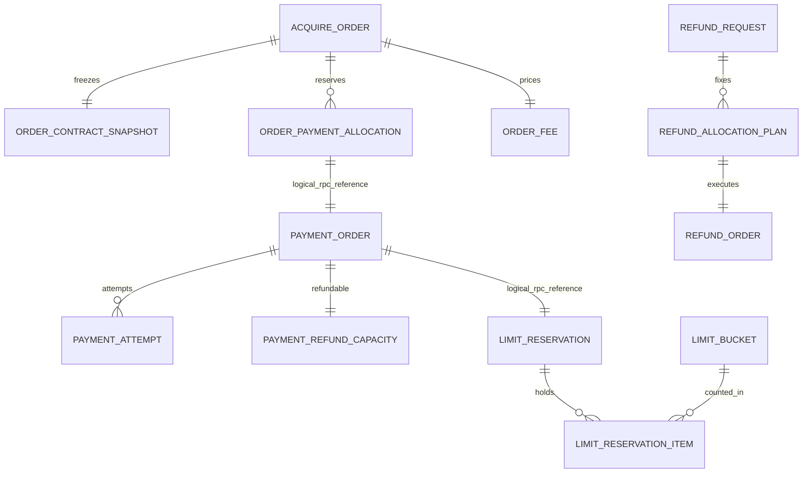

# 数据库详细设计

版本：v1.0 ｜ 日期：2026-10-20 ｜ 对应[详细设计](../DETAILED-DESIGN.md)

## 1. 物理约定与复用

六服务各自独立MySQL database、数据源、数据库账号与Flyway历史；开发可共用实例。使用InnoDB、utf8mb4_bin，唯一业务号大小写敏感；所有新表包含以下BaseDO字段。跨服务仅保存逻辑ID，不跨库JOIN或建外键。首期本地关系也以唯一键、锁和Gateway校验维护，不给恢复/历史保留引入级联删除。

| 公共列 | SQL类型/约束 | 语义 |
|---|---|---|
| `id` | `VARCHAR(64) NOT NULL` | 主键，IdGenerator生成，外部业务ID可显式指定 |
| `tenant_id` | `VARCHAR(64) NOT NULL` | 可信租户；商户业务唯一键按租户隔离 |
| `created_at` | `DATETIME(6) NOT NULL` | Asia/Shanghai创建时间 |
| `updated_at` | `DATETIME(6) NOT NULL` | Asia/Shanghai更新时间 |
| `deleted` | `TINYINT NOT NULL DEFAULT 0` | BaseDO标准字段；交易/累计事实禁止逻辑删除 |

`row_version`不是BaseDO自带字段，需要逐表显式声明；应用按行锁或条件更新维护。公共审计时间不等于业务事件发生时间。SQL草案没有把状态默认成成功：业务过程显式以INIT开始，在同事务内可以进入HELD/ACTIVE等已完成准备状态；框架Outbox/任务/合约生命周期保留原定义。

金额/计数为有符号BIGINT并校验非负，业务金额限制应小于long上限；货币缺省值在应用规范化成CNY，不依赖DB默认值。所有DATETIME(6)为Asia/Shanghai会话时间，SQL不做UTC默认转换。业务ID长度≤64，商户订单/退款号≤64、action/requestKey≤128，严格校验且不静默截断。大JSON/密文不建通用索引，字段大小另由请求/产品定义约束；关键状态/金额不只埋在JSON里。

交易、准入、幂等、门禁、成功退款、额度累计不允许通过deleted=1复用业务唯一键。索引不包含deleted；归档必须连同幂等/累计保留方案另行设计，当前不定保留期。租户插件之外，跨服务命令还要显式校验tenant/merchant归属。

技术全局键有明确例外：session token_hash，以及真实渠道账户作用域内的渠道请求号/交易号/退款号不带tenant前缀，防止同一外部资金事实被两个租户重复认领。它们不授予跨租户读取权限；冲突只返回脱敏错误，查证仍由服务端按真实绑定处理。

### 已有表直接复用

- customer：框架`merchant_profile`，不再建customer_profile。原有id、merchant_code、名称/行业/经营状态、row_version及联系资料按原迁移保留。
- product：框架`contract_catalog_version`、`merchant_contract`、`merchant_contract_revision`。catalog以kind区分产品/条件/组合/方案，不为同一概念复制多组产品表；合约generation与revision保持原语义。
- 各有需要的服务：database的sequence表、Outbox/Inbox、DelayedTask及其组件自有迁移。使用实际依赖所带脚本，不把本草案重复迁入组件表。
- 本文SQL仅包含收单平台新增表；已有表字段/迁移以框架源码为准。框架merchant/contract并没有OrderAdmission、子商户代操作、商户周期桶或退款表。

## 2. 表关系和约束

虚拟逻辑关系不表示跨库外键。支付/退款的成功事实与总额不受投影更新影响。主键id即实体ID；例如PaymentOrder.id=paymentId、AcquireOrder.id=orderId，不能再重复一列同义主键。

## 3. 新增表清单

### acquire（9张新增表）

DDL草案：[acquire.sql](schema/acquire.sql)。

#### `order_create_intent`

商户订单号的稳定创建意图；准入前不产生可支付订单。

以下为公共五字段以外的完整列。未写DEFAULT的列由业务显式写入；NULL只用于尚未产生的事实。

| 列 | 类型/约束 | 说明 |
|---|---|---|
| `payee_merchant_id` | `VARCHAR(64) NOT NULL` | 实际收款商户 |
| `merchant_order_no` | `VARCHAR(64) NOT NULL` | 商户业务订单号 |
| `order_id` | `VARCHAR(64) NOT NULL` | A0分配且重试不变的订单ID |
| `request_digest` | `CHAR(64) NOT NULL` | 规范化请求摘要 |
| `entry_mode` | `VARCHAR(24) NOT NULL` | CHECKOUT / DIRECT_PAY / ORDER |
| `intent_payload` | `JSON NOT NULL` | 非敏感规范化创建参数，含固定首笔动作（若有） |
| `state` | `VARCHAR(24) NOT NULL` | INIT / ADMITTED / COMPLETED / REJECTED / EXPIRED |
| `admission_id` | `VARCHAR(64) NULL` | product准入关联 |
| `materialize_before` | `DATETIME(6) NULL` | 未建单意图的恢复期限 |
| `result_code` | `VARCHAR(64) NULL` | 稳定的完成/拒绝码 |
| `row_version` | `BIGINT NOT NULL DEFAULT 0` | 本地CAS版本 |

约束/索引：

- `UNIQUE KEY uk_intent_merchant (tenant_id,payee_merchant_id,merchant_order_no)`
- `UNIQUE KEY uk_intent_order (tenant_id,order_id)`
- `KEY ix_intent_recovery (tenant_id,state,updated_at)`

#### `acquire_order`

固定总额订单；没有退款金额或退款状态字段。

以下为公共五字段以外的完整列。未写DEFAULT的列由业务显式写入；NULL只用于尚未产生的事实。

| 列 | 类型/约束 | 说明 |
|---|---|---|
| `payee_merchant_id` | `VARCHAR(64) NOT NULL` | 实际收款商户 |
| `merchant_order_no` | `VARCHAR(64) NOT NULL` | 商户业务订单号 |
| `admission_id` | `VARCHAR(64) NOT NULL` | 新单权威准入 |
| `contract_snapshot_id` | `VARCHAR(64) NOT NULL` | 不可变订单条款 |
| `subject` | `VARCHAR(200) NOT NULL` | 商户业务标题，不放付款码 |
| `currency` | `CHAR(3) NOT NULL` | 规范化后的币种，首期CNY |
| `amount_minor` | `BIGINT NOT NULL` | 固定应收总额 |
| `paid_amount_minor` | `BIGINT NOT NULL DEFAULT 0` | 累计正常成功付款，不因退款扣减 |
| `payment_reserved_minor` | `BIGINT NOT NULL DEFAULT 0` | HELD占用总额 |
| `successful_payment_count` | `INT NOT NULL DEFAULT 0` | 成功付款笔数 |
| `reserved_payment_count` | `INT NOT NULL DEFAULT 0` | HELD付款笔数 |
| `state` | `VARCHAR(24) NOT NULL` | INIT / PENDING / CLOSING / PAID / CLOSED |
| `admitted_at` | `DATETIME(6) NOT NULL` | 准入的业务受理时刻 |
| `order_due_at` | `DATETIME(6) NOT NULL` | 原条款等待策略检查点 |
| `deadline_version` | `BIGINT NOT NULL DEFAULT 1` | 延期/到期任务版本 |
| `close_epoch` | `BIGINT NOT NULL DEFAULT 0` | 父订单关闭门禁代次 |
| `paid_at` | `DATETIME(6) NULL` | 首次正常付清时间 |
| `closed_at` | `DATETIME(6) NULL` | 正常关闭完成时间 |
| `row_version` | `BIGINT NOT NULL DEFAULT 0` | 订单来源版本 |

约束/索引：

- `UNIQUE KEY uk_order_merchant (tenant_id,payee_merchant_id,merchant_order_no)`
- `UNIQUE KEY uk_order_admission (tenant_id,admission_id)`
- `KEY ix_order_payee_page (tenant_id,payee_merchant_id,created_at,id)`
- `KEY ix_order_due (tenant_id,state,order_due_at,id)`
- CHECK `amount_minor > 0`
- CHECK `paid_amount_minor >= 0 AND payment_reserved_minor >= 0`
- CHECK `paid_amount_minor <= amount_minor AND payment_reserved_minor <= amount_minor - paid_amount_minor`
- CHECK `successful_payment_count >= 0 AND reserved_payment_count >= 0`
- CHECK `state IN ('INIT','PENDING','CLOSING','PAID','CLOSED')`
- CHECK `state <> 'PAID' OR (paid_amount_minor = amount_minor AND payment_reserved_minor = 0)`

#### `order_contract_snapshot`

订单不可变条款副本；原单履约不依赖当前合约活跃。

以下为公共五字段以外的完整列。未写DEFAULT的列由业务显式写入；NULL只用于尚未产生的事实。

| 列 | 类型/约束 | 说明 |
|---|---|---|
| `order_id` | `VARCHAR(64) NOT NULL` | 逻辑关联订单 |
| `contract_id` | `VARCHAR(64) NOT NULL` | 框架商户合约ID |
| `contract_revision` | `INT NOT NULL` | 不可变修订号 |
| `contract_generation` | `BIGINT NOT NULL` | 准入时状态代次 |
| `snapshot_hash` | `VARCHAR(128) NOT NULL` | 原框架合约revision快照hash |
| `compiled_terms_hash` | `CHAR(64) NOT NULL` | typed条款编译后的独立canonical hash |
| `schema_version` | `INT NOT NULL` | 收单条款编译版本 |
| `configuration` | `JSON NOT NULL` | 编译后的强类型策略和各字段来源，不含密钥 |
| `admission_digest` | `CHAR(64) NOT NULL` | 准入绑定摘要 |

约束/索引：

- `UNIQUE KEY uk_snapshot_order (tenant_id,order_id)`

#### `order_payment_allocation`

订单内单笔金额/笔数占用及执行意图，付款结果逐笔幂等。

以下为公共五字段以外的完整列。未写DEFAULT的列由业务显式写入；NULL只用于尚未产生的事实。

| 列 | 类型/约束 | 说明 |
|---|---|---|
| `order_id` | `VARCHAR(64) NOT NULL` | 父订单 |
| `payment_id` | `VARCHAR(64) NOT NULL` | 稳定付款ID |
| `actor_scope` | `VARCHAR(128) NOT NULL` | 可信商户主体或sessionId，防跨调用者动作串用 |
| `action_key` | `VARCHAR(128) NOT NULL` | 一次用户意图，重放复用 |
| `request_digest` | `CHAR(64) NOT NULL` | 金额/币种/方式等不可变摘要 |
| `amount_minor` | `BIGINT NOT NULL` | 本笔占用金额 |
| `currency` | `CHAR(3) NOT NULL` | 与订单相同 |
| `state` | `VARCHAR(24) NOT NULL` | INIT / HELD / CONSUMED / RELEASED |
| `execution_intent` | `JSON NOT NULL` | 非敏感执行参数和inputRef，未准备输入时标明NEED_INPUT |
| `input_state` | `VARCHAR(24) NOT NULL` | NONE / NEED_INPUT / READY / EXPIRED |
| `payment_source_version` | `BIGINT NOT NULL DEFAULT 0` | 最后应用的该PaymentOrder来源版本 |
| `last_business_event_id` | `VARCHAR(64) NULL` | 结果事实ID |
| `consumed_at` | `DATETIME(6) NULL` | 正常成功累计时刻 |
| `released_at` | `DATETIME(6) NULL` | 确定无收款风险后释放时刻 |
| `row_version` | `BIGINT NOT NULL DEFAULT 0` | 占用CAS版本 |

约束/索引：

- `UNIQUE KEY uk_allocation_payment (tenant_id,payment_id)`
- `UNIQUE KEY uk_allocation_action (tenant_id,order_id,actor_scope,action_key)`
- `KEY ix_allocation_order (tenant_id,order_id,state,payment_id)`
- CHECK `amount_minor > 0`
- CHECK `state IN ('INIT','HELD','CONSUMED','RELEASED')`

#### `order_fee`

一次整单费用，退款不覆盖原计算。

以下为公共五字段以外的完整列。未写DEFAULT的列由业务显式写入；NULL只用于尚未产生的事实。

| 列 | 类型/约束 | 说明 |
|---|---|---|
| `order_id` | `VARCHAR(64) NOT NULL` | 原订单 |
| `fee_type` | `VARCHAR(24) NOT NULL` | ACQUIRING |
| `currency` | `CHAR(3) NOT NULL` | 费用币种，首期同CNY |
| `base_amount_minor` | `BIGINT NOT NULL` | 固定订单总额 |
| `fee_amount_minor` | `BIGINT NOT NULL` | 创建时计算并冻结F |
| `fee_rule_snapshot` | `JSON NOT NULL` | 费率/固定费/舍入/保底/封顶及版本 |
| `refund_basis_version` | `BIGINT NOT NULL DEFAULT 0` | 最新完整退款汇总版本，费用未确认时也保留 |
| `refund_basis_minor` | `BIGINT NOT NULL DEFAULT 0` | 最新成功退款累计依据 |
| `adjusted_amount_minor` | `BIGINT NOT NULL DEFAULT 0` | 已累计退费，受原确认F上界约束 |
| `state` | `VARCHAR(24) NOT NULL` | INIT / CONFIRMED |
| `confirmed_at` | `DATETIME(6) NULL` | PAID时唯一确认 |
| `row_version` | `BIGINT NOT NULL DEFAULT 0` | 费用调整并发协调版本 |

约束/索引：

- `UNIQUE KEY uk_fee_order_type (tenant_id,order_id,fee_type)`
- CHECK `base_amount_minor > 0 AND fee_amount_minor >= 0`
- CHECK `refund_basis_minor >= 0 AND refund_basis_minor <= base_amount_minor`
- CHECK `adjusted_amount_minor >= 0 AND adjusted_amount_minor <= fee_amount_minor`

#### `fee_adjustment`

独立退费记录；累计计算后生成差额，不更新原订单。

以下为公共五字段以外的完整列。未写DEFAULT的列由业务显式写入；NULL只用于尚未产生的事实。

| 列 | 类型/约束 | 说明 |
|---|---|---|
| `order_id` | `VARCHAR(64) NOT NULL` | 查询关联 |
| `fee_id` | `VARCHAR(64) NOT NULL` | 原已确认费用 |
| `refund_request_id` | `VARCHAR(64) NULL` | 若由单次退款汇总触发则关联申请；费用确认补算可为空 |
| `trigger_key` | `VARCHAR(128) NOT NULL` | FEE_CONFIRMED或REFUND_SUMMARY:version等稳定触发身份 |
| `source_event_id` | `VARCHAR(64) NOT NULL` | 触发事实ID：退款汇总或费用确认事实 |
| `source_version` | `BIGINT NOT NULL` | payment退款汇总版本 |
| `adjustment_minor` | `BIGINT NOT NULL` | 本次退费正数，可为0 |
| `cumulative_refunded_minor` | `BIGINT NOT NULL` | 此版本退款累计用于计算 |
| `rule_snapshot` | `JSON NOT NULL` | 原退费政策和本次计算依据 |

约束/索引：

- `UNIQUE KEY uk_fee_adjust_trigger (tenant_id,fee_id,trigger_key)`
- `KEY ix_fee_adjust_order (tenant_id,order_id,created_at,id)`
- CHECK `adjustment_minor >= 0`

#### `checkout_session`

订单scope会话；只保存token摘要，不是消费者登录态。

以下为公共五字段以外的完整列。未写DEFAULT的列由业务显式写入；NULL只用于尚未产生的事实。

| 列 | 类型/约束 | 说明 |
|---|---|---|
| `order_id` | `VARCHAR(64) NOT NULL` | 授权订单 |
| `payee_merchant_id` | `VARCHAR(64) NOT NULL` | 只读绑定 |
| `request_key` | `VARCHAR(128) NOT NULL` | 续发命令幂等键 |
| `request_digest` | `CHAR(64) NOT NULL` | 创建会话约束摘要 |
| `token_hash` | `CHAR(64) NOT NULL` | 高熵token的摘要 |
| `token_nonce` | `CHAR(64) NOT NULL` | 创建时安全随机nonce的Hex编码，固定不变 |
| `token_key_ref` | `VARCHAR(128) NOT NULL` | 服务器HMAC Secret引用，不是密钥值 |
| `token_key_version` | `VARCHAR(64) NOT NULL` | 可重建同一短期token的密钥版本 |
| `state` | `VARCHAR(24) NOT NULL` | INIT / ACTIVE / COMPLETED / CANCELLED / EXPIRED |
| `expires_at` | `DATETIME(6) NOT NULL` | 会话过期时间 |
| `allowed_origin` | `VARCHAR(512) NULL` | SDK允许origin，来自可信配置 |
| `scope_snapshot` | `JSON NOT NULL` | 允许操作/方式/金额约束，不允许浏览器扩大 |
| `row_version` | `BIGINT NOT NULL DEFAULT 0` | 会话版本 |

约束/索引：

- `UNIQUE KEY uk_session_request (tenant_id,order_id,request_key)`
- `UNIQUE KEY uk_session_token (token_hash)`
- `KEY ix_session_order (tenant_id,order_id,state)`

#### `order_command_receipt`

关闭/延期等订单命令回执；不替代业务表约束。

以下为公共五字段以外的完整列。未写DEFAULT的列由业务显式写入；NULL只用于尚未产生的事实。

| 列 | 类型/约束 | 说明 |
|---|---|---|
| `order_id` | `VARCHAR(64) NOT NULL` | 命令对象 |
| `command_type` | `VARCHAR(32) NOT NULL` | CLOSE / EXTEND / SESSION_CREATE |
| `request_key` | `VARCHAR(128) NOT NULL` | 调用方命令键 |
| `request_digest` | `CHAR(64) NOT NULL` | 命令摘要 |
| `result_payload` | `JSON NOT NULL` | 非敏感已提交结果；会话只记ID，不记token明文 |

约束/索引：

- `UNIQUE KEY uk_order_command (tenant_id,order_id,command_type,request_key)`

#### `merchant_notification_delivery`

该服务独立的商户语义通知投递；相同事件重试body不变。

以下为公共五字段以外的完整列。未写DEFAULT的列由业务显式写入；NULL只用于尚未产生的事实。

| 列 | 类型/约束 | 说明 |
|---|---|---|
| `business_event_id` | `VARCHAR(64) NOT NULL` | 商户去重eventId，与底层outboxId区分 |
| `aggregate_id` | `VARCHAR(64) NOT NULL` | 订单/退款申请等 |
| `aggregate_version` | `BIGINT NOT NULL` | 聚合业务版本 |
| `event_type` | `VARCHAR(64) NOT NULL` | PaymentSucceeded / OrderFullyPaid / OrderClosed / RefundSucceeded等 |
| `payee_merchant_id` | `VARCHAR(64) NOT NULL` | 通知归属 |
| `target_ref` | `VARCHAR(128) NOT NULL` | 经审核的不可变目标版本引用 |
| `key_ref` | `VARCHAR(128) NOT NULL` | 原配置密钥引用/版本，禁止存私钥 |
| `body_bytes` | `MEDIUMBLOB NOT NULL` | 固定UTF-8签名原始body字节，允许脱敏非秘密载荷 |
| `body_digest` | `CHAR(64) NOT NULL` | 原body摘要 |
| `policy_snapshot` | `JSON NOT NULL` | 超时/重试/窗口/签名策略 |
| `state` | `VARCHAR(24) NOT NULL` | INIT / PENDING / ACKED / EXHAUSTED |
| `attempt_count` | `INT NOT NULL DEFAULT 0` | 投递尝试次数 |
| `next_attempt_at` | `DATETIME(6) NULL` | 当前投递调度 |
| `acknowledged_at` | `DATETIME(6) NULL` | 语义ACK成功 |
| `row_version` | `BIGINT NOT NULL DEFAULT 0` | 投递状态CAS |

约束/索引：

- `UNIQUE KEY uk_notification_event_target (tenant_id,business_event_id,target_ref)`
- `KEY ix_notification_pending (tenant_id,state,next_attempt_at,id)`

### payment（15张新增表）

DDL草案：[payment.sql](schema/payment.sql)。

#### `payment_parent_gate`

父订单执行门禁及退款规划串行点，不是acquire订单副本。

以下为公共五字段以外的完整列。未写DEFAULT的列由业务显式写入；NULL只用于尚未产生的事实。

| 列 | 类型/约束 | 说明 |
|---|---|---|
| `order_id` | `VARCHAR(64) NOT NULL` | 即使PaymentOrder尚未创建也能先关闭 |
| `payee_merchant_id` | `VARCHAR(64) NOT NULL` | 固定收款主体 |
| `state` | `VARCHAR(24) NOT NULL` | INIT / OPEN / FENCED |
| `close_epoch` | `BIGINT NOT NULL DEFAULT 0` | 已应用最高关闭代次 |
| `refund_summary_version` | `BIGINT NOT NULL DEFAULT 0` | 退款完整汇总来源版本 |
| `refund_summary` | `JSON NOT NULL` | 累计成功/预占退款及申请进度，只读汇总事实 |
| `row_version` | `BIGINT NOT NULL DEFAULT 0` | 门禁CAS |

约束/索引：

- `UNIQUE KEY uk_parent_gate (tenant_id,order_id)`

#### `payment_gate`

单付款取消tombstone，先取消后到执行命令也拒绝。

以下为公共五字段以外的完整列。未写DEFAULT的列由业务显式写入；NULL只用于尚未产生的事实。

| 列 | 类型/约束 | 说明 |
|---|---|---|
| `order_id` | `VARCHAR(64) NOT NULL` | 父订单 |
| `payment_id` | `VARCHAR(64) NOT NULL` | 可在付款尚未创建时写入 |
| `state` | `VARCHAR(24) NOT NULL` | INIT / OPEN / FENCED |
| `fence_epoch` | `BIGINT NOT NULL DEFAULT 0` | 单笔门禁代次 |
| `reason_code` | `VARCHAR(64) NULL` | 取消/无输入等稳定原因 |
| `row_version` | `BIGINT NOT NULL DEFAULT 0` | CAS版本 |

约束/索引：

- `UNIQUE KEY uk_payment_gate (tenant_id,payment_id)`
- `KEY ix_payment_gate_order (tenant_id,order_id)`

#### `payment_order`

单笔不可变应付与权威资金成功事实，不承担退款进度。

以下为公共五字段以外的完整列。未写DEFAULT的列由业务显式写入；NULL只用于尚未产生的事实。

| 列 | 类型/约束 | 说明 |
|---|---|---|
| `order_id` | `VARCHAR(64) NOT NULL` | 原收单订单，非唯一 |
| `allocation_id` | `VARCHAR(64) NOT NULL` | acquire占用凭证 |
| `admission_id` | `VARCHAR(64) NOT NULL` | 原准入 |
| `payee_merchant_id` | `VARCHAR(64) NOT NULL` | 实际收款商户 |
| `amount_minor` | `BIGINT NOT NULL` | 固定本笔付款金额 |
| `currency` | `CHAR(3) NOT NULL` | 与占用一致 |
| `request_digest` | `CHAR(64) NOT NULL` | 接受执行意图摘要 |
| `state` | `VARCHAR(24) NOT NULL` | INIT / PROCESSING / UNKNOWN / CLOSING / SUCCEEDED / FAILED / CLOSED |
| `active_attempt_id` | `VARCHAR(64) NULL` | 锁下替换，禁止并行尝试 |
| `successful_attempt_id` | `VARCHAR(64) NULL` | 正常成功唯一来源 |
| `limit_operation_id` | `VARCHAR(64) NOT NULL` | 本PaymentOrder固定限额operation |
| `initiated_at` | `DATETIME(6) NOT NULL` | 首次受理归桶时间，不随重试变化 |
| `succeeded_at` | `DATETIME(6) NULL` | 付款成功事实时刻 |
| `terminal_evidence_id` | `VARCHAR(64) NULL` | 终结的可信证据 |
| `order_terms` | `JSON NOT NULL` | order总额/原退款/通知/限额/合约hash等可信必要快照 |
| `row_version` | `BIGINT NOT NULL DEFAULT 0` | 付款来源版本 |

约束/索引：

- `UNIQUE KEY uk_payment_allocation (tenant_id,allocation_id)`
- `UNIQUE KEY uk_payment_limit_op (tenant_id,limit_operation_id)`
- `KEY ix_payment_order (tenant_id,order_id,id)`
- `KEY ix_payment_payee_page (tenant_id,payee_merchant_id,created_at,id)`
- CHECK `amount_minor > 0`

#### `payment_attempt`

一次渠道尝试；稳定请求号、绑定revision、提交门禁和查证。

以下为公共五字段以外的完整列。未写DEFAULT的列由业务显式写入；NULL只用于尚未产生的事实。

| 列 | 类型/约束 | 说明 |
|---|---|---|
| `payment_id` | `VARCHAR(64) NOT NULL` | 所属付款 |
| `attempt_no` | `INT NOT NULL` | 递增序号 |
| `channel` | `VARCHAR(24) NOT NULL` | ALIPAY / WECHAT / UNIONPAY |
| `access_mode` | `VARCHAR(24) NOT NULL` | DIRECT / SERVICE_PROVIDER |
| `payment_method` | `VARCHAR(32) NOT NULL` | PAYMENT_CODE / QR / JSAPI / H5 / APP |
| `binding_revision_id` | `VARCHAR(64) NOT NULL` | 冻结实际收款/服务商/授权身份 |
| `account_scope_hash` | `CHAR(64) NOT NULL` | 规范化真实渠道账户作用域摘要 |
| `channel_request_no` | `VARCHAR(64) NOT NULL` | 此attempt的稳定商户请求号 |
| `channel_transaction_no` | `VARCHAR(128) NULL` | 可信成功后登记，并取得交易号claim |
| `state` | `VARCHAR(24) NOT NULL` | INIT / SUBMITTING / PENDING / UNKNOWN / SUCCEEDED / FAILED / CLOSED |
| `input_ref` | `VARCHAR(64) NULL` | 短期敏感输入引用 |
| `execution_epoch` | `BIGINT NOT NULL DEFAULT 0` | limit及本地执行代次 |
| `execution_permit_hash` | `CHAR(64) NULL` | 已绑定许可摘要，不含可伪造身份 |
| `risk_decision` | `VARCHAR(24) NOT NULL` | DEFAULT_ALLOW / ALLOW / DENY |
| `risk_reason` | `VARCHAR(64) NOT NULL` | NOT_CONNECTED / TIMEOUT等真实来源 |
| `risk_consultation_ref` | `VARCHAR(128) NULL` | 后续外部咨询关联 |
| `action_type` | `VARCHAR(24) NOT NULL` | NONE / DISPLAY_QR / REDIRECT / INVOKE_JSAPI / INVOKE_APP / WAIT |
| `action_payload` | `JSON NULL` | 受限支付参数；若含敏感字段则只保存加密引用 |
| `action_expires_at` | `DATETIME(6) NULL` | 渠道参数期限 |
| `next_query_at` | `DATETIME(6) NULL` | 查证索引，任务仍为权威调度 |
| `query_sequence` | `BIGINT NOT NULL DEFAULT 0` | 新查证任务唯一序号 |
| `row_version` | `BIGINT NOT NULL DEFAULT 0` | 尝试版本 |

约束/索引：

- `UNIQUE KEY uk_attempt_no (tenant_id,payment_id,attempt_no)`
- `UNIQUE KEY uk_attempt_request (channel,account_scope_hash,channel_request_no)`
- `KEY ix_attempt_query (tenant_id,state,next_query_at,id)`
- CHECK `attempt_no > 0`

#### `channel_transaction_claim`

同一渠道实际交易号不得被两个付款成功认领。

以下为公共五字段以外的完整列。未写DEFAULT的列由业务显式写入；NULL只用于尚未产生的事实。

| 列 | 类型/约束 | 说明 |
|---|---|---|
| `channel` | `VARCHAR(24) NOT NULL` | 规范渠道 |
| `account_scope_hash` | `CHAR(64) NOT NULL` | 渠道真实唯一范围；不以易轮换凭证版本代替 |
| `channel_transaction_no` | `VARCHAR(128) NOT NULL` | 渠道交易号 |
| `payment_id` | `VARCHAR(64) NOT NULL` | 正常资金事实归属 |
| `attempt_id` | `VARCHAR(64) NOT NULL` | 认领尝试 |

约束/索引：

- `UNIQUE KEY uk_channel_txn (channel,account_scope_hash,channel_transaction_no)`
- `UNIQUE KEY uk_claim_attempt (tenant_id,attempt_id)`

#### `channel_merchant_binding`

当前渠道收款绑定指针，与平台父子商户关系分开。

以下为公共五字段以外的完整列。未写DEFAULT的列由业务显式写入；NULL只用于尚未产生的事实。

| 列 | 类型/约束 | 说明 |
|---|---|---|
| `payee_merchant_id` | `VARCHAR(64) NOT NULL` | 实际商户/子商户 |
| `binding_code` | `VARCHAR(64) NOT NULL` | 商户内稳定绑定编码 |
| `channel` | `VARCHAR(24) NOT NULL` | 渠道 |
| `access_mode` | `VARCHAR(24) NOT NULL` | DIRECT / SERVICE_PROVIDER |
| `state` | `VARCHAR(24) NOT NULL` | INIT / ACTIVE / SUSPENDED / REVOKED |
| `current_revision_id` | `VARCHAR(64) NOT NULL` | 当前不可变revision |
| `row_version` | `BIGINT NOT NULL DEFAULT 0` | 管理更新CAS |

约束/索引：

- `UNIQUE KEY uk_binding_code (tenant_id,payee_merchant_id,binding_code)`
- `KEY ix_binding_route (tenant_id,payee_merchant_id,channel,access_mode,state)`

#### `channel_binding_revision`

不可变的类型化账户身份；凭证轮换不改变原实际收款主体。

以下为公共五字段以外的完整列。未写DEFAULT的列由业务显式写入；NULL只用于尚未产生的事实。

| 列 | 类型/约束 | 说明 |
|---|---|---|
| `binding_id` | `VARCHAR(64) NOT NULL` | 所属绑定 |
| `revision` | `INT NOT NULL` | 版本 |
| `identity_schema` | `VARCHAR(32) NOT NULL` | ALIPAY_DIRECT_V1等已实现类型 |
| `identity_payload` | `JSON NOT NULL` | 各渠道实际服务商/商户/子商户/app作用域，敏感授权仅引用 |
| `account_scope_hash` | `CHAR(64) NOT NULL` | 规范身份范围 |
| `credential_ref` | `VARCHAR(128) NOT NULL` | KMS/Secret中的版本化引用 |
| `credential_version` | `VARCHAR(64) NOT NULL` | 凭证版本 |
| `capabilities` | `JSON NOT NULL` | 已开通method/currency/原路退款/关闭语义 |
| `identity_hash` | `CHAR(64) NOT NULL` | 冻结非秘密身份摘要 |

约束/索引：

- `UNIQUE KEY uk_binding_revision (tenant_id,binding_id,revision)`

#### `payment_input_secret`

付款码/openId等必要参数的短期加密存储，非用户资源。

以下为公共五字段以外的完整列。未写DEFAULT的列由业务显式写入；NULL只用于尚未产生的事实。

| 列 | 类型/约束 | 说明 |
|---|---|---|
| `payment_id` | `VARCHAR(64) NOT NULL` | 固定绑定付款 |
| `input_key` | `VARCHAR(128) NOT NULL` | 输入准备幂等键 |
| `input_type` | `VARCHAR(32) NOT NULL` | PAYMENT_CODE / CHANNEL_PAYER等 |
| `input_digest` | `CHAR(64) NOT NULL` | 服务端keyed摘要，用于重放比较 |
| `ciphertext` | `MEDIUMBLOB NULL` | 短期密文；到期销毁密文后保留幂等壳 |
| `key_ref` | `VARCHAR(128) NOT NULL` | 不可变输入保护方案版本引用，解析加密与keyed摘要密钥版本，重试不换摘要key |
| `expires_at` | `DATETIME(6) NOT NULL` | 可使用期限，不作为支付失败证据 |
| `state` | `VARCHAR(24) NOT NULL` | INIT / READY / EXPIRED / DESTROYED |

约束/索引：

- `UNIQUE KEY uk_input_key (tenant_id,payment_id,input_key)`
- `KEY ix_input_expiry (tenant_id,state,expires_at,id)`

#### `channel_receipt`

已验签的渠道证据/通知摘要；先事实落库再渠道ACK。

以下为公共五字段以外的完整列。未写DEFAULT的列由业务显式写入；NULL只用于尚未产生的事实。

| 列 | 类型/约束 | 说明 |
|---|---|---|
| `channel` | `VARCHAR(24) NOT NULL` | 渠道 |
| `account_scope_hash` | `CHAR(64) NOT NULL` | 已验证的账户范围 |
| `receipt_key` | `VARCHAR(128) NOT NULL` | 渠道通知ID或稳定规范化证据键 |
| `receipt_type` | `VARCHAR(24) NOT NULL` | PAYMENT / REFUND / QUERY / CLOSE |
| `payment_id` | `VARCHAR(64) NULL` | 已解析付款 |
| `attempt_id` | `VARCHAR(64) NULL` | 已解析尝试 |
| `refund_id` | `VARCHAR(64) NULL` | 已解析退款 |
| `payload_digest` | `CHAR(64) NOT NULL` | 原始报文摘要用于证据追溯 |
| `facts_digest` | `CHAR(64) NOT NULL` | 规范化资金事实摘要，用于同通知ID的实质冲突判断 |
| `verified_facts` | `JSON NOT NULL` | 收款身份/金额/币种/结果等脱敏事实 |
| `encrypted_evidence_ref` | `VARCHAR(128) NULL` | 必要原始报文的受控加密引用 |
| `received_at` | `DATETIME(6) NOT NULL` | 本地接收时间 |

约束/索引：

- `UNIQUE KEY uk_receipt (tenant_id,channel,account_scope_hash,receipt_key)`
- `KEY ix_receipt_payment (tenant_id,payment_id,received_at,id)`
- `KEY ix_receipt_refund (tenant_id,refund_id,received_at,id)`

#### `payment_anomaly`

关闭后异常收款、金额不符等独立差错，不倒改正常终态。

以下为公共五字段以外的完整列。未写DEFAULT的列由业务显式写入；NULL只用于尚未产生的事实。

| 列 | 类型/约束 | 说明 |
|---|---|---|
| `order_id` | `VARCHAR(64) NOT NULL` | 逻辑关联 |
| `payment_id` | `VARCHAR(64) NULL` | 本地付款 |
| `receipt_id` | `VARCHAR(64) NOT NULL` | 可信证据 |
| `anomaly_type` | `VARCHAR(64) NOT NULL` | LATE_SUCCESS / AMOUNT_MISMATCH / CONFLICT等 |
| `state` | `VARCHAR(24) NOT NULL` | INIT / INVESTIGATING / RESOLVED |
| `resolution_ref` | `VARCHAR(128) NULL` | 独立查证/补偿关联 |
| `row_version` | `BIGINT NOT NULL DEFAULT 0` | 处置CAS |

约束/索引：

- `UNIQUE KEY uk_anomaly_receipt_type (tenant_id,receipt_id,anomaly_type)`
- `KEY ix_anomaly_pending (tenant_id,state,created_at,id)`

#### `payment_refund_capacity`

独立可退容量；退款不更新原成功PaymentOrder。

以下为公共五字段以外的完整列。未写DEFAULT的列由业务显式写入；NULL只用于尚未产生的事实。

| 列 | 类型/约束 | 说明 |
|---|---|---|
| `order_id` | `VARCHAR(64) NOT NULL` | 规划范围 |
| `payment_id` | `VARCHAR(64) NOT NULL` | 原成功付款 |
| `succeeded_at` | `DATETIME(6) NOT NULL` | FIFO固定排序依据 |
| `succeeded_amount_minor` | `BIGINT NOT NULL` | 原成功付款金额，不随退款变化 |
| `refunded_minor` | `BIGINT NOT NULL DEFAULT 0` | 成功退款累计 |
| `reserved_minor` | `BIGINT NOT NULL DEFAULT 0` | 在途/UNKNOWN退款预占 |
| `currency` | `CHAR(3) NOT NULL` | 原币种 |
| `row_version` | `BIGINT NOT NULL DEFAULT 0` | 可退上界锁/CAS |

约束/索引：

- `UNIQUE KEY uk_refund_capacity_payment (tenant_id,payment_id)`
- `KEY ix_refund_capacity_fifo (tenant_id,order_id,succeeded_at,payment_id)`
- CHECK `succeeded_amount_minor > 0 AND refunded_minor >= 0 AND reserved_minor >= 0`
- CHECK `refunded_minor <= succeeded_amount_minor AND reserved_minor <= succeeded_amount_minor - refunded_minor`

#### `refund_request`

独立商户退款申请及固定总额，不在acquire重复落申请。

以下为公共五字段以外的完整列。未写DEFAULT的列由业务显式写入；NULL只用于尚未产生的事实。

| 列 | 类型/约束 | 说明 |
|---|---|---|
| `order_id` | `VARCHAR(64) NOT NULL` | 原订单 |
| `payee_merchant_id` | `VARCHAR(64) NOT NULL` | 实际收款商户 |
| `merchant_refund_no` | `VARCHAR(64) NOT NULL` | 商户退款意图编号 |
| `request_digest` | `CHAR(64) NOT NULL` | 原订单/金额/策略/显式分配摘要 |
| `amount_minor` | `BIGINT NOT NULL` | 本次申请总额 |
| `currency` | `CHAR(3) NOT NULL` | 原币种 |
| `allocation_policy` | `VARCHAR(24) NOT NULL` | 首期FIFO，LIFO/EXPLICIT需实现后启用 |
| `plan_version` | `INT NOT NULL` | 固定计划版本，首期1 |
| `state` | `VARCHAR(24) NOT NULL` | INIT / PROCESSING / SUCCEEDED / PARTIAL_SUCCEEDED / FAILED |
| `succeeded_minor` | `BIGINT NOT NULL DEFAULT 0` | 本申请子项已成功累计 |
| `failed_minor` | `BIGINT NOT NULL DEFAULT 0` | 本申请确定失败累计 |
| `unknown_count` | `INT NOT NULL DEFAULT 0` | 未知子项数量，未收敛不终结 |
| `refund_terms` | `JSON NOT NULL` | 原冻结退款/恢复额度/通知策略 |
| `row_version` | `BIGINT NOT NULL DEFAULT 0` | 申请来源版本 |

约束/索引：

- `UNIQUE KEY uk_refund_merchant (tenant_id,payee_merchant_id,merchant_refund_no)`
- `KEY ix_refund_request_order (tenant_id,order_id,created_at,id)`
- CHECK `amount_minor > 0 AND succeeded_minor >= 0 AND failed_minor >= 0`
- CHECK `succeeded_minor <= amount_minor AND failed_minor <= amount_minor - succeeded_minor`

#### `refund_allocation_plan`

每个固定子项的原付款/金额/序号，重试不重新分配。

以下为公共五字段以外的完整列。未写DEFAULT的列由业务显式写入；NULL只用于尚未产生的事实。

| 列 | 类型/约束 | 说明 |
|---|---|---|
| `refund_request_id` | `VARCHAR(64) NOT NULL` | 所属申请 |
| `plan_version` | `INT NOT NULL` | 固定版本 |
| `sequence_no` | `INT NOT NULL` | FIFO计划序号 |
| `payment_id` | `VARCHAR(64) NOT NULL` | 原付款 |
| `refund_id` | `VARCHAR(64) NOT NULL` | 稳定执行子退款 |
| `amount_minor` | `BIGINT NOT NULL` | 原付款分配额 |

约束/索引：

- `UNIQUE KEY uk_refund_plan_seq (tenant_id,refund_request_id,plan_version,sequence_no)`
- `UNIQUE KEY uk_refund_plan_payment (tenant_id,refund_request_id,plan_version,payment_id)`
- `UNIQUE KEY uk_refund_plan_child (tenant_id,refund_id)`
- CHECK `amount_minor > 0`

#### `refund_order`

每笔原路退款的独立执行事实，同一子项永远复用原请求号。

以下为公共五字段以外的完整列。未写DEFAULT的列由业务显式写入；NULL只用于尚未产生的事实。

| 列 | 类型/约束 | 说明 |
|---|---|---|
| `refund_request_id` | `VARCHAR(64) NOT NULL` | 所属申请 |
| `payment_id` | `VARCHAR(64) NOT NULL` | 原付款 |
| `original_attempt_id` | `VARCHAR(64) NOT NULL` | 原成功尝试 |
| `binding_revision_id` | `VARCHAR(64) NOT NULL` | 原渠道收款身份 |
| `channel` | `VARCHAR(24) NOT NULL` | 原渠道 |
| `account_scope_hash` | `CHAR(64) NOT NULL` | 原账户唯一范围 |
| `channel_refund_no` | `VARCHAR(64) NOT NULL` | 固定子退款请求号 |
| `channel_refund_transaction_no` | `VARCHAR(128) NULL` | 渠道退款流水 |
| `amount_minor` | `BIGINT NOT NULL` | 子退款固定金额 |
| `currency` | `CHAR(3) NOT NULL` | 原币种 |
| `state` | `VARCHAR(24) NOT NULL` | INIT / PROCESSING / UNKNOWN / SUCCEEDED / FAILED |
| `terminal_evidence_id` | `VARCHAR(64) NULL` | 确定结果证据 |
| `next_query_at` | `DATETIME(6) NULL` | 恢复查证时间 |
| `query_sequence` | `BIGINT NOT NULL DEFAULT 0` | 任务去重序号 |
| `succeeded_at` | `DATETIME(6) NULL` | 成功退款事实时刻 |
| `row_version` | `BIGINT NOT NULL DEFAULT 0` | 子退款来源版本 |

约束/索引：

- `UNIQUE KEY uk_refund_channel_no (channel,account_scope_hash,channel_refund_no)`
- `KEY ix_refund_child_request (tenant_id,refund_request_id,id)`
- `KEY ix_refund_query (tenant_id,state,next_query_at,id)`
- CHECK `amount_minor > 0`

#### `merchant_notification_delivery`

该服务独立的商户语义通知投递；相同事件重试body不变。

以下为公共五字段以外的完整列。未写DEFAULT的列由业务显式写入；NULL只用于尚未产生的事实。

| 列 | 类型/约束 | 说明 |
|---|---|---|
| `business_event_id` | `VARCHAR(64) NOT NULL` | 商户去重eventId，与底层outboxId区分 |
| `aggregate_id` | `VARCHAR(64) NOT NULL` | 订单/退款申请等 |
| `aggregate_version` | `BIGINT NOT NULL` | 聚合业务版本 |
| `event_type` | `VARCHAR(64) NOT NULL` | PaymentSucceeded / OrderFullyPaid / OrderClosed / RefundSucceeded等 |
| `payee_merchant_id` | `VARCHAR(64) NOT NULL` | 通知归属 |
| `target_ref` | `VARCHAR(128) NOT NULL` | 经审核的不可变目标版本引用 |
| `key_ref` | `VARCHAR(128) NOT NULL` | 原配置密钥引用/版本，禁止存私钥 |
| `body_bytes` | `MEDIUMBLOB NOT NULL` | 固定UTF-8签名原始body字节，允许脱敏非秘密载荷 |
| `body_digest` | `CHAR(64) NOT NULL` | 原body摘要 |
| `policy_snapshot` | `JSON NOT NULL` | 超时/重试/窗口/签名策略 |
| `state` | `VARCHAR(24) NOT NULL` | INIT / PENDING / ACKED / EXHAUSTED |
| `attempt_count` | `INT NOT NULL DEFAULT 0` | 投递尝试次数 |
| `next_attempt_at` | `DATETIME(6) NULL` | 当前投递调度 |
| `acknowledged_at` | `DATETIME(6) NULL` | 语义ACK成功 |
| `row_version` | `BIGINT NOT NULL DEFAULT 0` | 投递状态CAS |

约束/索引：

- `UNIQUE KEY uk_notification_event_target (tenant_id,business_event_id,target_ref)`
- `KEY ix_notification_pending (tenant_id,state,next_attempt_at,id)`

### customer（2张新增表）

DDL草案：[customer.sql](schema/customer.sql)。

#### `merchant_relationship`

平台父子关系；不代表渠道服务商关系或完整代操作权限。

以下为公共五字段以外的完整列。未写DEFAULT的列由业务显式写入；NULL只用于尚未产生的事实。

| 列 | 类型/约束 | 说明 |
|---|---|---|
| `parent_merchant_id` | `VARCHAR(64) NOT NULL` | 平台父商户 |
| `child_merchant_id` | `VARCHAR(64) NOT NULL` | 独立实际商户 |
| `relation_type` | `VARCHAR(24) NOT NULL` | MANAGEMENT |
| `state` | `VARCHAR(24) NOT NULL` | INIT / ACTIVE / REVOKED |
| `valid_from` | `DATETIME(6) NOT NULL` | 生效区间 |
| `valid_to` | `DATETIME(6) NULL` | 空表示无固定终点 |
| `row_version` | `BIGINT NOT NULL DEFAULT 0` | 关系版本 |

约束/索引：

- `UNIQUE KEY uk_merchant_relationship (tenant_id,parent_merchant_id,child_merchant_id,relation_type)`
- `KEY ix_relationship_child (tenant_id,child_merchant_id,state)`
- CHECK `parent_merchant_id <> child_merchant_id`

#### `merchant_action_grant`

谁能代表哪个实际商户执行什么动作，按项授予。

以下为公共五字段以外的完整列。未写DEFAULT的列由业务显式写入；NULL只用于尚未产生的事实。

| 列 | 类型/约束 | 说明 |
|---|---|---|
| `principal_type` | `VARCHAR(24) NOT NULL` | MERCHANT_APP / MERCHANT / OPERATOR |
| `principal_id` | `VARCHAR(128) NOT NULL` | 认证系统稳定主体 |
| `payee_merchant_id` | `VARCHAR(64) NOT NULL` | 被授权商户 |
| `relationship_id` | `VARCHAR(64) NULL` | 代子商户操作时的关系依据 |
| `action` | `VARCHAR(32) NOT NULL` | CREATE_ORDER / REFUND / QUERY / MANAGE_BINDING等 |
| `state` | `VARCHAR(24) NOT NULL` | INIT / ACTIVE / REVOKED |
| `valid_from` | `DATETIME(6) NOT NULL` | 有效起点 |
| `valid_to` | `DATETIME(6) NULL` | 有效终点 |
| `row_version` | `BIGINT NOT NULL DEFAULT 0` | 授权版本 |

约束/索引：

- `UNIQUE KEY uk_merchant_action (tenant_id,principal_type,principal_id,payee_merchant_id,action)`
- `KEY ix_grant_payee (tenant_id,payee_merchant_id,state)`

### product（2张新增表）

DDL草案：[product.sql](schema/product.sql)。

#### `order_admission`

当前合约的新订单持久准入；同orderId重试先回原决定。

以下为公共五字段以外的完整列。未写DEFAULT的列由业务显式写入；NULL只用于尚未产生的事实。

| 列 | 类型/约束 | 说明 |
|---|---|---|
| `order_id` | `VARCHAR(64) NOT NULL` | acquire预先固定的订单ID |
| `payee_merchant_id` | `VARCHAR(64) NOT NULL` | 真实商户 |
| `request_digest` | `CHAR(64) NOT NULL` | 订单不可变创建摘要 |
| `contract_id` | `VARCHAR(64) NULL` | 允许时必填 |
| `contract_revision` | `INT NULL` | 允许时必填 |
| `contract_generation` | `BIGINT NULL` | 截止点代次 |
| `merchant_fact_version` | `BIGINT NULL` | 准入读取到的customer事实版本 |
| `state` | `VARCHAR(24) NOT NULL` | INIT / ADMITTED / DENIED |
| `reason_code` | `VARCHAR(64) NOT NULL` | 稳定决定原因 |
| `admitted_at` | `DATETIME(6) NULL` | P1决策时间 |
| `materialize_before` | `DATETIME(6) NULL` | 只限制尚未落库的新单意图 |
| `snapshot_hash` | `VARCHAR(128) NULL` | 允许结果的原合约hash |
| `compiled_terms_hash` | `CHAR(64) NULL` | 允许结果的typed条款hash，允许时必填 |
| `compiled_terms` | `JSON NULL` | 收单平台强类型条款及来源，允许时必填 |

约束/索引：

- `UNIQUE KEY uk_admission_order (tenant_id,order_id)`
- `KEY ix_admission_contract (tenant_id,contract_id,created_at,id)`

#### `contract_limit_publication`

原合约policy发布和limitcenter激活ACK；无ACK不放行新单。

以下为公共五字段以外的完整列。未写DEFAULT的列由业务显式写入；NULL只用于尚未产生的事实。

| 列 | 类型/约束 | 说明 |
|---|---|---|
| `contract_id` | `VARCHAR(64) NOT NULL` | 框架合约ID |
| `contract_revision` | `INT NOT NULL` | 修订 |
| `policy_id` | `VARCHAR(64) NOT NULL` | 限额策略稳定身份 |
| `policy_version` | `INT NOT NULL` | 解释版本，不构成桶key |
| `policy_hash` | `CHAR(64) NOT NULL` | 已编译规则摘要 |
| `state` | `VARCHAR(24) NOT NULL` | INIT / PUBLISHING / ACTIVE / FAILED |
| `activated_at` | `DATETIME(6) NULL` | 可信limitcenter激活ACK时刻 |
| `row_version` | `BIGINT NOT NULL DEFAULT 0` | 发布CAS |

约束/索引：

- `UNIQUE KEY uk_contract_policy_publication (tenant_id,contract_id,contract_revision)`
- `UNIQUE KEY uk_policy_publication_version (tenant_id,policy_id,policy_version)`

### limitcenter（8张新增表）

DDL草案：[limitcenter.sql](schema/limitcenter.sql)。

#### `limit_policy_revision`

已激活/可解释的版本化规则集合，旧pending仍可引用。

以下为公共五字段以外的完整列。未写DEFAULT的列由业务显式写入；NULL只用于尚未产生的事实。

| 列 | 类型/约束 | 说明 |
|---|---|---|
| `policy_id` | `VARCHAR(64) NOT NULL` | 策略身份 |
| `policy_version` | `INT NOT NULL` | 不可变版本 |
| `policy_hash` | `CHAR(64) NOT NULL` | 编译内容摘要 |
| `state` | `VARCHAR(24) NOT NULL` | INIT / ACTIVE |
| `compiled_rules` | `JSON NOT NULL` | 稳定ruleScopeId集合及恢复规则、可信父级范围 |
| `activated_at` | `DATETIME(6) NULL` | 激活时间 |

约束/索引：

- `UNIQUE KEY uk_limit_policy_version (tenant_id,policy_id,policy_version)`

#### `limit_rule_runtime`

稳定累计范围的当前阈值，停止合约不删除原范围。

以下为公共五字段以外的完整列。未写DEFAULT的列由业务显式写入；NULL只用于尚未产生的事实。

| 列 | 类型/约束 | 说明 |
|---|---|---|
| `rule_scope_id` | `VARCHAR(64) NOT NULL` | 稳定规则身份，不随修订变化 |
| `merchant_id` | `VARCHAR(64) NOT NULL` | payee或可信父级商户 |
| `metric` | `VARCHAR(24) NOT NULL` | AMOUNT / PAYMENT_COUNT |
| `currency` | `CHAR(3) NOT NULL` | 笔数也按原付款币种隔离 |
| `window_type` | `VARCHAR(16) NOT NULL` | DAY / WEEK / MONTH / LIFETIME |
| `week_start` | `TINYINT NOT NULL DEFAULT 1` | ISO星期1-7，非WEEK不参与计算 |
| `timezone` | `VARCHAR(64) NOT NULL` | 固定Asia/Shanghai |
| `current_limit` | `BIGINT NOT NULL` | 当前阈值，可低于已用+占用 |
| `enforcement_enabled` | `TINYINT NOT NULL DEFAULT 1` | 是否用此阈值拒绝新增；0仍保留持续计量 |
| `metering_enabled` | `TINYINT NOT NULL DEFAULT 1` | 已激活稳定范围持续计量，首期不允许直接关闭 |
| `state` | `VARCHAR(24) NOT NULL` | INIT / ACTIVE；停拦截使用enforcement_enabled，不删除runtime |
| `row_version` | `BIGINT NOT NULL DEFAULT 0` | 阈值变更CAS |

约束/索引：

- `UNIQUE KEY uk_limit_runtime_scope (tenant_id,rule_scope_id,merchant_id,metric,currency,window_type)`
- CHECK `current_limit >= 0 AND week_start BETWEEN 1 AND 7`

#### `limit_bucket`

日/周/月/终生MySQL权威累计；key没有policyVersion。

以下为公共五字段以外的完整列。未写DEFAULT的列由业务显式写入；NULL只用于尚未产生的事实。

| 列 | 类型/约束 | 说明 |
|---|---|---|
| `rule_scope_id` | `VARCHAR(64) NOT NULL` | 稳定规则范围 |
| `merchant_id` | `VARCHAR(64) NOT NULL` | 实际受限商户 |
| `metric` | `VARCHAR(24) NOT NULL` | AMOUNT / PAYMENT_COUNT |
| `currency` | `CHAR(3) NOT NULL` | 独立币种 |
| `window_type` | `VARCHAR(16) NOT NULL` | 自然窗口 |
| `window_start` | `DATETIME(6) NOT NULL` | 本地半开区间起点；终生1970-01-01 |
| `window_end` | `DATETIME(6) NOT NULL` | 半开终点；终生9999-12-31 |
| `used_value` | `BIGINT NOT NULL DEFAULT 0` | 成功消耗减已准许恢复 |
| `held_value` | `BIGINT NOT NULL DEFAULT 0` | 未确定付款占用 |
| `row_version` | `BIGINT NOT NULL DEFAULT 0` | 桶更新CAS |

约束/索引：

- `UNIQUE KEY uk_limit_bucket (tenant_id,rule_scope_id,merchant_id,metric,currency,window_type,window_start,window_end)`
- `KEY ix_bucket_merchant (tenant_id,merchant_id,window_type,window_start)`
- CHECK `used_value >= 0 AND held_value >= 0`
- CHECK `window_start < window_end`

#### `limit_operation_gate`

额度操作的持久门禁。Release早于Reserve到达时也保留禁止执行的事实，避免迟到Reserve留下无主held。以下为公共五字段以外的完整列。

| 列 | 类型/约束 | 说明 |
|---|---|---|
| `operation_id` | `VARCHAR(64) NOT NULL` | 稳定额度operation |
| `payment_id` | `VARCHAR(64) NOT NULL` | 必须绑定同一付款 |
| `request_digest` | `CHAR(64) NULL` | Reserve已到达时固定；先Release可为空 |
| `state` | `VARCHAR(24) NOT NULL` | INIT / OPEN / FENCED |
| `payment_source_version` | `BIGINT NOT NULL DEFAULT 0` | 最终无收款风险的付款来源版本 |
| `release_event_id` | `VARCHAR(64) NULL` | 独立释放事实关联 |
| `no_collection_evidence_id` | `VARCHAR(64) NULL` | 可信payment门禁/查证证据 |
| `row_version` | `BIGINT NOT NULL DEFAULT 0` | 门禁CAS版本 |

约束/索引：

- `UNIQUE KEY uk_limit_gate_operation (tenant_id,operation_id)`
- `UNIQUE KEY uk_limit_gate_payment (tenant_id,payment_id)`

#### `limit_reservation`

一个PaymentOrder一个operation，attempt不另计笔数。

以下为公共五字段以外的完整列。未写DEFAULT的列由业务显式写入；NULL只用于尚未产生的事实。

| 列 | 类型/约束 | 说明 |
|---|---|---|
| `operation_id` | `VARCHAR(64) NOT NULL` | 全程稳定幂等key |
| `payment_id` | `VARCHAR(64) NOT NULL` | 权威付款 |
| `order_id` | `VARCHAR(64) NOT NULL` | 原订单 |
| `payee_merchant_id` | `VARCHAR(64) NOT NULL` | 实际收款主体 |
| `amount_minor` | `BIGINT NOT NULL` | 固定本笔金额 |
| `currency` | `CHAR(3) NOT NULL` | 固定币种 |
| `policy_id` | `VARCHAR(64) NOT NULL` | 原条款policy |
| `policy_version` | `INT NOT NULL` | 解释版本 |
| `request_digest` | `CHAR(64) NOT NULL` | operation固定请求摘要 |
| `initiated_at` | `DATETIME(6) NOT NULL` | 桶选择时刻 |
| `state` | `VARCHAR(24) NOT NULL` | INIT / RESERVED / EXECUTING / CONFIRMED / RELEASED / EXPIRED |
| `reserve_expires_at` | `DATETIME(6) NOT NULL` | 仅RESERVED适用 |
| `execution_epoch` | `BIGINT NOT NULL DEFAULT 0` | 当前attempt许可代次 |
| `active_attempt_id` | `VARCHAR(64) NULL` | 许可绑定尝试 |
| `permit_hash` | `CHAR(64) NULL` | 执行许可摘要 |
| `payment_source_version` | `BIGINT NOT NULL DEFAULT 0` | 已确认payment来源版本 |
| `outcome_evidence_id` | `VARCHAR(64) NULL` | 成功或无收款风险证据 |
| `row_version` | `BIGINT NOT NULL DEFAULT 0` | 状态/过期互斥 |

约束/索引：

- `UNIQUE KEY uk_limit_operation (tenant_id,operation_id)`
- `UNIQUE KEY uk_limit_payment (tenant_id,payment_id)`
- `KEY ix_reservation_expire (tenant_id,state,reserve_expires_at,id)`
- CHECK `amount_minor > 0`

#### `limit_reservation_item`

原桶和本次delta；确认/退款恢复不重新计算窗口。

以下为公共五字段以外的完整列。未写DEFAULT的列由业务显式写入；NULL只用于尚未产生的事实。

| 列 | 类型/约束 | 说明 |
|---|---|---|
| `reservation_id` | `VARCHAR(64) NOT NULL` | 所属预占 |
| `bucket_id` | `VARCHAR(64) NOT NULL` | 原始桶 |
| `reserved_value` | `BIGINT NOT NULL` | 申请时金额或1 |
| `consumed_value` | `BIGINT NOT NULL DEFAULT 0` | 成功确认值 |
| `restored_value` | `BIGINT NOT NULL DEFAULT 0` | 已成功退款恢复值 |

约束/索引：

- `UNIQUE KEY uk_limit_item_bucket (tenant_id,reservation_id,bucket_id)`
- CHECK `reserved_value > 0 AND consumed_value >= 0 AND restored_value >= 0`
- CHECK `consumed_value <= reserved_value AND restored_value <= consumed_value`

#### `limit_refund_restore`

逐原桶的独立幂等退款恢复事实。

以下为公共五字段以外的完整列。未写DEFAULT的列由业务显式写入；NULL只用于尚未产生的事实。

| 列 | 类型/约束 | 说明 |
|---|---|---|
| `refund_id` | `VARCHAR(64) NOT NULL` | 成功子退款 |
| `reservation_item_id` | `VARCHAR(64) NOT NULL` | 原付款原桶item |
| `source_event_id` | `VARCHAR(64) NOT NULL` | 成功退款事实 |
| `restore_value` | `BIGINT NOT NULL` | 本次恢复金额或首次全额恢复笔数1 |

约束/索引：

- `UNIQUE KEY uk_limit_refund_restore (tenant_id,refund_id,reservation_item_id)`
- CHECK `restore_value >= 0`

#### `limit_operation_history`

预占/执行/确认/释放/恢复的不可变审计轨迹。

以下为公共五字段以外的完整列。未写DEFAULT的列由业务显式写入；NULL只用于尚未产生的事实。

| 列 | 类型/约束 | 说明 |
|---|---|---|
| `operation_id` | `VARCHAR(64) NOT NULL` | 操作身份 |
| `transition_key` | `VARCHAR(128) NOT NULL` | 业务状态迁移幂等标识 |
| `transition_type` | `VARCHAR(32) NOT NULL` | RESERVE / BEGIN / CONFIRM / RELEASE / RESTORE / EXPIRE |
| `source_event_id` | `VARCHAR(64) NULL` | 来源事实 |
| `from_state` | `VARCHAR(24) NOT NULL` | 之前状态 |
| `to_state` | `VARCHAR(24) NOT NULL` | 之后状态 |
| `facts_digest` | `CHAR(64) NOT NULL` | 规范化迁移事实摘要 |

约束/索引：

- `UNIQUE KEY uk_limit_history_transition (tenant_id,operation_id,transition_key)`
- `KEY ix_limit_history (tenant_id,operation_id,created_at,id)`

### realtime（5张新增表）

DDL草案：[realtime.sql](schema/realtime.sql)。

#### `trade_order_projection`

acquire完整订单投影，不放refund字段混写来源。

以下为公共五字段以外的完整列。未写DEFAULT的列由业务显式写入；NULL只用于尚未产生的事实。

| 列 | 类型/约束 | 说明 |
|---|---|---|
| `order_id` | `VARCHAR(64) NOT NULL` | 原订单 |
| `payee_merchant_id` | `VARCHAR(64) NOT NULL` | 权限与查询范围 |
| `merchant_order_no` | `VARCHAR(64) NOT NULL` | 商户查询 |
| `currency` | `CHAR(3) NOT NULL` | 原币种 |
| `amount_minor` | `BIGINT NOT NULL` | 原应收 |
| `paid_amount_minor` | `BIGINT NOT NULL` | acquire原累计成功 |
| `payment_reserved_minor` | `BIGINT NOT NULL` | acquire原在途占用 |
| `state` | `VARCHAR(24) NOT NULL` | acquire原订单状态 |
| `source_version` | `BIGINT NOT NULL` | acquire单订单版本 |
| `source_updated_at` | `DATETIME(6) NOT NULL` | 权威更新时间 |
| `order_created_at` | `DATETIME(6) NOT NULL` | 排序使用业务创建时间 |
| `snapshot_at` | `DATETIME(6) NOT NULL` | 投影应用时刻 |

约束/索引：

- `UNIQUE KEY uk_trade_order (tenant_id,order_id)`
- `UNIQUE KEY uk_trade_merchant_order (tenant_id,payee_merchant_id,merchant_order_no)`
- `KEY ix_trade_order_page (tenant_id,payee_merchant_id,order_created_at,order_id)`

#### `trade_payment_projection`

逐笔payment完整快照，不能覆盖为订单唯一付款字段。

以下为公共五字段以外的完整列。未写DEFAULT的列由业务显式写入；NULL只用于尚未产生的事实。

| 列 | 类型/约束 | 说明 |
|---|---|---|
| `payment_id` | `VARCHAR(64) NOT NULL` | 原付款 |
| `order_id` | `VARCHAR(64) NOT NULL` | 原订单 |
| `payee_merchant_id` | `VARCHAR(64) NOT NULL` | 可见范围 |
| `amount_minor` | `BIGINT NOT NULL` | 本笔金额 |
| `currency` | `CHAR(3) NOT NULL` | 本笔币种 |
| `state` | `VARCHAR(24) NOT NULL` | 付款状态 |
| `channel` | `VARCHAR(24) NULL` | 尚未选路时可空 |
| `access_mode` | `VARCHAR(24) NULL` | 当前/成功尝试模式 |
| `succeeded_at` | `DATETIME(6) NULL` | 成功时刻 |
| `source_version` | `BIGINT NOT NULL` | 本payment来源版本 |
| `snapshot_at` | `DATETIME(6) NOT NULL` | 应用时刻 |

约束/索引：

- `UNIQUE KEY uk_trade_payment (tenant_id,payment_id)`
- `KEY ix_trade_payment_order (tenant_id,order_id,payment_id)`
- `KEY ix_trade_payment_page (tenant_id,payee_merchant_id,created_at,payment_id)`

#### `trade_refund_projection`

每个退款子项独立完整投影。

以下为公共五字段以外的完整列。未写DEFAULT的列由业务显式写入；NULL只用于尚未产生的事实。

| 列 | 类型/约束 | 说明 |
|---|---|---|
| `refund_id` | `VARCHAR(64) NOT NULL` | 原子退款 |
| `refund_request_id` | `VARCHAR(64) NOT NULL` | 申请 |
| `payment_id` | `VARCHAR(64) NOT NULL` | 原付款 |
| `order_id` | `VARCHAR(64) NOT NULL` | 原订单 |
| `payee_merchant_id` | `VARCHAR(64) NOT NULL` | 权限范围 |
| `amount_minor` | `BIGINT NOT NULL` | 子退款额 |
| `currency` | `CHAR(3) NOT NULL` | 原币种 |
| `state` | `VARCHAR(24) NOT NULL` | 子退款状态 |
| `succeeded_at` | `DATETIME(6) NULL` | 成功时刻 |
| `source_version` | `BIGINT NOT NULL` | 本refund版本 |
| `snapshot_at` | `DATETIME(6) NOT NULL` | 投影应用时刻 |

约束/索引：

- `UNIQUE KEY uk_trade_refund (tenant_id,refund_id)`
- `KEY ix_trade_refund_order (tenant_id,order_id,refund_id)`
- `KEY ix_trade_refund_request (tenant_id,refund_request_id,refund_id)`

#### `trade_refund_summary`

payment按orderId发送独立完整退款汇总，版本不与acquire比较。

以下为公共五字段以外的完整列。未写DEFAULT的列由业务显式写入；NULL只用于尚未产生的事实。

| 列 | 类型/约束 | 说明 |
|---|---|---|
| `order_id` | `VARCHAR(64) NOT NULL` | 原订单 |
| `refunded_minor` | `BIGINT NOT NULL` | 全部成功子退款累计 |
| `refund_reserved_minor` | `BIGINT NOT NULL` | 未确定退款预占 |
| `request_summary` | `JSON NOT NULL` | 申请进度摘要 |
| `source_version` | `BIGINT NOT NULL` | payment_parent_gate.refundSummaryVersion |
| `snapshot_at` | `DATETIME(6) NOT NULL` | 应用时刻 |

约束/索引：

- `UNIQUE KEY uk_trade_refund_summary (tenant_id,order_id)`

#### `projection_checkpoint`

按生产方/投递流记录修复水位，不以单个最大eventId代表完整性。

以下为公共五字段以外的完整列。未写DEFAULT的列由业务显式写入；NULL只用于尚未产生的事实。

| 列 | 类型/约束 | 说明 |
|---|---|---|
| `producer` | `VARCHAR(32) NOT NULL` | acquire / payment |
| `stream_key` | `VARCHAR(128) NOT NULL` | 受控快照/重放分区 |
| `snapshot_cursor` | `VARCHAR(512) NULL` | 生产方给出的有序快照游标 |
| `snapshot_cutoff` | `DATETIME(6) NULL` | 当前重建快照截止时刻 |
| `state` | `VARCHAR(24) NOT NULL` | INIT / REBUILDING / ACTIVE / FAILED |
| `row_version` | `BIGINT NOT NULL DEFAULT 0` | 修复任务CAS |

约束/索引：

- `UNIQUE KEY uk_projection_checkpoint (tenant_id,producer,stream_key)`

## 4. 本地事务与固定锁顺序

| 服务 | 同时处理多行时的取锁顺序 | 条件更新要求 |
|---|---|---|
| acquire | order→allocation（paymentId排序）→fee→session/回执 | order非终态、剩余额/在途笔数上界；allocation由HELD仅转一次；关单closeEpoch递增 |
| payment准备/关闭/结果 | parent_gate→payment_gate→payment_order→attempt→capacity | activeAttemptId/executionEpoch匹配；成功attempt唯一；未创建记录的关闭先持久gate |
| payment退款规划 | parent_gate→capacity按paymentId→新request/plan/refund | 所有原付款可退金额同时预占；FIFO排序在容量锁齐后计算 |
| payment退款结果 | parent_gate→refund_request→capacity按paymentId→refund_order | 锁申请再锁子项；只在子项首次确定后改变容量/汇总 |
| product | merchant_contract→order_admission / publication | 当前资格/状态更改共用合约锁；同orderId同摘要返回原决定 |
| limitcenter | 不可变policy解释→operation_gate→reservation→runtime按稳定key→bucket按稳定key→item/history | Reserve/Begin/Expire/Confirm/Release/Restore全部遵守同序；事务外不持锁 |

limitcenter先读不可变policy或已存在item以确定锁集合，再创建/锁定operation_gate和唯一reservation，之后按固定顺序锁runtime和bucket，并在事务内复核。所有改变桶的方法都走同一协调入口，包括Begin/Expire/Confirm/Release/Restore；新gate/reservation插入冲突整事务回滚重试。Release无reservation时只持久FENCED gate与释放事实，不伪造桶明细；迟到Reserve/Begin明确拒绝。一次操作涉及全部命中范围，禁止逐桶独立提交。

SQL CHECK只保护本行表达式，不能保护跨行SUM或单payment只有一个成功attempt。后者依靠PaymentOrder行锁、successfulAttemptId和原子状态迁移；必须在真实MySQL并发测试覆盖。DDL没有使用MySQL不支持的条件唯一索引来约束active状态。channel_transaction_claim在成功事务内与payment一起提交，唯一冲突进入差错，不另认领付款。

channel_receipt的receiptKey在通知中取渠道稳定事件ID（或适配器规范化的稳定通知身份）；查询/关闭响应的证据键包含attemptId、querySequence和factsDigest后取定长hash，以免把同一次查证重投看到的新状态当成篡改。原始签名包裹不同但资金事实相同的通知幂等ACK；资金事实不同则保留冲突证据并查证。

### 关键原子操作的逻辑

- A2：锁order，校验`amount-paid-reserved>=本笔金额`，插入唯一action allocation、增加reserved/笔数并发Outbox。唯一键冲突回滚后读原动作，不重复加金额。
- A3：Inbox与业务数据同事务。锁order/allocation，只有HELD允许消耗或释放。paid+reserved约束保持；PaymentOrder普通中间版本不意味着必须加减金额。
- Y3：成功PaymentOrder/attempt、channel claim、退款capacity初始值和各目标Outbox同事务。amount不匹配只保存证据/anomaly，不能把实际差额直接加到正常订单。
- R1：所有capacity先锁齐，固定计划和预占同事务；任一不足全部回滚。不存在足够成功可退金额时返回REFUND_AMOUNT_EXCEEDED，不给未收款金额占位。
- R2：成功子退款reserved减、refunded加；失败只减reserved；UNKNOWN不动。parent gate持独立退款summaryVersion并发完整退款汇总，原payment_order成功事实和acquire_order均不写。
- 额度：同operation的item、bucket、reservation/history同事务。`used+held<=currentLimit`是新预占条件，不做数据库CHECK，因为合法降阈值后历史累计可能超阈值。

以上是事务逻辑说明；实现使用MyBatis-Flex QueryWrapper/UpdateEntity和生成Mapper，经domain Gateway封装，不在业务层引入JdbcTemplate或拼接SQL。

退费结果先锁order_fee，按refund_basis_version更新完整累计依据；费用未确认也提交依据。确认费用时同锁读取依据计算累计应退，按trigger_key插入独立fee_adjustment并更新adjusted_amount_minor。退款汇总先到或后到均不会丢失退费；调整不更新acquire_order。累计已退费须满足0≤adjusted_amount_minor≤已确认F。

## 5. 组件表、迁移与发布

新增DDL在`design/schema/`，是完整新增字段/索引的评审草案：没有CREATE DATABASE/USE/DROP、没有数据库账号或真实凭证，也没有框架表。不得直接对运行库执行。实施时按服务和功能切成`src/main/resources/db/migration/VyyyyMMddHHmmss__...sql`，选择唯一14位版本号并避免与所引入组件迁移冲突；不要重命名既有组件迁移版本。

1. 数据库连接/连接池及Flyway初始化显式设置Asia/Shanghai对应会话时区（固定+08:00也可）；DB服务器、JVM、任务Clock保持一致。DATETIME不自动转换时区，必须保证写入方和读取方约定一致。
2. 每服务schema先引入需要的组件迁移，再执行新增业务表；复用merchant/contract表只由其owner服务装配。sequence site由部署配置稳定分配，不让多个独立分配库使用同一编码site。
3. 按DDL声明DO extends BaseDO，额外列显式定义。启用database wrapper processor生成Mapper/Tables；不重复BaseDO五字段，不写空Mapper。
4. 先上线消费者及兼容字段，再启用生产事件/新功能。事件v1字段只增加可选字段；破坏语义用新type/schemaVersion，保留旧消费者直至积压清空。
5. 回滚优先停用新入口和回滚应用，不删除成功资金事实、门禁、Outbox、退款计划、累计桶或幂等唯一键。DDL不可当作down脚本逆向DROP。

## 6. 查询、修复与后置边界

- 商户列表走realtime，按tenant+授权payee集合+业务时间+稳定ID分页；索引不含payerId/userId。parent查询必须授权过滤，不能只取请求传入的商户集合。
- 单笔付款结果走acquire/payment权威查询；realtime的netReceived=paid-refunded只展示，不生成新的availableToPay。
- 修复按稳定order/payment/refund/operation ID重放或取完整快照。序列号最大值和单个最新事件不是跨实例完整水位；快照导出使用生产方给出的截止点与游标，投影同时做来源版本比较。
- 可变商业配置保存在product现有revision和编译副本，不在每个交易表复制当前阈值后独立修改。退款策略/通知目标/原始quota解释必须能按原条款追溯。
- 风控结果关联仅在attempt和独立Outbox保留，本期不建规则引擎/审核表；reconciliation后置，不建消费者用户表、会计账或清算表。

本轮静态检查字段/索引/业务归属，未连接MySQL执行DDL，未进行数据库并发测试或构建。数据库版本最终以LoadUp BOM/部署环境为准；实施时验证目标MySQL对CHECK的实际执行能力，并保留应用侧不变量。
