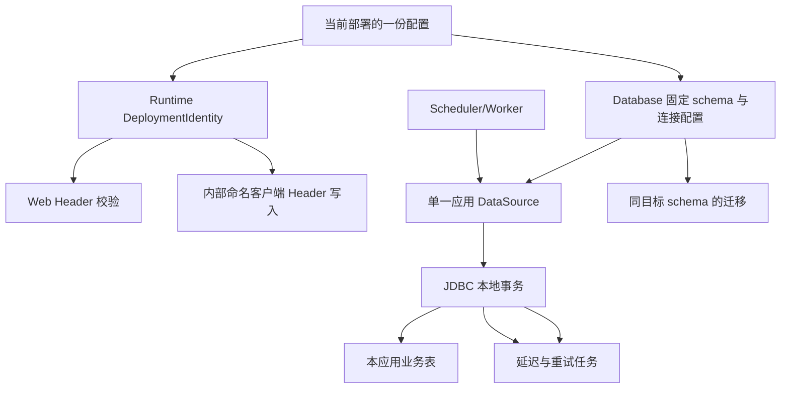

# 阶段 1B 重设计：固定部署与数据源隔离

日期：2026-11-16。状态：**设计已重订，尚未按本方案修改代码、POM、配置、SQL 或测试；未运行构建、测试、迁移或部署。**

本文替代原 1B“统一部署 tenant 上下文”的目标方案。原 1B 的 DeploymentDataScope、DatabaseTenant、Web/后台绑定代码目前仍存在，不因文档更新而视为已删除。阶段 1A、1C、2、3 的业务边界与证据校验继续作为实现约束；阶段 4 的实施应先服从本次重新确定的隔离边界。

本设计不要求兼容旧 API、配置、构造器、摘要格式或历史数据；不设计双模式、兼容重载、旧配置别名、历史数据回填或新旧版本混合运行。实施阶段是开发顺序，不是逐阶段线上部署方案。

配套文件：[逐文件影响清单](PHASE1B_CHANGE_INVENTORY.md)、[总体演进设计](ARCHITECTURE_EVOLUTION.md)。

## 1 决策与不变量

一套部署只服务一个租户。每个有持久化职责的应用固定使用自己的 DataSource、数据库账号和 schema；客户端的 `X-Tenant-Code` 只确认请求进入正确部署，不选择连接、schema、身份或权限。

1. `deployment.code` 是部署常量，无“当前租户”概念，不写入 ThreadLocal、ScopedValue 或任务上下文。
2. code 与 schema 显式配置，二者不是同一标识；禁止从请求 code 拼接 schema。
3. 每个应用一个主业务 DataSource 与匹配的 JDBC 事务管理器。业务表、Task、消费回执和事务内登记的延迟/重试任务属于同一数据源、同一应用 schema。
4. 一个租户的 payment、acquire、limitcenter 等仍各自拥有数据；不因单租户而共享业务表或跨服务直连。
5. 数据隔离由固定连接配置和数据库权限保证，Header 校验不承担认证职责。
6. 业务 Actor 保留用户/服务、商户、权限、原归属；不携带数据库租户。应用用例不依赖部署配置来选择数据。
7. 后台任务没有 HTTP 请求也能正常工作；不能通过“补 tenant 上下文”获得访问数据库的能力。
8. 保留 trace/requestId、任务元数据、认证上下文各自必要的传播，不把删除 tenant 等同于删除 ExecutionContext。

| 部署 code | 应用 | 固定 schema 示例 | 同库对象 |
|---|---|---|---|
| customer-a | payment | customer_a_payment | 付款/退款、Task、任务、消费回执、序列分配 |
| customer-a | acquire | customer_a_acquire | 订单/费用、Task、任务、消费回执 |
| customer-b | payment | customer_b_payment | customer-b 的付款及可靠性数据 |

可以共用 PostgreSQL 实例，也可以配置独立数据库；应用模型不因此改变。无数据库职责的应用只使用部署标识，不因本设计强制引入 JDBC。

## 2 当前代码事实与需要纠正的职责

| 当前文件/模块 | 当前行为 | 目标 |
|---|---|---|
| database/tenant/DatabaseTenant.java | 根据开关解析部署或上下文 tenant，启用时将 tenant 字符串视为 schema；并不创建路由连接 | 删除，固定 schema 由数据库配置直接决定 |
| database/tenant/TenantContext.java | 静态保存 resolver，缺 resolver 时回退上下文或默认 schema | 删除静态全局解析器及 fallback |
| commons-context/DeploymentDataScope.java；runtime/context/DeploymentScope*.java | 以 database.multi-tenant.default-tenant-id 装配固定范围 | 替换为 runtime 所有的 DeploymentIdentity 与独立部署配置 |
| webmvc/DeploymentScopeFilter.java | 每次请求及 redispatch 绑定相同 tenant | 替换为 Header 匹配校验，不建立 tenant 上下文 |
| TaskWorker、TaskAutoConfiguration | 选择 worker tenant，逐批绑定上下文 | worker 直接调用本数据源 dispatcher；删除 tenant 覆盖配置 |
| SchedulerTemplate、SchedulerAutoConfiguration | 在执行扫描任务前补部署 tenant | 删除此包装；保留任务注册、重叠保护、生命周期与其他元数据 |
| Pay 的 Jwt*ActorProvider | 部分入口从 DatabaseTenant 读取 actor.tenantId | 删除 database 身份依赖；身份只由认证凭证和本地业务授权产生 |
| JdbcTaskRepository | 注入 DataSource，校验 JDBC 事务管理器和连接参与原事务 | 保留并作为同库原子性约束，不引入租户路由 |
| TaskAutoConfiguration / Store / Template | 依赖注入的 JDBC/DataSource；业务恢复使用它登记任务 | 固定绑定到应用数据源，无逐租户 worker |
| LoadUpFlywayAutoConfiguration | 读取 default-schema 设置迁移目标 | 改为与连接池同源的唯一 schema 配置，禁止迁移目标与运行目标漂移 |

本次仓库核对未发现独立名为 RetryTask 的运行模块；本设计中的“重试任务”覆盖现有 Task、付款/退款/订单恢复队列，以及 Task 自身的重试。不得为满足术语另造一套 RetryTask 引擎。

## 3 目标装配、配置与数据库隔离



### 3.1 唯一配置来源

目标配置名如下；目前尚未实现：

```yaml
loadup:
  deployment:
    code: customer-a
  database:
    schema: customer_a_payment
spring:
  datasource:
    url: ${PAYMENT_JDBC_URL}
    username: ${PAYMENT_JDBC_USERNAME}
    password: ${PAYMENT_JDBC_PASSWORD}
```

- 一份应用配置只有一个 code 和一个 schema，无 tenants map、defaultTenant、currentTenant 或 required 开关。
- 平台可维护多租户部署清单，但只向应用下发本部署的配置和凭证，不向一个进程下发全部租户连接信息。
- code 使用明确的有界规范格式，建议 `[a-z][a-z0-9-]{0,63}`；请求必须精确匹配配置值，不 trim 后容忍错误输入，也不忽略大小写。
- schema 使用数据库标识符白名单，例如 `[a-z_][a-z0-9_]{0,62}`，拒绝保留的 `pg_` 前缀和默认 `public` 作为业务落点；不从 code 推导、不做动态 SQL 字符串拼接。
- `loadup.database.schema` 是 schema 的唯一应用配置源。连接池、Flyway 不得各维护一个独立可覆盖的 schema 值；JDBC URL 的 currentSchema/options 或池配置出现冲突时启动失败。
- 固定 schema 在物理连接创建时应用，通过现有连接池/JDBC 标准能力实现。禁止每次请求 `SET search_path`，禁止按 Actor/任务参数切换连接，禁止新建 AbstractRoutingDataSource。
- 只保留目标业务 schema 为应用搜索路径，不包含 public 或其他租户 schema 的业务回退；系统 catalog 按 PostgreSQL 原生规则处理。

### 3.2 权限、迁移与启动

独立连接池不是数据库授权边界。每个“部署 code × 应用”使用独立运行账号，只授予目标 schema 及其表/序列的必要权限；无其他租户或服务数据权限，无运行时 DDL、超级用户或跨角色提权能力。

迁移使用受控迁移凭证或外部迁移步骤，目标数据库/schema 与应用配置一致。不得要求运行账号拥有其他 schema 的迁移权限。同一应用的业务、可靠性组件及必要 Modules 迁移由应用统一选择，每个 schema 使用自己的迁移历史；不让各组件自行创建另一套数据源。

启动顺序：配置校验 → 受控创建/迁移目标 schema → 固定连接池与事务装配 → 验证实际 schema、表和必要权限 → readiness 通过 → 启动 worker/扫描器。需要在启动期间连接数据库的迁移配置同样必须只指向已解析的唯一目标。schema 缺失或配置冲突不能回退 public；禁止 worker 在 schema 就绪前扫描。

共享 PostgreSQL 中的跨 schema 权限拒绝需要真实数据库验收。启动检查只验证声明和当前所需能力，不把检查通过当作完整权限证明。

## 4 HTTP 与身份边界

### 4.1 普通业务 API

客户端发送 `X-Tenant-Code`。目标 `DeploymentCodeFilter` 对要求该头的路径校验：

| 输入 | 处理 |
|---|---|
| 单值、合法且等于本部署 code | 继续执行原认证、权限和业务校验 |
| 缺失、空白、格式非法、重复头、多值/逗号合并值 | 400；明确的部署请求错误，不静默选默认值 |
| 合法但不等于本部署 code | 403；明确部署不匹配，不读取目标业务库、不转发到其他部署 |
| code 正确，凭证无效或权限不足 | 保留原安全链 401/403 与业务错误分类 |

部署检查位于 ExecutionContextFilter 之后、认证和业务访问之前；它只处理 Header 与静态配置。REQUEST 校验一次，ASYNC/ERROR 使用请求内校验结果，不重新解析 body、不递归覆盖错误响应。trace/requestId 生命周期、原认证过滤器顺序和异常传播单独保留并验证。响应沿用现有错误 envelope；新部署错误归 Web/入口错误定义，不保留 TENANT_REQUIRED 或 INVALID_SCHEMA 的数据库租户异常语义。

### 4.2 例外入口的责任清单

| 入口 | 是否要求 Header | 替代保证 |
|---|---|---|
| 普通业务、管理及内部 API | 是 | Header 匹配后继续原身份/权限 |
| CORS 预检 | 否 | 只豁免真实预检；业务请求仍校验，allow-headers 包含 X-Tenant-Code |
| 实际健康探针、受控指标路径 | 否 | 原网络/管理访问策略，不能用 `/actuator/**` 泛化豁免业务 |
| 静态资源、收银台 HTML 首次导航 | 否 | 部署固定地址；页面 bootstrap 提供非敏感 code，随后 fetch 请求带头 |
| 支付渠道付款/退款回调 | 否 | 固定部署回调地址、原验签、账户/交易绑定、重放校验 |
| OAuth/OIDC 授权跳转、回调、令牌/JWKS 等标准协议端点 | 按明确端点豁免 | 固定部署 issuer/address、协议 state/nonce/PKCE、客户端认证与既有校验 |

豁免必须按应用实际注册的路径、方法和协议列出，不按“未登录”“所有回调”或整个 `/api/**` 豁免。NotificationCenterTenantFilter 的 JWT 守卫职责需要迁到明确的安全配置或保留为重命名的认证守卫；不能因删除 tenant Filter 而开放 `/api/*`、`/notifications*`。

### 4.3 出站与跨部署凭证

- 内部命名 HTTP 客户端统一写入本部署 code，不从用户请求复制，也不允许单次调用覆盖为另一 code。
- 仅标记为内部业务服务的客户端启用此行为；支付渠道、商户回调、对象存储、KMS、第三方 OAuth 等外部请求不得无差别注入 Header。不能在全局 RestClient 上添加传播拦截器。
- 网关可提前拒绝不匹配，但不得覆盖错误 code；应用入口仍独立校验。若存在跨部署入口路由，其路由配置归平台，不进入应用 DataSource 选择逻辑。
- 默认每套部署使用自己的认证 issuer 与客户端凭证；若共享身份发行平台，必须使接收方校验部署专属 audience/客户端授权边界。相同 `service_id=payment` 和 Header 不足以隔离两个部署。
- 原用户/服务身份、商户归属、scope、委托凭证和审批权限保持原责任层；不向 Actor 注入 DeploymentIdentity 来替代已删除的 tenant 字段。

## 5 业务与可靠性模块的删除规则

### 5.1 可以直接去除的运行时租户机制

删除 tenant 上下文键/工具、数据库 tenant resolver、逐租户 scanner 配置、Actor/本地事务参数中的 tenant，以及只为它们存在的包裹层。所有调用方和测试在同一改造中更新，不保留过渡重载。

`withTenantContext` 等方法常同时承担异常转换或事务边界：必须把业务错误映射、并发重试和原事务能力留在所属类中，再删除租户包装；不能把整个方法体替换为裸调用。

本地 schema 已隔离的唯一键、receipt、幂等摘要可去除冗余 tenant 维度；仍保留业务键、真实调用者、权限归属、来源版本、金额和证据完整性。允许重定义新摘要格式，不保留旧摘要读取分支，也不降低“同键改参必须冲突”的要求。

### 5.2 不能机械删除的隔离用途

| 已发现用途 | 目标处理 |
|---|---|
| PaymentEventCodecImpl、LimitPolicyCodec、PolicyPublicationCodecImpl 等本地摘要 | 分清本地幂等和跨服务协商哈希；同步所有生产/验证方和固定样例，不只删一侧 tenant 字段 |
| KmsPaymentInputCipher、HmacExecutionPermitIssuer、CheckoutPresentationImpl | 移除环境可变 tenant；跨部署密文/许可/令牌用固定部署安全域或独立密钥隔离，保留业务关联、用途、过期和签名验证 |
| 渠道 ChannelExecutionContext、DefaultChannel*Facade、Alipay/Wechat BindingGuard/CredentialReader | 去除 TenantUtil 比对；配置凭证命名空间固定在部署或适配器，保留 merchant/accountScopeHash/渠道绑定版本/证书与原交易身份校验 |
| HttpMerchantNotificationTransport、MerchantNotificationProperties | 删除 tenant→merchant 的外层配置选择，保留当前部署 merchant→目标/密钥映射及签名、目标白名单、重试窗口 |
| ConfiguredReconciliationAccountDirectory | 删除 tenants 外层配置查找；只加载当前部署账户目录，保留渠道/商户/账户匹配 |
| FileResourceService、DFS、缓存 | 文件业务归属保持；存储根目录/bucket/缓存前缀固定在部署配置，后台与前台一致。共享资源不得因删 tenant 前缀发生冲突 |
| SequenceScope/SegmentSequence 及 ID 分配 | 核对现有 schema 范围与后台预取；保持分配唯一性和并发行为。已无 tenant 读取的文件不为本次任务重复改写 |

这些场景允许基础设施读取不可变 DeploymentIdentity 或已配置的专用 namespace；不将其作为业务传参链，也不建立“新名字的当前租户”。KMS namespace 等第三方原生概念不应仅因测试值叫 tenant 而删除。

### 5.3 可靠性交付

Task、消费回执和需要事务登记的任务使用相同 DataSource Bean 与事务管理器。业务提交失败时，不得出现可领取事件/任务；登记失败时原业务事务回滚。worker 无 Header、无 tenant 上下文直接工作。多副本仍按原领取、lease/claim token、重试、幂等和状态机执行。

删除的仅是数据范围选择机制，不合并事件类型、目标路由、任务引擎或交易状态。阶段 3 的完整财务证据、原绑定、ACK 和累计金额校验继续保留。支付任务超时或失败仍不构成不收款证明。

## 6 文件与模块调整清单

下面路径均为现有文件或明确标注的拟新增文件。完整现有文件链接及测试联动见 [逐文件清单](PHASE1B_CHANGE_INVENTORY.md)。不删除任何整个 Maven 模块。

| 模块 | 删除或替换 | 调整/新增 |
|---|---|---|
| commons-context / commons-util / commons-dto | 删除 DeploymentDataScope.java、TenantUtil.java；移除 ContextKeys.TENANT_ID、CommonConstants 中仅租户使用的默认值 | 保留 ExecutionContext、ContextHolder 与 trace/其他元数据；默认 schema 常量引用归并后删除不再需要的默认值 |
| runtime | 替换 context/DeploymentScopeProperties.java、DeploymentScopeAutoConfiguration.java | 拟新增 deployment/DeploymentIdentity.java、DeploymentProperties.java、DeploymentAutoConfiguration.java；只表达 code，不知道 schema/JDBC |
| database | 删除 tenant/DatabaseTenant.java、TenantContext.java、DatabaseTenantResultCodeEnum.java 及对应旧测试 | 修改 DatabaseProperties、DatabaseCoreAutoConfiguration、LoadUpFlywayAutoConfiguration；由现有自动配置完成固定连接池装配，拟新增 schema/FixedSchemaVerifier.java 验证启动目标；核对 JdbcTransactionAutoConfiguration、MyBatisFlexAutoConfiguration、SequenceAutoConfiguration |
| webmvc | 替换 DeploymentScopeFilter.java、DeploymentScopeWebAutoConfiguration.java | 拟新增 DeploymentCodeFilter、DeploymentCodeWebAutoConfiguration 及错误定义/显式路径策略；保留 ExecutionContextFilter |
| http | 无需新增租户 HTTP 模块 | HttpProperties、HttpServiceClients、HttpTemplate、HttpAutoConfiguration/HttpClientDefaults 中明确内部客户端标记和固定 Header 注入；按实际入口只修改必要文件 |
| scheduler-api / binders | 删除 SchedulerTemplate 的部署范围参数与 tenant 包裹 | 同步 SchedulerAutoConfiguration、Local/PowerJob 测试；保留调度元数据和重叠抑制 |
| outbox | 删除 TaskProperties.tenantId、TaskWorker tenant 参数/分支与自动配置兜底 | 保留 JdbcTaskRepository、IdempotentEventConsumer 的同库事务门禁；新增无上下文执行和双 schema 隔离回归 |
| delayedtask | 不删除 Store/Dispatcher/Template | 核对 TaskAutoConfiguration 的 JdbcTemplate/DataSource 同源；为登记事务、后台扫描、租约补隔离回归 |
| payment-channel | 清除当前 tenant 检查及输入里的动态 tenant | API/core/binders 联动；账户、渠道、凭证来源和 security namespace 同步调整 |
| Modules file / transfer / notification / UPMS | 删除 FileResourceService 的 storageTenant 与上下文包装 | 核对持久化装配只使用宿主 DataSource；UPMS 用户/角色/权限逻辑保留，更新 SchemaIsolationIT 等宿主 schema 验收 |
| Pay 各服务 | 删除 Actor 中隔离用 tenant、Jwt Provider 的 DatabaseTenant 注入、事务/服务/任务的 tenant 参数链 | 调用方、转换器、摘要/签名、恢复任务、权限和错误分类逐条同步；Payment RecoveryInventoryCollector 移除 tenant-ids 遍历 |
| notificationcenter | 删除 NotificationCenterTenantFilter 的部署 tenant 前提与命名 | 原 JWT 守卫迁入安全链或明确重命名；同步构造器和测试 |
| Pay 配置与部署 | 删除 multi-tenant、default-tenant-id、task (固定 schema)、恢复 tenant-ids 及 tenant 外层映射 | 各 application.yml、deploy/config/{dev,test,prod}、scripts/render_deploy.py、configmap.py、common.py、网关/NetworkPolicy 与配套测试声明 deployment code/schema/账号/issuer；检查固定 namespace 假设 |
| Admin / 收银台客户端 | 不增加租户切换 UI | admin/src/request/index.ts、src/config/app.ts、收银台 checkout.js/core/bridge 在业务 fetch 写固定 code；登录/协议/静态入口按第 4 节处理 |
| 资源与说明 | 删除旧自动配置 imports 条目 | runtime/database/webmvc 的 AutoConfiguration.imports、各 README/ARCHITECTURE、部署说明、测试入口、配置样例同步 |

## 7 依赖目标与 POM 操作

| 模块/边 | 目标动作 | 删除前核对 |
|---|---|---|
| commons → runtime/database/web | 保持无依赖 | DeploymentIdentity 放 runtime，不把部署装配放入 commons-context |
| runtime → commons-context | 删除仅为 DeploymentDataScope 增加的需求；其他真实用途保留 | runtime 的异步上下文与其他配置可能仍需 context，不能整条盲删 |
| database → WebMVC/Servlet | 保持无依赖 | 新连接/schema 配置不得重新引入 Web |
| database → runtime/context | 移除租户 resolver 造成的需求；按其他源码使用决定是否删 POM | Clock、自动配置或真实上下文能力若仍使用则保留并记录原因 |
| WebMVC → runtime | 保留，用于不可变 DeploymentIdentity | 无 database/JDBC 依赖 |
| HTTP → runtime | 直接使用 DeploymentIdentity 时显式声明；已有声明则复用 | 仅内部客户端启用部署头，不影响第三方客户端 |
| scheduler-api → runtime/context | 移除仅部署 tenant 造成的依赖 | binder 独立的 trace/任务传播依赖按其自身使用保留 |
| outbox → runtime/context | 移除 tenant worker 造成的依赖 | JDBC、事务、观察能力及真实其他用途保留 |
| Pay adapter → database | 仅因 Jwt ActorProvider 解析 tenant 引入的边删除 | adapter 内如有其他实际数据库使用，应单列理由，不能谎报全部去除 |
| Pay app/domain/client → runtime/database | 不因替代 tenant 新增 | 部署常量不得下沉成业务身份/领域依赖 |
| channel/签名/文件基础设施 → 部署配置 | 必要处显式注入静态配置 | 能用本组件已有 namespace 配置时复用；不添加泛化“TenantProvider” SPI |
| Modules persistence → DataSource | 保留宿主注入 | 不私建连接池，不获取其他服务数据库权限 |

POM 删除条件是“本模块源码、自动配置资源和测试 scope 已没有相应用途”。实施时记录每条保留理由、生产/test scope 和所需直接依赖；不以 Maven 的传递依赖偶然可编译作为设计依据。无新 Maven 聚合模块或第三方库需求。

## 8 分阶段实施顺序

阶段编号为本次重设计的 1B-R0～R6，区别于总体阶段 0～5。所有阶段当前均未开始代码实施；R0 本轮仅完成文档清单，不声称执行验收。

| 阶段 | 实施顺序与涉及文件 | 完成条件 |
|---|---|---|
| R0 范围与配置定稿 | 核对本清单；按应用登记 code/schema/账号/issuer、内部客户端、协议豁免；分类 tenant 的数据路由/身份/哈希/密钥/对象存储用途 | 每个残留调用有明确去向；不存在未分类的安全用途，配置只定义一个目标 |
| R1 固定数据库与部署值 | runtime 新部署值 → database 固定 schema/池/事务/迁移 → 当前应用新建 schema 配置模板 | G1B-01～04 的测试源码齐全；相同 schema 来源、错误配置不就绪、无 Web 依赖 |
| R2 请求入口与客户端 | 新 Header Filter/错误策略 → 内部 HTTP 客户端 → Admin/收银台 → 网关与协议豁免 → issuer/audience 核对 | G1B-05～08；错头无业务访问、协议可用、第三方请求不泄漏部署头、跨部署凭证拒绝 |
| R3 业务身份与安全用途 | 各 Jwt Provider/Actor → 事务包装 → 业务服务/映射/端口 → 摘要/许可/密文/通知/渠道/文件与账户目录；调用方同批更新 | G1B-09～11；merchant/service/权限及幂等冲突完整，跨部署密钥/凭证隔离，业务无当前 tenant |
| R4 后台与可靠性交付 | Task worker/配置 → Scheduler → Task/业务恢复 → RecoveryInventory；更新直接调用/持久化 IT 装配 | G1B-12～14；无上下文可运行，同 DataSource 原子登记，多副本租约/重放语义保持 |
| R5 删除旧实现与依赖 | 删除 resolver/context/util/旧配置及测试；清 imports/POM；同步 SQL 新库定义、部署脚本、依赖说明与所有调用方 | G1B-15～16；旧生产符号/配置无引用，禁止兼容重载/dual mode；依赖无环、无隐式数据库身份读取 |
| R6 集中验证与文档归档 | 按验收矩阵做源码/IDE检查；得到用户运行授权后分模块 clean 构建、测试、双部署数据库与 HTTP 验收 | G1B-01～16 全部有证据后才可标记实施/运行验收完成；未运行项保持待验收 |

R1～R4 的开发过程中可暂时同时存在待删除源文件，但不能把中间状态作为支持两套模型的发布版本。R5 删除收口后才准备完整发布候选。不执行旧库迁移或历史兼容；新库结构可按最终模型直接整理，但本轮只列设计，不实际修改 SQL 或数据库。

## 9 验收标准与测试入口

以下全部是未来验收要求，**没有在本轮执行**。路径详见逐文件清单；“拟新增”表示尚不存在。

| 编号 | 可观察验收结果 | 对应验证入口 |
|---|---|---|
| G1B-01 | 缺 code/schema、非法 schema、冲突 currentSchema/池配置均启动失败；不能回退 public | 拟新增 DeploymentAutoConfigurationTest、FixedSchemaConfigurationTest |
| G1B-02 | 新连接、重建连接及池复用始终访问同一个 schema；修改请求/执行上下文无影响 | 拟新增 FixedDataSourceIsolationIT，两 schema 同名表写入并核对 |
| G1B-03 | 账号 A 对 B 的表读取/写入/显式 schema 限定 SQL 都被数据库拒绝，反向亦同；不只测应用过滤 | 拟新增 DatabasePrivilegeIsolationIT，实际最小权限角色 |
| G1B-04 | 业务、Task、任务表和 Flyway 历史均落入配置 schema；目标数据库/schema 缺失不启动 worker | FlywayAutoConfigurationTest、JdbcTransactionAutoConfigurationTest、组件持久化 IT |
| G1B-05 | 正确头通过；缺失/空白/重复/多值/非法为 400；不匹配为 403；拒绝前无业务库访问 | 替换 DeploymentScopeFilterTest 为 DeploymentCodeFilterTest，真实安全链回归 |
| G1B-06 | CORS、静态/协议/渠道回调按准确路径处理；ASYNC/ERROR 不重复写错误响应；trace/异常传播保持 | WebMVC 过滤器测试、MvcThreadModelTest、NotificationCenter 安全测试、渠道回调测试 |
| G1B-07 | 内部出站使用本部署常量且不可被用户头覆盖；第三方请求不带部署头；无请求上下文也能调用内部服务 | HttpServiceClientsTest、HttpAutoConfigurationTest、各 Pay HTTP 客户端、Admin/收银台请求测试 |
| G1B-08 | A 部署的合法 token 在 B 部署被拒绝，即使提供 B 的 Header；有效本地身份按原权限工作 | 各 Jwt*ActorProviderTest、实际 issuer/audience/客户端授权链验证 |
| G1B-09 | 业务 Actor/事务/领域模型无隔离 tenant 参数；同部署内不同商户/服务不得越权 | 各 ActorProvider/服务输入/归属/委托凭证回归 |
| G1B-10 | 同键同参重放原结果，同键改参/证据变更冲突；新哈希生产与校验双方一致 | Acquire/Limit/Payment/Realtime/ProductCenter codec、receipt、策略哈希回归 |
| G1B-11 | 跨部署许可/密文/渠道凭证不可互用；文件和缓存不冲突；渠道账户、商户、目标签名绑定有效 | HmacExecutionPermitIssuer、KmsPaymentInputCipher、Channel BindingGuard/凭证测试、FileResourceServiceTest、通知传输测试 |
| G1B-12 | 无任何 tenant 上下文时 Task、Task、Scheduler、RecoveryInventory 正常扫描；A worker 无法领取 B 数据 | TaskWorkerTest、TaskIT、Task IT、SchedulerTemplateTest、Local/PowerJob 测试及双 schema worker IT |
| G1B-13 | 业务 rollback 无事件/任务；入队失败业务 rollback；receipt 与资金/额度变更同事务；错误 DataSource/manager 组合拒绝 | PaymentResultPersistenceIT、RefundRecoveryHandlerPersistenceIT、AcquiringFinancialPersistenceIT、额度/Task/Task 真实数据库回归 |
| G1B-14 | 多副本领取、租约过期、旧 claim ACK、重复投递和 FAILED/replay 不重复资金效果；未知结果不变成功 | 原恢复/交付持久化 IT 与并发场景，不用 mock 事务次数代替证据 |
| G1B-15 | 生产源码和生效配置不再引用 TenantUtil/TenantContext/DatabaseTenant/DeploymentDataScope/TENANT_ID/旧租户配置；无旧构造重载或动态切换 | 精确符号及配置静态检索；历史说明文本不属于生产残留 |
| G1B-16 | database 无 Servlet；ActorProvider 无数据库身份解析；业务不因部署常量新增 runtime 依赖；所有 imports/POM/配置与默认装配一致 | IDEA 检查与依赖/自动配置审查，授权后的定向 clean 构建与装配测试 |

构建和测试默认由用户本地执行。只有明确授权后才安排窄范围 `mvnd clean` 和针对性测试，不自行运行全 reactor。静态检查、编译、单测、真实 PostgreSQL、真实 HTTP 和部署验证分别记录结果；不能用其中一项替代另一项。

## 10 当前交付与后续文档同步

本轮只重订设计、生成影响清单并同步总体入口。代码仍是旧 1B 实现，阶段 3 的证据实现也仍含 tenant 相关调用；本设计列出了下一轮应调整的范围，不表示已移除。

后续实施同时更新 Framework runtime/database/webmvc/http/scheduler/task/channel 的 README/ARCHITECTURE，Modules file/transfer/UPMS 文档，以及 Pay 各服务、契约、部署配置/网关/验收、阶段 0 差异说明和阶段 3 摘要/身份说明。历史阶段记录保留“当时状态”的事实定位，当前决策以本文件为准；不再把旧 1B 的兼容行为作为本设计验收标准。
