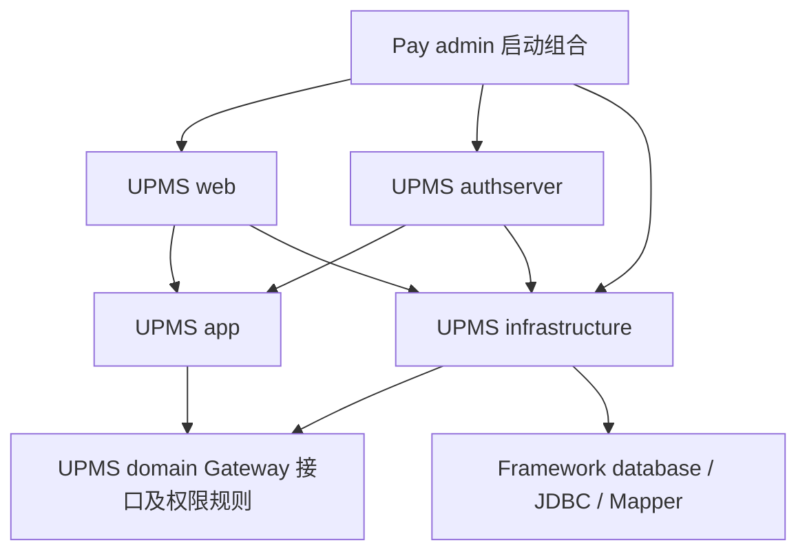

# 阶段 1C：UPMS 装配归属实施记录

日期：2026-11-15。状态：源码、消费者、测试源码与文档已同步；未运行构建、测试或格式化插件。阶段 1A～1C 的源码切片已调整，阶段 1 的运行验收仍待执行，不能据此认定 G1 全部通过。后续[阶段 2](PHASE2_IMPLEMENTATION.md)已同步源码（未构建/测试），阶段 3 后续边界切片已调整源码（证据替代未完成，未构建/测试），阶段 4～5 未开始。

## 1 职责与依赖

- **App**：`UpmsAutoConfiguration` 仅扫描 `io.github.loadup.modules.upms.app`，注册应用服务、登录策略与应用 Converter；保留原 PasswordEncoder、UserPermissionService、AccessDecisionService 的注册规则。删除 app → infrastructure 生产依赖，不扫描或导入具体持久化实现。
- **Infrastructure**：新增 `UpmsPersistenceAutoConfiguration`，以自身 `AutoConfiguration.imports` 唯一登记；通过 `beforeName` 明确先于 app，不产生 infrastructure → app 编译依赖。逐接口注册六类默认 Gateway，保留原类名和 Bean 名。只扫描 converter 包以注册 MapStruct 生成组件，不扫描 repository 包，不另造 Mapper 扫描路径。
- **Web/AuthServer**：各自显式依赖 app 与 infrastructure，选择默认持久化组合。Web 继续在 app/Audit 后装配；AuthServer 显式在 app 与 SAS 后装配。其协议、路径、控制器、Provider 和 token 行为保持原有实现。
- **Pay admin**：直接声明 infrastructure，将默认后端选择放在部署组合中；保留 AdminApplication 的窄包扫描，使用 Boot 自动配置发现 UPMS。没有扩大到其他 Pay 领域包或数据表。

Gateway 替换以接口为单位：User、Role、Permission、Department、LoginLog、UserOAuthBinding。替换其中一个不会禁用其他五个默认实现或所有应用服务。仅引入 app 时由消费者提供六类 Gateway 与 Clock；缺必需端口会暴露相应服务的装配失败，不采用缺任意 Gateway 就静默禁用全部 UPMS 的条件。

## 2 文件与调整顺序

| 顺序 | 文件或模块 | 结果 |
|---|---|---|
| 1 | infrastructure `autoconfigure/UpmsPersistenceAutoConfiguration.java`、自身 `META-INF/spring/org.springframework.boot.autoconfigure.AutoConfiguration.imports` | 建立默认适配独立注册路径、逐接口替换与先于 app 的显式顺序 |
| 2 | app `UpmsAutoConfiguration.java`、POM | 同一切片删除 infrastructure 扫描和 compile 依赖；只保留 app 扫描；显式声明 spring-tx 与 spring-security-crypto |
| 3 | web/authserver POM、`UpmsAuthServerAutoConfiguration.java` | 默认实现由适配消费者显式引入；AuthServer 增加 app 先于自身的顺序，原 SAS 顺序保留 |
| 4 | Pay admin POM、`UpmsAssemblyTest.java` | 显式选择默认持久化，补齐实际消费者类路径发现和四层组合装配测试源码 |
| 5 | UPMS test POM、两类新装配测试 | 补独立 app、自定义 Gateway、默认持久化、逐接口替换及密码匹配的回归源码 |
| 6 | 总体、各层及阶段文档 | 更新当前职责与依赖增量，阶段 0 保留历史快照，区分源码交付与运行验收 |

`TestApplication.java` 本来就使用 SpringBootConfiguration + EnableAutoConfiguration，没有宽包扫描或重复 Import；其 POM 已直接声明 test scope infrastructure。因此保留该启动器，默认适配通过新增 imports 发现。`AdminApplication.java` 也保留原实现，新增消费者测试核对该类加载器能发现所有 UPMS 装配入口。未为这两个既有正确入口增加第二条注册路径。

## 3 保留的登录、身份与权限语义

- PasswordEncoder 仍由原 `passwordEncoder()` 无条件注册，保持 DelegatingPasswordEncoder 的默认编码器与无前缀 BCrypt 匹配回退；未新增替换条件或改密码格式。
- UserPermissionService、AccessDecisionService 继续各自 ConditionalOnMissingBean，构造所需 Gateway 与权限规则不变。
- AuthenticationService、各 LoginStrategy、OAuthProvider、UpmsAuthenticationProvider、UpmsPrincipal、UpmsTokenController 均未改业务实现；保留账号锁定、认证异常映射、本地 userId、角色和权限收集、JWT claims、受众及有效期规则。
- 六个 GatewayImpl 保留原 @Repository、@Transactional、构造参数、查询和写入实现。默认 Bean 名继续为 `userGatewayImpl`、`roleGatewayImpl`、`permissionGatewayImpl`、`departmentGatewayImpl`、`loginLogGatewayImpl`、`userOAuthBindingGatewayImpl`；@Bean 声明返回具体实现类，接口可注入及具体类型可查找。
- Web 控制器、方法权限、敏感读取审计桥接、事务、JSON、错误码与数据范围规则未改。没有 SQL、迁移、schema 或部署配置变化。
- 当前 GitHubOAuthProvider 自行发 HTTP 请求的 E15 例外保留；不借装配拆分改写第三方登录或引入 Keycloak。UPMS web 的 Audit 组合依赖等其他既有规则同样不改。

## 4 依赖声明

| 模块 | 直接声明变化 |
|---|---|
| UPMS app | 删除 compile infrastructure；新增 spring-tx、spring-security-crypto，对原已使用的事务注解和密码 API 显式声明 |
| UPMS infrastructure | 新增 spring-boot-autoconfigure、spring-context、spring-jdbc；不依赖 app |
| UPMS web | 新增 compile infrastructure；保留 app 和 Audit 的既有依赖与顺序 |
| UPMS authserver | 新增 compile infrastructure；保留 app 与 OAuth server core |
| UPMS test | 新增 test scope spring-jdbc；既有 test scope app/domain/infrastructure 保留 |
| Pay admin | 新增 compile infrastructure；新增 compile app，明确运行时组合并供测试直接引用应用自动配置；原 web/authserver 依赖不变 |

版本沿用现有 BOM，无新增第三方库或模块。Infrastructure 的 provided Servlet API 已核对当前 Java 源码无导入，本切片保留声明，不以装配迁移扩大无关依赖清理范围。未运行 Maven 依赖解析或任何构建。

## 5 回归源码与验收标准

| 场景 | 回归入口 | 验收标准 | 状态 |
|---|---|---|---|
| App 独立装配 | `UpmsAutoConfigurationTest` | 过滤 infrastructure、Spring JDBC、MyBatis-Flex 类；仅提供 Gateway/Clock，应用服务与领域服务各唯一注册 | 源码已补，未运行 |
| 原密码语义 | 同上 | 编码保留 bcrypt 前缀；匹配带前缀和原无前缀 BCrypt；错误密码拒绝 | 源码已补，未运行 |
| 领域服务替换 | 同上 | 自定义权限/决策服务保持原 ConditionalOnMissingBean，默认不重复 | 源码已补，未运行 |
| 默认适配组合 | `UpmsPersistenceAutoConfigurationTest` | 即使测试传入配置次序相反，六类默认 Gateway 与应用服务仍各唯一注册 | 源码已补，未运行 |
| 逐项替换 | 同上 | 分别替换六类接口之一，该默认实现不创建，另外五类默认及应用服务继续注册 | 源码已补，未运行 |
| Admin 实际消费组合 | Pay admin `UpmsAssemblyTest` | 实际依赖类路径发现 persistence/app/web/authserver；四层组合可注册默认持久化、Controller 和 Provider；Web/AuthServer 单独组合不依赖对方配置 | 源码已补，未运行 |
| 登录、身份、权限与数据库契约 | 原 `ServiceInputContractTest`、`UpmsAuthenticationProviderTest`、`UpmsTokenControllerTest`、用户/角色/权限相关测试、`UserServiceIT`、`SchemaIsolationIT` | 原行为和真实装配无回归；SchemaIsolationIT 不代表动态路由已实现 | 既有源码保留，未运行 |

装配测试的模拟 JDBC/Mapper 仅用于验证 Bean 图，未替代真实数据库集成测试。Admin 组合测试关闭夹具中的协议端点，未验证 HttpSecurity、安全过滤链、JWT 签发或完整 Admin 启动。新回归源码和静态检查均不能作为这些运行结果的替代。

## 6 交付与边界

Modules 提供方与 Pay admin 消费方应配套交付。只引入 app 的消费者不再隐式获得默认持久化，必须显式加入 infrastructure 或提供全部自定义 Gateway；Web/AuthServer 已完成该依赖切换。不保留旧扫描兜底或混合装配路径。

本切片处理阶段 0 E01 的源码耦合；E02（其他小型 core 的同 JAR 装配依赖）、E15 及阶段 2～5 工作不随之关闭。阶段 1C 静态可审阅不等于阶段 1 运行验收完成。若回退，应整体恢复依赖归属、旧 app 扫描与默认持久化注册，避免新旧路径同时注册仓库；无数据回滚步骤。

## 7 静态核对与精确文件清单

本轮变更相对开始前的工作区生成，保留此前未提交修改。静态核对通过：变更 POM XML 可解析且无重复直接依赖；源 POM 的生产依赖图无 app → infrastructure 或反向路径；六类默认 Bean 的替换条件、唯一导入和消费者直接声明齐备；变更文档本地链接与 diff 空白检查通过。本轮生产 Java 仅改 app/authserver 装配类并新增持久化装配类，业务服务、登录策略、Provider、Controller、仓库方法、SQL 与 YAML 均未修改。未运行 Maven 解析、构建或测试。

### 生产源码及资源

- [loadup-modules/loadup-modules-upms/loadup-modules-upms-app/src/main/java/io/github/loadup/modules/upms/app/autoconfigure/UpmsAutoConfiguration.java](../../loadup-modules/loadup-modules-upms/loadup-modules-upms-app/src/main/java/io/github/loadup/modules/upms/app/autoconfigure/UpmsAutoConfiguration.java)
- [loadup-modules/loadup-modules-upms/loadup-modules-upms-authserver/src/main/java/io/github/loadup/modules/upms/authserver/UpmsAuthServerAutoConfiguration.java](../../loadup-modules/loadup-modules-upms/loadup-modules-upms-authserver/src/main/java/io/github/loadup/modules/upms/authserver/UpmsAuthServerAutoConfiguration.java)
- [loadup-modules/loadup-modules-upms/loadup-modules-upms-infrastructure/src/main/java/io/github/loadup/modules/upms/infrastructure/autoconfigure/UpmsPersistenceAutoConfiguration.java](../../loadup-modules/loadup-modules-upms/loadup-modules-upms-infrastructure/src/main/java/io/github/loadup/modules/upms/infrastructure/autoconfigure/UpmsPersistenceAutoConfiguration.java)
- [loadup-modules/loadup-modules-upms/loadup-modules-upms-infrastructure/src/main/resources/META-INF/spring/org.springframework.boot.autoconfigure.AutoConfiguration.imports](../../loadup-modules/loadup-modules-upms/loadup-modules-upms-infrastructure/src/main/resources/META-INF/spring/org.springframework.boot.autoconfigure.AutoConfiguration.imports)

### 测试源码

- [loadup-modules/loadup-modules-upms/loadup-modules-upms-test/src/test/java/io/github/loadup/modules/upms/UpmsAutoConfigurationTest.java](../../loadup-modules/loadup-modules-upms/loadup-modules-upms-test/src/test/java/io/github/loadup/modules/upms/UpmsAutoConfigurationTest.java)
- [loadup-modules/loadup-modules-upms/loadup-modules-upms-test/src/test/java/io/github/loadup/modules/upms/UpmsPersistenceAutoConfigurationTest.java](../../loadup-modules/loadup-modules-upms/loadup-modules-upms-test/src/test/java/io/github/loadup/modules/upms/UpmsPersistenceAutoConfigurationTest.java)
- [loadup-pay/loadup-pay-admin/src/test/java/io/github/loadup/admin/UpmsAssemblyTest.java](../loadup-pay-admin/src/test/java/io/github/loadup/admin/UpmsAssemblyTest.java)

### 依赖声明

- [loadup-modules/loadup-modules-upms/loadup-modules-upms-app/pom.xml](../../loadup-modules/loadup-modules-upms/loadup-modules-upms-app/pom.xml)
- [loadup-modules/loadup-modules-upms/loadup-modules-upms-authserver/pom.xml](../../loadup-modules/loadup-modules-upms/loadup-modules-upms-authserver/pom.xml)
- [loadup-modules/loadup-modules-upms/loadup-modules-upms-infrastructure/pom.xml](../../loadup-modules/loadup-modules-upms/loadup-modules-upms-infrastructure/pom.xml)
- [loadup-modules/loadup-modules-upms/loadup-modules-upms-test/pom.xml](../../loadup-modules/loadup-modules-upms/loadup-modules-upms-test/pom.xml)
- [loadup-modules/loadup-modules-upms/loadup-modules-upms-web/pom.xml](../../loadup-modules/loadup-modules-upms/loadup-modules-upms-web/pom.xml)
- [loadup-pay/loadup-pay-admin/pom.xml](../loadup-pay-admin/pom.xml)

### 文档

- [loadup-modules/ARCHITECTURE.md](../../loadup-modules/ARCHITECTURE.md)
- [loadup-modules/loadup-modules-upms/ARCHITECTURE.md](../../loadup-modules/loadup-modules-upms/ARCHITECTURE.md)
- [loadup-modules/loadup-modules-upms/README.md](../../loadup-modules/loadup-modules-upms/README.md)
- [loadup-modules/loadup-modules-upms/loadup-modules-upms-app/ARCHITECTURE.md](../../loadup-modules/loadup-modules-upms/loadup-modules-upms-app/ARCHITECTURE.md)
- [loadup-modules/loadup-modules-upms/loadup-modules-upms-app/README.md](../../loadup-modules/loadup-modules-upms/loadup-modules-upms-app/README.md)
- [loadup-modules/loadup-modules-upms/loadup-modules-upms-authserver/ARCHITECTURE.md](../../loadup-modules/loadup-modules-upms/loadup-modules-upms-authserver/ARCHITECTURE.md)
- [loadup-modules/loadup-modules-upms/loadup-modules-upms-authserver/README.md](../../loadup-modules/loadup-modules-upms/loadup-modules-upms-authserver/README.md)
- [loadup-modules/loadup-modules-upms/loadup-modules-upms-infrastructure/ARCHITECTURE.md](../../loadup-modules/loadup-modules-upms/loadup-modules-upms-infrastructure/ARCHITECTURE.md)
- [loadup-modules/loadup-modules-upms/loadup-modules-upms-infrastructure/README.md](../../loadup-modules/loadup-modules-upms/loadup-modules-upms-infrastructure/README.md)
- [loadup-modules/loadup-modules-upms/loadup-modules-upms-test/ARCHITECTURE.md](../../loadup-modules/loadup-modules-upms/loadup-modules-upms-test/ARCHITECTURE.md)
- [loadup-modules/loadup-modules-upms/loadup-modules-upms-test/README.md](../../loadup-modules/loadup-modules-upms/loadup-modules-upms-test/README.md)
- [loadup-modules/loadup-modules-upms/loadup-modules-upms-web/ARCHITECTURE.md](../../loadup-modules/loadup-modules-upms/loadup-modules-upms-web/ARCHITECTURE.md)
- [loadup-modules/loadup-modules-upms/loadup-modules-upms-web/README.md](../../loadup-modules/loadup-modules-upms/loadup-modules-upms-web/README.md)
- [loadup-pay/ARCHITECTURE.md](../ARCHITECTURE.md)
- [loadup-pay/design/ARCHITECTURE_EVOLUTION.md](ARCHITECTURE_EVOLUTION.md)
- [loadup-pay/design/PHASE0_BASELINE.md](PHASE0_BASELINE.md)
- [loadup-pay/design/PHASE0_DEPENDENCIES.md](PHASE0_DEPENDENCIES.md)
- [loadup-pay/design/PHASE1A_IMPLEMENTATION.md](PHASE1A_IMPLEMENTATION.md)
- [loadup-pay/design/PHASE1B_IMPLEMENTATION.md](PHASE1B_IMPLEMENTATION.md)
- [loadup-pay/design/PHASE1C_IMPLEMENTATION.md](PHASE1C_IMPLEMENTATION.md)
- [loadup-pay/loadup-pay-admin/README.md](../loadup-pay-admin/README.md)

