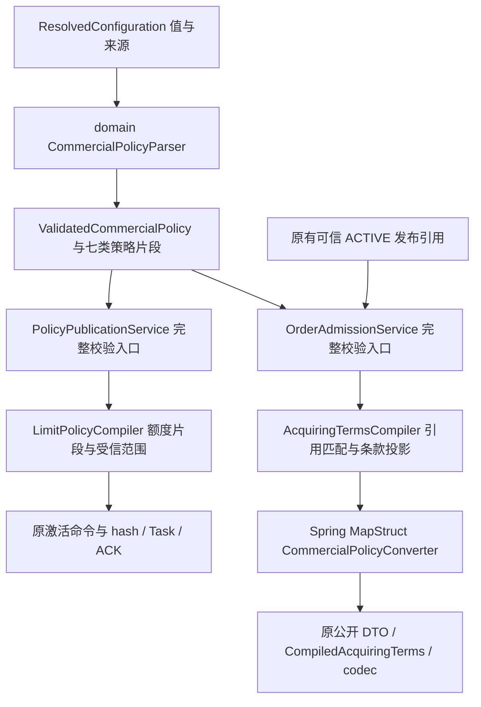

# 阶段 2：产品商业策略编译职责拆分

日期：2026-11-15。状态：源码、调用方、测试源码与文档已同步；仅静态核对，未运行构建、测试、MapStruct 生成或格式化插件。阶段 2 的运行验收尚未通过，阶段 3 后续边界切片已调整源码（证据替代未完成，未构建/测试），阶段 4～5 未开始。

## 1 当前职责与依赖

- **Domain**：CommercialPolicyParser 解析完整闭集词汇，保留精确数值、可选字段、枚举和原有规则；不依赖 Spring、Jakarta Validator、应用层、DTO、数据库或平台配置。使用 domain 原本已依赖的 client 枚举与错误码，不新增依赖边。
- **内部值**：ValidatedCommercialPolicy 与 OrderPolicy、PaymentPolicy、FeePolicy、RefundPolicy、NotificationPolicy、LimitPolicy、ChannelPolicy 位于 `domain/policy`。片段不可变，构造约束承接原 DTO 构造规则及已有 Bean Validation 的商业字段限制。LimitPolicy 的八组规则只包含窗口、计量、阈值和启用状态，不含激活 ACK 或桶累计。
- **条款编译**：AcquiringTermsCompiler 接收完整已验证策略与实际发布引用，核对 policyId，调用 Spring 管理的 CommercialPolicyConverter 并保留 Validator 补充校验。它不再读取原始字符串配置。ACTIVE 时点及合约资格检查继续由 OrderAdmissionService 在原位置执行，投影器不会制造激活证据。
- **额度编译**：LimitPolicyCompiler 只接收 LimitPolicy 与受信 tenant/payee，保留 ID 校验、父级聚合拒绝、稳定范围、八组计数命令及 hash。没有 AcquiringTermsCompiler 依赖，不读取订单、费用或通知字段，不再构造 INIT 的 ActivatedLimitPolicy。
- **总入口**：PolicyPublicationService 在原合约锁、来源和有效期检查后完整解析，再取 limits；OrderAdmissionService 在原资格、合约及 ACTIVE 发布检查后完整解析，再生成条款。原重放分支均位于解析之前。

未新增 Maven 模块、依赖或永久兼容重载。两个服务使用同一无状态领域解析类型，沿用现有领域策略直接实例化的习惯；需要 Spring 运行依赖的投影器和转换器仍由容器装配。

## 2 文件与调整顺序

| 顺序 | 文件 | 调整 |
|---|---|---|
| 1 | `domain/policy/CommercialPolicyParser.java`、七类片段、`ValidatedCommercialPolicy.java`、`PolicyChecks.java` | 从旧编译器抽出闭集 Reader 与商业约束，绑定原 ResolvedConfiguration 来源 |
| 2 | `app/converter/CommercialPolicyConverter.java` | 使用 LoadUpMapStructConfig，将内部片段投影至现有公开 DTO；不承担校验或读取平台配置 |
| 3 | `app/service/AcquiringTermsCompiler.java` | 类型化输入、发布引用匹配、原 Validator 补充校验；删除原 Reader 和字符串词汇解析 |
| 4 | `app/service/LimitPolicyCompiler.java` | 输入额度片段，移除完整条款调用与 INIT 占位引用 |
| 5 | `PolicyPublicationService.java`、`OrderAdmissionService.java` | 在原事务与判定位置接通完整解析，保留重放、身份、权限和锁语义 |
| 6 | app 原编译器/服务测试及 AcquiringFixtures | 同步构造器与类型化调用，保留原断言；增加解析及发布入口回归源码 |
| 7 | infrastructure `CommercialPolicyCompilationTest.java`、`commercial-policy-v1` 资源 | 经 Spring MapStruct、原 codec 比较固定公开快照和独立 hash 期望 |
| 8 | 架构、契约与阶段记录 | 更新现状、通知字段归属、验收与保留边界 |

精确文件路径见文末清单。生产 codec、存储转换器、公开 client DTO、acquire/payment 的条款模型与 RemoteContractConverter 保持原实现；它们是回归对象，不在本阶段批量删改。

## 3 校验与错误边界

| 原规则 | 当前承载 | 保留行为 |
|---|---|---|
| 闭集词汇与原类型 | CommercialPolicyParser.Reader | requireAllConsumed 保留；必填缺失、未知键、错误 TypedValue 类型仍拒绝 |
| 整数与小数 | Reader 与片段 | BigInteger.longValueExact、Math.toIntExact、BigDecimal；不经过 double，不静默截断 |
| 固定交易/费用/退款/额度解释 | Parser | CNY、FIXED_TOTAL、SUCCESS_SUM_EQUALS_TOTAL、ORDER_AMOUNT、ORDER_FULLY_PAID、SEQUENTIAL、MANUAL_REVIEW、FIFO、INITIATED_AT 保留 |
| 订单/付款/费用 | 对应片段 | 等待上下限、延期一致性、金额/笔数、费率/固定额/上下限及舍入约束保留 |
| 退款/通知 | 对应片段 | 正数时限、重试上下限和倍数、条件引用及精度规则保留；disabled 不免除原有数值/长度限制 |
| 额度 | LimitPolicy 与额度编译器 | weekStart 1～7、启用必填阈值、阈值非负、父级引用约束；发布仍拒绝父级聚合 |
| 引用字符串 | 对应片段与原 DTO | 长度/非空白和原条件性控制字符校验逐项保留；不对原本允许的引用额外 trim 或扩大 ID 校验 |
| 非法商业配置 | Parser / 编译器 | 原 IllegalArgumentException、ArithmeticException、DomainViolation 继续转换为 UNSUPPORTED_POLICY；TypedValue/来源对象的上游契约错误不重写 |
| 可信发布引用 | OrderAdmissionService / AcquiringTermsCompiler | ACTIVE 时点检查仍在总入口；policyId 不匹配或 DTO 版本/hash 约束不满足仍拒绝 |

可选上限/笔数的 enabled=false 行为不变：输入中的错误类型、越界 long、负数/零等原有错误仍校验，合法但未启用的值不进入公开可选字段。额度 disabled 且未提供 threshold 时，命令继续写 0；显式合法 threshold 不被覆盖。

完整发布入口依然要求整份商业配置，不能因为额度编译器只消费片段而接受缺通知、费用等字段的残缺配置。独立额度片段测试则直接构造类型化 LimitPolicy，不借其他片段验证来完成额度编译。

## 4 身份、幂等、事务与快照

- ProductActor/PublicationActor、ActorProvider、权限判断、受众、部署范围、HTTP 路径和错误枚举未改。
- 发布仍先按来源回放，再锁合约、锁后重查、核对状态/来源/期限；完整解析发生在这些检查之后、持久化与 Task 之前。INIT → PUBLISHING → ACTIVE、独立服务身份、可信 ACK、重试及 CAS 均保留。
- 准入仍先读并回放原单，资格网络读取在事务外；合约锁、时钟、允许性、ACTIVE 发布和原期限判定位置不变。旧准入直接解码原快照，不因新解析类型重新判断当前合约。
- stable ruleScope、policyId/version/hash、八组计量、退款恢复解释、compilerVersion=1、schemaVersion=1、哈希算法和 canonicalization 均不变。
- ValidatedCommercialPolicy.source 保留原 ResolvedConfiguration，包括 provenance；OrderAdmissionService 仍将原 runtime.configuration.origins 写入 CompiledAcquiringTerms。内部片段不进入公开快照，存量数据不重算。

## 5 通知参数分类决策

本阶段只登记归属，不迁移协议、覆盖规则或冻结字段。

| 字段 | 当前来源及覆盖 | 当前快照用途 | 归属判断及本阶段处理 |
|---|---|---|---|
| notify.enabled | 合约已解析值；来源见 origins | 冻结是否允许创建商户通知 | 商业启用条件，保持现状 |
| notify.targetRef / signingIdentityRef | 同上；按既有契约表达目标/签名引用，不新增 URL/密钥解析 | 启用时冻结目标/签名身份引用 | 商业策略与商户回调配置，保持条件校验 |
| notify.retryWindowSeconds | 同上，未增加平台覆盖 | 冻结通知有效窗口 | 当前作为合同参数；是否有明确交付承诺需产品确认，本阶段不重新解释 |
| notify.timeoutMillis | 同上，编译器不读取平台默认值 | 冻结单次执行预算 | 默认应归平台执行策略；本阶段保留当前冻结值 |
| notify.retryInitialSeconds / retryMultiplier / retryMaximumSeconds / retryMaxAttempts | 同上，未增加覆盖优先级 | 冻结退避与次数参数 | 默认应归平台执行策略；本阶段不改变来源或旧投递 |

ConfigurationResolver 原本按参数定义的 editableLayers 和商户 OverridePolicy 约束覆盖，并为最终值记录 ValueOrigin。解析器接收已解析合约值，不另做平台/环境覆盖，不能假定每个 notify 字段在所有层都可覆盖。MerchantNotificationEvents 从已保存准入条款取 notification，经原 MerchantNotificationConverter 生成 MerchantNotificationPolicy；启用状态决定是否创建投递，其超时、退避和窗口继续沿用冻结值。

后续归属调整需单独设计新投递的有效配置解析与冻结，并让旧投递继续使用原快照；不得直接让存量通知切换到当前平台参数。

## 6 回归源码与待运行验收

| 门禁 | 入口及新增证据 | 状态 |
|---|---|---|
| G2-1 同配置条款/来源/hash 一致 | CommercialPolicyCompilationTest：固定 configuration.json、公开 compiled.json、compiled.sha256；原 CompiledTermsCodecImplTest 的集合顺序回归保留 | 源码已补，未运行 |
| G2-2 完整闭集与非法配置拒绝 | CommercialPolicyParserTest；原 AcquiringTermsCompilerTest；PolicyPublicationServiceTest 新增非额度字段缺失/未知键在入库与入队前拒绝 | 源码已同步，未运行 |
| G2-3 精确数值 | ParserTest 的 Long.MAX_VALUE、超 2^53 阈值、精确小数、long/int 越界；原 codec 边界样例 | 源码已补，未运行 |
| G2-4 额度片段独立 | LimitPolicyCompilerTest 直接构造片段；生产源码无完整编译器、原始配置或 INIT 激活引用依赖 | 静态核对及回归源码已补，未运行 |
| G2-5 稳定规则与恢复解释 | LimitPolicyCompilerTest 的固定 ruleScope、disabled 及超 2^53 enabled 两个独立 v1 hash；原 PolicyPublicationCodecImplTest | 源码已补，未运行 |
| G2-6 可靠发布 | 原 PolicyPublicationServiceTest、PublicationTransactionsTest、PolicyActivationTaskHandlerTest；服务测试同步新入口 | 原断言保留，未运行 |
| G2-7 准入原回放与新单检查 | OrderAdmissionServiceTest 同步类型化调用；原 ContractPersistenceIT、MerchantContractIT | 原断言保留，未运行 |
| G2-8 严格读回 | 原 CompiledTermsCodecImplTest、PolicyPublicationStorageConverterTest；生产 codec/storage 未修改 | 未运行 |
| G2-9 公开契约与消费方 | client AcquiringTermsTest、acquire/payment 条款及 RemoteContractConverter 原回归源码；公开 DTO 和消费方源码未改 | 未运行 |

固定期望值根据原公开 DTO 字段和 v1 协议独立写出，未用新/旧 Java 编译器或 codec 执行结果生成。快照 hash 样例使用测试内的原生 JsonMapper 默认配置，保留 null 字段；不声称已经在应用自定义 mapper 下取得运行证明。MapStruct 实现类待用户本地构建生成。

源码核对、固定期望和未运行的测试不替代 PostgreSQL 的锁竞争、回滚、Task 原子性、真实 HTTP/安全链与消费者联调。未把阶段 2 标记为运行验收完成。

## 7 静态结果与精确文件清单

相对本轮开始前的工作区记录，保留此前未提交修改。闭集 Reader 的 47 个直接字面键与原实现相同，动态额度/渠道枚举读取及 requireAllConsumed 保留；domain/policy 无 Spring、Jakarta、app、infrastructure 或 client.dto 导入；额度编译器无完整编译器、原始配置或 INIT 激活引用。源文档链接、固定资源 JSON 和 diff 空白检查通过。POM、SQL、YAML、公开 DTO、codec/storage、Actor/权限代码及 acquire/payment 消费方源码均未修改。上述是静态证据，不代表编译、MapStruct 生成、哈希回归或真实业务验收已通过。

### 生产源码

- [loadup-pay/loadup-pay-productcenter/loadup-pay-productcenter-app/src/main/java/io/github/loadup/productcenter/app/converter/CommercialPolicyConverter.java](../loadup-pay-productcenter/loadup-pay-productcenter-app/src/main/java/io/github/loadup/productcenter/app/converter/CommercialPolicyConverter.java)
- [loadup-pay/loadup-pay-productcenter/loadup-pay-productcenter-app/src/main/java/io/github/loadup/productcenter/app/service/AcquiringTermsCompiler.java](../loadup-pay-productcenter/loadup-pay-productcenter-app/src/main/java/io/github/loadup/productcenter/app/service/AcquiringTermsCompiler.java)
- [loadup-pay/loadup-pay-productcenter/loadup-pay-productcenter-app/src/main/java/io/github/loadup/productcenter/app/service/LimitPolicyCompiler.java](../loadup-pay-productcenter/loadup-pay-productcenter-app/src/main/java/io/github/loadup/productcenter/app/service/LimitPolicyCompiler.java)
- [loadup-pay/loadup-pay-productcenter/loadup-pay-productcenter-app/src/main/java/io/github/loadup/productcenter/app/service/OrderAdmissionService.java](../loadup-pay-productcenter/loadup-pay-productcenter-app/src/main/java/io/github/loadup/productcenter/app/service/OrderAdmissionService.java)
- [loadup-pay/loadup-pay-productcenter/loadup-pay-productcenter-app/src/main/java/io/github/loadup/productcenter/app/service/PolicyPublicationService.java](../loadup-pay-productcenter/loadup-pay-productcenter-app/src/main/java/io/github/loadup/productcenter/app/service/PolicyPublicationService.java)
- [loadup-pay/loadup-pay-productcenter/loadup-pay-productcenter-domain/src/main/java/io/github/loadup/productcenter/domain/policy/ChannelPolicy.java](../loadup-pay-productcenter/loadup-pay-productcenter-domain/src/main/java/io/github/loadup/productcenter/domain/policy/ChannelPolicy.java)
- [loadup-pay/loadup-pay-productcenter/loadup-pay-productcenter-domain/src/main/java/io/github/loadup/productcenter/domain/policy/CommercialPolicyParser.java](../loadup-pay-productcenter/loadup-pay-productcenter-domain/src/main/java/io/github/loadup/productcenter/domain/policy/CommercialPolicyParser.java)
- [loadup-pay/loadup-pay-productcenter/loadup-pay-productcenter-domain/src/main/java/io/github/loadup/productcenter/domain/policy/FeePolicy.java](../loadup-pay-productcenter/loadup-pay-productcenter-domain/src/main/java/io/github/loadup/productcenter/domain/policy/FeePolicy.java)
- [loadup-pay/loadup-pay-productcenter/loadup-pay-productcenter-domain/src/main/java/io/github/loadup/productcenter/domain/policy/LimitPolicy.java](../loadup-pay-productcenter/loadup-pay-productcenter-domain/src/main/java/io/github/loadup/productcenter/domain/policy/LimitPolicy.java)
- [loadup-pay/loadup-pay-productcenter/loadup-pay-productcenter-domain/src/main/java/io/github/loadup/productcenter/domain/policy/NotificationPolicy.java](../loadup-pay-productcenter/loadup-pay-productcenter-domain/src/main/java/io/github/loadup/productcenter/domain/policy/NotificationPolicy.java)
- [loadup-pay/loadup-pay-productcenter/loadup-pay-productcenter-domain/src/main/java/io/github/loadup/productcenter/domain/policy/OrderPolicy.java](../loadup-pay-productcenter/loadup-pay-productcenter-domain/src/main/java/io/github/loadup/productcenter/domain/policy/OrderPolicy.java)
- [loadup-pay/loadup-pay-productcenter/loadup-pay-productcenter-domain/src/main/java/io/github/loadup/productcenter/domain/policy/PaymentPolicy.java](../loadup-pay-productcenter/loadup-pay-productcenter-domain/src/main/java/io/github/loadup/productcenter/domain/policy/PaymentPolicy.java)
- [loadup-pay/loadup-pay-productcenter/loadup-pay-productcenter-domain/src/main/java/io/github/loadup/productcenter/domain/policy/PolicyChecks.java](../loadup-pay-productcenter/loadup-pay-productcenter-domain/src/main/java/io/github/loadup/productcenter/domain/policy/PolicyChecks.java)
- [loadup-pay/loadup-pay-productcenter/loadup-pay-productcenter-domain/src/main/java/io/github/loadup/productcenter/domain/policy/RefundPolicy.java](../loadup-pay-productcenter/loadup-pay-productcenter-domain/src/main/java/io/github/loadup/productcenter/domain/policy/RefundPolicy.java)
- [loadup-pay/loadup-pay-productcenter/loadup-pay-productcenter-domain/src/main/java/io/github/loadup/productcenter/domain/policy/ValidatedCommercialPolicy.java](../loadup-pay-productcenter/loadup-pay-productcenter-domain/src/main/java/io/github/loadup/productcenter/domain/policy/ValidatedCommercialPolicy.java)

### 测试源码与固定期望资源

- [loadup-pay/loadup-pay-productcenter/loadup-pay-productcenter-app/src/test/java/io/github/loadup/productcenter/app/service/AcquiringFixtures.java](../loadup-pay-productcenter/loadup-pay-productcenter-app/src/test/java/io/github/loadup/productcenter/app/service/AcquiringFixtures.java)
- [loadup-pay/loadup-pay-productcenter/loadup-pay-productcenter-app/src/test/java/io/github/loadup/productcenter/app/service/AcquiringTermsCompilerTest.java](../loadup-pay-productcenter/loadup-pay-productcenter-app/src/test/java/io/github/loadup/productcenter/app/service/AcquiringTermsCompilerTest.java)
- [loadup-pay/loadup-pay-productcenter/loadup-pay-productcenter-app/src/test/java/io/github/loadup/productcenter/app/service/CommercialPolicyParserTest.java](../loadup-pay-productcenter/loadup-pay-productcenter-app/src/test/java/io/github/loadup/productcenter/app/service/CommercialPolicyParserTest.java)
- [loadup-pay/loadup-pay-productcenter/loadup-pay-productcenter-app/src/test/java/io/github/loadup/productcenter/app/service/LimitPolicyCompilerTest.java](../loadup-pay-productcenter/loadup-pay-productcenter-app/src/test/java/io/github/loadup/productcenter/app/service/LimitPolicyCompilerTest.java)
- [loadup-pay/loadup-pay-productcenter/loadup-pay-productcenter-app/src/test/java/io/github/loadup/productcenter/app/service/OrderAdmissionServiceTest.java](../loadup-pay-productcenter/loadup-pay-productcenter-app/src/test/java/io/github/loadup/productcenter/app/service/OrderAdmissionServiceTest.java)
- [loadup-pay/loadup-pay-productcenter/loadup-pay-productcenter-app/src/test/java/io/github/loadup/productcenter/app/service/PolicyPublicationServiceTest.java](../loadup-pay-productcenter/loadup-pay-productcenter-app/src/test/java/io/github/loadup/productcenter/app/service/PolicyPublicationServiceTest.java)
- [loadup-pay/loadup-pay-productcenter/loadup-pay-productcenter-infrastructure/src/test/java/io/github/loadup/productcenter/infrastructure/codec/CommercialPolicyCompilationTest.java](../loadup-pay-productcenter/loadup-pay-productcenter-infrastructure/src/test/java/io/github/loadup/productcenter/infrastructure/codec/CommercialPolicyCompilationTest.java)
- [loadup-pay/loadup-pay-productcenter/loadup-pay-productcenter-infrastructure/src/test/resources/commercial-policy-v1/compiled.json](../loadup-pay-productcenter/loadup-pay-productcenter-infrastructure/src/test/resources/commercial-policy-v1/compiled.json)
- [loadup-pay/loadup-pay-productcenter/loadup-pay-productcenter-infrastructure/src/test/resources/commercial-policy-v1/compiled.sha256](../loadup-pay-productcenter/loadup-pay-productcenter-infrastructure/src/test/resources/commercial-policy-v1/compiled.sha256)
- [loadup-pay/loadup-pay-productcenter/loadup-pay-productcenter-infrastructure/src/test/resources/commercial-policy-v1/configuration.json](../loadup-pay-productcenter/loadup-pay-productcenter-infrastructure/src/test/resources/commercial-policy-v1/configuration.json)

### 文档

- [loadup-pay/ARCHITECTURE.md](../ARCHITECTURE.md)
- [loadup-pay/design/ARCHITECTURE_EVOLUTION.md](ARCHITECTURE_EVOLUTION.md)
- [loadup-pay/design/PHASE0_BASELINE.md](PHASE0_BASELINE.md)
- [loadup-pay/design/PHASE0_DEPENDENCIES.md](PHASE0_DEPENDENCIES.md)
- [loadup-pay/design/PHASE0_FLOWS.md](PHASE0_FLOWS.md)
- [loadup-pay/design/PHASE1A_IMPLEMENTATION.md](PHASE1A_IMPLEMENTATION.md)
- [loadup-pay/design/PHASE1B_IMPLEMENTATION.md](PHASE1B_IMPLEMENTATION.md)
- [loadup-pay/design/PHASE1C_IMPLEMENTATION.md](PHASE1C_IMPLEMENTATION.md)
- [loadup-pay/design/PHASE2_IMPLEMENTATION.md](PHASE2_IMPLEMENTATION.md)
- [loadup-pay/loadup-pay-contracts/ARCHITECTURE.md](../loadup-pay-contracts/ARCHITECTURE.md)
- [loadup-pay/loadup-pay-productcenter/ARCHITECTURE.md](../loadup-pay-productcenter/ARCHITECTURE.md)
- [loadup-pay/loadup-pay-productcenter/README.md](../loadup-pay-productcenter/README.md)

