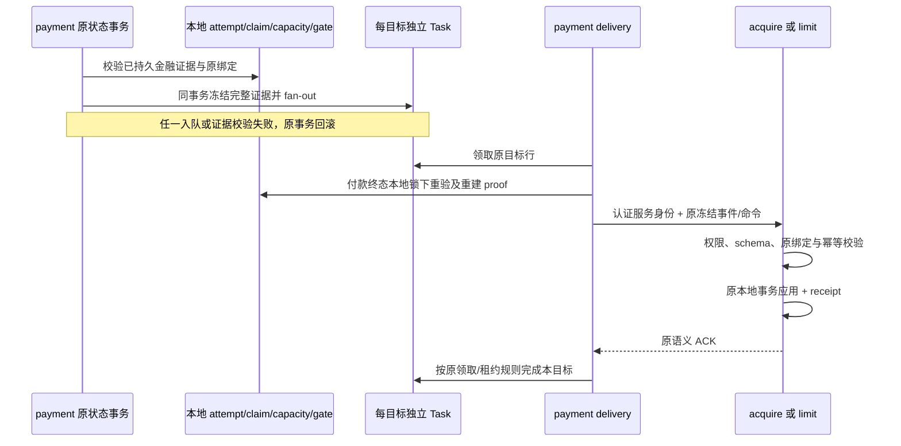

# 阶段 3：自包含财务证据与消费验证

日期：2026-11-16。状态：契约、生产、消费、调用方及回归测试源码已调整，仅做静态核对；按要求未运行构建、测试、格式化插件、数据库操作、部署或真实交付验收。本文补充并更新 [阶段 3 首批记录](PHASE3_IMPLEMENTATION.md)，不代表运行验收通过。

## 1 调整范围与逐条决策

| 调用位置 | 新完整证据路径 | 原冻结载荷路径 | 决策依据 |
|---|---|---|---|
| PaymentOutcomeEventService → payment.facts | 移除本次同步读取；从 PaymentFinancialEvidence 构造原终态观察，再走既有 terminal/convergeLocked | 无 financialEvidence 时保留原读取、错误和回执优先顺序 | 付款终态不可变；完整原绑定、活动尝试、版本、证据、发起时间及围栏可在原事务冻结 |
| LimitSettlementService.confirm → payment.paymentFacts | 从证据构造相同本地 facts，继续检查原 reservation、attempt、policy、items、gate、原桶及 receipt | 保持原先查询后查 receipt 的顺序 | 成功证明与本地执行尝试绑定，不能把事件送达当额度已确认 |
| LimitSettlementService.release → payment.paymentFacts | 从负向终态证据构造 facts，要求 FAILED/CLOSED 和永久不收款围栏；保留 Release-before-Reserve 的 gate 处理 | 同上，保留旧错误及可用性顺序 | 失败任务、超时、未知结果、普通事件均不提供不收款证明 |
| LimitRefundService.restoreRefund → payment.refundFacts | **保留**；新增冻结退款/原付款证据校验，再按查到的最新累计值恢复 | 保持已有先回放本地 receipt、再查证顺序 | 旧实现使用 queried cumulative/version 写恢复高水位与回执；只用事件累计值会改变晚到事件首次恢复额、返回值及错误语义 |
| FeeRefundOutcomeService → payment.refundSummary | **保留**，沿用来源身份与最新汇总校验 | 同原逻辑 | 旧实现允许收到低版本事件时应用当前更高的 verified version/refundedMinor；只用冻结快照会改变 appliedVersion 和费用基数 |
| PaymentOutcomeDeliverySupport → 本地 payment/attempt/claim/capacity/gate | **保留本地验证**，新证据与从本地权威来源重建的证据逐字段一致后才能发送 | 保留原本地验证 | 这些是生产方交付时的本地金融门禁，不是跨服务回查 |

本轮替代上述前三个满足条件的同步读取点，不删除仍被恢复、旧载荷或最新累计语义使用的端口/HTTP 权限。退款最新读取是明确保留的业务职责，不列为“可安全删除但尚未完成”的查询。若未来需要退款完全离线消费，必须另行设计最新累计事实推进协议及其活性、乱序、补偿和回执语义。

## 2 证据契约与类型

新增类型均在 contracts-events，消费者不依赖 payment app/domain：

| 类型 | 字段与约束 |
|---|---|
| PaymentFinancialEvidence | schemaVersion=1；payment/order/allocation/operation/payeeMerchant；正数 CNY 原金额；SUCCEEDED/FAILED/CLOSED；paymentVersion>0；terminalEvidenceId；activeAttemptId；initiatedAt；succeededAt；executionFenced |
| RefundFinancialEvidence | schemaVersion=1；refund/request/version/evidence；退款金额；cumulativePaymentRefundedMinor；paymentRefundVersion；refundedAt；完整原 PaymentFinancialEvidence |

付款成功必须有活动尝试和成功时间，成功时间不得早于发起时间；FAILED/CLOSED 必须有永久 executionFenced 且不得有 succeededAt，允许从未形成 attempt 的关闭。退款必须引用已成功原付款，满足 `0 < refundAmount ≤ cumulative ≤ originalPaymentAmount`，退款及容量版本为正。时间按既有 BusinessTime 规范化；不新增跨聚合时钟先后假设。

PaymentOutcomeEventDTO/RefundOutcomeEventDTO 的 financialEvidence 与原外层字段逐项绑定，不允许证据金额、身份、状态、版本或累计值与外层不一致。原始 DTO 的其他校验保留。

| 新生产 EventEnvelope.eventType | schemaVersion | 原 Task 路由 |
|---|---|---|
| pay.payment.financial-outcome.v1 | 1 | pay.payment.outcome.acquire.v1 / limit.v1 / risk.v1 |
| pay.payment.refund-financial-outcome.v1 | 1 | pay.payment.refund.limit.v1 |

新类型必须包含完整 proof。旧 canonical `pay.payment.outcome.v1`、`pay.payment.refund-outcome.v1` 和各入口明确列举的原目标类型仅接受无 proof 的原形态。新类型缺 proof、旧类型夹带 proof、未知 schema、错 producer/id/version 均拒绝；**不因证据损坏回退同步查询**。类型承担不同契约的区分，不能只凭某字段缺失猜测新事件是否允许降级。

旧 Task/FAILED/replay 数据不重写。financialEvidence 为 null 时不序列化该字段，缺字段可读为 null；不提供旧 Java 构造重载，源码调用方明确传递 proof 或 null。null 只用于既有冻结记录和对应旧路径。

## 3 生产、消费和依赖

PaymentEvents 复用原 freezeSnapshot 的尝试、正向永久 claim 或负向围栏验证，再冻结完整付款证据。PaymentOutcomeDeliverySupport 在原锁下重建 proof，不用当前退款累计量覆盖原成功付款金额；后来设置的 gate fence 不使先前成功事实失效。

RefundProjectionEvents 仅在成功退款时调用 RefundFinancialEvidenceVerifier。Verifier 要求原可写事务，核对退款永久 claim 与 channel/account/transaction 全局 claim、渠道退款身份、原付款/尝试、退款金额和 receipt、退款时间与原成功容量；成功后才构造证据。RefundResultService 仍先 insertClaim/update 原金融状态，再调用 projections，全部同事务提交。验证异常继续中止原事务，其他目标没有“先成功提交”的新窗口。

PaymentLimitOutcomeDelivery/RefundLimitDelivery 映射 proof 到原 confirm/release/restore 命令；RemoteContractConverter 保持共享 proof 原类型，消费方不跨越 app/domain 边界。limitcenter-client 新增直接 contracts-events 依赖，无新应用、模块、队列、数据库表或部署参数。

Acquire 仍从持久订单、allocation、准入与原付款意图恢复归属，proof 不提供新的 merchant/tenant 权限。Limit 仍验证实际 service_id、scope 与本地 reservation caller；证据不替代认证，也不启用公共匿名事件入口。

退款消费先执行原 bind，再比较 proof 的原付款 amount/version/evidence/attempt/initiatedAt/order/merchant、退款 request/id/version/evidence、原命令金额/累计及币种。冻结容量版本与累计不得领先最新 authority；同容量版本必须具有相同累计额。随后仍以 authority 的最新累计恢复原桶，回执区分收到的累计与已验证累计/版本。

## 4 幂等、错误与可靠交付

- acquire digest 和额度 confirm/release/restore digest 在 proof 存在时追加带版本标记的完整字段，沿用 UTF-8 字节长度分帧。proof 中的尝试、时间、容量版本等发生变化，同投递/业务键必须冲突；无 proof 时原摘要输入逐字不变。
- 原 businessEventId、deliveryId、原聚合版本及租户/来源服务绑定不变。完整 proof 不允许重新 credit 同一 allocation 或重复恢复同一 item 高水位。
- acquire 保持先查本地 receipt；limit confirm/release 仍在本地事务内查 receipt，完整 proof 只消除远端读取，未增加提前 ACK；restore 保持先回放 receipt。
- malformed envelope/codec、原绑定冲突、无权限、未就绪、幂等冲突和本地提交异常继续使用原入口对应的结果码；不吞异常、不把查询失败或未知结果转成成功，不新增远端自动重试。
- 原 bucket/item/gate、订单/费用和 receipt 更新继续同本地事务。Task 领取、租约、FAILED/replay、每目标 ACK/重试均沿用既有机制。单个目标 ACK 仍不表示所有目标完成或商户已收到通知。

## 5 文件与调整顺序

| 顺序 | 模块/主要文件 | 责任 |
|---|---|---|
| 1 | contracts-events：BusinessEventTypes、payment/PaymentFinancialEvidence、RefundFinancialEvidence、PaymentOutcomeEventDTO、RefundOutcomeEventDTO | 完整证据、强制类型及旧冻结形态的区分 |
| 2 | payment app：PaymentResultConverter、PaymentEvents、RefundFinancialEvidenceVerifier、RefundProjectionEvents；dispatch/PaymentFactRoutes、PaymentDeliveryRoutes | 在金融事务内验证/冻结；注册新事实与原路由 |
| 3 | payment app：PaymentOutcomeDeliverySupport、PaymentOutcomeDeliveryConverter、PaymentLimitOutcomeDelivery、RefundSettlementConverter、RefundLimitDelivery | 来源重验和证据透传、ACK/队列门禁 |
| 4 | limitcenter-client/pom.xml 与 command/LimitConfirmCommand、LimitReleaseCommand、LimitRefundRestoreCommand；payment app 同名本地命令 | 明确共享依赖与命令字段，无兼容构造重载 |
| 5 | acquire app：PaymentEventConverter、PaymentOutcomeEventService；infrastructure/codec/PaymentEventCodecImpl | 完整付款消费、原绑定/原子应用、摘要 |
| 6 | limitcenter app：LimitSettlementConverter、LimitSettlementService、LimitRefundService | 满足条件时取消付款回查；退款仍读最新并验证捕获证据 |
| 7 | 下表测试、手动构造和持久化 IT 装配、各架构说明 | 新旧路径及失败反例、配套来源与消费模块 |

## 6 验收清单

已完成的静态核对：`git diff --check` 无错误；涉及七类记录的直接构造调用未发现参数数量不匹配；新增依赖 POM 可解析；财务证据引用与本记录/阶段 3 主记录的本地链接无缺失。当前工具未提供 IDEA 检查能力，未执行 IDE 检查或代码生成验证。

以下为已编写/调整的验证源码及验收要求，**全部未执行**，不将静态阅读等同于编译、通过测试或数据库证明。

| 验收条件 | 对应源码 |
|---|---|
| 新类型完整 proof 往返；旧 null proof 缺字段读取且序列化省略；缺 proof/错类型/schema/金额/累计拒绝 | PaymentOutcomeEnvelopeCodecImplTest、RefundProjectionEnvelopeCodecImplTest、PaymentEventContractTest |
| 多目标同 fact 独立 delivery；冻结完整新事实；生产失败仍中止 owning transaction | PaymentFactPublisherTest、PaymentEventsTest、RefundProjectionEventsTest |
| 交付前本地 claim 与冻结成功时间等完整 proof 一致；缺 proof 不降级；原 confirm/release/restore 命令完整透传证据 | PaymentOutcomeDeliverySupportTest、PaymentLimitOutcomeDeliveryTest、RefundLimitDeliveryTest |
| acquire 新成功/永久不收款路径不调用 payment.facts；权限、一次落账、回放及 proof 变更冲突 | PaymentOutcomeEventServiceTest |
| 原摘要固定期望保留；新增尝试/时间进入摘要，等价 offset 不改变摘要 | PaymentEventCodecImplTest |
| limit 完整证据 confirm/release 不调用 paymentFacts；原桶、活动尝试、空 reservation 围栏、权限/回执失败；旧命令仍在事务外查询 | LimitSettlementServiceTest |
| 退款 proof 从原事务永久 claim 与原付款冻结，缺全局 claim/无事务拒绝 | RefundSettlementFactsServiceTest |
| 退款保留最新累计推进、receipt 重放无第二次读取；同版本异累计、未来容量版本与 proof 改参拒绝 | LimitRefundServiceTest |
| 费用退款最新版本应用、身份、原参数重放、重复/乱序与失败回滚 | 原 FeeRefundOutcomeServiceTest 保留 |
| 真实事务原子性、并发与未知交付重试 | 原 PaymentResultPersistenceIT、RefundRecoveryHandlerPersistenceIT、AcquiringFinancialPersistenceIT 及额度持久化验收；退款 IT 手动装配已接真实 verifier |

运行验收仍需证明原状态/claim/所有 Task 同事务、各消费状态与 receipt 同事务、重复与并发幂等、失败重试不重复资金效果、权限与租户隔离。不得以 mock 中记录的事务次数替代 PostgreSQL 回滚或端到端证据。

## 7 配套发布及回退边界

先准备 contracts、完整读取方及命令字段，再启用完整证据生产；Pay/依赖工件需配套本地验证后发布。当前未部署、未改写数据库。旧 reader 不理解新类型，因此不能在已有新 Task/receipt 后直接回退至仅识别旧类型的版本。

如需回退新生产逻辑，保留新旧读取能力及 proof 摘要规则，先核对已提交、PROCESSING、FAILED/replay 与回执保留范围；不重写原 payload/type/id/version/digest，不丢弃新事件，不在原行上填补 proof。冻结旧读取能力的收缩必须等历史数据生命周期结束后另行决定。
