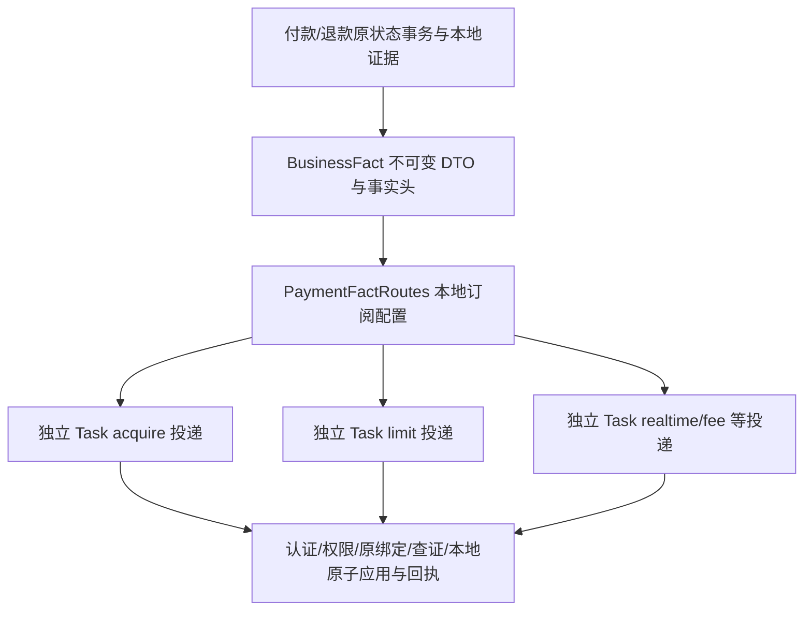

# 阶段 3：业务事实与目标投递边界

日期：2026-11-15 首批，2026-11-16 补齐财务证据。当前状态：事实/投递边界、自包含付款/退款证据与消费验证的源码及回归源码已调整；完整证据付款落账与额度 confirm/release 已替代同步回查。退款恢复/费用仍按原语义读取最新累计，旧冻结载荷保留原查证。详见 [财务证据补充记录](PHASE3_FINANCIAL_EVIDENCE.md)。仅静态核对，未构建、测试或运行验收；阶段 4～5 未开始。

以下第 1～4 节及原文件清单保留 2026-11-15 首批切片记录；第 5～7 节同步当前状态。当前完整查询决策、证据类型、依赖、文件、回退及验收清单以补充记录为准。

## 1 交付边界

本轮按“先付款、再额度消费、再退款”的顺序，规范现有事实与交付的职责。新增 canonical 业务类型用于新发布；旧目标名称继续作为 Task 路由。事件到达、某个目标 ACK、所有目标交付完成、金融终态和商户通知成功仍是不同事实。

原方案规定：未满足可信生产者、完整证据、原绑定、幂等回执及本地原子应用前继续同步查证。当前 PaymentOutcomeEventDTO 缺活动尝试和终态时间等信息；额度、退款以及费用退款还有不同的证据和重放要求。本轮保留这些查询，不把改事件名称当作证据充分，也不因未运行验收就删除金融防线。逐项决策见第 5 节。

## 2 事实与投递模型

BusinessFact 位于 contracts-events，包含 businessEventId、producer、eventType、schemaVersion、aggregateId/version、occurredAt 和不可变 DTO。它不包含目标或 deliveryId。每个目标通过 delivery 创建原 EventEnvelope 结构并分配不同 deliveryId；业务身份、来源版本、时间和载荷不因目标改变。业务身份必须连同生产者、事实类型和原聚合绑定理解，不能把 deliveryId 或任意 businessEventId 当金融证据。

这是逻辑职责与持久交付的分离，不是新增事件存储中心：事实头和不可变载荷随各目标 Task 行持久化，不新增独立事实表。业务聚合仍是权威状态；目标行各自领取、租约、重试、FAILED/replay 和完成。同一原事务原子写全部目标行；任何 enqueue 异常继续抛出，使原事务回滚。没有新跨服务事务、MQ 或全局工作流。

### 2.1 新事实类型与既有队列路由

| 新 EventEnvelope.eventType | 保持不变的 Task.type | 载荷及实际消费 |
|---|---|---|
| pay.payment.outcome.v1 | pay.payment.outcome.acquire.v1 / limit.v1 / risk.v1 | PaymentOutcomeEventDTO；订单消费、额度命令映射、本地 RiskOutcomeGateway |
| pay.payment.snapshot.v1 | pay.payment.snapshot.realtime.v1 | PaymentSnapshotEventDTO；交易投影 |
| pay.payment.refund-outcome.v1 | pay.payment.refund.limit.v1 | RefundOutcomeEventDTO；成功退款映射原额度恢复命令 |
| pay.payment.refund-snapshot.v1 | pay.payment.refund.realtime.v1 | RefundSnapshotEventDTO；退款投影 |
| pay.payment.order-refund-summary.v1 | pay.payment.refund-summary.realtime.v1 / pay.payment.refund.fee.v1 | OrderRefundSummaryEventDTO；同一汇总事实投递 realtime 与费用消费 |
| pay.payment.refund-progress.v1 | pay.payment.refund.merchant.v1 | RefundMerchantEventDTO；退款/退款请求完成的商户通知唤醒 |
| pay.acquire.order-snapshot.v1 | pay.acquire.snapshot.realtime.v1 | OrderSnapshotEventDTO；订单投影 |

第一行的完整路由分别为 pay.payment.outcome.acquire.v1、pay.payment.outcome.limit.v1、pay.payment.outcome.risk.v1。schemaVersion 保持 1，既有 DTO 字段结构不变；新业务类型不在名字中编码消费者。RefundMerchantEventDTO 的现有名称/字段继续保留，不开展无关 DTO 批量重命名。

### 2.2 付款侧装配归属

- PaymentEvents 只冻结付款终态与生命周期快照，不列出 acquire/limit/risk 目标。
- RefundProjectionEvents 只冻结退款、汇总及进展事实。汇总只生成一次，realtime/fee 两个目标共享 businessEventId 与载荷，各自 deliveryId。
- PaymentFactPublisher 只在原可写本地事务中分发，不裁定金融状态。PaymentFactRoutes/PaymentFactDeliveryConfiguration 在 app.dispatch 负责订阅，后者通过本模块 AutoConfiguration.imports 在用户配置之后登记默认注册表；默认九条目标路线保留，重复、缺失或错绑既有必需路线会在配置构造时失败。
- 增加订阅须提供含全部既有必需路线的扩展注册表及对应 handler/消费实现，不修改 PaymentEvents 或 RefundProjectionEvents 的事实生产。没有新增可绕过权限的 HTTP 配置入口。
- payment 原常量迁至 PaymentDeliveryRoutes，handler 与 delivery 使用路由常量；acquire 的单目标订单投递常量明确命名为 DELIVERY_TYPE。Task event_type 列的值不改。

## 3 消费边界与既有冻结记录

contracts-events 的 FrozenEventTypes 只支持预先声明的当前 canonical 类型及该入口原有的冻结 v1 标签，不改写任何已冻结头或载荷。DTO 仍验证生产者、schema、聚合 ID/版本和 data 绑定；消费入口继续限制自己的旧标签，不能将 limit 的旧标签拿到 acquire 入口使用。

付款侧 delivery 仍核对 event/message/stored Task 行的路由、版本、businessId 和 PROCESSING 状态，再核对业务事实类型及原聚合。终态 delivery 的本地锁、执行围栏、尝试、claim、金额和原接收意图查验保留。所有 HTTP/Risk 调用继续在本地锁与事务释放后执行，语义 ACK 的字段/状态规则不变。

已持久化的旧标签载荷必须原样投递或重放：PaymentEventCodecImpl、TradeProjectionCodecImpl、费用消费 digest 继续使用收到的原 eventType。不能把同一个 deliveryId 的旧类型改成新类型，否则原请求摘要应冲突。保留读取是为保护已提交交付和历史回执，不提供旧生产构造器、双写或混合版本运行方案；新生产只有 canonical 路径。未来移除读取支持须先处理旧待投递/FAILED/replay 记录及其回执保留期，不能仅依据新生产已切换就删除。

公共事实头的 producer 声明不是认证身份；service_id/sub/issuer/audience/权限和本地部署范围仍由原安全入口确定。没有改成信任 HTTP body、Header 或事件中商户字段。

## 4 文件与调整顺序

| 顺序 | 位置 | 调整 |
|---|---|---|
| 1 | contracts-events：BusinessEventTypes、BusinessFact、FrozenEventTypes；七类事件 DTO | 定义目标无关事实类型、独立交付身份和限定的冻结读取；原载荷构造校验保留 |
| 2 | payment app.dispatch：PaymentDeliveryRoutes、PaymentFactRoutes、PaymentFactPublisher、PaymentFactDeliveryConfiguration | 分离队列路由、订阅自动配置及 imports 和原事务 fan-out |
| 3 | PaymentEvents、RefundProjectionEvents | 生产事实，不枚举目标；统一退款汇总业务身份 |
| 4 | payment delivery/support、九类 Task handler、RefundProjectionEnvelopeCodecImpl | 路由验证与事实验证分开；保留原 ACK、本地证据和队列状态门禁 |
| 5 | acquire PaymentOutcomeEventService/FeeRefundOutcomeService、订单生产/投递；realtime TradeProjectionService | 新事实头接入，保留来源认证、目标旧类型约束、查证、回执和应用事务 |
| 6 | 原测试夹具、producer/output 断言、真实数据库 IT 构造调用 | 同步路由常量和注册表参数，不删除原可靠性断言 |
| 7 | 新 fan-out/路由/冻结契约测试、原消费服务冻结回放测试、固定旧/新摘要期望 | 补齐业务身份与投递身份分离、配置不可漏目标、旧记录不重写的回归源码 |
| 8 | 架构、契约、阶段及依赖记录 | 同步当前状态、回查清单、验证限制与未完成门禁 |

payment app 新增直接 spring-boot-autoconfigure 声明，用于路由配置的 ConditionalOnMissingBean；版本由既有 BOM 管理。无新模块、SQL、迁移、部署键或数据回填。PaymentEvents 与 RefundProjectionEvents 构造器新增路由注册表参数，手工调用/子类测试已同步；不保留旧重载。

## 5 同步查证治理与例外清单（2026-11-16 更新）

| 链路 | 当前决策 |
|---|---|
| 付款 → acquire 首次落账 | 完整 PaymentFinancialEvidence 经类型、来源与原订单/分配绑定校验后走原 terminal/convergeLocked，不调用 payment.facts；旧冻结无 proof 路径保留原查询与错误语义 |
| 付款 → limit confirm/release | 完整证据构造原 facts，继续验证 reservation/gate/attempt/policy/原桶与 receipt，不调用 paymentFacts；旧命令仍在 receipt 前查证 |
| 退款 → limit restore | 完整 RefundFinancialEvidence 已冻结并消费验证；保持先回放 receipt、再查最新 refundFacts，并使用最新累计/容量版本恢复，不用旧事件累计替代 |
| 退款汇总 → acquire 费用 | 保留 refundSummary 最新汇总查询；继续允许晚到事件应用当前更高 verified version/refundedMinor，原来源身份与回执保持 |
| 付款侧本地终态/claim 验证 | 原数据库锁、attempt/claim/capacity/围栏检查保留；发送前逐字段重建并比较完整 proof |
| realtime/商户通知 | 保持原来源版本、去重及各自完成条件，不把目标 ACK 或通知唤醒视为资金证明 |

新类型 pay.payment.financial-outcome.v1 / pay.payment.refund-financial-outcome.v1 必须含完整 proof；旧 canonical/限定目标类型只接受原 null-proof 形态。缺失、错绑、未知版本不得回退查询。新增字段进入 proof 存在时的摘要，无 proof 的旧摘要输入保持原样。退款最新累计查询属于保留语义，非尚待批量删除的缺口。详细证据及文件见[财务证据记录](PHASE3_FINANCIAL_EVIDENCE.md)。

## 6 验收矩阵与未运行项

| 编号 | 条件与入口 | 本轮结果 |
|---|---|---|
| G3-1 | 新事实类型无目标名；PaymentEvents/RefundProjectionEvents 无目标枚举；注册表有唯一装配归属 | 源码已调整，静态核对；路由配置测试未运行 |
| G3-2 | 一个事实多目标共享身份/载荷、deliveryId 各异；可扩展订阅且不能遗漏既有必需目标 | PaymentFactPublisherTest、RefundProjectionEventsTest 已补源码，未运行 |
| G3-3 | 原事务 fan-out，任一 enqueue 失败传播并回滚；重试及目标进度相互独立 | 新 publisher 失败测试、原 PaymentResultPersistenceIT/RefundRecoveryHandlerPersistenceIT/Task 事务回归源码保留，未运行；真实数据库待验收 |
| G3-4 | 新/冻结类型均受数据、producer/schema/id/version 约束；错误旧目标标签不得跨入口使用 | FrozenEventContractTest 及原 delivery/codec 反例源码保留，未运行 |
| G3-5 | 旧载荷和 receipt 摘要不重写；同 delivery 的变更仍冲突 | 有 proof 时追加完整字段；无 proof 时原输入保持不变；固定旧/新头摘要及 proof 变更/等价时间用例源码已补，未运行 |
| G3-6 | 原身份、权限、租户、绑定、围栏、金额、ACK 与 receipt 原子性 | 原安全入口与金融 IT 回归保留，acquire/limit 消费和来源验证已调整并补失败反例源码；未运行 |
| G3-7 | 自包含财务证据足以替代回查，源版本/冲突/重复/失败回滚通过验收 | 完整证据及符合条件的付款回查替代源码已调整，退款最新累计语义保留；全部相关测试及真实事务验收未运行，不能标记阶段 3 运行验收通过 |

固定摘要期望独立按原 UTF-8 长度分帧协议计算，未执行 Java codec 生成期望。测试中设置事务标记只验证 publisher 入口，不证明 PostgreSQL 原子性。未运行构建、测试、数据库操作、真实 HTTP、部署或金融验收。

## 7 配套交付与保留限制

contracts-events、payment、acquire、realtime 源码需配套准备；limit 三类命令已增加共享 proof 字段；risk 仍经原本地金融验证及回执机制。不发布中间混合版本，不在运行中重写旧 Task 或 receipt。本轮不存在迁移 SQL，但新增事件类型仍需全链路本地验证后方可发布。

当前尚未部署或运行，本轮没有实际生成需迁移的数据。未来发布后若已有 canonical 类型记录，不能简单恢复仅理解旧标签的 reader；应保留本轮两类记录读取能力，停止或回退新生产逻辑前先核对已提交 Task、FAILED/replay 及 receipt 保留需求。不得为回退而改写原 payload、deliveryId 或摘要；读取支持的收缩需在历史记录生命周期关闭后单独实施。此处是数据保全约束，不自动授权部署、停机或数据操作。

阶段 3 的事实/投递边界源码切片可审阅；回查替代与 G3 运行门禁仍开放。阶段 4/5、金融状态机、全局事务及商户 HTTP 协议不在本轮范围。

## 8 静态结果与精确文件清单

清单相对本轮开始前的工作区生成，保留此前未提交修改。静态检查通过：七类既有 DTO 的字段签名与商业构造校验不变；新路由自动配置导入唯一并有对应源码；旧生产常量调用已迁移；变更 POM XML/直接声明无重复，文档本地链接与 diff 空白检查通过。limitcenter 生产源码、各 adapter/security、安全配置及原付款/投影摘要实现未改；无 SQL/YAML 变更。上述不代表 Java 编译、Spring 装配、单测、PostgreSQL 原子性或真实交付成功。

### 生产源码与装配资源

- [loadup-pay/loadup-pay-acquire/loadup-pay-acquire-app/src/main/java/io/github/loadup/acquire/app/service/FeeRefundOutcomeService.java](../loadup-pay-acquire/loadup-pay-acquire-app/src/main/java/io/github/loadup/acquire/app/service/FeeRefundOutcomeService.java)
- [loadup-pay/loadup-pay-acquire/loadup-pay-acquire-app/src/main/java/io/github/loadup/acquire/app/service/OrderSnapshotDelivery.java](../loadup-pay-acquire/loadup-pay-acquire-app/src/main/java/io/github/loadup/acquire/app/service/OrderSnapshotDelivery.java)
- [loadup-pay/loadup-pay-acquire/loadup-pay-acquire-app/src/main/java/io/github/loadup/acquire/app/service/OrderSnapshotEvents.java](../loadup-pay-acquire/loadup-pay-acquire-app/src/main/java/io/github/loadup/acquire/app/service/OrderSnapshotEvents.java)
- [loadup-pay/loadup-pay-acquire/loadup-pay-acquire-app/src/main/java/io/github/loadup/acquire/app/service/PaymentOutcomeEventService.java](../loadup-pay-acquire/loadup-pay-acquire-app/src/main/java/io/github/loadup/acquire/app/service/PaymentOutcomeEventService.java)
- [loadup-pay/loadup-pay-acquire/loadup-pay-acquire-infrastructure/src/main/java/io/github/loadup/acquire/infrastructure/outbox/OrderSnapshotTaskHandler.java](../loadup-pay-acquire/loadup-pay-acquire-infrastructure/src/main/java/io/github/loadup/acquire/infrastructure/outbox/OrderSnapshotTaskHandler.java)
- [loadup-pay/loadup-pay-contracts/loadup-pay-contracts-events/src/main/java/io/github/loadup/contracts/event/BusinessEventTypes.java](../loadup-pay-contracts/loadup-pay-contracts-events/src/main/java/io/github/loadup/contracts/event/BusinessEventTypes.java)
- [loadup-pay/loadup-pay-contracts/loadup-pay-contracts-events/src/main/java/io/github/loadup/contracts/event/BusinessFact.java](../loadup-pay-contracts/loadup-pay-contracts-events/src/main/java/io/github/loadup/contracts/event/BusinessFact.java)
- [loadup-pay/loadup-pay-contracts/loadup-pay-contracts-events/src/main/java/io/github/loadup/contracts/event/FrozenEventTypes.java](../loadup-pay-contracts/loadup-pay-contracts-events/src/main/java/io/github/loadup/contracts/event/FrozenEventTypes.java)
- [loadup-pay/loadup-pay-contracts/loadup-pay-contracts-events/src/main/java/io/github/loadup/contracts/event/acquire/OrderSnapshotEventDTO.java](../loadup-pay-contracts/loadup-pay-contracts-events/src/main/java/io/github/loadup/contracts/event/acquire/OrderSnapshotEventDTO.java)
- [loadup-pay/loadup-pay-contracts/loadup-pay-contracts-events/src/main/java/io/github/loadup/contracts/event/payment/OrderRefundSummaryEventDTO.java](../loadup-pay-contracts/loadup-pay-contracts-events/src/main/java/io/github/loadup/contracts/event/payment/OrderRefundSummaryEventDTO.java)
- [loadup-pay/loadup-pay-contracts/loadup-pay-contracts-events/src/main/java/io/github/loadup/contracts/event/payment/PaymentOutcomeEventDTO.java](../loadup-pay-contracts/loadup-pay-contracts-events/src/main/java/io/github/loadup/contracts/event/payment/PaymentOutcomeEventDTO.java)
- [loadup-pay/loadup-pay-contracts/loadup-pay-contracts-events/src/main/java/io/github/loadup/contracts/event/payment/PaymentSnapshotEventDTO.java](../loadup-pay-contracts/loadup-pay-contracts-events/src/main/java/io/github/loadup/contracts/event/payment/PaymentSnapshotEventDTO.java)
- [loadup-pay/loadup-pay-contracts/loadup-pay-contracts-events/src/main/java/io/github/loadup/contracts/event/payment/RefundMerchantEventDTO.java](../loadup-pay-contracts/loadup-pay-contracts-events/src/main/java/io/github/loadup/contracts/event/payment/RefundMerchantEventDTO.java)
- [loadup-pay/loadup-pay-contracts/loadup-pay-contracts-events/src/main/java/io/github/loadup/contracts/event/payment/RefundOutcomeEventDTO.java](../loadup-pay-contracts/loadup-pay-contracts-events/src/main/java/io/github/loadup/contracts/event/payment/RefundOutcomeEventDTO.java)
- [loadup-pay/loadup-pay-contracts/loadup-pay-contracts-events/src/main/java/io/github/loadup/contracts/event/payment/RefundSnapshotEventDTO.java](../loadup-pay-contracts/loadup-pay-contracts-events/src/main/java/io/github/loadup/contracts/event/payment/RefundSnapshotEventDTO.java)
- [loadup-pay/loadup-pay-payment/loadup-pay-payment-app/src/main/java/io/github/loadup/payment/app/dispatch/PaymentDeliveryRoutes.java](../loadup-pay-payment/loadup-pay-payment-app/src/main/java/io/github/loadup/payment/app/dispatch/PaymentDeliveryRoutes.java)
- [loadup-pay/loadup-pay-payment/loadup-pay-payment-app/src/main/java/io/github/loadup/payment/app/dispatch/PaymentFactDeliveryConfiguration.java](../loadup-pay-payment/loadup-pay-payment-app/src/main/java/io/github/loadup/payment/app/dispatch/PaymentFactDeliveryConfiguration.java)
- [loadup-pay/loadup-pay-payment/loadup-pay-payment-app/src/main/java/io/github/loadup/payment/app/dispatch/PaymentFactPublisher.java](../loadup-pay-payment/loadup-pay-payment-app/src/main/java/io/github/loadup/payment/app/dispatch/PaymentFactPublisher.java)
- [loadup-pay/loadup-pay-payment/loadup-pay-payment-app/src/main/java/io/github/loadup/payment/app/dispatch/PaymentFactRoutes.java](../loadup-pay-payment/loadup-pay-payment-app/src/main/java/io/github/loadup/payment/app/dispatch/PaymentFactRoutes.java)
- [loadup-pay/loadup-pay-payment/loadup-pay-payment-app/src/main/java/io/github/loadup/payment/app/service/PaymentAcquireOutcomeDelivery.java](../loadup-pay-payment/loadup-pay-payment-app/src/main/java/io/github/loadup/payment/app/service/PaymentAcquireOutcomeDelivery.java)
- [loadup-pay/loadup-pay-payment/loadup-pay-payment-app/src/main/java/io/github/loadup/payment/app/service/PaymentEvents.java](../loadup-pay-payment/loadup-pay-payment-app/src/main/java/io/github/loadup/payment/app/service/PaymentEvents.java)
- [loadup-pay/loadup-pay-payment/loadup-pay-payment-app/src/main/java/io/github/loadup/payment/app/service/PaymentLimitOutcomeDelivery.java](../loadup-pay-payment/loadup-pay-payment-app/src/main/java/io/github/loadup/payment/app/service/PaymentLimitOutcomeDelivery.java)
- [loadup-pay/loadup-pay-payment/loadup-pay-payment-app/src/main/java/io/github/loadup/payment/app/service/PaymentOutcomeDeliverySupport.java](../loadup-pay-payment/loadup-pay-payment-app/src/main/java/io/github/loadup/payment/app/service/PaymentOutcomeDeliverySupport.java)
- [loadup-pay/loadup-pay-payment/loadup-pay-payment-app/src/main/java/io/github/loadup/payment/app/service/PaymentRealtimeDelivery.java](../loadup-pay-payment/loadup-pay-payment-app/src/main/java/io/github/loadup/payment/app/service/PaymentRealtimeDelivery.java)
- [loadup-pay/loadup-pay-payment/loadup-pay-payment-app/src/main/java/io/github/loadup/payment/app/service/PaymentRiskOutcomeDelivery.java](../loadup-pay-payment/loadup-pay-payment-app/src/main/java/io/github/loadup/payment/app/service/PaymentRiskOutcomeDelivery.java)
- [loadup-pay/loadup-pay-payment/loadup-pay-payment-app/src/main/java/io/github/loadup/payment/app/service/RefundFeeDelivery.java](../loadup-pay-payment/loadup-pay-payment-app/src/main/java/io/github/loadup/payment/app/service/RefundFeeDelivery.java)
- [loadup-pay/loadup-pay-payment/loadup-pay-payment-app/src/main/java/io/github/loadup/payment/app/service/RefundLimitDelivery.java](../loadup-pay-payment/loadup-pay-payment-app/src/main/java/io/github/loadup/payment/app/service/RefundLimitDelivery.java)
- [loadup-pay/loadup-pay-payment/loadup-pay-payment-app/src/main/java/io/github/loadup/payment/app/service/RefundMerchantDelivery.java](../loadup-pay-payment/loadup-pay-payment-app/src/main/java/io/github/loadup/payment/app/service/RefundMerchantDelivery.java)
- [loadup-pay/loadup-pay-payment/loadup-pay-payment-app/src/main/java/io/github/loadup/payment/app/service/RefundProjectionEvents.java](../loadup-pay-payment/loadup-pay-payment-app/src/main/java/io/github/loadup/payment/app/service/RefundProjectionEvents.java)
- [loadup-pay/loadup-pay-payment/loadup-pay-payment-app/src/main/java/io/github/loadup/payment/app/service/RefundRealtimeDelivery.java](../loadup-pay-payment/loadup-pay-payment-app/src/main/java/io/github/loadup/payment/app/service/RefundRealtimeDelivery.java)
- [loadup-pay/loadup-pay-payment/loadup-pay-payment-app/src/main/resources/META-INF/spring/org.springframework.boot.autoconfigure.AutoConfiguration.imports](../loadup-pay-payment/loadup-pay-payment-app/src/main/resources/META-INF/spring/org.springframework.boot.autoconfigure.AutoConfiguration.imports)
- [loadup-pay/loadup-pay-payment/loadup-pay-payment-infrastructure/src/main/java/io/github/loadup/payment/infrastructure/codec/RefundProjectionEnvelopeCodecImpl.java](../loadup-pay-payment/loadup-pay-payment-infrastructure/src/main/java/io/github/loadup/payment/infrastructure/codec/RefundProjectionEnvelopeCodecImpl.java)
- [loadup-pay/loadup-pay-payment/loadup-pay-payment-infrastructure/src/main/java/io/github/loadup/payment/infrastructure/outbox/PaymentAcquireOutcomeTaskHandler.java](../loadup-pay-payment/loadup-pay-payment-infrastructure/src/main/java/io/github/loadup/payment/infrastructure/outbox/PaymentAcquireOutcomeTaskHandler.java)
- [loadup-pay/loadup-pay-payment/loadup-pay-payment-infrastructure/src/main/java/io/github/loadup/payment/infrastructure/outbox/PaymentLimitOutcomeTaskHandler.java](../loadup-pay-payment/loadup-pay-payment-infrastructure/src/main/java/io/github/loadup/payment/infrastructure/outbox/PaymentLimitOutcomeTaskHandler.java)
- [loadup-pay/loadup-pay-payment/loadup-pay-payment-infrastructure/src/main/java/io/github/loadup/payment/infrastructure/outbox/PaymentRealtimeTaskHandler.java](../loadup-pay-payment/loadup-pay-payment-infrastructure/src/main/java/io/github/loadup/payment/infrastructure/outbox/PaymentRealtimeTaskHandler.java)
- [loadup-pay/loadup-pay-payment/loadup-pay-payment-infrastructure/src/main/java/io/github/loadup/payment/infrastructure/outbox/PaymentRiskOutcomeTaskHandler.java](../loadup-pay-payment/loadup-pay-payment-infrastructure/src/main/java/io/github/loadup/payment/infrastructure/outbox/PaymentRiskOutcomeTaskHandler.java)
- [loadup-pay/loadup-pay-payment/loadup-pay-payment-infrastructure/src/main/java/io/github/loadup/payment/infrastructure/outbox/RefundFeeTaskHandler.java](../loadup-pay-payment/loadup-pay-payment-infrastructure/src/main/java/io/github/loadup/payment/infrastructure/outbox/RefundFeeTaskHandler.java)
- [loadup-pay/loadup-pay-payment/loadup-pay-payment-infrastructure/src/main/java/io/github/loadup/payment/infrastructure/outbox/RefundLimitTaskHandler.java](../loadup-pay-payment/loadup-pay-payment-infrastructure/src/main/java/io/github/loadup/payment/infrastructure/outbox/RefundLimitTaskHandler.java)
- [loadup-pay/loadup-pay-payment/loadup-pay-payment-infrastructure/src/main/java/io/github/loadup/payment/infrastructure/outbox/RefundMerchantTaskHandler.java](../loadup-pay-payment/loadup-pay-payment-infrastructure/src/main/java/io/github/loadup/payment/infrastructure/outbox/RefundMerchantTaskHandler.java)
- [loadup-pay/loadup-pay-payment/loadup-pay-payment-infrastructure/src/main/java/io/github/loadup/payment/infrastructure/outbox/RefundRealtimeTaskHandler.java](../loadup-pay-payment/loadup-pay-payment-infrastructure/src/main/java/io/github/loadup/payment/infrastructure/outbox/RefundRealtimeTaskHandler.java)
- [loadup-pay/loadup-pay-payment/loadup-pay-payment-infrastructure/src/main/java/io/github/loadup/payment/infrastructure/outbox/RefundSummaryRealtimeTaskHandler.java](../loadup-pay-payment/loadup-pay-payment-infrastructure/src/main/java/io/github/loadup/payment/infrastructure/outbox/RefundSummaryRealtimeTaskHandler.java)
- [loadup-pay/loadup-pay-realtime/loadup-pay-realtime-service/src/main/java/io/github/loadup/realtime/app/service/TradeProjectionService.java](../loadup-pay-realtime/loadup-pay-realtime-service/src/main/java/io/github/loadup/realtime/app/service/TradeProjectionService.java)

### 测试源码

- [loadup-pay/loadup-pay-acquire/loadup-pay-acquire-app/src/test/java/io/github/loadup/acquire/app/service/FeeRefundOutcomeServiceTest.java](../loadup-pay-acquire/loadup-pay-acquire-app/src/test/java/io/github/loadup/acquire/app/service/FeeRefundOutcomeServiceTest.java)
- [loadup-pay/loadup-pay-acquire/loadup-pay-acquire-app/src/test/java/io/github/loadup/acquire/app/service/OrderSnapshotDeliveryTest.java](../loadup-pay-acquire/loadup-pay-acquire-app/src/test/java/io/github/loadup/acquire/app/service/OrderSnapshotDeliveryTest.java)
- [loadup-pay/loadup-pay-acquire/loadup-pay-acquire-app/src/test/java/io/github/loadup/acquire/app/service/OrderSnapshotEventsTest.java](../loadup-pay-acquire/loadup-pay-acquire-app/src/test/java/io/github/loadup/acquire/app/service/OrderSnapshotEventsTest.java)
- [loadup-pay/loadup-pay-acquire/loadup-pay-acquire-app/src/test/java/io/github/loadup/acquire/app/service/PaymentOutcomeEventServiceTest.java](../loadup-pay-acquire/loadup-pay-acquire-app/src/test/java/io/github/loadup/acquire/app/service/PaymentOutcomeEventServiceTest.java)
- [loadup-pay/loadup-pay-acquire/loadup-pay-acquire-infrastructure/src/test/java/io/github/loadup/acquire/infrastructure/codec/PaymentEventCodecImplTest.java](../loadup-pay-acquire/loadup-pay-acquire-infrastructure/src/test/java/io/github/loadup/acquire/infrastructure/codec/PaymentEventCodecImplTest.java)
- [loadup-pay/loadup-pay-acquire/loadup-pay-acquire-infrastructure/src/test/java/io/github/loadup/acquire/infrastructure/repository/AcquiringFinancialPersistenceIT.java](../loadup-pay-acquire/loadup-pay-acquire-infrastructure/src/test/java/io/github/loadup/acquire/infrastructure/repository/AcquiringFinancialPersistenceIT.java)
- [loadup-pay/loadup-pay-payment/loadup-pay-payment-app/src/test/java/io/github/loadup/payment/app/dispatch/FrozenEventContractTest.java](../loadup-pay-payment/loadup-pay-payment-app/src/test/java/io/github/loadup/payment/app/dispatch/FrozenEventContractTest.java)
- [loadup-pay/loadup-pay-payment/loadup-pay-payment-app/src/test/java/io/github/loadup/payment/app/dispatch/PaymentFactPublisherTest.java](../loadup-pay-payment/loadup-pay-payment-app/src/test/java/io/github/loadup/payment/app/dispatch/PaymentFactPublisherTest.java)
- [loadup-pay/loadup-pay-payment/loadup-pay-payment-app/src/test/java/io/github/loadup/payment/app/service/PaymentAcquireOutcomeDeliveryTest.java](../loadup-pay-payment/loadup-pay-payment-app/src/test/java/io/github/loadup/payment/app/service/PaymentAcquireOutcomeDeliveryTest.java)
- [loadup-pay/loadup-pay-payment/loadup-pay-payment-app/src/test/java/io/github/loadup/payment/app/service/PaymentEventsTest.java](../loadup-pay-payment/loadup-pay-payment-app/src/test/java/io/github/loadup/payment/app/service/PaymentEventsTest.java)
- [loadup-pay/loadup-pay-payment/loadup-pay-payment-app/src/test/java/io/github/loadup/payment/app/service/PaymentLimitOutcomeDeliveryTest.java](../loadup-pay-payment/loadup-pay-payment-app/src/test/java/io/github/loadup/payment/app/service/PaymentLimitOutcomeDeliveryTest.java)
- [loadup-pay/loadup-pay-payment/loadup-pay-payment-app/src/test/java/io/github/loadup/payment/app/service/PaymentOutcomeDeliverySupportTest.java](../loadup-pay-payment/loadup-pay-payment-app/src/test/java/io/github/loadup/payment/app/service/PaymentOutcomeDeliverySupportTest.java)
- [loadup-pay/loadup-pay-payment/loadup-pay-payment-app/src/test/java/io/github/loadup/payment/app/service/PaymentRealtimeDeliveryTest.java](../loadup-pay-payment/loadup-pay-payment-app/src/test/java/io/github/loadup/payment/app/service/PaymentRealtimeDeliveryTest.java)
- [loadup-pay/loadup-pay-payment/loadup-pay-payment-app/src/test/java/io/github/loadup/payment/app/service/PaymentRiskOutcomeDeliveryTest.java](../loadup-pay-payment/loadup-pay-payment-app/src/test/java/io/github/loadup/payment/app/service/PaymentRiskOutcomeDeliveryTest.java)
- [loadup-pay/loadup-pay-payment/loadup-pay-payment-app/src/test/java/io/github/loadup/payment/app/service/RefundFeeDeliveryTest.java](../loadup-pay-payment/loadup-pay-payment-app/src/test/java/io/github/loadup/payment/app/service/RefundFeeDeliveryTest.java)
- [loadup-pay/loadup-pay-payment/loadup-pay-payment-app/src/test/java/io/github/loadup/payment/app/service/RefundLimitDeliveryTest.java](../loadup-pay-payment/loadup-pay-payment-app/src/test/java/io/github/loadup/payment/app/service/RefundLimitDeliveryTest.java)
- [loadup-pay/loadup-pay-payment/loadup-pay-payment-app/src/test/java/io/github/loadup/payment/app/service/RefundProjectionEventsTest.java](../loadup-pay-payment/loadup-pay-payment-app/src/test/java/io/github/loadup/payment/app/service/RefundProjectionEventsTest.java)
- [loadup-pay/loadup-pay-payment/loadup-pay-payment-app/src/test/java/io/github/loadup/payment/app/service/RefundRealtimeDeliveryTest.java](../loadup-pay-payment/loadup-pay-payment-app/src/test/java/io/github/loadup/payment/app/service/RefundRealtimeDeliveryTest.java)
- [loadup-pay/loadup-pay-payment/loadup-pay-payment-infrastructure/src/test/java/io/github/loadup/payment/infrastructure/repository/PaymentResultPersistenceIT.java](../loadup-pay-payment/loadup-pay-payment-infrastructure/src/test/java/io/github/loadup/payment/infrastructure/repository/PaymentResultPersistenceIT.java)
- [loadup-pay/loadup-pay-payment/loadup-pay-payment-infrastructure/src/test/java/io/github/loadup/payment/infrastructure/repository/RefundRecoveryHandlerPersistenceIT.java](../loadup-pay-payment/loadup-pay-payment-infrastructure/src/test/java/io/github/loadup/payment/infrastructure/repository/RefundRecoveryHandlerPersistenceIT.java)

### 依赖声明

- [loadup-pay/loadup-pay-payment/loadup-pay-payment-app/pom.xml](../loadup-pay-payment/loadup-pay-payment-app/pom.xml)

### 文档

- [loadup-pay/ARCHITECTURE.md](../ARCHITECTURE.md)
- [loadup-pay/design/ARCHITECTURE_EVOLUTION.md](ARCHITECTURE_EVOLUTION.md)
- [loadup-pay/design/PHASE0_BASELINE.md](PHASE0_BASELINE.md)
- [loadup-pay/design/PHASE0_DEPENDENCIES.md](PHASE0_DEPENDENCIES.md)
- [loadup-pay/design/PHASE0_FLOWS.md](PHASE0_FLOWS.md)
- [loadup-pay/design/PHASE1C_IMPLEMENTATION.md](PHASE1C_IMPLEMENTATION.md)
- [loadup-pay/design/PHASE2_IMPLEMENTATION.md](PHASE2_IMPLEMENTATION.md)
- [loadup-pay/design/PHASE3_IMPLEMENTATION.md](PHASE3_IMPLEMENTATION.md)
- [loadup-pay/loadup-pay-acquire/ARCHITECTURE.md](../loadup-pay-acquire/ARCHITECTURE.md)
- [loadup-pay/loadup-pay-acquire/README.md](../loadup-pay-acquire/README.md)
- [loadup-pay/loadup-pay-contracts/ARCHITECTURE.md](../loadup-pay-contracts/ARCHITECTURE.md)
- [loadup-pay/loadup-pay-contracts/README.md](../loadup-pay-contracts/README.md)
- [loadup-pay/loadup-pay-contracts/loadup-pay-contracts-events/README.md](../loadup-pay-contracts/loadup-pay-contracts-events/README.md)
- [loadup-pay/loadup-pay-limitcenter/ARCHITECTURE.md](../loadup-pay-limitcenter/ARCHITECTURE.md)
- [loadup-pay/loadup-pay-limitcenter/README.md](../loadup-pay-limitcenter/README.md)
- [loadup-pay/loadup-pay-payment/ARCHITECTURE.md](../loadup-pay-payment/ARCHITECTURE.md)
- [loadup-pay/loadup-pay-payment/README.md](../loadup-pay-payment/README.md)
- [loadup-pay/loadup-pay-realtime/ARCHITECTURE.md](../loadup-pay-realtime/ARCHITECTURE.md)
- [loadup-pay/loadup-pay-realtime/README.md](../loadup-pay-realtime/README.md)

