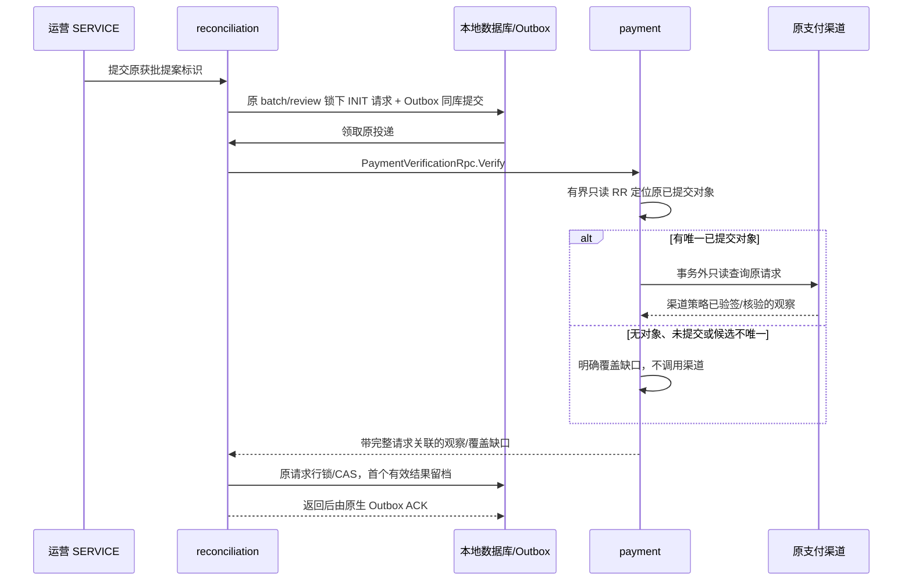

# 获批差错的可信源端查询与观察留档（P1）

更新：2026-10-28。本文对应源码、迁移与测试源码；未运行 IDEA、构建、测试、DDL、部署或真实渠道调用。

## 目标与边界

获批复核可以登记一个持久化查证请求，由 reconciliation 的 Outbox 调用 payment 自有 gRPC；payment 从自己的原始已提交对象发起只读渠道查询。
返回的观察独立留档，不修改原对账输入、差错、批次结果、复核结论或任何付款/退款/费用/额度状态。
RECORDED 表示一次查询结果已经持久化，不表示差错解决、查询证明未收款或资金修正成功。

首期同时支持收款与子退款，原渠道由冻结对象决定；不提供 submit/close/refund/recover 或 Y3 写入口。
商户上传文件、账单行和管理员备注都只是查询提示，不能作为渠道成功/失败或可释放 UNKNOWN 的证明。
真实金融修正与其他受控处置须走源端自己的门禁、证据和资金事务，当前读接口不执行。

## 运营契约与审核

`ReconciliationVerificationFacade` 的运营 HTTP：

| 入口                                          | 参数/结果                                                                             |
|-----------------------------------------------|---------------------------------------------------------------------------------------|
| POST /api/reconciliation/verifications/submit | batchId、differenceId、proposalId、approvalEventId、expectedReviewVersion、requestKey |
| POST /api/reconciliation/verifications/detail | IdQuery(id)，返回原请求、独立观察、版本与原 Outbox 状态/attempts                      |
| POST /api/reconciliation/verifications/retry  | requestId、expectedDeliveryId、审计 reason；只重放原 FAILED Outbox                    |

独立权限 `pay:reconciliation:verification:submit/read/retry`。身份为已验证 SERVICE；租户不由请求传入。
登记要求原差错批次 `DIFFERENCES`、当前账户授权、精确 APPROVED 复核版本/提案/审批事件，
且提案结论为 NEEDS_SOURCE_VERIFICATION。审批仍要求不同于提案的受信 SERVICE，并不构成自然人审批证明。
源请求详情/重试仅原创建 SERVICE 与当前账户授权可操作。

查询范围由服务器冻结：原 review reference（difference/batch/run/resultHash/matchKeyHash）、原 scope、完整自然匹配键、
原 proposal/approval/version，以及 merchantPaymentNo。两侧都存在时优先使用权威 LEDGER 一侧的原请求号，只有 CHANNEL
一侧时使用其请求号。
这样 REQUEST_MISMATCH 不会把账单侧请求号覆盖成本地付款提交参数。外部请求不能指定 binding、credential、渠道 URL、金额或查询结果。

同一 tenant/caller/requestKey 绑定全部原审批标识和 expectedReviewVersion。重放只返回原请求，不重新发布 Outbox、不替换已记录观察。
新 key 可以发起新的只读时点查询，旧结果仍保留；未来如需限频，须在这一登记边界实施，不把同一请求改成新查询。

## 事务与投递

请求与 Outbox 在同一 DataSource 登记，锁序原 batch → review → verification。消息是 owner-local 的
`verification-request-v1:<canonical-base64url-request-id>`，只携带原持久化 id；不持久化公共 DTO JSON，也不允许消息注入新参数。
类型 `pay.reconciliation.verification` / version1；handler 核对可信 tenant、原 deliveryId、businessId、type、PROCESSING 与
attempt。

网络前复核原请求与当前账户/审批授权；RPC 在本地事务外。回包必须完全关联原 provider query，再映射成本服务自有领域回执。
提交前重新锁原范围与请求、核对 native PROCESSING/attempt，INIT → RECORDED/version1 首次有效提交赢得观察。
原生 ACK 与业务留档独立：ACK 丢失后即使 Outbox FAILED，原 RECORDED 快照仍保留；显式重放只补 ACK，不再查询渠道。

多个 worker 或 RPC 回包/数据库提交丢失可能造成重复的只读渠道查询；此机制不承诺外部 IO 只执行一次。
业务 CAS 和不可变回执防止覆盖，原生 claim/lease 保护 Outbox ACK。技术失败保留 INIT，由原生有界退避/失败重放管理。
原件、差错和复核不被观察更新，也不因为查询结果与账单相符就将批次改成 MATCHED。

## payment 提供方契约

`PaymentVerificationFacade.verify(PaymentVerificationQuery)` / `payment_verification.proto` 的
PaymentVerificationRpc.Verify。
只允许配置的 reconciliation SERVICE 和 `pay:payment:reconciliation:verify`；原挂载 Token 需由发行方增加该权限，当前未签发或修改凭证。
没有商户 HTTP 入口，也没有内部 HTTP 回退。

请求含 sourceRequestId、channel、accountScopeHash、PAYMENT/REFUND、merchantPaymentNo、账单原 channelTransactionNo、退款时的子
channelRefundNo。
这些字段仅用来定位/关联提示，不授予提交或资金写权限。

- 收款：按 tenant/channel/实际 accountScopeHash/原 channelRequestNo 有界查找最多两行，从原 attempt 重建不可变 binding，
  校验原 payment/attempt 绑定及实际提交边界。没有当前选路或凭证替换。
- 退款：按 tenant/channel/账户/原付款请求号/子退款号查找；已提交才重建原 PreparedChannelRefund。
  原 attempt、payment、永久成功 claim、原成功时间/流水/金额和容量快照必须一致。
- 本地读取为带 10 秒预算的只读 RR，无金融行锁或写入；签名/凭证读取与渠道 query/queryRefund 在事务外。
- 只接受 QUERY_RESPONSE，必须匹配原 identity、金额及原子退款号。协议/签名/依赖失败不变成业务成功或覆盖缺口。

响应 disposition：

| disposition      | 含义                                                           |
|------------------|----------------------------------------------------------------|
| OBSERVED         | 对唯一原已提交对象完成查询；outcome 可以仍是 ACCEPTED/UNKNOWN  |
| NO_LOCAL_TARGET  | 当前租户/账户/原请求无法定位对象；不是没有收款或没有退款的证据 |
| NOT_SUBMITTED    | 本地对象没有原提交边界；不调用渠道，不能推导外部流水不存在     |
| AMBIGUOUS_TARGET | 存在多个原账户/请求候选；停止查询，不任取其中一个              |

覆盖缺口不携带 amount/outcome/sourceVersion/target ids/sourceDigest，更不以 0 伪造金额。
OBSERVED 记录原 binding/payment/attempt/可选 refund、本地 sourceVersion/state、原渠道 outcome/金额、实际流水和渠道观察摘要，
以及 started/finished/succeeded/可选 refund accepted 时刻。调用者传的账单流水可以与 actual observation
不同，差异不被隐藏或当作查询失败抹掉。
退款受理时间是元数据，不能替代成功退款/终态证据；本接口不把它写回退款表。
sourceDigest 来自现有已核验渠道观察，本功能没有新增原始签名响应归档，不能宣称已保存完整渠道签名原文。

## 协议、数据与配置

Wire scalar 使用 optional、金额 int64/CNY、完整请求 echo 和微秒 Timestamp。拒绝缺字段、未知符号、互斥/presence 错误、
非 CNY/非正金额、缺成功时间、错误退款身份、时间倒置或非微秒时间。Money 复用 LoadUp commons；映射用 Spring MapStruct。
sourceRequestId 与完整 query 都必须相同，消费者不能把另一请求回执当成本请求结果。

`reconciliation_verification_request` 保存原批准请求和 consumer-owned 类型化观察元数据；不存公共 DTO JSON、KMS 凭证或任意
URL。
INIT/version0 无回执；RECORDED/version1 有完整时间与 disposition，观察/覆盖缺口保持严格 nullable 区分。
协议时刻保存绝对 epoch microseconds，再按本地业务 Clock 的 zone 展示；BaseDO 审计字段仍本地 DATETIME (6)，未强制 UTC。

迁移源码：payment 的 `V20261028020000__payment_reconciliation_lookup.sql` 增加有界账户/原号读取索引；
reconciliation 的 `V20261028030000__reconciliation_verification.sql` 增加独立请求与观察表。未执行 DDL。
Outbox 复用框架组件及其本库迁移，不另建队列或计时线程。独立 `payment-verification` channel 复用 payment 目标与
round_robin，默认 60 秒 RPC deadline。
worker 默认 8 次尝试、5 秒起点退避、2 分钟租约、批次10；真实吞吐/时间预算和多副本行为仍待验收。

## 当前证据与后续

已有源端/消费编排、gRPC presence/int64/微秒/退款受理时间、缺口不伪造金额、原 ACK 重放、原 native attempt、
领域不可变性与存储 nullable/时刻映射测试源码。未执行任何验证。

后续需要源端实际 MySQL 账户隔离/多候选/退款 claim 一致性和索引证明、请求/Outbox/回执实际原子回滚、
原生多 worker/租约/断线与真实 JWT/TLS/渠道验收，以及独立受控金融处置设计和源端证据保留。
支付宝官方来源/解析、银联产品明确后的接入与完整业务目标继续保留；此功能不代表整个 P1 已完成。

## 2026-10-28 持久化故障测试源码补充

ReconciliationVerificationPersistenceIT 使用实际 MySQL 和 native Outbox dispatcher，补请求/事件共同回滚、SQL 回执写后故障、原
FAILED 重试审计、业务提交后 ACK 丢失、并发同请求，以及过期 claim 被新 worker 处理后旧 worker
返回的用例。测试只替换来源查询传输及外部对象字节；没有模拟业务存储或队列表。当前仅编写源码，没有执行。

过期并发用例明确允许重复只读查询，但只有首份有效本地回执保持；新 worker 已提交后旧结果不会覆盖，旧 claim 也不能 ACK 新
claim。不将这些尚未运行的断言视为实际集群租约/事务证明。源端 payment 实际查询 SQL、真实 gRPC 授权和渠道验收继续待办。
