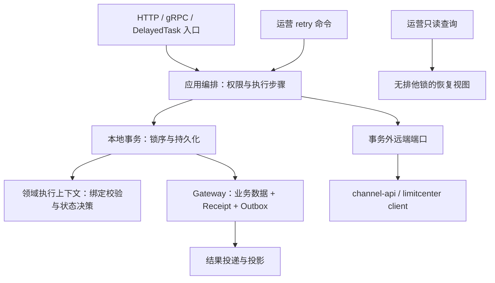

# LoadUp Pay 架构与设计 Review

审查日期：2026-10-26

源码基线：`020cd42`，审查开始时已跟踪文件无工作区改动。

范围：`acquire / payment / channel / customer / product / limitcenter / realtime` 的模块依赖，以及关键交易、恢复、投递、查询实现；抽查相关测试、Flyway 迁移与设计文档。采用静态分析，没有执行 IDEA 检查、编译、测试、数据库迁移、部署或真实渠道调用。本文是全项目架构评审，不是某次提交的差异审查，也不是逐行安全审计。

本文替换此前以局部代码风格为主的 review，聚焦可执行的设计优化。下文的“已确认”表示源码可直接证明；“风险”表示需要运行证据验证影响，不能等同于已发生的生产故障。

## 1. 总体结论

**建议保留六个业务服务和渠道插件的基本划分，优先完善一致性验证、恢复运行机制和模块内部封装，再扩展业务能力。** 当前主要问题不是缺少分层，而是实现正确性依赖大量调用顺序、字段交叉校验、任务代次和事务约定；这些知识仍散布在编排、编解码与仓储中。

代码已经远超“client/domain 契约骨架”：六个服务具备 app、infrastructure、adapter、rpc 等实现。另一方面，存在这些源码不等于业务闭环已经通过真实环境验收。两种状态必须分开记录。

### 应保留的设计

| 设计 | 源码依据 | 评审判断 |
|---|---|---|
| 订单金额、付款事实、额度分别归属 acquire、payment、limitcenter | [PaymentInitiationOperations:110–170](../acquire/acquire-app/src/main/java/io/github/loadup/pay/acquire/app/service/PaymentInitiationOperations.java#L110)、[PaymentOrder:113–161](../payment/payment-domain/src/main/java/io/github/loadup/pay/payment/domain/model/PaymentOrder.java#L113) | 不合并成一个跨库聚合，不让投影反向决定资金状态。 |
| 先持久化执行资格，再在事务外调用渠道，最后落结果 | [PaymentSubmissionPreparation:115–178](../payment/payment-app/src/main/java/io/github/loadup/pay/payment/app/service/PaymentSubmissionPreparation.java#L115)、[PaymentExecutionService:66–114](../payment/payment-app/src/main/java/io/github/loadup/pay/payment/app/service/PaymentExecutionService.java#L66) | Y2 的唯一提交权应保留；任务重新领取不等于获得再次扣款权。 |
| 未知结果保留占用，退款拥有独立生命周期 | [LimitExecutionService:168–177](../limitcenter/limitcenter-app/src/main/java/io/github/loadup/pay/limitcenter/app/service/LimitExecutionService.java#L168)、[RefundExecutionService:71–117](../payment/payment-app/src/main/java/io/github/loadup/pay/payment/app/service/RefundExecutionService.java#L71) | 不以 TTL、RPC 超时或任务失败推导“未收款”；退款不能重开原订单。 |
| 终态结果按目标独立 Outbox，投影有 receipt 与版本控制 | [PaymentResultEvents:67–96](../payment/payment-app/src/main/java/io/github/loadup/pay/payment/app/service/PaymentResultEvents.java#L67)、[TradeProjectionService:129–145](../realtime/realtime-app/src/main/java/io/github/loadup/pay/realtime/app/service/TradeProjectionService.java#L129) | 不替换为进程内异步事件；单个下游故障不应拖住其他目标。 |
| 渠道 API 与插件实现隔离，注册表拒绝重复 Provider | [ChannelStrategyRegistry:33–51](../channel/channel-core/src/main/java/io/github/loadup/pay/channel/core/ChannelStrategyRegistry.java#L33)、[ChannelModuleBoundaryTest:40–102](../channel/channel-core/src/test/java/io/github/loadup/pay/channel/core/ChannelModuleBoundaryTest.java#L40) | 已有真实的支付宝、微信 Adapter，值得保留这个扩展位置；暂不引入插件框架。 |

### 依赖关系判断

定向检查未发现领域生产源码依赖 Spring、ORM 或其他服务实现层；已核对的 RPC 契约依赖也未发现环。`infrastructure → app` 用于实现 app 所定义的 port，是依赖倒置的一种实现，**不能只凭层名判为反向依赖错误**。后续约束应是 infrastructure 仅引用所需 port/model，禁止反向调用 app 编排服务，而不是机械要求每层只能引用 domain。

`acquire ↔ payment` 的运行时交互承载受理、查询、事件确认等不同责任，也不能据此判为 Maven 依赖环。必须继续保证各端只提交自己的本地事务。

## 2. 优先级总览

P1：进入真实业务验收前优先补齐；不表示已经证明资金错误。P2：下一轮设计收敛；P3：有规模证据后实施。

| 编号 | 优先级 | 结论 | 性质 |
|---|---|---|---|
| R1 | P1 | 资金与任务原子性缺少本仓库中的真实数据库集成证明 | 验证缺口 |
| R2 | P1 | 运营详情查询复用写路径锁序，占用核心交易排他锁 | 已确认设计问题，影响待测 |
| R3 | P1 | 恢复机制有安全约束，但长期未知状态的负载与可观测性契约不足 | 已确认机制，容量风险 |
| R4 | P2 | 交易绑定不变量散落，模块接口暴露过多正确调用条件 | 设计改进 |
| R5 | P2 | 同名事务 helper 的 read 语义不同，隐含事务与租户上下文契约 | 已确认设计问题 |
| R6 | P2 | 持久化恢复快照直接使用公开 Command，存储与接口演进耦合 | 已确认耦合 |
| R7 | P2 | 付款/退款恢复的机械流程重复，修改容易不对称 | 已确认重复 |
| R8 | P2 | 架构约束与能力状态缺少统一、可验证的维护入口 | 已确认文档与门禁缺口 |
| R9 | P3 | realtime 深分页采用 count + offset，大数据场景需独立查询方案 | 条件性性能风险 |

## 3. 详细结论与优化建议

### R1 · P1：补齐跨事务边界的真实数据库验证

**证据。** [PaymentRecoveryServiceTest:40–47](../payment/payment-app/src/test/java/io/github/loadup/pay/payment/app/service/PaymentRecoveryServiceTest.java#L40) 使用 mock gateway、mock DelayedTask 和自定义 `UnitTransactions`；[TradeProjectionServiceTest:61–71](../realtime/realtime-app/src/test/java/io/github/loadup/pay/realtime/app/service/TradeProjectionServiceTest.java#L61) 使用 mock 投影/receipt gateway 和内存事务替身。它们能验证调用行为和事务标记，但不能证明 MySQL 锁竞争、真实回滚和多表唯一约束。

在本仓库 Java 源码中搜索 `Testcontainers / EnableTestContainers / SpringBootTest / MySQLContainer` 未找到匹配，也未找到 `*IT.java`。这不否认框架仓库或外部已有验证；只是当前 pay 仓库没有提供对应集成测试证据。

**影响。** 当前最重要的承诺是“状态、receipt、Outbox/DelayedTask 同时提交”，而不是某个方法被调用过。测试替身即使模拟 rollback，也无法发现真实 Mapper SQL、索引、连接/事务管理器配置或隔离级别造成的问题。

**建议。** 保留领域单测，在现有模块中补充少量真实 MySQL 集成测试，复用现有 Testify/Testcontainers，不新建通用测试平台。优先覆盖以下行为：

1. 两个并发相同请求只产生一份 allocation/attempt，金额不重复预占。
2. Y2 竞争仅一个调用者获得首次提交权；提交权落库后进程中断，恢复只查询原请求。
3. 结果或 receipt/Outbox 写入中任一步失败，整组本地变更回滚；远端成功而本地 ACK 丢失，重放不重复业务生效。
4. 两个 worker、租约到期、旧 generation 与新 generation 并发，不跳过当前恢复、不扩大执行权限。
5. 投影同版本不同内容被拒绝，旧版不会覆盖新版；退款容量并发不超退。

**验收。** 使用实际迁移和实际 gateway，通过数据库最终记录与并发屏障断言结果；明确列出运行范围和结果。本文没有执行这些测试。

### R2 · P1：运营“查询”应与交易“修改”分开取得数据

**证据。** [AcquireRecoveryOperationsService:80–87、137–157](../acquire/acquire-app/src/main/java/io/github/loadup/pay/acquire/app/service/AcquireRecoveryOperationsService.java#L80) 的 `detail()` 进入 `transactions.write()`，`inspect()` 锁订单、allocation 和 cursor。[PaymentRecoveryOperationsService:78–85、135–163](../payment/payment-app/src/main/java/io/github/loadup/pay/payment/app/service/PaymentRecoveryOperationsService.java#L78) 对付款/退款执行相同模式；付款详情继续进入 [PaymentExecutionLocks:49–61](../payment/payment-app/src/main/java/io/github/loadup/pay/payment/app/service/PaymentExecutionLocks.java#L49)，锁父门禁、付款门禁与付款。付款仓储明确使用 [PaymentControlGatewayImpl:86–95](../payment/payment-infrastructure/src/main/java/io/github/loadup/pay/payment/infrastructure/repository/PaymentControlGatewayImpl.java#L86) 的 `forUpdate()`。

**影响。** 故障期间的运营轮询会与受理、关单、结果落账竞争同一组排他锁。源码能证明锁竞争关系，但没有压测证据可以量化延迟或断言发生死锁。当前代码注释说明查询要求一致视图，因此这是一项需要调整的接口语义，而不是误加一个注解。

**建议。** 拆成无排他锁的 `readInspection` 与写路径的 `lockForRetry`。详情返回版本、generation、taskId、attempts、nextExecuteAt；真正执行 retry 时继续持锁复核这些条件。需要多表一致视图时使用短只读快照事务；并发变化可返回“状态已变化”，不能把查询到的 retryable 当执行授权。

**验收。** 详情读取不发出 `SELECT ... FOR UPDATE`；持续轮询时正常落账不等待详情持有的写锁；过时详情发起 retry 仍被版本/任务条件拒绝，审计与原任务重试仍同事务。

### R3 · P1：将恢复从“不断执行”完善为可运营的生命周期

**证据。** [PaymentRecoveryService:51–68、99–113](../payment/payment-app/src/main/java/io/github/loadup/pay/payment/app/service/PaymentRecoveryService.java#L51) 和 [RefundRecoveryService:51–66、97–111](../payment/payment-app/src/main/java/io/github/loadup/pay/payment/app/service/RefundRecoveryService.java#L51) 在非终态时固定延迟，并为下一 generation 注册不同任务。默认间隔 30 秒；[业务配置:14–17、48–57](../payment/payment-bootstrap/src/main/resources/application-payment-business.yml#L14) 中 `max-attempts` 是单个 native task 的失败重试上限，不限制成功处理但仍未知的后续 generation。

按 30 秒理想调度估算，一笔持续未知交易每天可生成约 2,880 个 successor；实际数量取决于扫描间隔、处理耗时和故障。这是**生成量估算，不是已测存储增长率**；框架清理机制也需要单独核实。

本仓库 `src/main` Java 未检出直接使用 `MeterRegistry/ObservationRegistry` 的业务埋点。[application.yml:28–52](../payment/payment-bootstrap/src/main/resources/application.yml#L28) 有通用监控配置，默认 `METRICS_ENABLED=false`；不能因此认定整个系统没有框架指标，但未见 UNKNOWN 持续时间、金额占用年龄、投影延迟等业务指标定义。

**建议。**

- 区分传输失败重试与“查询成功但结果未知”的业务轮询；增加按持续时间退避、抖动、渠道并发限制。
- 为长期未知状态建立告警与人工查证入口；超出运营阈值只调整轮询/升级处置，绝不自动释放资金占用或重扣。
- 明确终结任务的保留/归档策略，分别处理调度历史、业务幂等回执和资金证据，不能统一按 TTL 删除。
- 定义业务指标：未知笔数及最老年龄、占用未收敛金额、FAILED 任务数、Outbox 最老未交付年龄、投影新鲜度。标签只用服务、渠道、状态等低基数维度，订单号放受控日志或追踪。

**验收。** 模拟长期 UNKNOWN 时请求速率和任务生成量受策略约束；告警能够定位原业务身份；恢复与人工操作仍使用原 paymentId/attempt/requestNo；不能因为告警或清理丢失幂等和资金证据。

### R4 · P2：以业务不变量收敛模块，而不是继续拆小 Service

**证据。** 付款与 attempt 的 paymentId、金额、商户、callerService、requestDigest、limitOperationId 关联校验重复出现在 [PaymentExecutionService:168–175](../payment/payment-app/src/main/java/io/github/loadup/pay/payment/app/service/PaymentExecutionService.java#L168)、[PaymentSubmissionPreparation:207–218](../payment/payment-app/src/main/java/io/github/loadup/pay/payment/app/service/PaymentSubmissionPreparation.java#L207)、[PaymentChannelCallbackService:70–81](../payment/payment-app/src/main/java/io/github/loadup/pay/payment/app/service/PaymentChannelCallbackService.java#L70)。各入口需要的额外条件并不完全相同。`PaymentExecutionLocks` 已收敛锁序，但调用者仍需继续理解并核对这些关系。

**影响。** 增加新的执行或回调路径时，开发者必须知道哪些字段要相等、何时核验 active attempt、哪些终态允许迟到观察。只新增一个 Service 或复制一段 if，很容易得到与旧入口不同的约束集合。这里是维护风险，不是断言现有校验都可删除。

**建议。** 在 payment 内部建立小接口、完整语义的付款执行上下文：一次组装已校验的 payment/attempt/gate；纯领域校验集中表达共同绑定关系，`requireSubmittable / requireObservable / requireClosable` 分别表达不同前置条件。保留数据库重建时与外部输入进入时的防御校验；不要把租户授权、协议验签和状态转换塞进一个万能 Validator。

编排层只负责“读取/加锁 → 取得合法上下文与决策 → 提交 → 远端调用 → 结果应用”。不要把渠道 IO 搬进聚合，也不要把整个支付流程包成大事务。

**验收。** 同一绑定规则有一个维护位置；首提、恢复、回调、关单共同经过它。逐项篡改金额、商户、attempt、摘要和 operation 的参数化测试覆盖所有入口，同时保留各入口不同的权限和终态要求。

### R5 · P2：让事务与租户上下文的接口语义明确

**证据。** [PaymentAcceptanceTransactions:47–69](../payment/payment-app/src/main/java/io/github/loadup/pay/payment/app/service/PaymentAcceptanceTransactions.java#L47) 与 [OrderCreationTransactions:47–74](../acquire/acquire-app/src/main/java/io/github/loadup/pay/acquire/app/service/OrderCreationTransactions.java#L47) 的 `read()` 只是绑定租户和转换异常，**并不启动只读事务**；[RealtimeTransactions:40–66](../realtime/realtime-app/src/main/java/io/github/loadup/pay/realtime/app/service/RealtimeTransactions.java#L40) 的 `read()` 则启动 `REQUIRES_NEW + REPEATABLE_READ + readOnly`。前三者的写重试均存在最多三次 duplicate/transient 捕获模式。

**影响。** 同名方法在不同模块具有不同一致性和网络调用约束。例如 PaymentExecutionService 在 `read()` 内调用渠道目前没有跨本地事务；如果维护者参照 realtime“统一”这个方法，会改变重要安全条件。方法签名没有传达这种差异。

**建议。** 将无事务的操作明确命名为 `withTenantContext`，真正一致性读取命名为 `readSnapshot`，本地可重试写命名为 `writeLocal`，并记录隔离级别、是否允许嵌套与重试范围。重试闭包仅包含可重放的本地数据库操作；远端 IO 继续禁止进入。先统一语义和契约测试，再评估是否把纯技术执行机制复用到现有框架；业务错误映射留在各自模块，不新建 pay-common 或公共 BaseService。

**验收。** 各接口对“是否存在真实事务、是否只读、租户何时恢复”有一致命名和测试；原渠道调用仍在事务外；重复键冲突重放与不可重试业务错误有明确区分。

### R6 · P2：为持久恢复意图建立自己的表示契约

**证据。** [PaymentInitiationCodecImpl:45–71](../acquire/acquire-infrastructure/src/main/java/io/github/loadup/pay/acquire/infrastructure/codec/PaymentInitiationCodecImpl.java#L45) 把 `PaymentExecuteCommand` 写入 acquire 的 intent payload；[PaymentAcceptanceCodecImpl:47–85](../payment/payment-infrastructure/src/main/java/io/github/loadup/pay/payment/infrastructure/codec/PaymentAcceptanceCodecImpl.java#L47) 把同一公开 Command 写入 payment，并以其当前类型反序列化。两侧均严格校验字段与条款版本，SHA-256 验证的是载荷完整性。

**影响。** 公开调用参数、服务间表示和长时间存在的恢复快照共享 Java 类型。调整公开 Command 的校验、字段或嵌套结构，会同时影响两个数据库中在途记录的读取；checksum 不能解决这种语义耦合。

**建议。** 对核心恢复流程定义本地不可变的 `PaymentIntentSnapshot`，只保存恢复必要的身份、金额、原条款引用/内容与输入引用；由 mapper 映射到公开 Command。存储快照明确格式标识与校验职责，避免每个 codec 重复定义所有业务关系；业务关系交给 R4 的模块处理。

本项目当前不要求向后兼容，因此**不建议先建设多版本兼容框架**。开发期可以同步重构 DTO、快照、迁移和调用方；一旦需要保留在途数据，才选择明确的数据迁移或特定版本读取方案，并验证旧记录恢复。

**验收。** 对外 Command 的纯表示变化不再隐式改变持久快照；格式不支持或快照损坏时明确失败；当前在途记录的处置方式在每次变更中明确，不静默套用新参数。

### R7 · P2：复用恢复流程的机械部分，保留业务状态机差异

**证据。** [PaymentRecoveryService:71–116](../payment/payment-app/src/main/java/io/github/loadup/pay/payment/app/service/PaymentRecoveryService.java#L71) 与 [RefundRecoveryService:69–114](../payment/payment-app/src/main/java/io/github/loadup/pay/payment/app/service/RefundRecoveryService.java#L69) 重复了 native 任务身份/lease/attempts 校验、旧代跳过、锁内前置检查、锁外执行、锁内完成或注册 successor。两者主要差异是业务锁序、终态判定和实际推进动作。

**影响。** 新增任务有效性字段、退避或观测时需要成对修改。单纯复制测试会确认两份实现各自符合预期，却不保证以后使用相同恢复协议。

**建议。** 先只在 payment 模块内部提取任务校验与 successor 计算的纯函数/值对象，付款和退款的锁序、状态迁移、提交权限仍各自持有。等两条路径的组合接口足够小，再考虑小型组合式 runner；不要直接建设跨六服务的泛型 Saga 引擎，也不要让 runner 暴露 channel.submit。

**验收。** 旧代、未来代、租约失效和重复 handler 的协议测试可共享；付款/退款特有的锁序和终态测试仍保留；统一流程不将 UNKNOWN 解释成失败或获得新提交权。

### R8 · P2：统一当前能力说明，并为关键边界补门禁

**证据。** [根 README:5–23](../README.md#L5) 仍称 Facade 只有接口、没有应用服务或 Controller、业务功能为契约层；[payment README:1–23](../payment/README.md#L1) 与实际 `PaymentExecutionService` 等源码已描述/实现业务切片。[ARCHITECTURE:3–21](../ARCHITECTURE.md#L3) 同样保留早期状态。ROADMAP 的早期总览与后续增量记录混合，部分已实现项仍被列为“继续实现”。

[ChannelModuleBoundaryTest:34–102](../channel/channel-core/src/test/java/io/github/loadup/pay/channel/core/ChannelModuleBoundaryTest.java#L34) 已有渠道边界门禁；在本次源码搜索中未发现覆盖六服务依赖与领域纯净度的通用架构测试。未发现违规依赖与缺少防止未来违规的门禁，是两件事。

**建议。** 根 README 只保留一份当前能力矩阵：能力、源码状态、自动化验证状态、真实环境验收状态、责任模块。模块 README 维护契约，架构文档维护决策与不变量；历史实施记录不再兼任“当前事实”。逐步整理现有 ROADMAP 的重复与过期条目。

补充针对本项目真实规则的窄门禁：domain 不依赖 Spring/ORM/传输实现；跨服务不引用 app/infrastructure；业务层不引用渠道插件；app 不依赖基础设施实现；infrastructure 引用 app 时限定允许的 port/model。可沿用现有源码/POM 检查方式，并在正常构建时补字节码依赖验证；无需创建新服务或新治理平台。

**验收。** 每个能力能分别回答“已写代码、已通过什么测试、已在哪个环境验收”；故意加入一个非法依赖时对应门禁失败，合法的 port Adapter 实现不会误报。

### R9 · P3：为大量交易查询设置明确的分页边界

**证据。** [TradeProjectionGatewayImpl:305–344](../realtime/realtime-infrastructure/src/main/java/io/github/loadup/pay/realtime/infrastructure/repository/TradeProjectionGatewayImpl.java#L305) 的订单/付款/退款查询先 count，再按业务时间和 ID 双排序，最后 limit/offset。双排序是正确的稳定排序基础；但大 offset 与宽时间范围 count 的工作量仍会增长。

**建议。** 保留现有约定的页码 API；对大范围遍历/导出另定义基于 `(businessCreatedAt, id)` 的 cursor 接口，或先限制时间窗口、深页范围。只有真实查询计划和数据量证明必要时再加专用复合索引，避免给投影写入无条件增加索引成本。

**验收。** 在代表性数据量上检查实际执行计划、深页耗时与总数查询成本；cursor 场景验证并发插入和同时间戳下不重复、不漏读，并明确快照/时间上界语义。本轮没有性能实测，不能认定现有分页已超出需求。

## 4. 建议的演进目标

维持现有服务拓扑，优先收敛每个服务内部的接口。以 payment 为例：

该图是建议的内部组织，不是新增部署单元。`Module` 的价值在于把一组完整规则藏在小接口后；`Adapter` 负责实现协议或存储差异。应集中维护不变量，同时保持首提、观察、关单和退款各自不同的条件。拆文件数量、接口数量或类的行数都不是优化完成指标。

### 实施顺序与停止条件

| 批次 | 范围 | 交付与停止条件 |
|---|---|---|
| A：证明与隔离 | R1、R2 | 有真实数据库并发/回滚证据；运营查询不持核心写锁；retry 仍严格复核。先建立回归保护，再动状态机组织。 |
| B：恢复可运营 | R3 | 长期 UNKNOWN 的轮询、告警、保留策略可解释且可演练；任务失败不会转化成资金失败。 |
| C：接口收敛 | R4、R5、R6、R7 | 先在 payment 内完成一个完整切片，再推广到 acquire；共同校验和恢复协议只有一个维护点，不引入跨服务大事务。 |
| D：持续约束 | R8 | 文档与实际能力一致，关键依赖规则有可执行门禁；后续变更同步维护。 |
| 按需优化 | R9 | 有代表性查询计划/容量证据后实施，不作为当前核心一致性工作的前置条件。 |

## 5. 范围限制与待验证事项

- 没有发现可仅凭此次静态证据定为 P0 的资金破坏问题；这不构成生产可用性或安全性保证。
- 已阅读的代码存在明确的幂等、fencing、receipt、版本 CAS 和事务外 IO 防护，不能把系统描述为“没有幂等/没有可靠事件”。
- 本轮没有评估真实 MySQL 执行计划、渠道产品限制、真实 JWT/TLS 配置和多实例调度效果，也没有核验框架底层任务清理实现。
- 银联、后置对账等已明确后置的能力，不作为本轮设计缺陷；也不建议为潜在需求先建设万能渠道协议、分布式事务引擎或独立公共业务层。
- 本轮仅输出审查文档，并按仓库要求登记 ROADMAP；所有重构、测试补充及验收均为后续工作，未修改业务代码。
