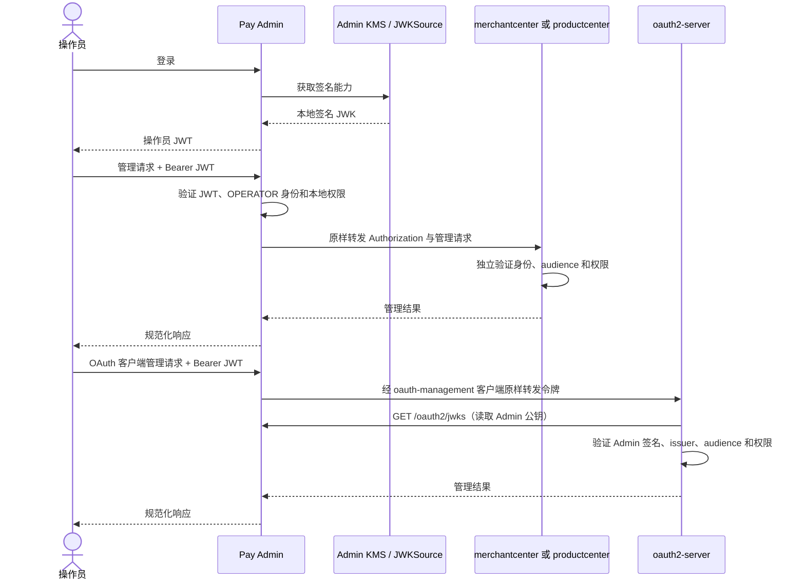

# Pay Admin 架构

Pay Admin 是单模块可执行应用，Maven 工件 `loadup-pay-admin` 同时装配操作员 UPMS、审计能力和多个管理 BFF。`AdminApplication` 的默认组件扫描范围为 `io.github.loadup.admin`；其他 UPMS 模块通过 Boot 自动配置导入。Admin 不拥有商户、产品合约或 OAuth client 注册事实，亦不直接连接对应服务数据库。

## 边界与职责

| 责任 | Admin 提供 | 权威归属 |
| --- | --- | --- |
| 操作员身份 | UPMS 用户、登录和权限装配 | Admin 数据库与 UPMS |
| 商户管理 | `/api/merchantmng/**` BFF | merchantcenter |
| 产品与合约管理 | `/api/productmng/**`、`/api/merchantmng/product/**` BFF | productcenter |
| OAuth 客户端管理 | `/api/oauth/clients/**` BFF | oauth2-server |
| Admin 验证密钥 | `GET /oauth2/jwks` 公钥发布 | Admin KMS/JWKSource |

Admin 用例校验操作员身份与本地权限，将原 `Authorization` Bearer token 转发给受信管理服务。merchantcenter/productcenter 仍独立校验 JWT 和权限；OAuth 管理端校验 Admin issuer、`admin` audience 和所需权限。转发层不以机器令牌替换操作员身份，不跨服务直接写库。

## UPMS 和数据库

POM 显式声明 UPMS infrastructure、web、authserver 与应用层组件。AdminApplication 限定自身包扫描，Boot imports 发现 UPMS persistence、app、web、authserver 自动配置。Admin 使用自有 JDBC 数据源；Flyway 仅扫描 Admin、UPMS 和 Audit 三组迁移目录。应用不扫描 merchantcenter/productcenter 包，也不访问它们的表。

`UpmsAssemblyTest` 以 `ImportCandidates` 检查自动配置发现，并以 `ApplicationContextRunner` 组合 UPMS persistence/app/web/authserver 配置；夹具使用模拟 JDBC 与 Mapper，并关闭协议端点。该测试不等于真实登录或生产数据库迁移验收。

## KMS 与 JWT

配置启用 `loadup.kms` 的 local binder，读取部署挂载的 PKCS12 keystore。Admin AuthServer 使用 KMS 提供的签名 JWKSource 签发操作员 JWT；`AdminSecurityConfiguration` 以同一 JWKSource 创建本地 JwtDecoder，因此无需远端拉取自己的 JWKS。私钥不得经 JWKS 发布，`AdminJwksController` 只返回公钥参数。Admin 的 OAuth2 协议端点关闭；公开 JWKS 仅用于管理令牌验证。

## BFF 调用序列

下图对应 `OAuthClientManagementController`、`MerchantManagementController`、`ProductManagementController`、`ProductCenterManagementController`、`ManagementHttpConfiguration` 和各自的远端管理 API：

Admin 对 Center 的 bearer 透传及真实端到端验证仍需部署联调；Mermaid 图表达源代码的调用边界，不代表当前集成已经验收通过。对 OAuth secret 的响应不缓存、不自动重试；创建或轮换结果不确定时须显式查询并恢复，详见 [README](README.md)。

总体服务所有权、HTTP 客户端约束和验收定义见 [Pay 总体架构](../ARCHITECTURE.md)。
