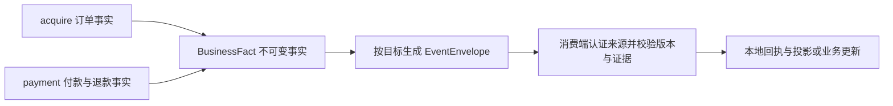

# Pay 集成事件架构

Maven 坐标：`io.github.loadup-cloud:loadup-pay-contracts-events:0.0.1-SNAPSHOT`。本工件只定义 acquire/payment 发布的跨服务事实 DTO、状态枚举和事件类型，不包含领域聚合、请求响应 API、传输实现或数据库访问。发布方与消费方依赖同一契约版本。

## 契约内容

- Acquire：完整订单快照及订单生命周期状态。
- Payment：付款和退款快照、付款/退款结果、商户退款通知、订单退款汇总，以及对应状态枚举。
- `BusinessEventTypes` 是业务事实类型词汇；`BusinessFact` 携带业务事件 ID、生产方、类型、schema 版本、聚合 ID/版本、发生时间与不可变数据。每个目的地通过 `delivery(deliveryId)` 派生带独立 delivery ID 的 `EventEnvelope`，delivery 标识不属于业务事实。
- `FrozenEventTypes` 和 DTO 的 `requireEnvelope` 用于验证已冻结投递标签。旧载荷、类型和回执摘要按原形读取，不得重写为新事实或把 delivery ID 解释为业务身份。

## 金融证据边界

新付款金融事实使用 `pay.payment.financial-outcome.v1`，新退款金融事实使用 `pay.payment.refund-financial-outcome.v1`，schema 版本为 1，必须携带对应 proof。`PaymentFinancialEvidence` 固定原付款身份、金额、状态版本、终态证据、活动尝试、发起/成功时间及执行围栏；`RefundFinancialEvidence` 固定成功退款、累计退款、容量版本和时间，并嵌入原付款证据。结果 DTO 校验 proof 字段与外层结果逐项一致。

旧 canonical 或目标限定 v1 事件继续使用原有无 proof 形态；缺失的旧 JSON 字段按 null 读取且 null 不写出。新金融类型缺少证据必须拒绝，不能降级为旧类型。事件本身不认证发送方：消费端仍须验证实际服务主体、权限、来源身份、版本和幂等性。该契约不单独构成支付成功、退款成功或商户收款证明，资金处置必须遵循对应业务服务的完整校验规则。

## 事实流转

各服务的投递事务、重放和验收边界见 [Acquire](../../loadup-pay-acquire/ARCHITECTURE.md)、[Payment](../../loadup-pay-payment/ARCHITECTURE.md)、[Realtime](../../loadup-pay-realtime/ARCHITECTURE.md) 与 [Pay 总体架构](../../ARCHITECTURE.md)。
