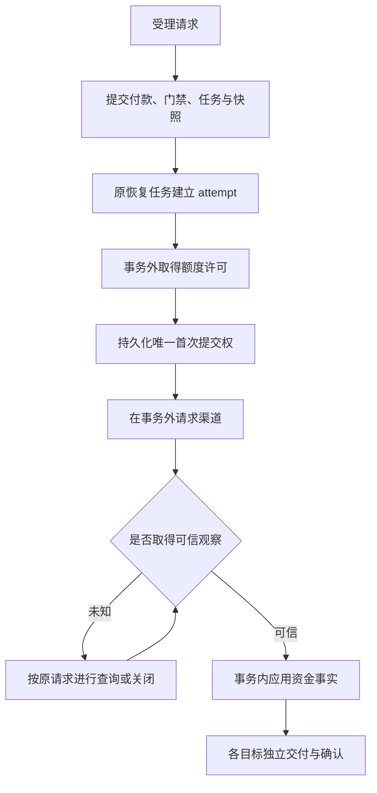

# Payment 恢复与运营规则

## 受理执行和交付边界

当前[付款与退款时序](../design/PHASE0_FLOWS.md)以源码为基线：accept 只提交付款、门禁、恢复任务与快照，不同步扣款；原恢复任务创建 attempt、在事务外获取额度许可，以 Y2 的唯一 ticket 进行首次提交，再由 Y3 应用可信观察。SUBMITTING 后的恢复沿原请求查询/关闭，超时不构成未收款证明。H5 交互动作本身不产生成功事实。

付款终态、acquire 落账、limit 结算、费用/退款通知与 realtime 投影分别有独立完成条件。阶段 3 已将新业务事实类型与目标 Task 路由分开，付款/退款事实经本地订阅配置分发；完整付款证据路径已替代满足条件的远端回查，退款最新累计读取与旧冻结载荷查证保留。阶段 0 的[现状例外](../design/PHASE0_BASELINE.md)保留历史含义，当前边界及待运行证据门禁见[阶段 3 记录](../design/PHASE3_IMPLEMENTATION.md)，运行验收尚未完成。本文不以目标 ACK 代替资金证据或商户送达。

## 从受理到结果交付

## 当前业务轮询

付款与退款使用同一个纯领域 RecoveryPollingPolicy，配置由 payment-app 的 RecoveryPollingConfiguration 注入。
只有正常执行后仍未终结的分支计算新 dueAt，游标更新与 native successor 仍在原本地事务一起提交。
轮询策略不得改变状态机、锁序、原请求身份、Y2 提交权、金额或占用。

年龄分别取付款 initiatedAt / 退款 plannedAt 到本次锚点，不因 native attempts、generation 或重启重置。
这是原业务存续年龄；首次 UNKNOWN 时间、占用年龄指标仍需另外实现，不能把它们混为一谈。
锚点使用 now 与 previousDueAt 的较晚者，避免时钟回拨把任务排回旧截止之前。

| 参数（loadup.modules.payment.recovery-polling） | 默认 | 范围           |
|-------------------------------------------------|------|----------------|
| initial-delay-seconds                           | 30   | 1..86400       |
| maximum-delay-seconds                           | 1800 | initial..86400 |
| backoff-every-seconds                           | 900  | 1..604800      |
| jitter-percent                                  | 20   | 0..50          |

年龄每增加 backoff-every，名义等待翻倍，在 maximum 饱和；先检查上限再乘倍，不以溢出回到短间隔。
偏移由租户、任务类型、原业务 ID 与当前 generation 确定；相同输入稳定，不消耗额外状态或更换金融幂等键。
窗口为 [max (initial, nominal-spread), min (maximum, nominal+spread)]，spread=nominal*jitter/100，整数秒。
默认新业务 30..36 秒；饱和后 1440..1800 秒。策略只约束该业务的下一次正常唤醒，不声称提供全渠道并发/总请求速率上限。

长期饱和且持续返回未知时，理论正常后继生成量由间隔约束到每笔每天约 48..60 次量级；这只是 86400/间隔 的推算，不是实测存储增长或渠道请求量。
每次推进可包含不止一次外部协议操作，native 失败重试/运营重试另计；并发限制与保留策略不能省略。

配置修改只影响之后登记的后继，不重写既有 executeAt。
所有时间沿用系统本地时区，数据库业务时间为 timestamp(6) without time zone；不更改机器时区或绝对协议时间。

## 失败重试与资金事实

- 传输/依赖失败继续由原 native 任务 attempts/lease/retry-delay/max-attempts 管理；不是一次新的业务付款/退款。
- 正常查询但结果不确定，保留原状态及占用，提交当前业务 generation 的唯一后继。
- FAILED 表示任务处理失败，不等于付款未收款或退款未发生；运营重试原任务仍须复核原身份/attempts/nextExecuteAt，并与审计同事务。
- 终态依原付款/退款权威证据完成游标；退避策略不能调用 submit、创建 attempt、解封门禁、释放额度或改写金融终态。

运营详情使用只读快照，retry 重新加锁校验；这不授予绕过预检或人工注入成功事实的能力。
不提供手工资金记账、查询结果伪造或无证据释放入口。

## 渠道恢复并发

统一 ChannelPaymentFacade 在原路由/租户/绑定/能力检查后，以标准 Bulkhead 保护
query/recover/close/queryRefund/recoverRefund。
LoadUp ResilienceRegistries 由 payment 业务服务的 runtime core binder 提供，
`loadup-pay-payment-channel-core` 仅依赖 `loadup-pay-payment-channel-api`。
每个 Channel 共用一个 payment-channel-recovery-<channel> 实例，部署配置默认各 16、等待 0ms；非零等待在装配时拒绝。
使用原生许可/释放，满额在 Provider 前抛 CHANNEL_RECOVERY_BUSY，finally 归还名额，不创建线程池或任何新的金融请求。

该限制覆盖单次 Provider 恢复操作，其中可能有多步外部 IO；不是逐 HTTP 请求 QPS 限制。只有同 JVM 的调用共享；多个副本的预算不能当作一个集群配额。
错误继续走原任务 retry/FAILED；付款保留原状态，退款依赖故障可以转 UNKNOWN，但原金额/容量保持。
Core binder 提供原生 Bulkhead 指标绑定源码，尚无运行观测，不能当作 UNKNOWN 金额/年龄等业务指标已完成。

首提 submit/submitRefund 不纳入该恢复预算，避免在 Y2 已赢得且落库后再抛并发拒绝而消耗唯一票据。
首次提交限流必须在其持久化边界前管理名额；不能用通用 Retry 重建票据。validate/canRefund 仍是本地预检。

## 恢复执行指标

RecoveryExecutionMetrics 使用共享 MeterRegistry，不建立私有 SimpleMeterRegistry/backend；没有共享 registry 时业务照常执行。
实际付款/退款任务 handler 外层记录：

| 名称                              | 类型与标签                                                             | 口径                                                              |
|-----------------------------------|------------------------------------------------------------------------|-------------------------------------------------------------------|
| loadup.payment.recovery.execution | Timer，kind=payment/refund，outcome=continued/completed/skipped/failed | 每次 handler 调用一次，耗时包括校验、本地事务、外部推进与后继提交 |
| loadup.payment.recovery.inflight  | Gauge，kind=payment/refund                                             | 当前进程正在执行的 handler 数量                                   |

业务恢复服务返回已提交的 RecoveryHandlingOutcome：继续、推进后完成或无需推进/失去当前代。
标签结果来自固定枚举；异常记 failed 并原样抛出给 native 重试。计数在事务外层，不对每次本地写重试单独加数。
预检发现已有终态或旧代记 skipped，虽可顺便完成游标；这不是资金失败或成功计数。
服务执行结束不等于原生 ACK 成功；原生 lease_lost 等仍由框架自己的 dispatcher 观测。

类型与结果只形成 8 个 Timer 和 2 个 Gauge 身份，不使用任何租户、业务/任务 ID、账户、金额、generation、URL 或异常文本标签。
指标写入的常规 RuntimeException 不覆盖原业务异常，诊断只含固定 kind/outcome 与异常类型；不据指标改写资金或重试。
这些指标是调用流量、耗时及本进程在途量，不是 UNKNOWN 库存、最老年龄、真实 held 金额、FAILED 任务存量或 Task 新鲜度的替代品。

## 存量观测与升级查证

UNKNOWN 库存只统计当前未知付款/子退款的笔数、名义金额与首次未知时间，不等于额度 held 或可释放金额。采样由后台定期执行，不在 Prometheus scrape 时查库。当前适配通过参数化 Spring JDBC 聚合；以首次 UNKNOWN 时间判断 REVIEW/URGENT，缺失、过期或未初始化库存不能伪装为零。

配置入口为 `loadup.modules.payment.recovery-inventory` 与 `recovery-escalation`，默认库存采样关闭，启用时必须限定可信租户。只读查证和原 FAILED 任务重试不允许人工注入成功事实。详见 [模块接入](README.md) 与 [监控部署](../deploy/README.md)。

## 关单 ACK 独立保存

PaymentCloseService 已接原执行/恢复流程：只有已验证的 NO_COLLECTION/CLOSE_RESPONSE 才保存不可变的原 attempt 关单确认，独立提交后再交
Y3。Y3 失败后的原任务优先应用旧确认，避免把随后模糊的 CLOSED 当成新证据；没有收到或没有保存成功 ACK
时仍不制造未收款结论。独立表、MapStruct、原账户/epoch
约束保持；真实关闭回复丢失、确认写前崩溃和数据库独立提交需运行验收。

## 待验收

PostgreSQL 初始化/并发回滚、Y2/Y3 与原任务租约交错、签名/渠道回调、密钥与凭证轮换、恢复限流及指标/告警送达均须保留当前版本运行证据。测试范围见 [持久化测试说明](loadup-pay-payment-infrastructure/src/test/README.md)。

## 事实与目标交付（阶段 3）

PaymentEvents/RefundProjectionEvents 生产 contracts-events 定义的目标无关 BusinessFact；app.dispatch 的 PaymentFactRoutes/PaymentFactPublisher 负责目标级 Task，默认注册通过 PaymentFactDeliveryConfiguration 与 AutoConfiguration.imports 唯一装配。原九条路由保持不变，缺失、重复或错绑必需路线拒绝配置；扩展订阅不需修改事实生产。新头使用 BusinessEventTypes，schema=1、原 DTO 字段含义和每目标 ACK/重试规则不变；完整财务证据增量见下文。

退款汇总只冻结一个业务事实，再分别投递 realtime/fee：载荷与 businessEventId 相同，deliveryId 不同。所有目标写入原状态事务，没有跨目标整体完成标志。已冻结旧标签通过限定读取路径原样投递，不重写 JSON 或 receipt 摘要；当前状态、attempt/claim/围栏等查验继续保留。付款、额度命令与退款的回查清单、替代前提和未运行回归见[实施记录](../design/PHASE3_IMPLEMENTATION.md)。

2026-11-16：PaymentEvents/RefundProjectionEvents 在原金融事务内冻结完整付款/退款证据，默认财务路由使用 financial-outcome/refund-financial-outcome 新类型；PaymentOutcomeDeliverySupport 在原锁下重建并比较 proof。契约、生产与消费文件及查询决策见[财务证据记录](../design/PHASE3_FINANCIAL_EVIDENCE.md)，未构建或测试。
