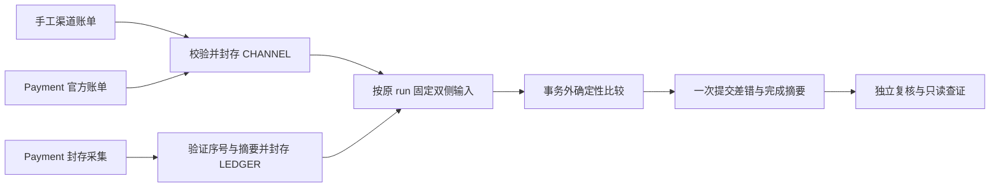

# Reconciliation 架构

[README](README.md) 维护配置与 API；本文维护封存、比较、来源证明与独立复核规则。数据库和跨服务边界见 [总体架构](../ARCHITECTURE.md)。

## 双侧输入到差错复核

## 批次与确定性执行

create/attach/start 是独立本地写事务，start 固定原 runId，与 Task 同事务登记。执行分为“只读 RR 取双侧封存输入→事务外纯比较→写事务锁批次并提交全部差错及完成摘要”。查询与计数使用同一只读 RR 快照。

原 run、task 和双侧输入固定，重试不换源重跑；更正文件/profile 必须新建输入和批次。原生租约/ACK 管理调度，确定性结果与原运行身份管理业务幂等，不能把任务元数据当作金融 token fencing。

只接受经受信适配器完整验证的 artifact，不开放直接上传成功结果或规范化行。普通文件、请求自报 hash 和解析成功都不等于官方来源证明。

## 手工 CHANNEL 输入

文件拥有者、批次原 caller 与当前账户授权必须同时满足；账单实际商户/子商户由受控目录冻结。批次锁限制同批次一个 INIT 导入，已有 CHANNEL、已运行/完成批次不新增来源。

提交先事务外固定原 fileId/storageId/长度/hash，再在同库事务登记导入、长期文件引用和 Transfer。handler 校验原 RUNNING 任务、owner/handler/sourceFileId/importId，解析在事务外。

必须接收完整长度并核对 hash 后才判断内容。I/O/短读保留 INIT 待原 FAILED 显式重试；完整字节但 hash/格式/汇总/账户不符则 REJECTED。全部行、封存 artifact、批次 CHANNEL 引用和 SEALED 同事务提交，失败不保存部分行或伪造空文件。ACK 丢失重放核对原 manifest，不重复解析。

MANUAL_UPLOAD 保留来源标记；成功/拒绝后均保留业务证据引用。Transfer 释放临时引用不使业务文件可删除，RUNNING 不自动回收成 QUEUED。

## 官方 CHANNEL 输入

请求与原 Task 先落 INIT，handler 在事务外调用 payment 原绑定的只读账单接口并保存原件/凭证。两个长期 File 引用、Transfer、OFFICIAL_DOWNLOAD import 和来源 READY 同事务登记，再由严格解析器封存 CHANNEL。

READY sourceId 为 importId；下载 taskId 与 Transfer taskId 独立，失败各重试原任务，不重领 RUNNING。每次核验原 scope、实际收款主体及授权，绑定版本固定；配置轮换不换来源。`official:` 导入键仅供内部使用，sourceKind 不接受请求自封可信。

原件/凭证不公开，不把 URL 或 token 写业务表。微信解析器校验账户、账期、规范化行及完整汇总，不支持的 REVOKED 拒绝整份输入。

## LEDGER 权威采集

只从 payment 标准 HTTP 获取，不读 realtime、不跨库。prepare 固定源端 capture，import 只接受 SEALED，并验证完整页序、空 EOF、总计、hash 与冻结范围；保存规范二进制证据后，同事务写长期引用、LEDGER 全行及批次关联。

原 capture 重放不做远端 IO；数据库提交失败可重试原 capture。INIT/BLOCKED 不提供可导出金额或行，不把覆盖阻断当作零交易。源资金核实后新请求创建新 RR，原封存证据永不覆盖。

## 独立复核与查证

原 DIFFERENCES、差错和资金不被复核改写。证据永久引用、不可变提案、事件/head 及命令回执同库提交；INIT→PROPOSED→APPROVED/REJECTED，驳回可在当前版本重提，旧提案与回执不覆盖。

审批 SERVICE 必须与提案 SERVICE 不同且有同账户授权；这不构成两名自然人的审批证明。原请求重放返回首次 ACK，detail 返回当前状态，备注不进普通诊断。

显式源端查询只接受获批 NEEDS_SOURCE_VERIFICATION 提案及精确审批事件/版本。原查询自然键和优先 LEDGER 请求号由服务端从源对象重建；请求与 Task 同库冻结，事务外只读查询原渠道。无对象、未提交或不唯一是覆盖缺口，UNKNOWN 不等于未收款。

首个有效源回执独立留档且与原请求精确关联；ACK 丢失/FAILED 重放不覆盖回执或重复查询。RECORDED 不表示差错已解决，接口不写原付款、退款、批次或复核资金事实。

## 能力限制与待验收

当前仅微信 ALL，支付宝/银联、长期文件清理、Transfer RUNNING 崩溃恢复和受控金融处置未完成。官方来源、批次封存与比较提交、RR 并发、任务失败重放、文件引用、独立审批/查证授权及真实渠道均需单独验收，不能由 Pod 就绪或解析样例成功代替。
