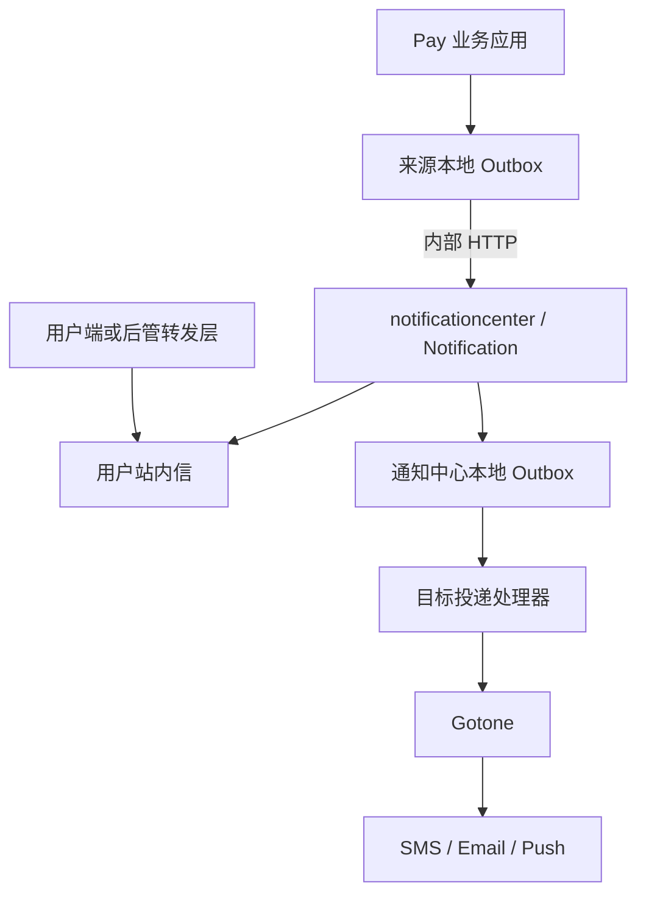

# 通知体系系统设计

日期：2026-11-04。本文是目标设计；第 11 节区分当前实现与待实施内容。

## 1. 职责划分

| 层次 | 模块 | 职责 |
|---|---|---|
| 可靠性基础设施 | Outbox | 本地事务记录事件、至少一次分发、租约、重试、失败管理、消费去重 |
| 三方集成组件 | Gotone | SMS、Email、Push 等渠道适配、模板、供应商路由、熔断、单次发送结果 |
| 通用业务模块 | Notification | 通知请求幂等、目标级投递状态、站内信及阅读生命周期 |
| Pay 部署应用 | notificationcenter | 组装 Framework 能力，管理数据库、渠道凭证、身份权限与运行配置 |

Outbox 不解析通知场景，不承担跨数据库事务；Gotone 不承担持久化任务调度；Notification 不依赖 Pay 领域代码。
消费去重 Inbox 与用户 Inbox 分别表示消费凭证和用户消息。消费工具命名为 `IdempotentEventConsumer`，表名仍为
`loadup_outbox_inbox`。用户站内信保留在 Notification module。

## 2. 模块及依赖



Framework Notification 沿用 client/domain/app/infrastructure/web/test 分层：

- client：提交通知命令、受理 DTO、Facade、站内信查询契约。
- domain：请求、投递目标、状态规则、Gateway；保持纯 Java。
- app：受理、目标展开、投递编排及站内信操作。
- infrastructure：存储实现、Outbox 与 Gotone 适配。
- web：内部提交接口、用户查询及受控运维入口。
- test：事务、幂等、隔离、重启恢复与契约验证。

当前 `InAppChannelProvider` 是 Gotone 至站内信的适配；完成统一入口迁移后，Notification 直接写站内信，外部渠道调用
Gotone。快速开发阶段同步迁移所有调用方，不引入历史兼容分支。

Gotone 保持 API/engine/store-jdbc/channels。供应商 SDK 按需引入。模板与技术渠道配置暂复用 Gotone，避免第二套配置表；
Notification 管理业务请求与投递账本，Pay 负责触发条件和收件人选择。

## 3. Pay 组装位置

新增 `loadup-pay/notificationcenter/notificationcenter-bootstrap`，初期只有组装模块，复用 Framework 的业务实现。
使用独立 PostgreSQL 数据库。目标为按可信租户隔离 schema；当前数据库组件尚未实现动态路由，因此当前部署只服务
`NOTIFICATIONCENTER_TENANT_ID` 配置的一个租户、一个默认 schema。通知中心拒绝其他租户 JWT；不能以 enabled 开关宣称已有隔离。
数据库表、索引与 Gateway 不接受 tenant_id。未来实现路由后，后台任务必须逐租户绑定上下文执行。

| Pay 应用 | 职责 |
|---|---|
| payment / acquire | 支付及订单事实生产方，按业务规则产生通知意图 |
| merchantcenter / productcenter | 商户、合约等通知生产方 |
| reconciliation | 差错等通知生产方 |
| merchantmng / productmng | UI 入口或转发层，保持无数据库 |
| realtime | 交易查询投影 |
| authserver | 身份与令牌签发 |
| notificationcenter | 通知受理、用户消息与第三方渠道投递 |

各生产方只依赖公开客户端契约和本地 Outbox。通知数据由通知中心独占，不跨库读取。
独立部署增加服务运维成本，但集中管理凭证、数据和后台执行器，避免多应用重复组装。

## 4. 可靠请求流程与事务

来源应用本地事务：更新业务状态，同时写通知意图 Outbox，事务提交后由处理器在事务外调用通知中心。
通知中心完成持久化后返回受理结果，来源处理器才确认完成。

通知中心受理事务：

1. 从已验证令牌获得租户和来源服务，检查来源允许的场景及渠道。
2. 根据 source + requestKey 在当前租户 schema 内去重。
3. 保存请求、参数/模板版本快照及内容摘要。
4. 按接收人及渠道生成投递目标。
5. 创建站内信，并为外部目标创建本地 Outbox 事件。
6. 提交事务后返回 notificationId。

响应丢失时来源重试相同 key；相同内容返回原结果，不同内容返回冲突。
两端 Outbox 分别负责跨服务交接与通知中心到渠道的可靠执行，不使用跨库事务。
业务提交后直接 HTTP 调用或线程池提交不能代替来源 Outbox。

## 5. 对外契约

建议统一 `NotificationFacade.submit(command)`；受理结果包含 notificationId、acceptedAt、duplicate。
受理成功只说明已持久化。

| 命令字段 | 规则 |
|---|---|
| requestKey | 必填、来源业务稳定幂等键 |
| sceneCode | 已授权的通知场景 |
| businessRef | 业务类型与标识，用于关联查询 |
| recipients | 稳定主体标识与必要渠道地址；限制批量大小 |
| channels | 场景允许范围内选择 |
| templateParams | 模板参数，限制结构与大小 |
| action | 站内信跳转；仅允许安全应用内路径 |
| expiresAt | 通知失效时间 |
| schemaVersion | 命令版本 |

来源与租户取自可信上下文，不能由 body 任意指定。内部 HTTP 使用提供方 audience 及明确 scope；客户端使用现有
Spring HTTP Service Clients/RestClient，网络操作在业务事务外。

初期接收人由业务应用确定；通知中心通过受控内部参数或目录接口获得渠道地址，不跨库解析 Pay 业务。
外部地址与业务内容按最小需要保存快照，避免变更后重试改变目标或正文。

用户接口提供分页、未读数、已读、全部已读、归档，身份来自认证上下文。更新和查询均约束实际接收人。
个人消息与组织消息需明确区分；首期只投递明确个人，不以 merchantId 代替用户 ID。

## 6. 数据模型

| 逻辑表 | 内容 | 唯一约束（每租户 schema 内） |
|---|---|---|
| notification_request | 来源、场景、业务关联、快照、内容摘要、失效时间 | source + requestKey |
| notification_delivery | 目标接收人、渠道、状态、供应商标识 | notification + recipient + channel |
| notification_attempt | 尝试代次、结果、错误摘要、耗时 | delivery + attemptNo |
| notification_inbox | 标题、正文、跳转、接收人、已读、归档 | deliveryId（目标设计新增） |
| Outbox 表 | 调度、租约、重试状态 | 复用组件 |
| 消费凭证表 | consumerId 与 eventId | 复用组件 |

现有 inbox 仍按 recipient_id + request_key 去重；deliveryId 关联属于后续迁移，不宣称已经存在。
表结构遵守当前仓库 PostgreSQL、审计字段、逻辑删除和 ID 规范。具体迁移在实现批次中随模型落地。
模板使用版本或已渲染内容快照；修改模板不改变已受理通知。地址及正文设置访问与保留期限，不写普通日志。

## 7. 投递状态与网络调用

先用短事务检查并登记尝试，事务外调用 Gotone，再以短事务有条件地更新结果。更新需要匹配尝试代次，
防止租约过期的旧执行者覆盖新结果。外部副作用仍是至少一次，租约不能保证外部 exactly-once。

| 状态 | 含义 |
|---|---|
| PENDING | 等待投递 |
| SENDING | 一次已登记的投递正在执行 |
| ACCEPTED | 供应商已受理 |
| DELIVERED | 有可信送达确认 |
| RETRY_WAIT | 明确可重试失败 |
| UNKNOWN | 超时等原因导致是否受理不确定 |
| FAILED | 不可重试或重试耗尽 |
| EXPIRED | 超过有效期 |

不支持送达确认的渠道以 ACCEPTED 作为完成态。站内信使用 readAt/archivedAt，独立于投递状态。
每个渠道与接收人独立记录结果；任一成功不能将其他目标一起确认成功。

UNKNOWN 优先使用稳定 deliveryId 作为供应商幂等键，或查询原请求。供应商两者均不支持时，场景必须明确是否允许重复风险；
不可直接把不确定请求切换到另一供应商。

## 8. 重试与标识所有权

- 来源 Outbox：到通知中心的持久化重试。
- 通知中心 Outbox：外部目标的持久化执行调度。
- Gotone：有限即时重试与熔断，不作为持久化重试队列。
- Notification：目标结果、失效规则、失败分类和人工重发权限。

持久化重试时间使用现有 Outbox 能力；不另加扫描器。同一目标只能有一个调度所有者。
若 Outbox 当前契约不足以表达场景期限/复杂退避，再明确采用 delayed-task，并停止该目标的 Outbox 重试所有权。

requestKey 标识业务提交，notificationId 标识请求，deliveryId 标识目标，eventId 标识事件。
重试保持 deliveryId 稳定；人工新通知应有新业务请求标识并记录原请求关联。

## 9. 支付商户协议回调

acquire 的商户 notifyUrl 回调保留独立协议和领域状态。当前 MerchantNotificationService 依赖 delayed-task，
校验尝试代次、回调期限、报文摘要与 ACK。它不自动迁入通用通知中心，也不被 Gotone Webhook 直接替换。
同一订单事实可以独立触发商户回调和用户提醒；两者互不确认，也不改变已经确定的支付事实。

## 10. 运维与验收

按 requestKey、notificationId、deliveryId、业务标识追踪。指标包括积压、最老年龄、受理率、失败率、耗时、UNKNOWN
数量及停留时间、过期与耗尽数量。标签避免用户、请求等高基数数据。重放校验权限、期限与状态并记录操作人。

验收必须覆盖：业务回滚不发送；中心故障可恢复；受理响应丢失不重复；部分成功只重试失败目标；
供应商受理后进程崩溃；租约过期并发；跨租户及用户访问拒绝；模板修改后快照稳定；重试不重置已读；
普通消息故障不影响支付回调及支付事实。

## 11. 实施状态与后续批次

已实施批次（源码状态，不代表运行验收）：

- 保存本设计；在 Pay reactor 增加 notificationcenter bootstrap。
- 复用现有 Notification 站内信 Web 与持久化，启用 JWT，并增加配置租户一致性检查。
- 装配 Gotone engine 和 store-jdbc，配置与发送日志归通知中心数据库，不装配真实渠道 binder。
- 新增 NotificationFacade.submit、内部提交接口、请求摘要幂等、目标级记录和事务内 Outbox 入队。
- 首期固定 IN_APP，按收件人展开，后台锁定目标后在同一事务写站内信与 DELIVERED 状态；过期目标记 EXPIRED。
- 同 source/key 不同内容拒绝；同内容返回原 ID 和时间。收件人去空格、去重和排序，避免顺序差异导致冲突。
- 发送内容已渲染，保存在请求快照；当前不支持模板参数、混合渠道、业务关联查询和发送状态查询接口。
- 明确消费去重类命名，同步调用方与测试，不改 SQL 或事务语义。
- 仅完成源码及静态审查；未执行构建、测试、数据库迁移、启动或部署。

下一批：扩展外部目标模型与 Gotone 结果分类、供应商幂等和 UNKNOWN 恢复；补齐业务关联及查询；
随后选择合约生效等场景接入来源 Outbox。当前不接受 SMS/Email/Push 请求，拒绝码为 NOTIFICATION_UNSUPPORTED_CHANNEL。

应用组装不是统一可靠通知链路已完成的标志。当前 bootstrap 已提供内部 IN_APP 提交，但不装配供应商 binder，
不加入发布脚本或生产网关，直至可靠链路及身份权限验收具备条件。

## 12. Gotone 持久化归属

notificationcenter-bootstrap 同时引入 gotone-engine 与 gotone-store-jdbc。后者的三类表位于通知中心独立数据库中：

| 表 | 职责 |
|---|---|
| gotone_notification_service | 服务/场景配置 |
| gotone_service_channel | 渠道、模板、供应商配置 |
| gotone_notification_record | 逐次发送结果日志 |

它们与 notification_request、notification_delivery、notification_inbox、Outbox 表共用应用数据源，由依赖 JAR 的
Flyway 迁移初始化；表所有权仍分别归 Gotone 与 Notification，不通过跨表 SQL 耦合两者。
其他 Pay 应用不装配 JDBC store，只发送通知意图。Gotone engine 不依赖数据库，仍可用于其他应用的纯发送场景。
供应商凭证从应用受控配置或密钥引用提供，避免将明文凭证散落到业务应用和普通日志。

RecordHandler 为发送尝试日志，记录失败不能当作可靠业务状态；Notification 的请求和目标记录才是业务受理及恢复依据。

## 13. 首期内部接口

`POST /api/internal/v1/notifications/submit`，权限 `SCOPE_notification:submit:in-app`，只接受 SERVICE 令牌且
subject 必须匹配 service_id。source 由签名身份确定，body 不允许自行指定。通知中心额外要求 tenant_id 等于配置租户。
该权限授权服务向当前租户用户发送 IN_APP；需要更细场景授权时增加场景白名单后再开放相关调用方。

```json
{
  "requestKey": "contract:123:activated:v1",
  "sceneCode": "CONTRACT_ACTIVATED",
  "recipients": ["user-123"],
  "channel": "IN_APP",
  "title": "合约已生效",
  "body": "你的合约已生效，可查看详情。",
  "actionUrl": "/contracts/123",
  "expiresAt": null
}
```

受理响应使用 SuccessResponse<NotificationAcceptedDTO>。重复请求保持 notificationId/acceptedAt 不变，duplicate 为 true。
请求持久化、目标生成与 Outbox 入队同事务；站内信生成和目标完成同事务；Outbox 事件只保存 deliveryId，不复制正文。
失败重试及耗尽状态由 Outbox 管理，目标 PENDING 不等于永远会自动重试，排查须同时查询关联 event_id 的 Outbox 状态。
人工重放 Outbox 前必须校验投递状态和失效期限。当前尚未在 AuthServer 或生产网关中授权或发布此接口。
